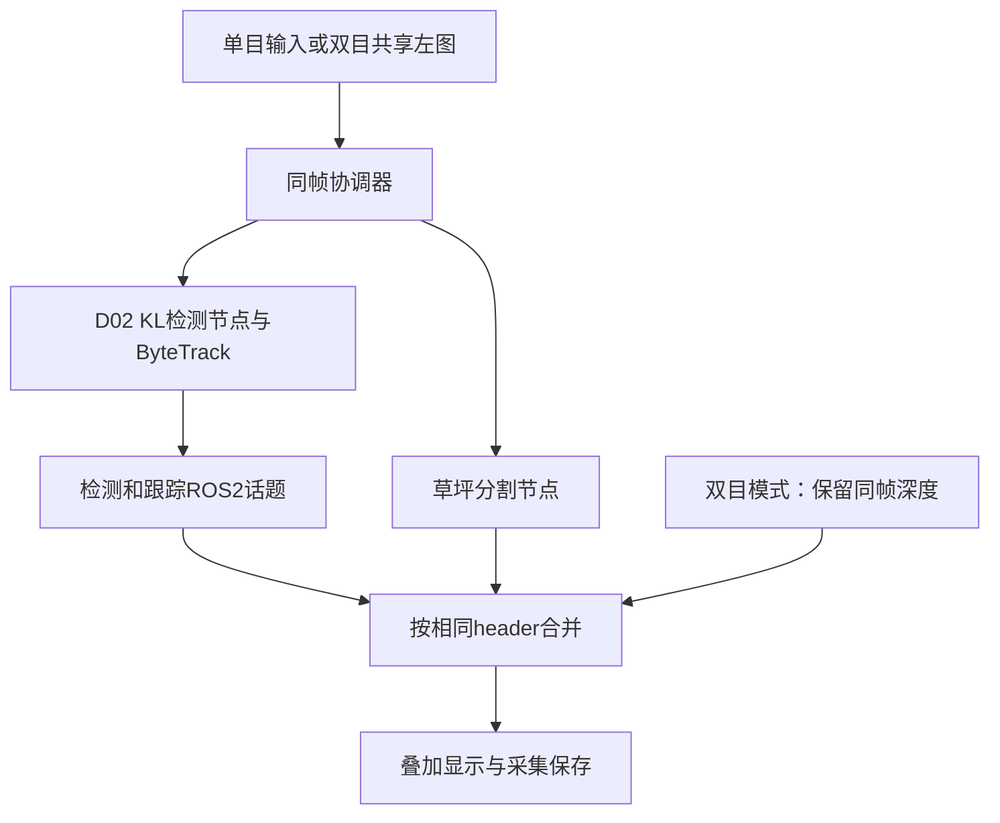
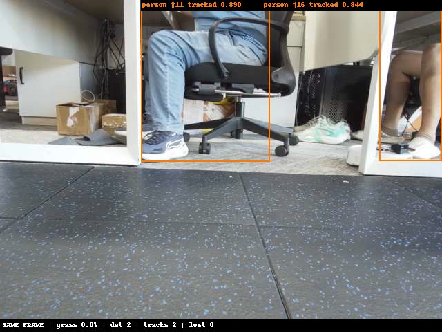

# 障碍物检测与跟踪ROS2节点集成与接口联调——交付报告

父任务：#25042 YOLOv8障碍物检测与ByteTrack跟踪ROS2部署。交付日期：2026-11-06。
子任务编号待补充，按已确认的任务标题归档。

## 任务目标

将D02 KL模型与ByteTrack接入公司ROS2工程，复用相机输入，发布结构化检测和跟踪结果，确认坐标、时间戳、启动参数及异常恢复方式。

## 交付结论

**已完成ROS2节点开发、板端部署、固定输入回归、消息接口与同帧联调。**
单目输入已验证；后续增加双目左图共享输入及同帧深度展示，模型和原ByteTrack关联方式保持不变。
输出可供下游接入，但尚未接入安全停车或绕障控制。

## 已完成工作

1. 检测节点订阅图像，不独立打开摄像头；分割保持独立节点。
2. RGB8消息转换为BGR缓冲区，保持比例缩放、补边至640×640，按转换模型要求输入NPU。
3. 完成分类别NMS、原图坐标还原及ByteTrack关联。
4. 发布检测、跟踪及性能指标，保留原图stamp和frame_id。
5. 由协调器将同一图像送入检测与分割，按相同header汇合，生成红色草坪、目标框和ID叠加图。
6. 提供launch、参数、systemd服务、手动启停和采集入口；完成服务级断流恢复验证。
7. 补齐61服务器独立编译环境，双目引擎在禁用网络容器中从空构建目录编译成功。

## 当前数据流



## 接口约定

| 话题 | 消息类型 | 内容 |
|---|---|---|
| `/perception/image` | `sensor_msgs/msg/Image` | 当前640×480、rgb8，同帧模型输入 |
| `/obstacle_detect/detections` | `vision_msgs/msg/Detection2DArray` | 类别、置信度、原图像素框、header |
| `/obstacle_detect/tracks` | `mower_obstacle_detect/msg/TrackedObstacleArray` | session_id、track_id、状态、observed、框、类别等 |
| `/obstacle_detect/metrics` | `std_msgs/msg/Float64MultiArray` | 检测各阶段及跟踪耗时 |
| `/perception/overlay` | `sensor_msgs/msg/Image` | 同帧叠加图 |
| `/perception/obstacle_ranges` | `std_msgs/msg/String`，JSON | 双目模式附加轴向深度与有效状态，非车头净距 |

- 检测框为原图像素坐标，bbox采用中心位置与宽高，theta=0。
- 检测数组及检测项header复制输入图像；跟踪保留同帧header和session_id。
- 当前双目frame_id为`camera_color_frame`；输入时间戳为软件接收时刻，不宣称硬件曝光时间精度。
- 原始检测话题发布置信度≥0.25结果；内部≥0.10低分框可参与轨迹续接。
- 有输入但没有目标时发布同帧空数组；无输入时不伪造“无障碍物”结果。
- 检测消息的默认pose不代表有效三维坐标。双目Z也不能直接作为车体坐标或停车净距。
- 采用SensorDataQoS、depth=1；观察器未配对数量不直接等于推理管线丢帧。

## 联调验证

| 项目 | 实测结论 |
|---|---|
| launch启动 | 在隔离ROS域98启动并完成固定输入验证 |
| 8类固定图片及BGR行填充输入 | 与此前交付结果逐项一致；截断输入被拒绝 |
| 90秒单目同帧记录 | 405组完整配对，检查错误0 |
| 40秒指标短测 | 174条跟踪记录，header不一致0；观察器未配对9条 |
| 主动停相机服务及恢复 | 协调器随依赖停止，统一启动后恢复输出 |
| 检测进程重启 | 产生新session，不沿用旧会话身份 |
| 双目共享接入 | 15秒38组完整配对；单目/原引擎回退完成验证 |
| 户外采集 | 两组共168组原图、掩码、叠加图与记录完整 |

服务级停止不等于已验证USB物理拔插。双目共享短测在建图空闲状态完成，未验收建图实际工作负载下的长期并行运行。

## 实测展示



室内实测第200帧，展示框、类别、置信度与ID；为人工选取的正常成像样本，不将其扩展为整批精度结论。

## 交付目录与运行方式

公司工程：`D:\cpp_project\mower`，分支`feature/dev_sds_vision`，已推送提交`67284f1`。

| 内容 | 路径 |
|---|---|
| 检测与跟踪 | `vision/obstacle_detect` |
| 同帧协调器 | `slam_fastlio/mower_bringup/scripts/perception_sync.py` |
| 采集入口 | `slam_fastlio/mower_bringup/scripts/camera_capture.sh` |
| 双目配置与控制 | `vision/stereo_camera` |
| 61双目编译工作区 | `/home/shiqiang.chen/sds/stereo-permanent-20261106` |

板端双目模式手动运行：

```bash
bash /root/sds/perception/current/control.sh stereo
bash /root/sds/camera-control/camera_capture.sh field-start 30
# 采集结束后停止推理
bash /root/sds/perception/current/control.sh stop
```

30秒结束只停止保存；推理需单独停止。推理保持手动启动策略。

证据：[launch验证](assets/STORY25042_20261106/launch_fixture_result.json)、[90秒汇总](assets/STORY25042_20261106/ros2_90s_summary.json)。
完整说明见公司工程`docs/sds/obstacle_detect_ros2.md`及`docs/sds/stereo_permanent_20261106.md`。

## 遗留事项

室外相机偏色和过曝按输入成像问题跟进，修复后复测。相机安装抬高7 mm已更新外参，旧地图存在外参不一致提示，需重新建图验证。
坐标转换、障碍物占用范围、风险判断、停车及绕障是后续任务，不属于本次接口联调通过的范围。
