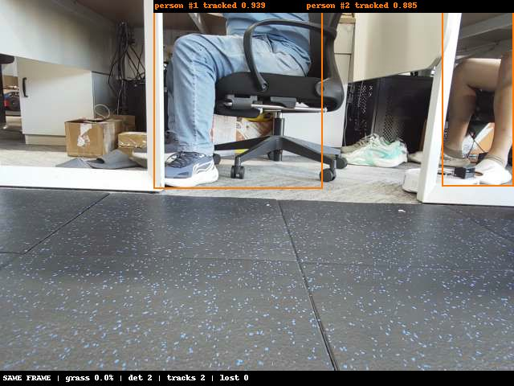
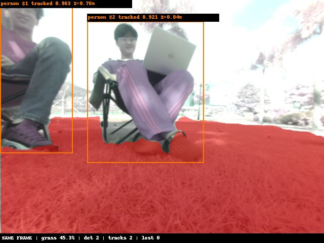

# STORY #34635 障碍物检测ByteTrack接入与跟踪状态验证——交付报告

父任务：#25042 YOLOv8障碍物检测与ByteTrack跟踪ROS2部署。交付日期：2026-11-06。

## 任务目标

将AM970芯片端D02八类障碍物检测结果接入ByteTrack，输出类别、置信度、二维框、track_id及轨迹状态，并验证连续输入、低分关联和轨迹生命周期。

## 交付结论

**已完成算法接入、板端运行、状态规则验证及ROS2工程集成，可交付接入代码、配置、测试记录与正常运行展示。**
正常可见条件下有连续ID证据；复杂交叉、长遮挡及检测框剧变仍可能换ID，不宣称完成全场景身份连续性验收。
本次保留原ByteTrack运动预测与IoU关联，不采用ReID。

## 已完成工作

1. 复用同次NPU检测结果进行跟踪，不新增一遍模型推理。
2. 内部保留低置信度框用于续接，检测发布阈值与跟踪阈值分开。
3. 八类分别关联，防止不同类别错误继承ID。
4. 实现NEW、TRACKED、LOST、REMOVED及observed字段，区分真实观测和预测轨迹。
5. 接入ROS2话题，保留输入图像header，以session_id与track_id共同标识轨迹。
6. 完成核心状态检查、固定检测结果回归、实时摄像头记录与户外短测。

## 模型与配置

模型：D02 KL混合量化；输入640×640；板端模型SHA-256：
`ac7690b71345ab579ec6da1953ecc6cd8b91230d00a44412e1c81a422f09e916`。

| 配置 | 数值或规则 |
|---|---|
| 类别 | 0人员、1猫、2狗、3飞盘、4运动球、5玩具熊、6软管、7石头 |
| 跟踪低分阈值 | 0.10 |
| 高分检测阈值 | 0.25 |
| 新建轨迹阈值 | 0.35 |
| 第一阶段匹配代价阈值 | 0.80，非IoU下限 |
| 丢失保留 | 1000 ms，按单调时间判断，后续处理帧执行清理 |
| 关联 | 按类别隔离；Kalman预测＋IoU匹配 |
| 状态 | NEW=0、TRACKED=1、LOST=2、REMOVED=3 |
| 丢失/移除 | observed=false；预测框不能视为本帧检测 |

## 验证结果

| 验证项目 | 实际结果 | 证据范围 |
|---|---|---|
| 核心状态规则 | 15项检查通过 | 低分续接、确认、丢失、超时、类别隔离等 |
| 独立开发板固定图片回归 | 140/140张检测结果与接入前一致 | 固定图片，不代表新增现场精度结论 |
| 独立开发板检测序列回放 | 5266/5266帧最终程序回放结果一致 | 确定性验证，不是身份准确率 |
| 原独立程序正常连续轨迹 | run3中ID31连续431帧、29.168秒 | 特定正常可见片段 |
| ROS2实机记录 | 90.36秒、405组完整配对，检查错误0 | 单目同帧检测、分割和跟踪 |
| 户外近距离两人 | 81组；79组有两条已观测轨迹 | ID1出现81帧、ID2出现80帧，另有一次短轨迹 |

户外另一移动片段产生24个不同ID，包含误检与短轨迹；**不同ID数不是人数，也不是ID切换次数**。
未建立人工身份真值，未报告IDF1、MOTA或ID切换率。

## 实测展示

以下图片为人工筛选的运行展示样本，原样复制，没有调色或修改预测框；不代表整批数据无异常。

室内同帧实测第1帧：两个人员局部目标分别有类别、置信度和track_id，地板未输出草坪掩码。

户外近距离展示：两个目标可正常检出并跟踪。该图存在摄像头室外偏色/曝光异常，仅展示跟踪链路与输出，不作为颜色正常样本或距离精度证明。

## 交付位置

- 公司工程：`D:\cpp_project\mower\vision\obstacle_detect`；已推送提交`67284f1`，分支`feature/dev_sds_vision`。
- 板端安装：`/root/sds/releases/d02-bytetrack-20261105/install`。
- [核心检查日志](assets/STORY25042_20261106/tracker_check.log)、[140张静态回归](assets/STORY25042_20261106/static_regression.json)。
- [原始ByteTrack详细报告](../mower_obstrast_check/docs/STORY34635_ByteTrack接入与验证/交付与验证报告.md)。
- [ROS2实测汇总](assets/STORY25042_20261106/ros2_90s_summary.json)、[展示素材来源与哈希](assets/STORY25042_20261106/source_manifest.json)。

## 遗留事项与验收边界

1. 摄像头室外偏色、过曝列为输入成像问题，先恢复成像再复测；不据异常输入直接判定模型退化或启动重训。
2. 重复框、局部身体框、长遮挡和同类交叉仍可能造成多轨或换ID，保留问题记录。
3. 已完成开发接入及基础状态验证；复杂交叉与遮挡完整场景验证仍需补充。
4. 本任务不包含自动停车、绕障和车辆运动控制。
