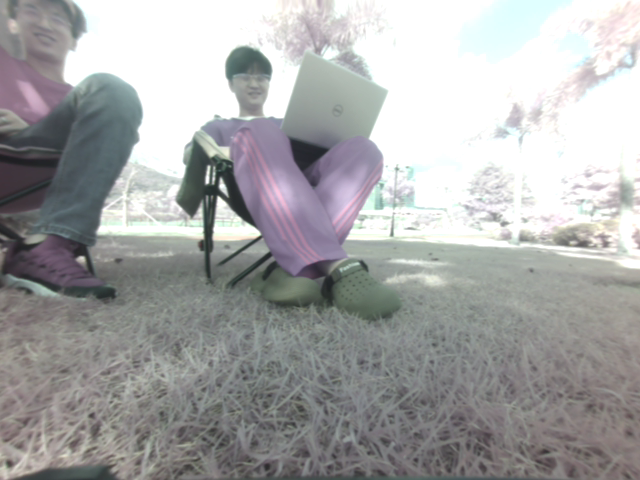
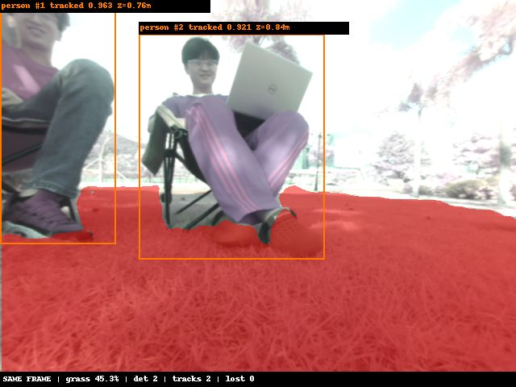
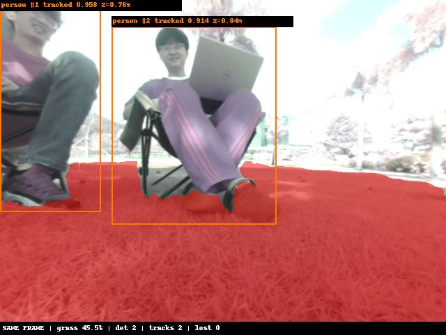

# 障碍物检测与跟踪性能、稳定性测试与部署交付——交付报告

父任务：#25042 YOLOv8障碍物检测与ByteTrack跟踪ROS2部署。交付日期：2026-11-06。
子任务编号待补充，按已确认的任务标题归档。

## 任务目标

在完成模型转换、ByteTrack接入及ROS2联调后，通过最终户外实机测试验证实际输入下的检测、跟踪和结果发布，记录性能、现场问题及交付配置，形成#25042本轮部署工作的收尾材料。

## 交付结论

**本轮已完成从板端部署、ROS2联调到最终户外实机测试的流程，并形成交付记录。**
2026-11-06在户外草坪及相邻道路进行了两组实机采集，共168组完整结果。近距离两人场景能够持续输出人员框、置信度、跟踪ID，并与草坪分割同帧展示；两组采集均按设定时长正常结束，文件完整。

现场同时发现摄像头室外偏色、过曝，作为本轮交付的已知输入问题记录，不据此归因于模型或启动重训。
以下首先展示本次户外测试的实际图片和逐帧证据，再列性能和前序验证结果。小时级稳定性不在现有采集记录覆盖范围内，不作已验证结论，也不把此前建议的2小时观察窗口新增为本次任务的既定验收门槛。

## 最终户外实机测试

### 测试场景与数据

| 项目 | 户外移动观察 | 草坪近距离两人 |
|---|---|---|
| 原始目录 | `20261105_210638_065604788` | `20261105_211804_876800295` |
| 场景 | 草坪、相邻铺装区域、远处行人，视角变化 | 草坪上两人坐姿及局部姿态变化 |
| 持续时间 | 30.20秒 | 30.51秒 |
| 完整保存 | 87组 | 81组 |
| 停止原因 | duration，按时结束 | duration，按时结束 |
| 文件核验 | 原图、掩码、叠加图及逐帧记录完整 | 原图、掩码、叠加图及逐帧记录完整 |

测试日期按北京时间2026-11-06记录。目录采用板端HST时间，因此日期显示为20261105；两者不矛盾。
每组保存3张图，两组共504张图片已通过解码检查。现场使用双目左图输入D02 KL检测、ByteTrack和v2-2草坪分割，深度显示为辅助输出，不属于本任务的测距精度验收。

### 图1：户外原始输入



来源：两人场景第1帧，未叠加任何算法结果。展示实际安装视角、人员姿态和草坪环境；紫灰色偏色与亮部过曝在输入图像中已存在。

### 图2：同帧检测、跟踪和分割结果



与图1为同一帧。左侧人员ID1、置信度0.963；右侧人员ID2、置信度0.921，均为TRACKED。
红色区域来自同帧草坪分割，草坪掩码占全图约45.3%。说明现场图像已实际进入模型，并形成检测、跟踪、分割联合输出。
图中Z值是同帧深度估计，不能作为人员真实距离或车头净距的验收数据。

### 图3：检测、跟踪和距离均有输出的现场样本



来源：同批次第3帧。左侧人员ID1、置信度0.958、Z=0.76m；右侧人员ID2、置信度0.914、Z=0.84m，均为TRACKED。
两个标签完整可读，无unknown；同帧草坪分割以红色显示。本图用于展示各项输出正常的现场结果，距离精度仍需真值验证。
全段统计ID1有81帧观测、ID2有80帧观测；79/81帧同时有两条已观测轨迹。连续性结论来自全段记录，而非仅凭两张相邻图片。

以上图片均从本次户外采集中原样选取，未调色、未改框、未修改ID。选择的是能够说明链路运行和跟踪行为的帧，不声称其颜色已恢复正常或整批图像都没有问题。
对应数据见[选中帧原始记录](assets/STORY25042_20261106/outdoor_selected_records.json)，图片路径与哈希见[来源清单](assets/STORY25042_20261106/source_manifest.json)。

## 性能实测

不同负载和采集方式分别列出，不直接混合比较。

| 工况 | 时长/样本 | 结果序列FPS | 跟踪P50/P95 | 同帧结果年龄P50/P95 |
|---|---|---:|---|---|
| ROS2单目同帧，JPEG记录 | 90.36秒，405组 | 4.59 | 0.41 / 10.31 ms | 234.82 / 297.35 ms |
| 双目户外移动，原图PNG＋掩码＋叠加存储 | 30.20秒，87组 | 2.95 | 0.28 / 9.30 ms | 394.91 / 471.62 ms |
| 双目户外两人，同上 | 30.51秒，81组 | 2.74 | 0.41 / 8.30 ms | 407.28 / 491.55 ms |

上表FPS采用首末完整配对之间的序列统计，不是相机帧率。单目90秒整个观察窗口为4.48FPS。
户外移动和两人段整个观察窗口分别为2.88、2.65FPS。
双目图像时间戳为软件接收时刻，结果年龄不应当作已测得的曝光到显示总延迟。

| 双目户外工况 | 双模型配对耗时P50/P95 | 结果年龄最大值 |
|---|---|---|
| 移动 | 192.40 / 236.94 ms | 589.18 ms |
| 两人 | 198.78 / 264.25 ms | 667.31 ms |

原独立检测跟踪程序曾测得run3约14.65FPS、跟踪P95约0.156ms；它不包含当前ROS2同帧双模型和PNG采集负载，不能直接作为当前整机FPS。

## 稳定性与恢复验证

| 项目 | 结果 | 边界 |
|---|---|---|
| 90秒单目同帧运行 | 405组完整配对，检查错误0 | 短测 |
| 40秒指标记录 | 174条跟踪，header不一致0，无非预期退出 | 非长稳 |
| 停相机服务4秒后恢复 | 同帧协调器随依赖停止，统一启动后恢复 | 服务模拟，不是物理拔插 |
| 检测节点重启 | 新session生效 | 消费者应使用session与ID组合 |
| 恢复验证记录 | 83条跟踪，header不一致0，最大空窗约10秒 | 包含主动停机和启动耗时 |
| 双目部署与回退短测 | 测试窗口内相关服务NRestarts为0 | 建图空闲状态 |
| 户外图片完整性 | 168组、504张配套图片存在并通过解码 | 不能代替检测精度验收 |
| 内存与长稳 | 已提供RSS/PID记录工具 | 当前没有足够小时级记录证明长期无增长 |

此前独立程序短测RSS未见持续增长迹象；ROS2一次结束快照MemAvailable约309MiB。
这些均不是峰值内存或长期内存泄漏结论。systemd的MemoryMax是限额，不是实际占用测量。

## 本次现场发现的问题与处理结论

室内成像与室外成像表现存在差异，现场原图有偏色和过曝。按本轮确认，将其作为摄像头室外成像问题优先处理，暂不据此认定模型退化或安排重训。
原始异常图片及分析记录保留；根因尚未细分到具体镜头、ISP或参数。

| 现场现象 | 当前处理结论 |
|---|---|
| 室外偏色、过曝，室内颜色较正常 | 记录为摄像头成像问题，交由相机链路排查；不直接据异常输入判定模型退化 |
| 移动段15帧草坪掩码全空，其中典型帧可见草地 | 保留失败样本；摄像头修复后复测分割，不把全空输出当成无可割草区域真值 |
| 移动段局部误检、漏检及短轨迹 | 作为输入异常工况下的实际现象保留，不以精选图片覆盖全量记录 |
| 近距离两人段主要ID连续，但个别帧有额外短轨迹 | 正常可见跟踪链路已验证；不宣称复杂场景身份关联无误 |
| 部分距离unknown | 正确保留未知状态；本次没有深度真值，不能给出测距误差 |

本次交付结论是部署与现场运行流程已完成验证，摄像头问题随报告一并交付；不将这些现象隐去，也不扩大为模型精度已经全面通过的结论。

## 部署归档与复现

- 模型：D02 KL混合量化八类，SHA-256 `ac7690b71345ab579ec6da1953ecc6cd8b91230d00a44412e1c81a422f09e916`。
- 跟踪：原ByteTrack运动预测＋IoU匹配，无ReID。
- 公司代码：`feature/dev_sds_vision`，提交`67284f1`已推送。
- ROS2检测安装：`/root/sds/releases/d02-bytetrack-20261105/install`。
- 双目版本：`/root/sds/perception/releases/stereo-20261106-r1`。
- 61服务器已具备双目引擎独立编译能力，源码、SDK、依赖均在自身目录；已通过断网容器空目录编译，不依赖WSL或175在线服务。
- 61新编译产物仅完成编译及ELF检查，未替换板上首次部署的引擎；不将原板端测试冒充新产物运行测试。

板端按场景采集：

```bash
bash /root/sds/perception/current/control.sh stereo
bash /root/sds/camera-control/camera_capture.sh field-start 30
# 需要长稳记录时另外启动；此命令记录指标，不保存图片
bash /root/sds/camera-control/camera_capture.sh long-start 7200 outdoor
```

30秒是图片采集批次，7200秒是计划的指标观察窗口。**提供长稳命令不代表已经完成长稳测试。**
采集目录为`/root/sds/perception-captures`，指标目录为`/root/sds/field-tests`；注意板端磁盘余量并及时拉取。

## 交付清单与后续跟进

交付：部署代码与配置、启停及回退说明、性能实测、恢复记录、最终户外测试图片及逐帧证据、现场问题清单。

本报告作为本轮任务的最终户外测试收尾记录；前序ByteTrack接入和ROS2接口联调分别见同目录另外两份交付报告。

后续跟进事项（与本轮已完成的部署及户外测试区分记录）：

1. 修复摄像头室外成像后，同场景复测检测、跟踪及分割表现。
2. 小时级持续运行，按时间统计帧率、P50/P95、RSS和进程重启，验证无持续积压或内存增长。
3. 补复杂遮挡、交叉运动及物理相机重连场景记录。
4. 如后续使用双目测距，另采同帧原始深度与距离真值；当前保存的叠加图不足以验证距离精度。

原始证据：[90秒汇总](assets/STORY25042_20261106/ros2_90s_summary.json)、[户外移动](assets/STORY25042_20261106/outdoor_moving_summary.json)、[户外两人](assets/STORY25042_20261106/outdoor_people_summary.json)、[来源清单](assets/STORY25042_20261106/source_manifest.json)。
本次交付不包含自动停车、规划绕行或整车安全验收。
