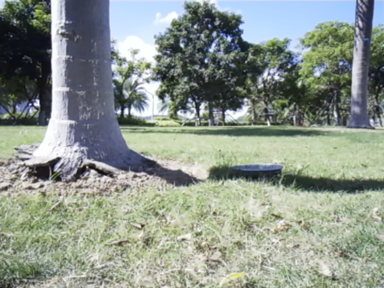
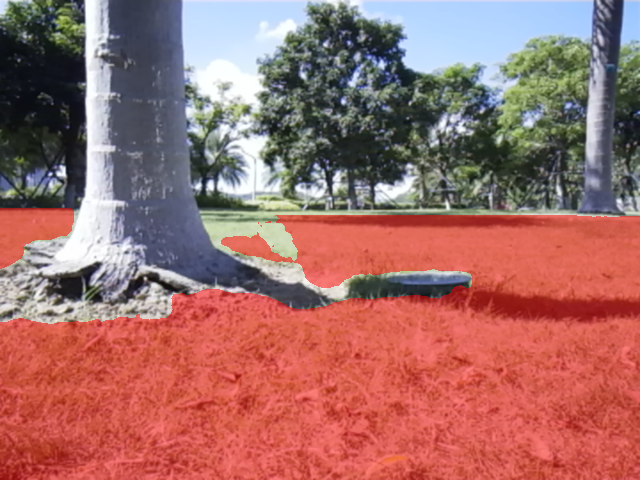
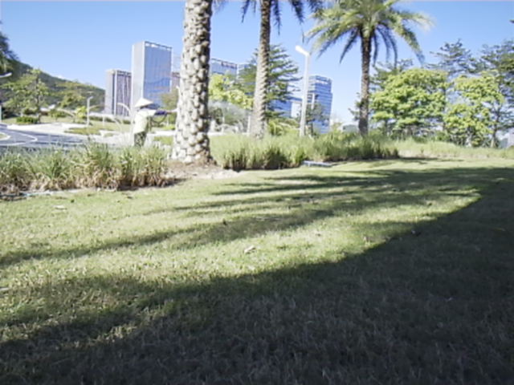
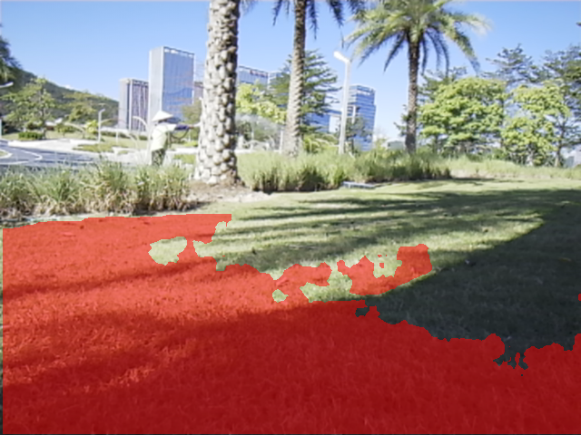
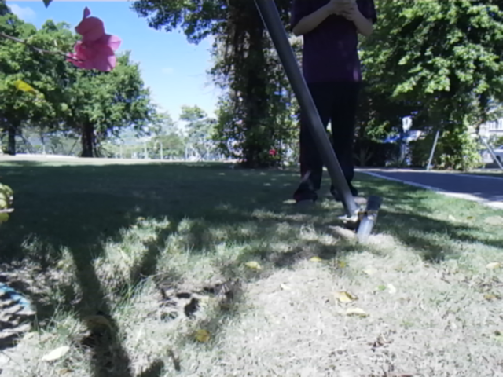
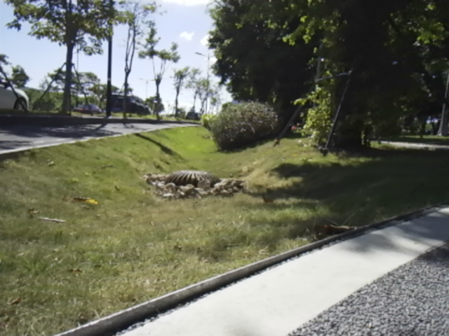
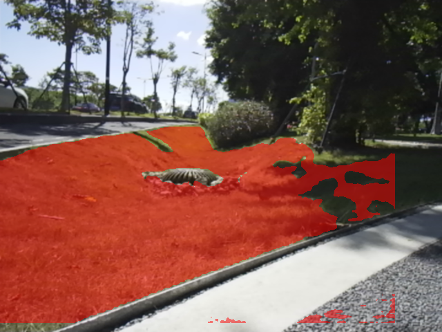

# STORY #25034 交付报告

## YOLOv8-Seg 草坪分割 ROS2 节点开发与性能验证

报告日期：2026-10-20（北京时间）  
父任务：#23579 割草机器人-RGB 草坪及作业区域分割开发  
任务负责人：宋冬笋；计划工期：3 个工作日；任务截止：10/21  
交付性质：工程实现、部署与已有外场验证结果交付。任务系统状态是否关闭，由负责人依据本文验收边界确认；本报告不宣称全部验收标准无条件通过。

## 1. 交付结论

已将 B08_v3_2 芯片端模型集成到 AM970 的 ROS2 系统，完成 USB RGB 相机接入、NPU 推理、草坪实例合并、原尺寸 Mask 发布，以及启动参数、部署说明、手动推理/保存/指标控制。室内集成验证和外场采集均已形成证据。

本报告仅分析可按原始图像时间戳匹配逐帧指标的 151 组外场图片（453 张文件）。其所属五批指标记录累计 787.180 秒，观察到 5,978 帧 Mask，整体观察输出 7.594 FPS；回调耗时 P50/P95 为 117.316/154.121 ms，输入时间戳至 Mask 发布年龄 P50/P95 为 198.597/280.200 ms。五批内未记录到推理自动重启或时钟跳变，未观察到短时持续内存增长。

视觉结果表明：多数近处草坪及道路、树干等边界能够区分，但阴影草坪漏分、局部整帧漏分、道路零散误分仍存在。未提供人工真值，因此不输出 IoU、准确率或召回率。当前交付可以证明工程链路与短时外场运行可用，不能证明所有草坪区域完整识别、小时级稳定性或运动安全联动已验收。

## 2. 交付范围与实现

### 2.1 运行环境和版本

| 项目 | 本次依据 |
| --- | --- |
| 主控与系统 | AM970，ARM64，Ubuntu 22.04，ROS2 Humble |
| 相机 | 2MP USB Camera；配置为 640×480、30 fps、YUYV 转 RGB；30 fps 是配置值，不是本次观察器证明的实际输入帧率 |
| 推理模型 | B08_v3_2，network_binary.nb；阈值 confidence=0.25、NMS=0.45、Mask=0.5 |
| 相机部署 | /root/sds/releases/usb-camera-20261020/install |
| 分割部署 | /root/sds/releases/grass-seg-20261020/install |
| 模型及 SDK | /root/sds/static-b08-v3-2-20261019；复用已验证的 VKNN SDK |
| 开发源码 | D:/cpp_project/mower，分支 feature/dev_sds_vision |
| ROS2 包 | vision/grass_seg，包名 mower_grass_seg |
| 版本归档状态 | 核验时 Git HEAD 为 9e419ed；阶段计时、指标工具和相关文档仍是本地未提交改动，已通过源码归档构建部署，不能称为该提交已包含全部交付内容 |

五批 metadata 中模型、参数一致，推理进程首轮采样的二进制哈希一致；存在两个 boot ID，不能拼接成单次不重启长稳。

模型 SHA-256：

```text
9f162de626472adaac621eb5ffde0fff4dc3e7daf6089ec1810c4141023bf898
```

外场记录中的推理节点 SHA-256：

```text
1cb1b4649f3eff0e8bda8e66996b73fa4ed42d1f72cdc2b14eeb8271c0bb4075
```

### 2.2 数据流与接口

```text
USB Camera → /camera/image_raw → RGB/BGR 处理与 letterbox
           → VKNN/NPU → 输出解析、NMS、Mask 恢复与并集
           → /grass_seg/mask（原尺寸、原 header、mono8）

/camera/camera_info ─┐
/camera/image_raw ───┼→ 指标采集器：配对检查、原始计时与资源记录
/grass_seg/mask ─────┤
/grass_seg/metrics ──┘
```

| 接口/行为 | 已实现内容 |
| --- | --- |
| RGB 输入 | sensor_msgs/Image；支持 rgb8、bgr8 和每行 padding；非法长度/stride 输入拒绝处理 |
| 模型输入 | rgb8 转 BGR；bgr8 直接使用；CPU letterbox 后调用 SDK；模型内嵌的预处理耗时仍计入 NPU 调用 |
| 分割输出 | 解码、NMS，计算各草坪实例 Mask，恢复到原图并取并集；无检出时发布全黑 Mask |
| Mask 话题 | /grass_seg/mask，sensor_msgs/Image，mono8；草坪=255，背景=0；逐项复制输入 header |
| 时序和队列 | 单线程 executor；输入/输出 best effort、keep last 1；无应用层图片积压队列，不承诺每个输入帧都输出 |
| CameraInfo | 相机发布；指标采集器订阅并校验配对后的 frame_id/尺寸。分割节点自身不订阅或使用 CameraInfo 内参；相机尚未标定，不做去畸变、投影或距离估计 |
| 计时接口 | /grass_seg/metrics；按需发布逐帧阶段耗时及输入时间戳；无订阅者时不发送该消息 |
| 保存与控制 | 推理、指标、图片保存独立启停；默认不存图；保存时输出同帧原图/Mask/红色半透明叠加图 |

“合并完整 Mask”在算法层面指合并所有已检出的草坪实例，不等于模型已经覆盖画面中全部真实草坪。当前功能不控制底盘，也不构成避障或刀盘安全联动。

### 2.3 交付物位置

| 交付物 | 源码或说明位置（相对 D:/cpp_project/mower） |
| --- | --- |
| 分割核心与 ROS2 节点 | vision/grass_seg/grass_seg.cpp、grass_seg.hpp、grass_seg_node.cpp |
| launch 与参数 | vision/grass_seg/launch/grass_seg.launch.py；config/grass_seg.yaml |
| 编译定义 | vision/grass_seg/CMakeLists.txt、package.xml |
| 板端服务 | slam_fastlio/systemd/sds-npu.service、sds-usb-camera.service、sds-grass-seg.service |
| 手动控制及三图保存 | slam_fastlio/mower_bringup/scripts/camera_capture.sh、camera_capture.py |
| 指标记录及离线统计 | tools/profiling/grass_mask_check.py |
| 部署、运行、回退说明 | docs/sds/grass_ros2.md、usb_camera.md、grass_static.md |
| 项目状态入口 | docs/robot-mower-development-status.md |

本报告及附件属于交付说明和证据，不替代完整工程源码、模型和 SDK 安装包。

## 3. 集成、上机及出场前验证

本节为已有工程记录的归纳；不是本次报告编写期间重新连接板子做出的实时状态声明。

1. 完成模型静态推理到 ROS2 共用核心的接入。早期重构后的 50 张静态结果在工程记录中为逐文件一致；本次计时版本没有重新完成 50 张静态回归。ROS 构建附带的静态程序曾因缺少 OpenCV imgcodecs 4.5d 无法运行，不能隐去该验证边界。
2. 复用服务器既有 ARM64 Docker 构建环境，产物放在独立 sds 目录；本轮计时版本一个包构建成功，耗时 4 分 52 秒。源码归档、安装包和板端 install 清单已核验，旧 release 保留用于回退。
3. 修复相机启动时缓存系统/单调时钟偏移导致的时间戳偏差。历史修复后 10 秒探针的图像年龄 P50/P95 为 36.47/40.25 ms；这是相机图像到观察器的消息年龄，不是 NPU 耗时，也不是本次外场完整分割延迟。
4. 隔离话题回放验证：rgb8 与带 padding 的 bgr8 输入得到逐字节相同的 Mask，各含 129,485 个草坪像素；原尺寸/header 保留，非法输入被拒绝。新版计时节点也通过此正向回放。
5. 推理开关、图片保存开关和指标开关已上机验证。热点环境短测保存 3 组图片，均可匹配逐帧指标；停止后记录以 user_stop 完整落盘，下载哈希与板端一致。出场前历史批次清理与本次外场批次分开，不混入本报告样本。

本轮分割安装包为 mower-grass-metrics-20261020.tar.gz，SHA-256：

```text
dd39ceb07ab983cea0610dd990502cd6ebe36c776779c870dabe2af2a5b2bd2a
```

## 4. 外场数据范围和统计方法

原始来源：E:/cpp_project/mower_env/pictures/grass-seg-captures。以文件名中的原图 stamp 秒/纳秒，与 records.jsonl 的 frame.values[0:2] 精确匹配，不使用目录创建时间或图片写盘时间近似配对。

仅纳入以下五批图片及对应指标；所有 151 组均找到同帧计时。未匹配的 214011、220610 两批共 26 组，以及空目录 214728，不用于本文视觉结论、例图或图片子集耗时统计。

| 编号 | 图片批次（完整名称见附件清单） | 指标批次 | 图片组数 | 记录时长 | 观察 Mask 数 / FPS |
| --- | --- | --- | ---: | ---: | ---: |
| A | 20261019_211205… | 20261019_211202_773448286 | 33 | 205.977 s | 1,566 / 7.603 |
| B | 20261019_212314… | 20261019_212311_635165357 | 33 | 173.835 s | 1,354 / 7.789 |
| C | 20261019_213235… | 20261019_213232_683964360 | 33 | 216.964 s | 1,637 / 7.545 |
| D | 20261019_215453… | 20261019_215451_009645345 | 32 | 114.029 s | 872 / 7.647 |
| E | 20261019_220227… | 20261019_220224_879256690 | 20 | 76.375 s | 549 / 7.188 |
| 合计 | 5 个图片批次 | 5 个指标批次 | 151 | 787.180 s | 5,978 / 7.594 |

五段开始时间转换为北京时间分别为 2026-10-20 的 14:12:05、14:23:14、14:32:35、14:54:53、15:02:27。文件夹名使用板端本地时区，不能将其中的 20261019 当作北京时间采集日期。五批均以 user_stop 正常结束。

统计口径：

- 图片效果及图片子集统计：仅限上述 151 组；总览检查后放大典型问题，不作为逐像素人工标注评测。
- 整体运行统计：使用上述五个指标窗口的所有 5,977 条 frame 计时和 5,978 条 Mask 接收记录；不是只拿 151 张保存图片估计 FPS。
- P50 为中位数；P95 为排序后第 ceil(0.95×N) 项。汇总分位数从全部原始样本重新计算，不平均各批 P95。
- 观察 FPS = 接收到的 Mask 数 / 该批记录单调时钟时长；包括订阅发现和采集器开销。它不是纯 NPU FPS，也不是光学端到端帧率。
- 阶段耗时使用单调时钟；发布/接收年龄使用系统时间减输入 stamp。无时钟跳变并不等于完成外部光学时间校准。

## 5. 性能与稳定性结果

### 5.1 所属五批的整体阶段耗时

单位：ms；共 5,977 条逐帧指标。

| 阶段 | 平均值 | P50 | P95 | 最大值 |
| --- | ---: | ---: | ---: | ---: |
| CPU 预处理 | 1.687 | 1.350 | 3.387 | 21.142 |
| SDK 输入准备 | 0.511 | 0.451 | 0.729 | 14.874 |
| NPU 推理调用 | 37.808 | 37.634 | 39.564 | 65.766 |
| SDK 输出读取、拷贝及检查 | 51.400 | 48.767 | 67.849 | 173.266 |
| 后处理及 Mask 恢复/合并 | 26.941 | 25.432 | 49.451 | 188.149 |
| 回调开始至 Mask 发布调用返回 | 121.353 | 117.316 | 154.121 | 309.232 |
| 输入时间戳至 Mask 发布年龄 | 205.532 | 198.597 | 280.200 | 487.817 |

观察器实际收到 Mask 的年龄 P50/P95 为 203.735/287.260 ms，最大 821.180 ms。发布年龄与接收年龄的样本数量不同，不能直接相减各自最大值来推断一次通信耗时。

NPU 计时是 SDK 调用的墙钟耗时，不是芯片硬件 profiler 数据。SDK 输出阶段平均约 51.4 ms，高于 NPU 调用；实际草坪场景后处理平均约 26.9 ms，明显重于室内无检出场景。因此外场约 7～8 FPS 不能简单归因于 NPU 算力不足，也不能沿用室内约 11 FPS 作为外场结论。

### 5.2 151 张保存图片的同帧耗时

该表只统计可精确匹配的 151 帧，避免把全窗口指标冒充每张保存图片的性能。

| 指标 | P50 | P95 |
| --- | ---: | ---: |
| NPU 调用 | 38.161 ms | 40.329 ms |
| SDK 输出阶段 | 50.099 ms | 74.561 ms |
| 后处理 | 25.641 ms | 51.702 ms |
| 推理回调 | 119.485 ms | 169.944 ms |
| 发布年龄 | 202.808 ms | 304.370 ms |

各帧完整阶段值、图片路径及 SHA-256 见附件 matched_images.csv。保存图片是间隔采样，不是对所有推理帧的随机抽样；该子集分位数不替代全窗口性能。

### 5.3 运行稳定性、时间戳和证据限制

- 五批原始 JSONL 均完整结束，无截断行、error 记录、检测到的时钟跳变或负接收年龄。
- 各批内推理 PID 未变，采样的 NRestarts 均为 0；这不等于连续一小时未重启。metadata 存在两个 boot ID，批次间不可当作单次长稳。
- 推理节点 RSS 全部采样中的峰值为 49,592 KiB（约 48.43 MiB）。前三批首末分别为 44,736→42,284、44,124→42,576、46,480→42,440 KiB；第四批 49,348→49,592 KiB 后持平；第五批 42,536→46,324 KiB，但分段均值未持续上升。短测未见持续增长证据，不能据此排除小时级泄漏。
- 五批观察器共接收原图 9,077 条、CameraInfo 19,013 条、Mask 5,978 条；Image/Mask 配对 3,054 条、未配对 2,924 条，CameraInfo/Mask 配对 5,222 条。已匹配部分的 header/frame_id/尺寸错误计数为 0，Mask 格式错误计数为 0。151 张保存图片另行按 stamp 匹配指标全部成功。
- 观察器配对率约 51.1%，原图接收计数也不能证明相机实际只有约 11.5 FPS。best-effort 订阅、反序列化/调度和采集开销均可能影响观察结果，现有证据不能确定根因；不能把未配对等同于模型漏处理，也不能声称所有外场帧都已完成一致性验证。
- 最大相邻 Mask 接收间隔约 0.726 s；各批接收年龄分段未出现一致、持续上升趋势。结合深度 1 的实现，未见短窗口持续消息积压证据，但本次没有直接测量 DDS 队列占用。
- 指标采集与部分图片保存同时运行，存在额外 CPU/内存/写盘开销。前三批按保存服务状态分段，存图时平均回调比未存图时高约 3～6 ms；场景并非严格相同，不能单独归因于存图。
- 本批记录没有完整 CPU、温度、功耗或底盘运动轨迹证据，不给出能耗、热稳定或安全制动结论。RSS 不包含全部 NPU 驱动保留内存。

## 6. 有指标图片的视觉结果

以下四组例图全部来自已纳入的 151 组。每组依次为原图和叠加图；红色表示预测草坪，不表示人工真值。原始 PNG 仅复制用于引用，未修改内容。对应文件名、时间戳、SHA-256 与逐帧计时保存在附件清单中。

### 6.1 正常案例：近处草坪与树干、树根边界

批次 C，stamp 秒为 1792477990。该例中近处草坪形成连续区域，树干和主要树根区域未被大面积计入草坪，体现出基础分割和原图坐标恢复有效。不能由单例推出所有树根、障碍物都可靠排除。




### 6.2 问题案例：阴影草坪出现大片漏分

批次 D，stamp 秒为 1792479297。原图中草坪跨越明暗区域，预测却漏掉右侧及部分远处草坪，局部出现孔洞。可见光照变化下区域完整性不足；仅凭图片不能确定是置信度、训练分布还是实例输出边界造成。




### 6.3 问题案例：有草坪但整帧 Mask 为空

批次 C，stamp 秒为 1792478028。画面含阴影草坪、稀疏地表、支撑杆和人物；该帧 Mask 草坪像素数为 0，所以叠加图与原图一致。该图已有同帧推理指标，属于分割结果漏检证据，不能解释为没有执行推理。




并非所有全黑 Mask 都是错误：纳入范围中也存在以道路为主、无明显可分割草坪的正常空输出。本报告不把所有空 Mask 计为失败率。

### 6.4 问题案例：草坪边界外的道路零散误分

批次 B，stamp 秒为 1792477499。主要草坪区域得到识别，但画面下方道路出现零散红色区域，树荫草坪同时存在漏分。该例说明边界结果既有漏分，也有误分，不能将当前 Mask 直接当作唯一安全通行边界。




综合上述 151 组的总览及重点检查：主要道路、树干、人物和放置物体大多未被大面积分为草坪，近处开阔草坪通常连续；阴影、远处窄草带、树根/稀疏地表混合区域的完整性不足。当前未做连续视频评测，不能从间隔图片定量得出逐帧闪烁率。没有人工真值，不给出精度百分比。

## 7. 任务工作项与验收对照

### 7.1 主要工作完成情况

| 任务工作项 | 交付情况 |
| --- | --- |
| 订阅 RGB 图像和 CameraInfo | RGB 已在分割节点订阅；CameraInfo 在指标采集器订阅校验，分割节点自身不订阅。按“同一推理节点订阅两者”的严格要求，仍有差距 |
| 图像预处理和 NPU 推理 | 已实现并板端运行，已输出阶段计时 |
| 分割输出解析、草坪实例 Mask 合并 | 已实现；合并所有检出实例，但模型存在真实草坪漏分 |
| 恢复原始图像尺寸 | 已实现；保存样本尺寸检查、回放测试及匹配帧检查通过 |
| 发布 Mask、时间戳和 frame_id | 已实现，直接复制原 header；外场有已匹配检查证据及未匹配边界 |
| 帧率、延迟、内存和稳定性测试 | 五批短时外场结果已完成；未完成小时级连续长稳 |
| launch、参数和运行说明 | 已提供源码与说明，新增计时部分仍需提交归档 |

### 7.2 验收标准判定

| 验收标准 | 本次判定 | 依据与保留事项 |
| --- | --- | --- |
| 节点稳定接收相机图像 | 已验证短时运行 | 五批均持续输出、批内无记录到自动重启；不外推长稳 |
| 正确发布完整草坪区域 Mask | 接口通过，语义完整性未完全通过 | 原尺寸 mono8 发布正常、实例并集合并实现；存在阴影漏分、空 Mask 和道路误分 |
| 输出时间戳与输入一致 | 实现及已匹配样本通过 | 原 header 复制、3,054 对外场检查错误为 0；2,924 条未配对不计作验证通过 |
| 不存在持续消息积压和内存增长 | 短窗口未见持续增长，长期待验 | 单线程深度 1、RSS/延迟无一致上升；最长单批约 217 秒，无一小时证据 |
| 完成实际 FPS 及 P50/P95 统计 | 已完成 | 基于五批原始数据统计，区分整体窗口、保存图片子集和观察端开销 |

交付建议：提交本报告及实现成果，作为“ROS2 集成上机及首轮外场性能验证”交付。若按原任务全部验收标准关闭，应由负责人明确接受上述保留项，或将 CameraInfo 接入范围、阴影/边界改进、配对取证和连续长稳列为后续验收任务；不以本报告替代问题闭环。

## 8. 部署与外场使用交接

当前运行策略为相机开机自启、推理手动开启、默认不保存图片。图片与指标服务独立于 SSH 会话；断网不等于停止记录，主控重启后需要重新启动推理和采集。

板端操作：

```bash
# 开始推理、记录一小时指标、开启一批图片保存
bash /root/sds/camera-control/camera_capture.sh inference-start
bash /root/sds/camera-control/camera_capture.sh metrics-start 3600 outdoor
bash /root/sds/camera-control/camera_capture.sh start-result

# 结束，按顺序停止保存、记录、推理
bash /root/sds/camera-control/camera_capture.sh stop
bash /root/sds/camera-control/camera_capture.sh metrics-stop
bash /root/sds/camera-control/camera_capture.sh inference-stop
```

图片每批最多 33 组，按时间戳创建独立目录；完成一组后至少间隔 2 秒，不承诺每 2 秒精确保存一次。图片保存有单批容量、超时及剩余空间保护，不能作为整场连续录像。指标记录也有时长/容量保护；一小时设置只表示请求时长，不代表已有一小时测试完成。

检查命令为 inference-status、metrics-status、status。若服务已自动结束，stop 可能提示单元不存在，应结合状态、日志及 JSONL 的 end 原因判断。

Windows 下载与离线统计示例（IP 以实际网络为准，手机热点最近核验为 10.116.49.33）：

```powershell
scp -r root@10.116.49.33:/root/sds/grass-seg-captures E:\cpp_project\mower_env\pictures\
scp -r root@10.116.49.33:/root/sds/field-tests E:\cpp_project\mower_env\pictures\
python D:\cpp_project\mower\tools\profiling\grass_mask_check.py summarize --input "E:\cpp_project\mower_env\pictures\field-tests\本次目录名\records.jsonl"
```

应先停止记录再下载，检查文件数量、结束标记和哈希。升级安装需要源码归档、服务器构建、安装包校验、新 release 安装、更新服务并 daemon-reload；具体顺序以工程 docs/sds/grass_ros2.md 为准。旧 OpenCV runtime 与 SDK 是依赖，不能随旧文件夹一起随意删除。

## 9. 已知问题及交付后的建议

1. 优先整理本次有指标的阴影、明暗边界、稀疏草和道路误分样本，人工标注后再评估模型改进；不要用降低阈值或无差别填洞掩盖道路误分。
2. 优先分析 SDK 输出读取/拷贝及 Mask 后处理耗时，保留相同输入的输出一致性校验。
3. 排查观察器原图配对不足，保证后续数据能支持更充分的 header 一致性验证；不能仅凭当前计数调整相机帧率。
4. 固定模型和配置，补做连续一小时稳定性及资源趋势记录；保留保存开启/关闭的分段条件，不混作纯推理性能。
5. 归档并提交已部署但尚未提交的计时、采集和文档改动，使 Git、构建归档和板端产物可追溯；本次报告操作不执行代码提交推送。

## 附件与证据索引

- 本报告同名 .md 与 .docx：内容同源，Word 内嵌图片。
- STORY25034_20261020_assets/fig1～fig4：四组原始 PNG 和叠加 PNG；Markdown 使用相对路径引用，发送 Markdown 时须同时发送该目录。
- [151 组图片与计时匹配清单](STORY25034_20261020_assets/matched_images.csv)：批次、原始文件名、stamp、三图 SHA-256、各阶段耗时。
- [复算统计数据](STORY25034_20261020_assets/statistics.json)：五批及合并统计、151 帧子集统计。
- STORY25034_20261020_assets/evidence：五份原始 records.jsonl 副本及本次核验的部署说明、节点/配置等证据快照；SHA256SUMS.txt 用于复核。快照可能含本地未提交内容，不能当作远端已提交版本。
- 原图来源不变；未纳入的 26 组图片和空目录未删除，也未用于本文效果结论。
