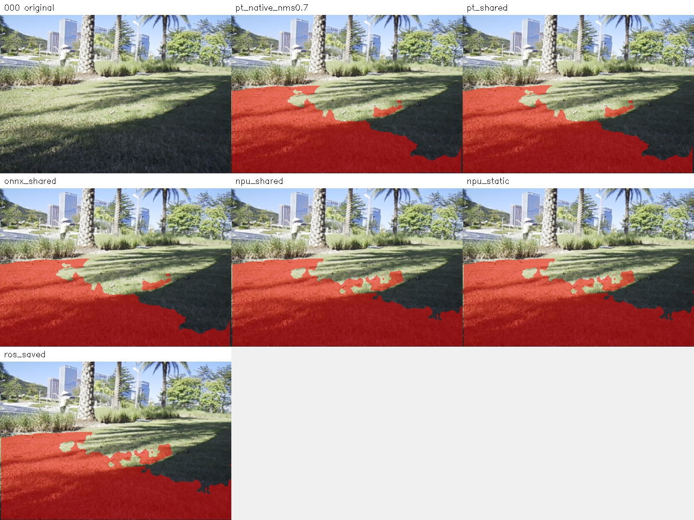
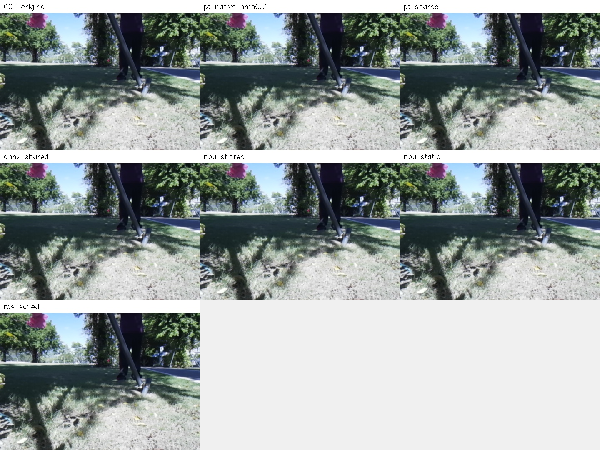
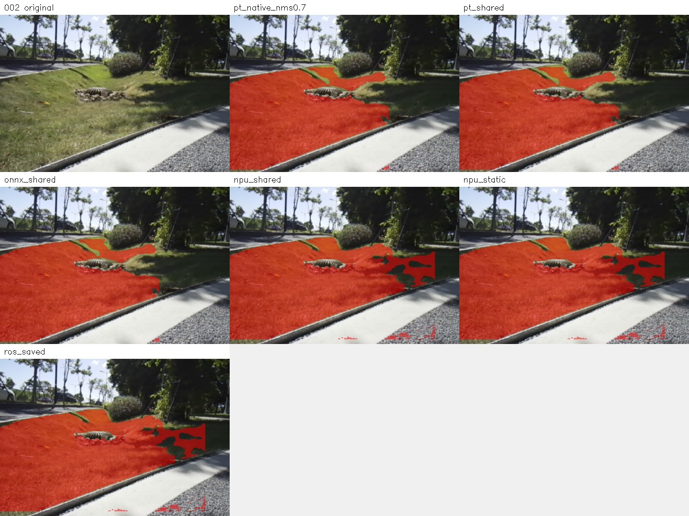

# 三张场外问题图片：B08_v3_2 跨后端对比

日期：2026-10-20。对应 STORY #25034 交付报告图 2、3、4。

## 结论

不是简单的“ROS2 集成后把结果弄坏了”。这三个样本同时存在原始模型的问题，以及 ONNX→NB/NPU 转换执行链的输出差异：

| 图片 | 原始 PT 表现 | NPU / 现场表现 | 定位 |
| --- | --- | --- | --- |
| 000：阴影草坪漏分 | 已存在明显漏分 | 仍漏分，部分区域覆盖比 PT 多 | 原模型已有问题，同时存在后端差异 |
| 001：草坪 Mask 全黑 | 同样全黑，最高分仅 0.00979 | 同样全黑，最高分 0.04272 | 在检测筛选阶段已没有候选，不是保存 Mask 丢失 |
| 002：道路零散误分 | 已有小块道路误分 | 道路碎片更加明显，检测框也发生变化 | 原模型误分与后端差异叠加 |

三张图的 PT 与 ONNX 在统一解码后 Mask 均逐像素一致。NPU 原始张量统一解码、板端静态推理和现场保存的 ROS2 Mask 也均逐像素一致。因此，这三例没有显示 ROS2 接入或保存环节额外引入 Mask 差异。

尚不能据此断言是哪一个量化层出了问题，也不能把整个转换执行链的差异直接等同于“纯量化误差”。需进一步用全精度或更高精度板端基线、逐层输出对比来区分转换、量化、编译及运行因素。

## 对比口径

复用项目已有的 [历史一致性方法](../../data/b08_v3_2_consistency_20261014/README.md) 和 [冻结解码脚本](../STORY25028_B08_v3_2_20261014/09_scripts/compare_mower_backends.py)，不修改训练、生产部署和模型。

- 使用现场保存的原始 PNG，不经过 JPEG 转码；原图及现场 Mask 的 SHA256 与交付报告来源记录核对。
- 原图 640×480，统一 letterbox 到 640×640，上下各补 80 像素，填充值 114。
- PT / ONNX 使用 RGB float32 / 255；NPU 使用 BGR uint8 和模型内嵌预处理。两者是各自模型的输入约定，不能直接统一成相同通道字节。
- 统一解码：置信度 0.25、NMS IoU 0.45、Mask 阈值 0.5；检测框向外 floor/ceil 裁剪；恢复原尺寸后合并实例。
- PT 原生预测另外保留历史 `retina_masks=True`、NMS 0.7 口径，并与 NMS 0.45 对照。三张图这两个 NMS 设置的最终 Mask 均一致。
- 板端实际重新执行静态推理，并导出 NPU 原始张量，在电脑上使用同一个 Python 解码器重建。

图中 `pt_native_nms0.7` 是原生预测，`pt_shared` / `onnx_shared` / `npu_shared` 是统一解码；`npu_static` 是板端静态程序，`ros_saved` 是当时现场保存结果。

## 逐图结果

### 000：阴影草坪漏分



PT 统一解码得到 96,696 个草坪像素，NPU 得到 110,712 个，双方有 15,586 个像素不同，Mask 一致性 IoU 为 86.02%。

阴影区域漏分在 PT 中已经存在，不能归咎于 ROS2。NPU 在部分区域覆盖更多，不能仅凭像素数量断言其整体效果更差。要判断准确率，需要人工真值。

### 001：全黑 Mask



PT 最高候选分数 0.009786，ONNX 为 0.009786，NPU 为 0.042725，均低于 0.25。所有后端均没有通过筛选的检测，最终 Mask 全黑。

这是模型输出在当前筛选口径下漏检，不是 ROS2 保存失败，也不是最后恢复原图尺寸时丢失草坪。不能靠全黑 Mask 之间 IoU 为 1 就宣称预测正确；这里只表示一致地失败。

### 002：道路零散误分



PT 统一解码得到 85,729 个草坪像素，NPU 得到 101,896 个，双方有 17,741 个像素不同，一致性 IoU 为 82.72%。

PT 本身已经将右下方道路的一小块识别为草坪，NPU 的道路碎片更加明显。最终保留的检测框右边界从 PT 约 443.28 像素扩大到 NPU 572 像素；最高置信度从 0.5104 变为 0.8271。

原始张量检查还显示，最高分候选索引由 PT 的 8228 变为 NPU 的 8227：

| 候选索引 | PT 分数 | NPU 分数 |
| --- | --- | --- |
| 8227 | 0.10664 | 0.82715 |
| 8228 | 0.51041 | 0.34961 |

这表明差异不只是最后的 Mask 缩放：检测分数、框坐标和候选排序已经变化。现有解码保留了检测框裁剪，但框内部仍可能存在道路误分，所以不能把问题简单归为“忘记裁剪框”。

## 一致性汇总

| 样本 | PT vs ONNX 不同像素 | PT vs NPU 不同像素 | NPU 统一解码 vs 板端静态 | 板端静态 vs 现场 ROS2 |
| --- | ---: | ---: | ---: | ---: |
| 000 | 0 | 15,586 | 0 | 0 |
| 001 | 0 | 0（双方全黑） | 0 | 0 |
| 002 | 0 | 17,741 | 0 | 0 |

PT 原生与统一解码在 000 / 002 上分别有 372 / 302 个像素不同，属于两种 Mask 重建口径的可观测差异；不能混用两种口径去解释上万像素的 PT/NPU 差异。

这里所有 IoU 均为后端一致性，不是相对人工标注的分割准确率。只有三个选定问题样本，不代表全部场外数据。

## 下一步建议（本次未实施）

1. 将这三张和其他独立场外样本固定为回归集，标注草坪边界与道路区域，分别衡量草坪漏分和道路误分。
2. 先检查 ONNX→NPU 链的数值漂移；在同一输入和统一解码下对比更高精度板端模型，避免将部署偏差误判为训练不足。
3. 对 PT 已有的阴影漏分、全黑和道路误分，核对训练集是否覆盖同类光照、视角、草坪状态与道路负样本，再决定补数据和训练。
4. 小连通域过滤只能作为候选后处理实验，可能误删远处真草坪；不应在未验证时用它掩盖模型和转换问题，更不能将草坪 Mask 单独作为安全通行依据。

## 复现与证据

- [诊断入口](compare_cases.py)：复用冻结解码器；不修改训练代码。
- [逐图数值与来源](details.json)、[像素对比 CSV](per_case.csv)、[环境及方法摘要](summary.json)。
- `reference/`：PT / ONNX 输出；`outputs/`：实际 NPU 输出；`masks/`：各口径二值 Mask。
- `board_checksums.txt`、`board_run.log`：板端校验和与运行记录。

在已有 WSL 环境中重新计算：

```powershell
wsl.exe -d Ubuntu-22.04 -- bash -lc "cd /mnt/e/cpp_project/lawn_mowing_robot_yolov8 && /root/cpp_project/am970/model/tools/conda-acuity310/bin/python mower_grass_seg/deliverables/field_three_cases_20261020/compare_cases.py"
```

该命令复用已保存的板端张量，不会自动连接板子重新推理；仍需要原始采集目录可访问。

模型校验：

| 模型 | SHA256 |
| --- | --- |
| B08_v3_2 best.pt | `ab8e640f665208ad80857a29786b4111d17774b7bb36773d83967d2afebe20ff` |
| b08_v3_2.onnx | `05ef0fe144942c2c2a7f29d26c85506729eee959a57cd2dd56f84b901af70089` |
| network_binary.nb | `9f162de626472adaac621eb5ffde0fff4dc3e7daf6089ec1810c4141023bf898` |
