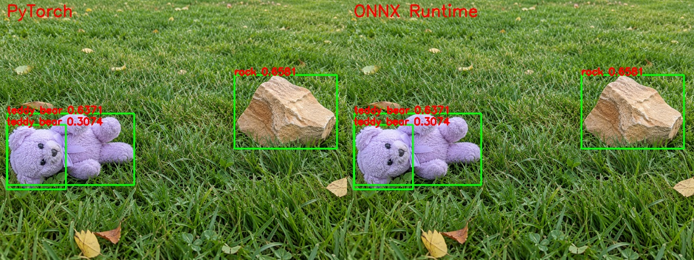

# STORY #34629：D02 ONNX 导出与独立开发板部署接口确认交付报告

日期：2026-11-03。父任务：#25042。计划工期：1 个工作日。

## 1. 交付结论

D02 已完成 FP32 ONNX 导出、结构检查和 **294 张固定样本的 PT/ONNX 同输入推理比较**。两端最终检测均为 **659 个框**，所有框均完成同类别一对一匹配，八类 TP/FP/FN 完全一致。最终框最大坐标误差 **0.00042725 原图像素**，最大置信度误差 **0.0000037551**。

严格的全候选数值检查为 **219/294 张通过、75 张存在记录项**：106 个低置信度候选框的坐标差超过事先设置的 0.01 输入像素阈值，最大 0.02212524 像素。这些候选最高置信度仅 0.0000046492，全部低于 0.25，未进入最终检测结果。没有事后放宽阈值或删除失败记录。

结论为：**本批固定样本在当前推理参数下，最终检测结果一致；全候选严格数值门槛并非全通过，差异已定位到被过滤的候选框。**这不是对所有图片、所有置信度阈值的等价性保证。浮点实现差异是合理解释，但本次未逐算子追踪，不能宣称已定位到某个具体算子。

独立开发板 192.168.8.11 已确认 NPU 驱动、历史 VKNN 运行库和 ROS2 Humble 环境；加载环境后 ROS2 CLI 正常。D02 `.nb` 转换、板端 D02 推理以及 ROS2 检测跟踪节点尚未执行，属于后续部署任务。本次没有修改公司项目或覆盖板上分割模型。

## 2. 模型与导出配置

| 项目 | 值 |
| --- | --- |
| 推荐模型 | D02，YOLOv8n + P3 通道注意力，无 P2 |
| 权重来源 | ../训练与评估/final_D02_20261103/best.pt |
| 模型输入 | images，float32，[1,3,640,640]，RGB/255 |
| 模型输出 | output0，float32，[1,12,8400] |
| 导出 | ONNX opset 12，static，batch=1，FP32，不简化、不内嵌 NMS |
| 推理参数 | conf=0.25，iou=0.7，max_det=300，按类别 NMS，multi_label=false |
| 类别 | person、cat、dog、frisbee、sports ball、teddy bear、garden hose、rock；ID 为 0～7 |
| 结构检查 | onnx.checker.check_model 成功；ONNX Runtime 成功加载并完成整批推理 |

权重 SHA256：`388902aeff6d18f3b8313fef38a5ad548a4099abc73ec7d256fe7b4798339d5f`。

ONNX SHA256：`c254d79f1e58cbd5d558e8dcc36b84428a3e4cf5265202ef7ecf13077f8af130`。

导出代码基准：`05345dbbab1bbc5a97e674e4c88c03c2f967f024`。本次复现脚本与证据文件单独归档，最终文件散列见 `SHA256SUMS.json`。

## 3. 固定样本与比较方法

- 验证集：按文件名排序，每个类别选择前 20 张含该类别的图片，合并去重后 154 张。是确定性的类别覆盖样本，**不是随机抽样，也不是全量验证集**。
- 测试集：固定 synthetic_8cls_140_20261030 全部 140 张，共 231 个标注框；属于 AI 生成测试数据，不代表真实相机泛化能力。
- 每张图像和标签的路径、SHA256、原图尺寸与类别记录在 comparison/input_manifest.json。
- 两端共享同一个 640×640 letterbox RGB float32 输入数组；共用仓库 NMS 和坐标还原逻辑。PT 为 CPU FP32 融合模型，ONNX Runtime 为 CPUExecutionProvider。
- 同类别 IoU≥0.5 一对一配对，再核对坐标与分数严格误差。GT 统计同样按同类别 IoU≥0.5 匹配，每框最多计一次。
- 原始阈值、版本和完整 I/O 信息见 export_config.json；逐图结果见 comparison/per_image.csv；全部最终框见 comparison/predictions.json。

**本次为固定方形输入口径。**历史选型使用 rect=true；因此不能将此处的测试集 TP/FP/FN 与旧报告直接相减后归因为 ONNX 转换。这里比较的是同方形输入下的 PT 与 ONNX，两端完全一致。历史完整验证 AP 仍以已冻结的选型报告为准。

## 4. 数值比较结果

| 检查项 | 实测最大值/数量 | 阈值 | 结果 |
| --- | --- | --- | --- |
| 输出 shape 与有限值 | 294 张均正常 | 一致且有限 | 通过 |
| 原始候选框坐标误差 | 0.02212524 输入像素 | ≤0.01 | 75 张有超阈值记录 |
| 原始分类分数误差 | 0.0000417233 | ≤0.0001 | 通过 |
| 最终未配对框 | 0 | 0 | 通过 |
| 最终框坐标误差 | 0.00042725 原图像素 | ≤0.1 | 通过 |
| 最终框置信度误差 | 0.0000037551 | ≤0.0001 | 通过 |

对 75 张记录项进行了重新推理定位：106 个候选超出原始框误差阈值，**0 个达到 conf=0.25**。候选最高分 0.0000046492；详细记录见 comparison/raw_difference_diagnosis.json。该诊断保留原始严格检查的失败状态，仅说明当前最终检测不受影响。

## 5. 分类别对照

下表所有 TP/FP/FN 在 PyTorch 和 ONNX 中完全相同，因此合并展示。P=TP/(TP+FP)，R=TP/GT；这是固定 conf=0.25 下的单点指标，**不是 AP**。

### 154 张验证集覆盖样本

| ID | 类别 | GT | PT=ONNX TP | PT=ONNX FP | PT=ONNX FN | P | R |
| --- | --- | --- | --- | --- | --- | --- | --- |
| 0 | person | 190 | 144 | 25 | 46 | 85.21% | 75.79% |
| 1 | cat | 27 | 26 | 4 | 1 | 86.67% | 96.30% |
| 2 | dog | 28 | 24 | 3 | 4 | 88.89% | 85.71% |
| 3 | frisbee | 27 | 23 | 0 | 4 | 100.00% | 85.19% |
| 4 | sports ball | 22 | 18 | 3 | 4 | 85.71% | 81.82% |
| 5 | teddy bear | 44 | 29 | 9 | 15 | 76.32% | 65.91% |
| 6 | garden hose | 20 | 20 | 2 | 0 | 90.91% | 100.00% |
| 7 | rock | 72 | 46 | 54 | 26 | 46.00% | 63.89% |

### 140 张 AI 生成测试集

| ID | 类别 | GT | PT=ONNX TP | PT=ONNX FP | PT=ONNX FN | P | R |
| --- | --- | --- | --- | --- | --- | --- | --- |
| 0 | person | 47 | 47 | 5 | 0 | 90.38% | 100.00% |
| 1 | cat | 26 | 25 | 1 | 1 | 96.15% | 96.15% |
| 2 | dog | 26 | 24 | 2 | 2 | 92.31% | 92.31% |
| 3 | frisbee | 27 | 27 | 9 | 0 | 75.00% | 100.00% |
| 4 | sports ball | 26 | 14 | 0 | 12 | 100.00% | 53.85% |
| 5 | teddy bear | 26 | 26 | 3 | 0 | 89.66% | 100.00% |
| 6 | garden hose | 26 | 25 | 14 | 1 | 64.10% | 96.15% |
| 7 | rock | 27 | 7 | 0 | 20 | 100.00% | 25.93% |

当前测试集中，球类仍漏掉 12/26 个，石块漏掉 20/27 个，软管存在 14 个误检。这些问题在 PT 中已经存在，ONNX 导出没有解决它们，也没有在本批样本中增加它们。不能因转换一致就认为已满足实车避障要求。

## 6. 可视化说明

图中左侧 PyTorch、右侧 ONNX Runtime，绿色为最终预测框，红字为类别和置信度。完整图集在 comparison/ 下，包含八类覆盖图及原始候选检查记录项对应图片。



上图两端结果一致；玩具熊出现重叠重复框，是模型/当前 NMS 参数的共同输出，不是转换引入的问题。


两端均未给出该球类目标的有效检测，说明转换一致性与模型识别能力需要分别评价。

## 7. 本机耗时（不是开发板性能）

CPU：Intel Core Ultra 5 225，WSL；batch=1、6 线程；预热 3 次，294 张顺序逐图运行。仅计模型前向，不包含读图、预处理、NMS、坐标还原与 ROS2 发布。两后端顺序测试，线程运行时及 CPU 调度会影响结果，不据此承诺 NPU 加速倍数。

| 后端 | P50 | P95 |
| --- | --- | --- |
| PyTorch CPU | 330.96 ms | 410.11 ms |
| ONNX Runtime CPU | 23.87 ms | 27.50 ms |

## 8. 板端与接口确认

详见 [部署接口与验收口径](部署接口与验收口径.md)。本次已确认：

1. AM970 独立板为 aarch64 Buildroot，vipcore 驱动及 /dev/vipcore 存在，已有 VKNN/NBG 运行基础。
2. /opt/ros2 为 Humble，加载环境后 ros2 --help 正常；vision_msgs 包未发现，需要补齐。
3. ONNX 作为 Acuity 输入，VKNN 运行格式为 `.nb`；后续需以 D02 实际转换与板上运行验证兼容性。
4. ROS2 输入约定 sensor_msgs/Image；输出采用原图像素框、类别及分数，保留原图 stamp/frame_id；ByteTrack 的 ID 和状态在后续跟踪节点产生。
5. 板上时钟为 1970 年；跨设备端到端时延前先统一时基。本次未改系统时间。
6. 已定义后续转换精度、帧率、延迟、内存和持续运行的工程测试门槛，并明确其暂定性质。

## 9. 验收对应与遗留项

| 验收项 | 状态及证据 |
| --- | --- |
| ONNX 正常加载与推理 | 完成，294 张全部成功 |
| 相同输入及前后处理对比 | 完成，复现脚本共享输入数组与 NMS |
| 差异记录与定位 | 完成，75 张原始候选记录项已定位为被过滤候选；未追踪到具体浮点算子 |
| 模型、配置、映射可追溯 | 完成，权重/ONNX/配置/脚本/散列/原始板端证据已归档 |
| ROS2 接口确认 | 接口设计已整理；板上实际相机话题确认、消息实现与时间戳端到端验证待完成 |
| 性能与精度测试要求明确 | 完成口径定义，板端实际性能等待下一任务测量 |

ONNX 导出与软件比较部分可以交付；ROS2 部分目前是接口设计文档，不能将实际接口确认、接入和端到端验证标记为完成。不能写成 D02 NPU 模型已部署或 ROS2 检测跟踪已经完成。保留严格原始候选阈值记录项，后续阈值变化时应重新复评。

下一任务：D02 转换 `.nb`，独立板同样本推理和 NPU 精度性能测试；补齐消息依赖，随后开发 ROS2 检测/ByteTrack 节点。公司系统集成另行开展。

## 10. 归档与复现

- best.pt / best.onnx：冻结权重副本与导出模型。
- export_config.json：导出选项、版本、哈希、类别与 I/O。
- comparison/：清单、逐图 CSV、预测框 JSON、汇总、诊断和双端图片。
- evidence/board_readonly.json：开发板原始检查命令及结果，不含登录密码。
- scripts/export_compare.py：导出与完整对比；scripts/diagnose_raw_difference.py：原始候选诊断；reference_match.py 为现有评估匹配函数的原样归档。
- 部署接口与验收口径.md：芯片、ROS2、坐标和测试口径。
- SHA256SUMS.json：目录文件完整性清单（不含清单本身）。

在本机 WSL Ubuntu-22.04 已有环境中复现；运行会重建本目录对应模型与比较结果，需保留当前归档后再复跑：

```bash
cd /mnt/e/cpp_project/lawn_mowing_robot_yolov8
/root/cpp_project/am970/model/tools/conda-acuity310/bin/python mower_obstrast_check/docs/STORY34629_D02_ONNX_20261103/scripts/export_compare.py
/root/cpp_project/am970/model/tools/conda-acuity310/bin/python mower_obstrast_check/docs/STORY34629_D02_ONNX_20261103/scripts/diagnose_raw_difference.py
```

复现依赖当前仓库的 D02 自定义注意力实现，不能仅安装原版 Ultralytics 后直接加载权重；数据路径须与 input_manifest.json 对应。工具版本见 export_config.json。新导出文件元数据可能导致 ONNX 文件散列变化，需同时检查配置和推理结果，不能仅凭新旧导出文件哈希不同判定数值变化。
