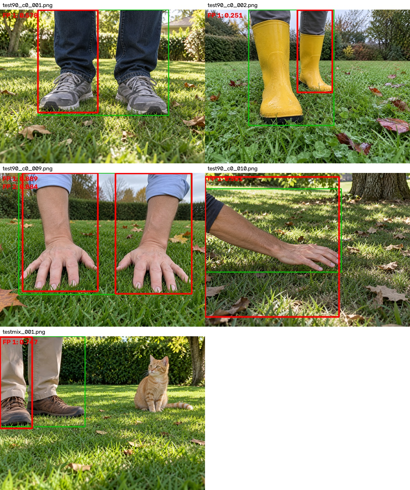
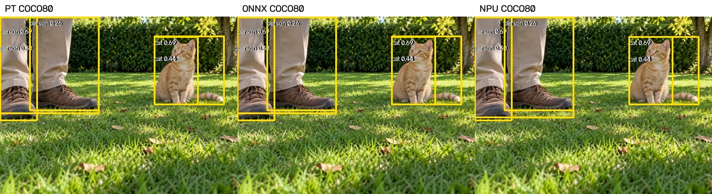
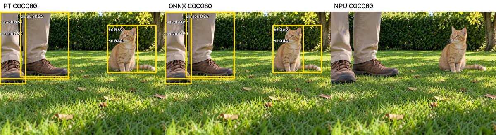

# STORY #34634：D02 KL 主模型与 COCO80 备选交付报告

日期：2026-11-03。独立 AM970（192.168.8.11）。按用户确认，将 D02 KL 混合量化版作为本轮交付，原版 YOLOv8n COCO80 作为备选。

## 1. 交付结论

主模型位于 delivery_D02_KL/，根目录 network_binary.nb 与其相同。备选位于 history_coco80/，保留官方原始 yolov8n.pt 的80类，不含项目微调与注意力结构。两版均完成同一140张图片的PT、ONNX与板端NPU静态推理。

主模型采用 UINT8+FP16 混合精度与 KL 校准，保护检测头尾部及注意力内部。备选最终交付全FP16精度版，另存80类KL混合量化性能对照；原网络没有注意力模块。八类主模型不能称为全INT8或全FP16。

本次完成模型转换与固定图片静态验证。ROS2、ByteTrack、板端相机实时预处理、持续运行稳定性及实车避障仍属于后续工作。

## 2. 模型与输入输出

| 项目 | 主模型 D02 KL | 备选 COCO80 |
|---|---|---|
| 来源 | 已选定 D02 best.pt | 官方原始 yolov8n.pt |
| 类别数 | 8 | 80 |
| ONNX输入 | [1,3,640,640] FP32 | [1,3,640,640] FP32 |
| ONNX/NPU解码输出 | [1,12,8400] | [1,84,8400] |
| 推理阈值 | conf=0.25，分类NMS IoU=0.7，max_det=300 | 相同 |
| 权重与模型目录 | delivery_D02_KL/ | history_coco80/ |

两版 ONNX 均为 opset12、batch1、静态尺寸、无内置NMS。主机生成640×640等比例letterbox图片，填充值114；板端输入BGR uint8 HWC，由模型内置节点完成RGB转换与/255，不重复归一化。输出不重复sigmoid、不乘objectness；NMS后还原原图xyxy坐标。

## 3. 类别映射与评估边界

| 项目类别 | 项目ID | COCO ID |
|---|---:|---:|
| person | 0 | 0 |
| cat | 1 | 15 |
| dog | 2 | 16 |
| frisbee | 3 | 29 |
| sports ball | 4 | 32 |
| teddy bear | 5 | 77 |
| garden hose | 6 | 不支持 |
| rock | 7 | 不支持 |

COCO没有garden hose和rock，不能把其他类别强行映射成软管或石头。全部80类输出原样保留，类别清单见 history_coco80/class_mapping.json。

当前140张合成图仅有项目8类标注，共231个框。其中六个共有类别178个框，软管26、石头27个框。备选评估排除不支持的两类GT，仅报告六类的指标；其他74类未完整标注，其预测不能据此一概判为误检。本报告的备选指标不是COCO80标准mAP，不能与主模型八类总mAP直接排名。

AP：conf=0.001、multi_label=true、IoU=0.7；固定阈值计数：conf=0.25、multi_label=false、同类IoU≥0.5一对一匹配。采用稳定torchvision CPU NMS，并核对板端C++结果。

## 4. 主模型八类结果

| 后端 | AP50 (%) | AP50-95 (%) |
|---|---:|---:|
| D02 PT | 90.723 | 84.064 |
| D02 ONNX | 90.723 | 84.064 |
| D02 KL NPU | 90.902 | 83.418 |

| 类别 | GT | ONNX AP50-95 (%) | KL AP50-95 (%) | KL P/R@0.25 (%) | KL TP/FP/FN |
|---|---:|---:|---:|---|---|
| person | 47 | 95.52 | 94.77 | 88.68/100.00 | 47/6/0 |
| cat | 26 | 94.93 | 94.62 | 100.00/92.31 | 24/0/2 |
| dog | 26 | 95.49 | 94.26 | 92.59/96.15 | 25/2/1 |
| frisbee | 27 | 91.80 | 91.97 | 67.50/100.00 | 27/13/0 |
| sports ball | 26 | 81.58 | 76.79 | 100.00/65.38 | 17/0/9 |
| teddy bear | 26 | 96.14 | 94.84 | 83.87/100.00 | 26/5/0 |
| garden hose | 26 | 69.96 | 77.01 | 58.14/96.15 | 25/18/1 |
| rock | 27 | 47.09 | 43.08 | 100.00/22.22 | 6/0/21 |

KL相对ONNX的八类AP50-95下降约0.65个百分点；石头检出6/27，ONNX为7/27。人员47/47无漏检，6个FP均位于人体部位，主要是重复框和定位问题。相对ONNX逐GT新增漏检3个（猫、石头、球各1），恢复5个（狗1、球4），并非完全数值等价。

详细优化历史、NMS取舍和失败样本见 [精度复核](optimization_20261103/后处理与混合量化精度复核.md)。该记录保留当时“候选、未替换”的历史描述；当前正式选择以本报告和 selected_model.json 为准。

## 5. 备选六个共有类别结果（NPU为全FP16）

| 后端 | 六类AP50 (%) | 六类AP50-95 (%) |
|---|---:|---:|
| COCO80 PT | 93.789 | 88.818 |
| COCO80 ONNX | 93.789 | 88.818 |
| COCO80 NPU | 93.750 | 88.818 |

80类KL混合量化性能对照：六类AP50-95=84.436%，比ONNX下降约4.38个百分点，未满足暂定1个百分点的转换精度目标，因此默认备选采用FP16。KL模型保留为 network_binary_kl_uint8.nb，不能把其较快速度与FP16精度合并描述成同一个版本。

为便于公平比较，下面只取相同六类的逐类AP作算术平均，不包含石头和软管：

| 模型 | 同六类AP50-95 (%) |
|---|---:|
| D02 ONNX | 92.577 |
| D02 KL NPU | 91.208 |
| COCO80 ONNX | 88.818 |
| COCO80 NPU | 88.818 |

| COCO类别 | GT | PT AP50-95 (%) | ONNX AP50-95 (%) | NPU AP50-95 (%) | NPU TP/FP/FN |
|---|---:|---:|---:|---:|---|
| person | 47 | 95.28 | 95.28 | 95.39 | 47/7/0 |
| cat | 26 | 85.37 | 85.37 | 85.32 | 24/4/2 |
| dog | 26 | 94.41 | 94.41 | 94.77 | 24/6/2 |
| frisbee | 27 | 89.17 | 89.17 | 89.17 | 26/17/1 |
| sports ball | 26 | 76.79 | 76.79 | 76.68 | 12/0/14 |
| teddy bear | 26 | 91.89 | 91.89 | 91.58 | 26/5/0 |

完整80类预测位于 history_coco80/evaluation/*_predictions.json；140张PT/ONNX/NPU并排图片位于 history_coco80/visualizations/，图片索引见 image_index.json。

备选PT/ONNX在conf=0.25下共226个最终框全部配对，未配对框0，最大原图坐标差0.000732像素、最大分数差约0.00000715。记录见 history_coco80/evaluation/pt_onnx_comparison.json。

备选ONNX/FP16最终框225个配对、1个未配对，最大坐标差10.6659像素、最大分数差约0.00717。总体AP接近并不代表逐框完全相同：test90_c4_003.png的球分数由0.252309变为恰好0.25，按两端统一的严格大于0.25规则被过滤，新增1个球漏检；其候选框IoU仍约0.915。testmix_001.png的人员框因相邻候选分数次序变化，NMS选择由候选8124变为8123，产生约10.67像素的框边差异。对应ONNX分数为0.687273/0.686751，FP16为0.683105/0.685059。详见 onnx_fp16_comparison.json 与 onnx_fp16_difference_cases.json，未改阈值掩盖差异。

## 6. 性能和后处理一致性

| 模型 | 推理P50/P95 ms | 后处理P50/P95 ms | C++/Python未匹配框 | 最大坐标差px |
|---|---|---|---:|---:|
| attention_tail_kl | 45.519/45.708 | 1.230/1.263 | 0 | 0.000000 |
| coco80_kl | 65.715/66.959 | 12.506/14.092 | 0 | 0.000000 |
| coco80_fp16 | 1681.300/1682.448 | 13.529/14.288 | 0 | 0.000000 |

每版剔除前5张，统计后135张。推理包含输入提交、执行、输出获取与复制，不含PNG读取、主机缩放、网络和保存，不能直接当作端到端FPS或长时间性能报告。

新增八类/80类通用板端解析程序后，已再次上板复跑八类主模型140张。280个原始输出与检测框文件的哈希全部与原KL结果一致，回归记录见 delivery_D02_KL/runner_regression.json；复跑目录为 board/delivery_D02_KL/。

## 7. 校准、追溯及剩余工作

两种KL转换沿用128张项目训练校准图，按8类各选16张并覆盖面积分位；未使用验证集或140张测试图校准。全FP16备选不依赖UINT8校准。校准图覆盖项目场景，不代表完整覆盖COCO80。原图、标签、预处理图哈希已经复核。测试集已用于部署优化决策，不再视为未接触盲测。

工具链：Acuity 6.33.31、VivanteIDE5.10.1，目标VIP9000NANODI_PLUS_PID0X1000000B；转换命令、图和日志分别在 variants/attention_tail_kl/、variants/coco80_kl/、variants/coco80_fp16/。官方权重来源及哈希见 history_coco80/source.json；导出参数和版本见 export_config.json。

80类140张板端推理正常结束后，因板端剩余空间不足，首次生成重复tar包失败。已改为直接流式下载并校验283个输出/日志文件的SHA256；同时移除7份与本地归档哈希一致的冗余打包文件。为补做FP16推理，进一步将140份已校验的80类KL原始输出转存至本地，板端保留其模型、框和日志。记录见 board/archive_cleanup.json 与 board/coco80_kl/raw_transfer_cleanup.json。该问题不属于模型推理失败。

剩余工作：真实相机和连续图像验证、剩余误检/漏检与重复框处理、ROS2消息及时间戳、ByteTrack、端到端延迟和稳定性、实车验收。本次不宣称整个部署父任务或现场检验已完成。

## 8. 文件入口

- delivery_D02_KL/：正式主模型PT/ONNX/NB、配置、评估及140张推理图。
- history_coco80/：80类备选PT/ONNX/NB、全部80类映射、六类可比评估及140张推理图。
- board/attention_tail_kl/、board/coco80_kl/、board/coco80_fp16/：各版板端日志、原始float32输出、检测框、耗时；board/delivery_D02_KL/另存主模型交付复跑结果。
- initial_fp16_report.md/docx：初始FP16精度对照报告，历史选型已由本报告替代。
- SHA256SUMS.json：完整产物哈希清单。

## 9. 原版COCO80纯INT8直接整图试验

独立试验 coco80_int8，没有替换主交付及FP16备选。沿用相同128张项目训练校准图、KL算法及140张测试图片；指定int8，无FP16保护。量化表核查为267个i8条目、64个i32条目，无浮点量化条目；i32是偏置。实际激活采用asymmetric_affine、权重/偏置采用symmetric_affine。输入预处理、输出解量化和CPU NMS不属于全程8位整数计算的承诺。

编译成功且板端140张退出码0。六类AP50-95=0.000%，最终框总数=0；推理P50/P95=53.119/55.051ms。

原始输出核查：140张所有分类分数最大值=0.0，非零分类分数数量=0。最终输出张量同时包含0～约658的坐标与0～1的分数；其INT8量化scale=2.579249、zero_point=-128，使0～1分数均舍入到零。问题发生在输出精度配置，不是NMS把正确框删光。

因此本次直接整图INT8版本不可用于检测，耗时不能作为可用检测方案的性能结论。这不说明所有INT8部署都会失败。后续若继续该路线，应拆分坐标与分类输出、分别量化，或由NPU输出INT8检测头特征再在CPU解码，明确浮点处理边界后重新评估；上述改造本轮未实施。

模型、量化表、审计与指标：variants/coco80_int8/；140张对比图：variants/coco80_int8/visualizations/；板端原始输出与日志：board/coco80_int8/。为腾出测试空间，已将本地校验一致的80类FP16原始输出从板端转存至本地，模型、框与日志仍保留，记录见 board/coco80_fp16/raw_transfer_cleanup.json。

