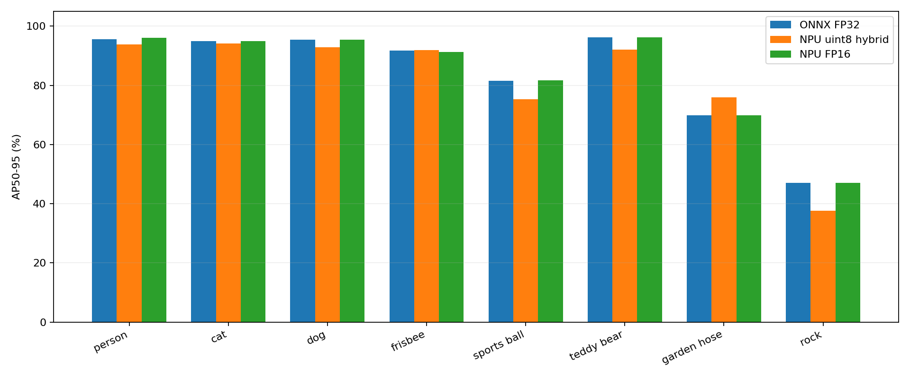
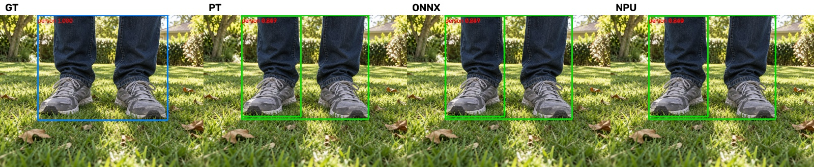
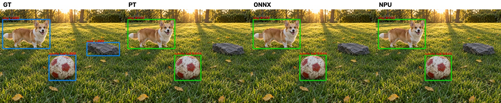
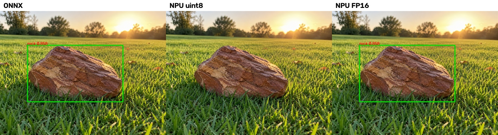
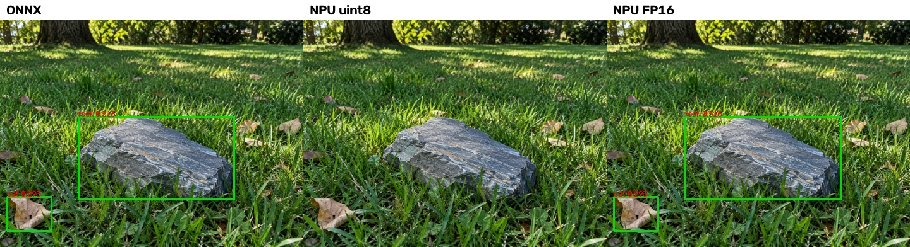
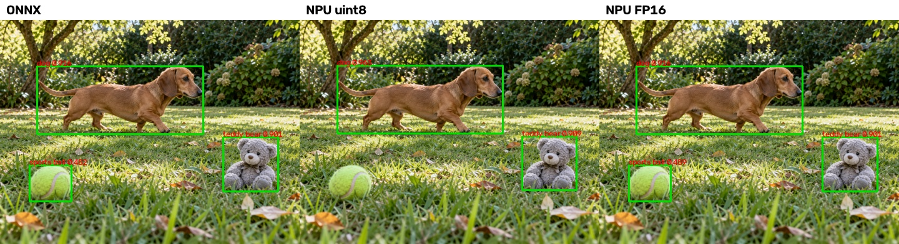

# STORY #34634：D02 NPU 转换与 140 张静态推理交付报告

日期：2026-11-03。父任务：#25042。对象：独立 AM970 开发板 192.168.8.11。计划工期：1 个工作日。

## 1. 实际完成情况

已完成 D02 的 Acuity 转换、芯片端模型加载、140 张固定图片推理、输出解析、NMS、原图坐标还原和三端指标对比。测试集为既有 140 张 AI 生成图片，共 231 个标注框。

先转换了 **uint8 主体 + FP16 坐标链**版本，随后补做 **全 FP16** 对照。完整保留两种 NPU 产物及失败排查记录。交付根目录 network_binary.nb 选择全 FP16，8 位版本保留在 variants/uint8_hybrid/；模型选取信息见 selected_model.json。

统一稳定 NMS 后：PT/ONNX 的 AP50-95 为 **84.0638%**，8 位混合量化为 **81.7191%**，全 FP16 为 **84.0764%**。FP16−ONNX 差值为 **+0.0126 个百分点**，属于微小数值波动，不能解释为量化提高了模型能力。

FP16 在本批静态测试上满足“AP50-95 下降不超过 1 pp”的暂定精度门槛，人员与猫狗召回也没有下降；但其约 1.40 秒/张的推理耗时明显不满足此前建议的 10 FPS 实时目标。8 位版约 33 ms/张，但精度门槛未满足。**当前没有一个版本同时证明达到暂定的精度与实时性要求。**这两项门槛并未成为已确认的整机业务指标，也不能用本批测试替代完整验证集与端到端测试。

**这是静态图片交付，不是现场相机或 ROS2 实时链路验收。**本次只验证了准备好的 640×640 输入；相机原图在板端实时缩放、图像话题、时间戳传递、ByteTrack、持续运行和整机避障仍未完成。

## 2. 来源与转换

| 项目 | 记录 |
| --- | --- |
| 模型 | 冻结 D02，YOLOv8n + P3 通道注意力，P3/P4/P5 检测头 |
| 输入/输出 | images [1,3,640,640] → output0 [1,12,8400] |
| 类别 | 0 person、1 cat、2 dog、3 frisbee、4 sports ball、5 teddy bear、6 garden hose、7 rock |
| ONNX | FP32、opset 12、batch=1、静态、不包含 NMS |
| 工具链 | Acuity 6.33.31、VivanteIDE 5.10.1、VIP9000NANODI_PLUS_PID0X1000000B |
| 初始量化 | asymmetric_affine、normal、uint8、128 次校准；9 个坐标/输出节点 FP16 |
| 精度对照 | --dtype float16；不使用 8 位量化表 |
| 板端 | aarch64 Buildroot 2021.02，Linux 5.10.59，vipcore，既有 VKNN 运行库 |

权重 SHA256：`388902aeff6d18f3b8313fef38a5ad548a4099abc73ec7d256fe7b4798339d5f`。

ONNX SHA256：`c254d79f1e58cbd5d558e8dcc36b84428a3e4cf5265202ef7ecf13077f8af130`。

当前 FP16 NBG SHA256：`680fe750b5860b92d980bda7cb1e7c48324b84832d0020dbdd5e727051567643`。

完整导入、量化、导出命令和日志见 conversion/；精度策略节点及连接关系见 precision_policy.json。最终成功导入/导出日志均无 Acuity 错误或警告，不存在已知未支持算子导致导出失败的遗留项。

## 3. 校准样本

初始 8 位量化使用 128 张唯一训练集图片，按八类各选 16 张，每类根据目标框面积四分位各选 4 张，随机种子 42。平均灰度覆盖约 21.09～221.32。多类别图片使实际标签数不是每类 16 个；实际各类框数依次为 196、19、31、28、19、26、16、52。

校准图片来自 data/yolo_check/images/train，未使用验证集和测试集校准，并与已归档的完整验证集及 140 张测试集做图片 SHA256 排重。清单记录源图片/标签路径、哈希、选样类别、面积分位和准备后 PNG 哈希，见 calibration/manifest.json、summary.json。

全 FP16 不依赖这些校准统计。140 张测试集用于比较精度策略，因此今后不能再把它称为完全未用于部署决策的独立终验集。

## 4. 前后处理与口径

主机统一完成等比例 letterbox，居中补边 114，输出 640×640 BGR uint8 PNG。PT/ONNX 另做 RGB/NCHW/float32/255；NPU 使用嵌入模型的通道转换和归一化节点，板端直接提交同一 PNG 的 HWC BGR uint8 像素，不重复归一化。输入哈希见 board/input_manifest.json。

输出不再做 sigmoid，不乘 objectness。部署阈值 conf=0.25、按类别 NMS IoU=0.7、max_det=300、multi_label=false。NMS 后去补边、除比例并裁剪到原图范围，输出原图像素 xyxy。板端为 C++ 稳定分数排序，主机明确固定 torchvision CPU NMS，确保同分候选的顺序一致。

AP 使用 conf=0.001、multi_label=true，其他输入与 NMS 参数相同；P/R 单点表固定 conf=0.25，同类 IoU≥0.5 一对一匹配 GT。AP 不是单点 P/R。下表均为当前固定方形口径，不能直接和过去 rect=true 的训练选型指标相减。

## 5. 三端与量化对照

| 后端 | AP50 | AP50-95 | 相对 ONNX AP50-95 差值 |
| --- | --- | --- | --- |
| PyTorch FP32 | 90.7232% | 84.0638% | +0.0000 pp |
| ONNX FP32 | 90.7232% | 84.0638% | +0.0000 pp |
| NPU uint8 混合 | 89.3499% | 81.7191% | -2.3447 pp |
| NPU FP16 | 90.7451% | 84.0764% | +0.0126 pp |

### 分类别 AP50-95

| 类别 | GT | PT | ONNX | NPU uint8 | NPU FP16 | FP16−ONNX |
| --- | --- | --- | --- | --- | --- | --- |
| person | 47 | 95.52% | 95.52% | 93.83% | 96.07% | +0.56 pp |
| cat | 26 | 94.93% | 94.93% | 94.17% | 94.93% | +0.00 pp |
| dog | 26 | 95.49% | 95.49% | 92.80% | 95.49% | +0.00 pp |
| frisbee | 27 | 91.80% | 91.80% | 91.98% | 91.23% | -0.57 pp |
| sports ball | 26 | 81.58% | 81.58% | 75.29% | 81.76% | +0.18 pp |
| teddy bear | 26 | 96.14% | 96.14% | 92.09% | 96.14% | +0.00 pp |
| garden hose | 26 | 69.96% | 69.96% | 76.00% | 69.87% | -0.08 pp |
| rock | 27 | 47.09% | 47.09% | 37.60% | 47.11% | +0.02 pp |

### 固定 conf=0.25 的最终结果

PT 与 ONNX 的单点 TP/FP/FN 相同。以下比较 ONNX 与最终 FP16 NPU：

| 类别 | ONNX TP/FP/FN | NPU TP/FP/FN | ONNX P/R | NPU P/R |
| --- | --- | --- | --- | --- |
| person | 47/5/0 | 47/5/0 | 90.38% / 100.00% | 90.38% / 100.00% |
| cat | 25/1/1 | 25/1/1 | 96.15% / 96.15% | 96.15% / 96.15% |
| dog | 24/2/2 | 24/2/2 | 92.31% / 92.31% | 92.31% / 92.31% |
| frisbee | 27/9/0 | 27/9/0 | 75.00% / 100.00% | 75.00% / 100.00% |
| sports ball | 14/0/12 | 14/0/12 | 100.00% / 53.85% | 100.00% / 53.85% |
| teddy bear | 26/3/0 | 26/3/0 | 89.66% / 100.00% | 89.66% / 100.00% |
| garden hose | 25/14/1 | 25/14/1 | 64.10% / 96.15% | 64.10% / 96.15% |
| rock | 7/0/20 | 7/0/20 | 100.00% / 25.93% | 100.00% / 25.93% |

### 小目标召回

按原图长边缩放到 640 后框面积 <32² 定义 small。样本少时只报告计数，不外推现场泛化。

| 类别 | small GT | ONNX 命中 | NPU FP16 命中 |
| --- | --- | --- | --- |
| person | 0 | 0 | 0 |
| cat | 0 | 0 | 0 |
| dog | 0 | 0 | 0 |
| frisbee | 0 | 0 | 0 |
| sports ball | 0 | 0 | 0 |
| teddy bear | 0 | 0 | 0 |
| garden hose | 0 | 0 | 0 |
| rock | 0 | 0 | 0 |

## 6. 板端后处理校验与可视化

同一 FP16 NPU 原始输出，板端 C++ 与主机 Python 后处理：未配对框总数 **0**，最大原图坐标差 **0.00000000 像素**。140 张均有原始 float32 输出和最终框文本，见 board/fp16/outputs/。

FP16 与 ONNX 最终框另行配对：229 个框配对、0 个未配对；配对框原图最大坐标差 1.601517 像素，置信度最大绝对差 0.007039。这与“同一 NPU 输出的两种后处理差为零”是两项不同检查，不混淆概念。

对 ONNX 与 FP16 NPU 的 GT 命中逐框比较：NPU 新增漏检 0 个，恢复命中 0 个。逐图索引见 evaluation/case_index.csv；全部 140 张四列可视化位于 evaluation/visualizations/，依次为 GT、PT、ONNX、NPU。

转换一致不代表原模型已经满足避障要求。球类和石块的原有漏检、软管与玩具熊的误检仍需单独看；尤其各类测试框数仅 26～47，不能以少数图片证明真实场景泛化。

### 8 位量化的典型退化

以下图按 ONNX、NPU uint8、NPU FP16 顺序排列，列出 8 位量化新增漏检的具体类别。该批图片用于定位部署精度问题，不用于校准。

test90_c7_003.png：8 位版新增漏检 1 个，类别：rock。

test90_c7_005.png：8 位版新增漏检 1 个，类别：rock。

testmix_010.png：8 位版新增漏检 1 个，类别：sports ball。

## 7. 板端耗时与体积

每种模型共处理 140 张；下表排除前 5 张，统计后 135 张。输入提交、推理、输出获取及输出复制计入 inference_ms，后处理含有限值检查、框解析、NMS、坐标还原。不包含 PNG 解码、主机 letterbox、网络、图片保存和 ROS2 通信；不是端到端 FPS，也不是 1000 帧正式性能测试。

| 模型 | 大小 | 推理 P50/P95 | 后处理 P50/P95 |
| --- | --- | --- | --- |
| uint8 混合 | 4.24 MiB | 33.05/33.40 ms | 0.99/1.10 ms |
| FP16 | 8.19 MiB | 1398.88/1399.33 ms | 1.48/1.50 ms |

FP16 的精度优先选择不等于实时部署推荐。若其耗时达不到后续帧率预算，需要继续做敏感层混合精度或芯片工具链性能定位，不能直接进入实车运行并宣称满足实时性。

## 8. 已处理异常与剩余限制

1. 首次本机转换/参考推理并行期间，WSL 会话中断，量化图文件变成空文件；没有证据将它归因于算子不支持。保留 interrupted 日志，重新导入并串行转换后成功。
2. 初版程序读取调用方空缓冲区，造成全零输出；已改为读取 VKNN 返回的 SDK 管理缓冲区，再复制并解码。首次无效结果保留在 board/failed_buffer_attempt/，不纳入精度报告。
3. NMS 后端未固定时，同分候选选择不同。已统一到稳定排序，重新计算三端及 8 位对照，避免把排序差异当作量化损失。此前过程中提及的 81.50% 属旧 NMS 实现临时结果，以本报告统一口径为准。
4. 8 位量化 AP 损失超过暂定 1 pp 门槛，尤其石块明显退化，不作为当前精度交付的推荐版本；保留模型供后续性能/量化优化。
5. 只评估 140 张 AI 生成测试集，未复评完整验证集、未现场拍摄、未持续运行一小时、未接入 ROS2 或 ByteTrack。上一任务的性能与精度门槛是工程建议，尚不是已确认的整机业务要求。

## 9. 验收对应与下一步

| 验收项 | 当前证据与范围 |
| --- | --- |
| 模型加载并输出检测 | 两种 NPU 模型均完成 140 张，退出码 0 |
| 类别及坐标正确 | 固定八类映射、原图尺寸、逆变换元数据；板端与主机逐图对照 |
| 转换前后统一比较 | PT/ONNX/NPU 同输入、明确 NMS 与阈值；指标和剩余精度差异如实记录 |
| 算子/量化异常处理 | 成功导出；缓冲区、NMS 和 8 位精度损失记录完整 |
| 来源与配置追溯 | 权重、ONNX、NBG、工具链、校准清单、命令、日志、哈希与代码已归档 |

本次可以交付“模型转换与固定测试集静态推理”部分，不能将任务标题中的现场检验或整个部署父任务标记为已完成。下一步先根据精度与速度取舍确定部署精度策略，再补真实相机输入、ROS2 接口和实际性能/稳定性验证。

## 10. 文件索引

- network_binary.nb、selected_model.json：当前 FP16 静态精度交付模型与来源信息。
- variants/uint8_hybrid/、variants/fp16/：两种精度模型和独立评估结果。
- conversion/：转换命令、日志、输入输出配置、模型图、量化表及源模型配置。
- calibration/：128 张训练校准输入、源数据哈希清单和类别统计。
- scripts/：数据准备、转换、交叉编译、板端 C++、远程运行、三端评估和报告脚本。
- board/：输入清单、程序、日志、原始输出、传输哈希和异常排查证据。
- evaluation/：三端指标、逐图输出、尺寸统计、分类别对比图及 140 张可视化。
- [运行说明](运行说明.md)：复现步骤及预处理职责划分。

所有资料在本任务 docs 文件夹中；不含 SSH 密码。文件完整性清单见 SHA256SUMS.json。
