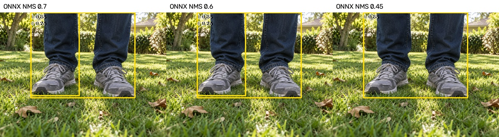
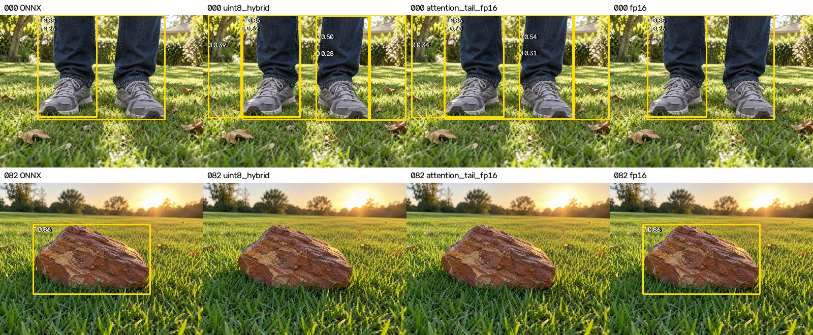
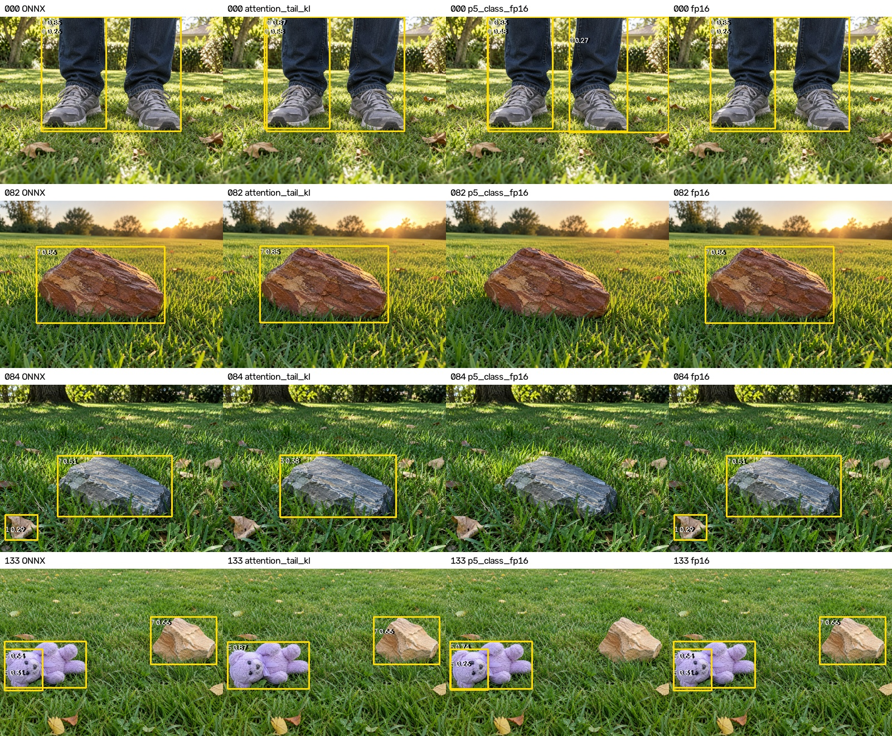

# D02 后处理与混合量化精度专项复核

日期：2026-11-03。原交付报告的补充记录；未替换根目录正式模型，未修改板端默认 NMS。

## 结论

本轮新增 KL 校准与 P5 分类分支 FP16 两项实测。KL 是当前更好的快速部署候选：AP50-95=83.42%，推理中位耗时约45.5ms，石头恢复至6/27；仍有新增漏检，尚未替换正式归档模型。P5 分支保护未恢复石头，且新增人员漏检，不推荐。前文保留前轮对照记录，最新结论见本节和追加实测。

## 统一口径

固定合成测试集 140 张、231 个标注框；640×640 方形 letterbox，填充值 114。AP 使用 conf=0.001、分类 NMS IoU=0.7、multi_label=true；部署统计使用 conf=0.25、IoU=0.7、multi_label=false、max_det=300，同类别 IoU≥0.5 匹配 GT。两种统计口径不可混淆。

128 张校准图全部来自训练集，沿用原校准清单，未使用验证集或测试集校准。该测试集已参与部署优化分析，不能再称为未接触的最终盲测集。

## 板端实测

| 版本 | AP50 (%) | AP50-95 (%) | 推理 P50 / P95 (ms) |
|---|---:|---:|---:|
| ONNX | 90.723 | 84.064 | — |
| uint8_hybrid | 89.350 | 81.719 | 33.053 / 33.403 |
| head_tail_fp16 | 89.723 | 82.533 | 44.920 / 45.146 |
| attention_tail_fp16 | 90.039 | 82.775 | 45.006 / 45.204 |
| fp16 | 90.745 | 84.076 | 1398.880 / 1399.333 |

耗时剔除前 5 张预热，只计板端推理，不含图像读取、主机缩放、传输与保存，不等于端到端帧率。新候选均完成板端 140 张推理，退出码为 0。

uint8_hybrid 是 UINT8 与 FP16 混合，不能表述为全 INT8。head_tail_fp16 保护最终预测输出、DFL、Sigmoid 与解码等尾部；attention_tail_fp16 进一步保护注意力内部计算，在模块输出保留量化边界。主干特征仍为整数计算。

## 分类别 AP50-95 (%)

| 类别 | ONNX | 原混合 | 尾部 FP16 | 注意力内部+尾部 FP16 | 全 FP16 |
|---|---:|---:|---:|---:|---:|
| person | 95.52 | 93.83 | 94.03 | 93.78 | 96.07 |
| cat | 94.93 | 94.17 | 94.03 | 94.64 | 94.93 |
| dog | 95.49 | 92.80 | 95.48 | 95.90 | 95.49 |
| frisbee | 91.80 | 91.98 | 93.37 | 92.78 | 91.23 |
| sports ball | 81.58 | 75.29 | 77.05 | 78.31 | 81.76 |
| teddy bear | 96.14 | 92.09 | 93.32 | 93.34 | 96.14 |
| garden hose | 69.96 | 76.00 | 75.86 | 75.31 | 69.87 |
| rock | 47.09 | 37.60 | 37.12 | 38.12 | 47.11 |

## 部署阈值下 TP / FP / FN

| 类别 | ONNX | 原混合 | 尾部 FP16 | 注意力内部+尾部 FP16 | 全 FP16 |
|---|---|---|---|---|---|
| person | 47/5/0 | 47/11/0 | 47/10/0 | 47/10/0 | 47/5/0 |
| cat | 25/1/1 | 25/0/1 | 25/0/1 | 25/0/1 | 25/1/1 |
| dog | 24/2/2 | 25/2/1 | 25/2/1 | 25/2/1 | 24/2/2 |
| frisbee | 27/9/0 | 27/14/0 | 27/13/0 | 27/13/0 | 27/9/0 |
| sports ball | 14/0/12 | 17/0/9 | 16/0/10 | 18/0/8 | 14/0/12 |
| teddy bear | 26/3/0 | 26/6/0 | 26/5/0 | 26/6/0 | 26/3/0 |
| garden hose | 25/14/1 | 26/23/0 | 26/23/0 | 26/24/0 | 25/14/1 |
| rock | 7/0/20 | 4/0/23 | 4/0/23 | 4/0/23 | 7/0/20 |

## 重复框：原因和取舍

脚部样本 test90_c0_001.png 在 ONNX 上已经存在两个 person 框，分数约 0.849 和 0.257。框间 IoU=0.4522，小框约 99.79% 被大框包含。原 NMS=0.7 按规则保留两框，不是板端重复解析输出。提高精度也不保证自动消除模型原有重复框。

| 数据范围 | NMS=0.7 TP/FP/FN | NMS=0.6 TP/FP/FN |
|---|---|---|
| test140 | 195/34/36 | 195/32/36 |
| val154 | 330/100/100 | 330/85/100 |
| val2938 | 6705/1646/2394 | 6690/1378/2409 |

完整验证集 2938 张：降低到 0.6 减少 268 个 FP，但 TP 净减少 15 个；丢失 15 个人员和 1 个玩具熊，找回 1 个人员。因此不能描述为无损去重。

0.45 可消除示例脚部重复框，但在 154 张验证子集丢失 2 个人员和 1 个玩具熊；额外包含关系过滤也会丢失真实人员。上述方案均未设为正式默认。完整验证集本次只验证了 0.7/0.6，不把子集结论冒充全量结论。

## 逐图对比

图中框使用相同部署阈值。所有预测及 GT 命中记录保存在 evaluation/ 与 variants/*/NPU_predictions.json，可按图片名追溯。

## 工程校验与限制

新混合版的板端 C++ 后处理与主机相同原始输出的 Python 后处理逐图核对，匹配数及坐标差记录于各 variant/npu_per_image.csv。转换失败的算子类型日志保留：部分 FP16 激活不能直接连接 UINT8 权重卷积；通过保护 DFL 权重、保留注意力出口整数边界完成编译。开发机曾因内存压力中断转换，最终成功产物与板端完整结果独立保存，失败结果未纳入指标。

## 前轮建议及本轮落实

1. 不继续盲目降低全局 NMS 阈值；保留 0.7 作为当前追溯基准。若业务决定接受召回损失再减少误报，应单独验收人员遮挡、交叠场景。
2. 前轮快速候选 attention_tail_fp16 相对 ONNX 仍下降约 1.29 个 AP50-95 百分点，未达到暂定下降≤1个百分点的目标；石头 TP 仍为 4/27，ONNX 为 7/27，不据此声称漏检问题解决。
3. 下一项优先实验是量化校准算法与敏感特征层分析：在训练校准数据上比较当前 normal 与 KL 校准，并逐层比较浮点/量化特征误差，优先保护造成小目标信息损失的层。本轮已完成 KL 对照与 P5 分支保护实验，结果见追加章节；完整逐层敏感度扫描仍未完成。
4. 若上述仍不能达到精度目标，再扩大浮点保护范围，并实测速度；全 FP16 约 1.4 秒/张已证明存在明显性能代价。此次不重新训练 D02，不改变模型类别或数据划分。

## 产物

候选模型、转换配置和日志：../variants/head_tail_fp16/ 与 ../variants/attention_tail_fp16/；原始板端输出：../board/ 对应目录；NMS 统计：本目录 nms_sweep_*.json。模型哈希统一收录 ../SHA256SUMS.json。

## 追加：石头漏检原始输出定位

针对 ONNX 检出、attention_tail_fp16 漏检的三个 GT，在 NMS 前选取与该 GT 的 IoU≥0.5 的候选中石头分数最高者。此处比较各端最佳匹配候选，不假设候选索引完全相同。

| 图片 | ONNX 石头分数 | 原混合 | 注意力内部+尾部 FP16 | 全 FP16 | 新混合候选 IoU / 最高分类 |
|---|---:|---:|---:|---:|---|
| test90_c7_003.png | 0.857538 | 0.198730 | 0.241333 | 0.858398 | 0.9461 / 7 |
| test90_c7_005.png | 0.512568 | 0.038208 | 0.038666 | 0.514648 | 0.9640 / 3 |
| testmix_044.png | 0.658093 | 0.137573 | 0.156616 | 0.662598 | 0.9380 / 7 |

三个目标均有位置准确的候选框（IoU>0.93），但石头分数低于 0.25，故主要是分类分数退化，发生在 NMS 之前。test90_c7_005.png 的上述候选最高类别变为飞碟（3）。降低 NMS IoU 无法恢复这些已被置信度筛选排除的候选。具体内部敏感层尚未定位，不能仅凭输出将责任归于某一层。

## 追加：KL 校准对照实测

使用相同 128 张训练校准图片、相同 FP16 保护策略和板端后处理，仅将校准算法改为 kl_divergence；新模型位于 ../variants/attention_tail_kl/，没有替换正式模型。

AP50=90.902%，AP50-95=83.418%；推理 P50=45.519ms，P95=45.708ms。

| 类别 | normal AP50-95 (%) | KL AP50-95 (%) | normal TP/FP/FN | KL TP/FP/FN |
|---|---:|---:|---|---|
| person | 93.78 | 94.77 | 47/10/0 | 47/6/0 |
| cat | 94.64 | 94.62 | 25/0/1 | 24/0/2 |
| dog | 95.90 | 94.26 | 25/2/1 | 25/2/1 |
| frisbee | 92.78 | 91.97 | 27/13/0 | 27/13/0 |
| sports ball | 78.31 | 76.79 | 18/0/8 | 17/0/9 |
| teddy bear | 93.34 | 94.84 | 26/6/0 | 26/5/0 |
| garden hose | 75.31 | 77.01 | 26/24/0 | 25/18/1 |
| rock | 38.12 | 43.08 | 4/0/23 | 6/0/21 |

## 追加：P5 分类分支 FP16 对照

在 normal 校准及 attention_tail_fp16 基础上，保护 P5 分类分支内部激活与后续卷积权重；第一层卷积仍保留整数输入/整数权重边界。该实验并非全网络浮点，不能据此排除更上游特征层的量化误差。

AP50-95=82.844%，推理 P50=49.736ms、P95=49.972ms。

| 类别 | P5 分支 FP16 AP50-95 (%) | TP/FP/FN |
|---|---:|---|
| person | 94.20 | 46/6/1 |
| cat | 94.89 | 25/0/1 |
| dog | 96.54 | 24/2/2 |
| frisbee | 93.94 | 27/9/0 |
| sports ball | 77.16 | 18/0/8 |
| teddy bear | 93.36 | 26/6/0 |
| garden hose | 75.99 | 25/12/1 |
| rock | 36.68 | 4/0/23 |

该候选石头仍只检出4/27，且相比 ONNX 新增人员漏检。不推荐以它替换 KL 或原始模型。

## 本轮逐图恢复情况

| 图片 | ONNX 石头分数 | normal 混合 | KL 混合 | P5 分类保护 |
|---|---:|---:|---:|---:|
| test90_c7_003.png | 0.857538 | 0.241333 | 0.848145 | 0.093567 |
| test90_c7_005.png | 0.512568 | 0.038666 | 0.081909 | 0.013779 |
| testmix_044.png | 0.658093 | 0.156616 | 0.661133 | 0.054230 |

KL 找回 test90_c7_003.png 和 testmix_044.png 中的两个石头。test90_c7_005.png 最佳匹配候选的石头分数仍仅约0.082；最终输出包含飞碟误检，未恢复正确识别。

脚部样本 KL 输出2个人员框，normal 注意力混合版为5个、ONNX为2个。量化带来的额外框减少，但原模型的重复框仍未解决；本轮没有降低 NMS 或置信度阈值。

相对 ONNX，KL 逐 GT 核对共丢失3个（猫、石头、球各1个），找回5个（狗1个、球4个）。软管与 ONNX 的 GT 命中相同，但比上一版 normal 混合少检1个。详见 candidate_gt_changes_vs_onnx.json，不能以总检出数增加代替逐图一致性。

## 当前建议与未完成项

优先保留 attention_tail_kl 作为快速部署候选：相对原混合量化 AP50-95 提高约1.70个百分点，相对 ONNX 下降约0.65个百分点。140张静态结果满足暂定整体 AP 下降≤1个百分点，但分类别并非全部恢复，且耗时仅为推理时间，不能代替端到端实时验收。根目录正式归档仍保持全 FP16 静态参考。

下一步应先在固定真实验证样本和板端连续图像上复核 KL 候选，重点检查新增猫、石头漏检；如继续优化校准集，应从已有训练数据选取更多独立场景，排查同源 copy/增强图片的相关性，再做受控比较，不使用测试图校准。若石头分类仍明显退化，再定位更上游特征层，而不是盲目扩大整段 FP16。

128张校准原图、标签和预处理图片的哈希复核全部通过（calibration_integrity_check.json）。KL与normal最终均有42个FP16参数条目且集合相同（kl_policy_check.json），支持算法对照的可比性。初次KL混合阶段因发现输出保护需要显式恢复而主动中止；修正后完整重跑并成功上板，非板端推理失败。
