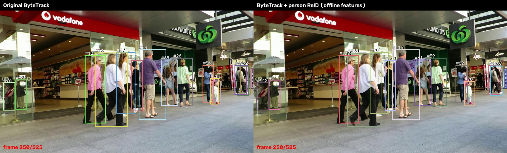

# 人员 ReID 接入与首轮对照测试

日期：2026-11-04。

## 结论

**已接入真实的人员外观特征，并用同一段视频、完全相同的 D02 NPU 检测框完成测试。结果有收益，也有退化，不建议直接替换原方案。**

身份保持指标 IDF1 从 **44.83% 提高到 51.89%**，HOTA 从 **37.81% 提高到 42.72%**。但 ID 切换 **135→159**，轨迹中断 **94→103**。这说明较长时间的身份对应有所改善，同时部分局部关联更不稳定，不能说串 ID 已解决。

本轮采用“主机提取外观特征＋板端 C++ 跟踪重放”。ReID 不是仅写了一个开关，实际提取了 **5903 个 256 维人员外观向量**并参与关联；但**尚未将外观网络部署到 AM970 NPU，也未接进实时摄像头/视频推理入口**。当前实时预览仍为原 ByteTrack。

## 1. 对照输入与实现

- 视频：官方 MOT17-09 无框预览，960×540、30 FPS、525 帧。使用第一遍完整序列，不混入循环重播。
- 检测：复用 D02 KL 在 AM970 上记录的所有检测框，未重新训练或更换检测模型。
- 两组完全相同：检测框、分数、类别、顺序、时间、NMS及跟踪基础阈值。仅 ReID 组提供外观向量并启用外观关联。
- 基础参数：低分0.10、高分0.25、新建0.35、第一阶段代价上限0.80、丢失保留1000 ms。
- 基线：同一份 C++ 源码接收无特征记录，走原 ByteTrack 路径。
- ReID：同一份 C++ 源码接收额外的外观向量。板端程序为 `/root/d02_bytetrack/tracker_check_reid`。

模型采用 Open Model Zoo 的 [person-reidentification-retail-0288](https://docs.openvino.ai/2023.3/omz_models_model_person_reidentification_retail_0288.html)，输入 BGR、1×3×256×128，输出256维外观特征。按模型输入要求使用0～255浮点数据，不另外做RGB交换或重复归一化。模型文件与来源哈希见 [models/sources.json](models/sources.json)。

当前特征策略：

1. 对 person、分数≥0.25、宽≥24、高≥64像素的检测框裁剪并提取特征；保留全部检测，不因缺少特征删除框。
2. 输出向量L2归一化；轨迹外观历史采用EMA，旧特征权重0.9。
3. 高分第一阶段和未确认轨迹关联结合IoU与余弦外观距离。IoU代价和归一化余弦距离各占0.5，余弦距离>0.4或IoU代价>0.8时拒绝该配对。
4. 无可用特征的配对回退到原IoU路径；第二阶段低分续接与重复轨迹处理保持原规则。

这是本地实验性扩展，不是宣称使用了官方“ByteTrack ReID默认配置”，也没有换成另一套跟踪器后将全部差异归因于ReID。

## 2. 同口径评估结果

使用官方 [TrackEval](https://github.com/JonathonLuiten/TrackEval)，提交 `12c8791b303e0a0b50f753af204249e622d0281a`。启用 MOT17 标准预处理，包括忽略类别处理，输出仅统计已确认且本帧观测到的 person 轨迹。

视频是官方压缩预览而非原始JPEG序列，因此预测坐标乘2对应原1920×1080标注。结果是本项目的固定片段对照，**不是MOT17全数据集官方成绩**。未使用身份标注提取特征或参与运行时关联。

| 指标 | 原ByteTrack | 加人员ReID | 变化 |
| --- | ---: | ---: | ---: |
| HOTA ↑ | 37.81% | 42.72% | +4.91个百分点 |
| AssA（关联准确性）↑ | 32.99% | 41.77% | +8.78个百分点 |
| DetA ↑ | 43.97% | 44.25% | +0.28个百分点 |
| IDF1 ↑ | 44.83% | 51.89% | +7.07个百分点 |
| IDSW（身份切换）↓ | 135 | 159 | 增加24次 |
| Frag（轨迹中断）↓ | 94 | 103 | 增加9次 |
| MOTA ↑ | 34.93% | 34.84% | -0.09个百分点 |
| 匹配到的GT框 | 3930 | 3852 | -78 |
| FP | 1935 | 1838 | -97 |
| FN | 1395 | 1473 | +78 |

两组原始检测相同，输出的确认状态、关联路径与Kalman滤波框不同，因此跟踪评估的TP/FP/FN可以变化，不代表重新执行了不同的检测模型。

IDF1与IDSW衡量的侧重点不同：全局身份对应可以改善，同时局部短暂切换增加。需要继续定位具体片段，不能单凭一个上涨指标判定可交付。

原始结果：[comparison.json](comparison.json)、[baseline_metrics.json](baseline_metrics.json)、[reid_metrics.json](reid_metrics.json)。TrackEval为适配NumPy 2，仅替换废弃的数值类型别名，补丁与版本记录见 [trackeval_numpy2.patch](trackeval_numpy2.patch)、[evaluation_provenance.json](evaluation_provenance.json)。

## 3. 视频查看

[左右对比视频 comparison.mp4](comparison.mp4)

- 左：原ByteTrack；右：同检测框加入人员ReID。
- 两侧各自分配编号，不能要求左右编号相同；应观察同一侧、同一个人在交叉遮挡后是否保持编号。
- 该视频是525帧离线结果按原30 FPS回放，不是ReID板端实时速度展示。
- 只画已确认且当前有观测的人员轨迹；两组显示规则一致。

## 4. 性能与部署边界

特征提取使用主机CPU、OpenVINO、2线程，共525帧、5903个人员框。每帧特征准备平均 **43.38 ms**，P50 **43.98 ms**、P95 **61.86 ms**。此计时包含裁剪、缩放、推理、归一化和特征文本编码，不是单独神经网络的纯推理耗时。详见 [extraction.json](extraction.json)。

板端关联实际执行成功，但本轮通过文件重放，耗时包含大文本读取/解析及SSH输出，因此没有将其写成端到端FPS，也没有把主机CPU耗时冒充AM970 NPU耗时。

若后续采用，仍需把特征网络转换到目标平台，接入实时检测裁剪与特征提取，测量端到端帧率、延迟、内存以及对NPU检测任务的影响。本轮没有完成这部分部署。

## 5. 正确性检查

- 原15项状态检查及新增的外观身份交换检查全部通过，见 [checks.log](checks.log)。新增检查在位置互换而外观不同的输入下检查身份保持，用于验证实际C++关联路径，不替代真实视频评估。
- 无特征重放的 **525/525 帧当前观测轨迹与此前视频推理完全相同**。
- 全状态记录在6帧有差异：此前文本将时间戳保留12位有效数字，恰好位于严格1000 ms失效边界的轨迹会提前/推迟一帧移除。未影响当前观测轨迹，且本轮两组都使用同一份序列化时间输入。见 [baseline_regression.txt](baseline_regression.txt)。不能将其描述为所有状态逐位一致。
- 编译命令、二进制与源码哈希归档在 [build](build/)。

## 6. 下一步建议

暂不替换当前实时程序。先查看新增24次ID切换集中在哪些人、哪些遮挡阶段，再有针对性地调整：

1. 检查特征质量与更新：当前没有专门识别遮挡比例，局部人体、重叠人员或框突变可能污染外观历史。
2. 检查硬阈值：外观距离超过阈值就拒绝，可能把原本可续接的轨迹打断；但直接放宽也可能重新引入串轨，需固定片段验证。
3. 保留另外一段未用于调整的双人交叉视频进行复核，避免只适应MOT17-09。
4. 确认身份切换和断轨都有改善后，再投入NPU转换与实时部署。

本轮结论是“外观特征确实参与了关联，并带来部分收益，但当前配置仍有明显退化”，不是“ReID已经解决问题”。
