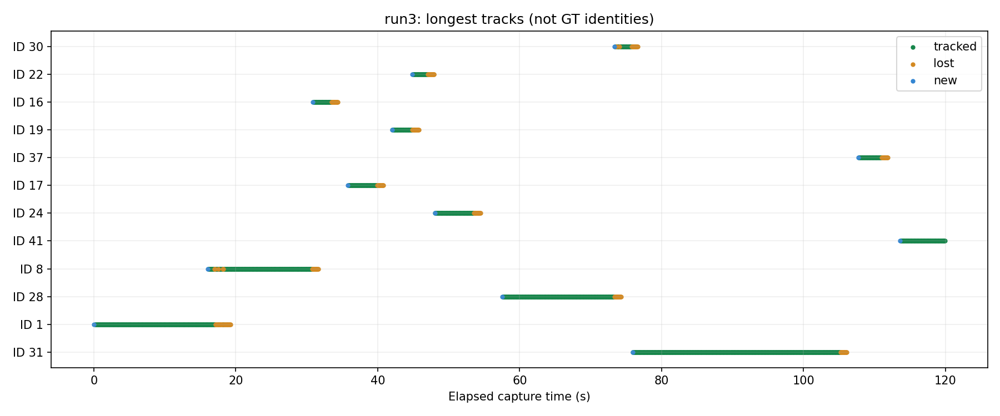
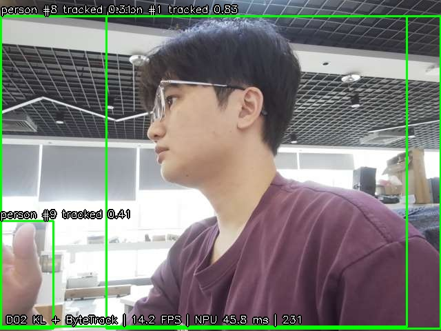
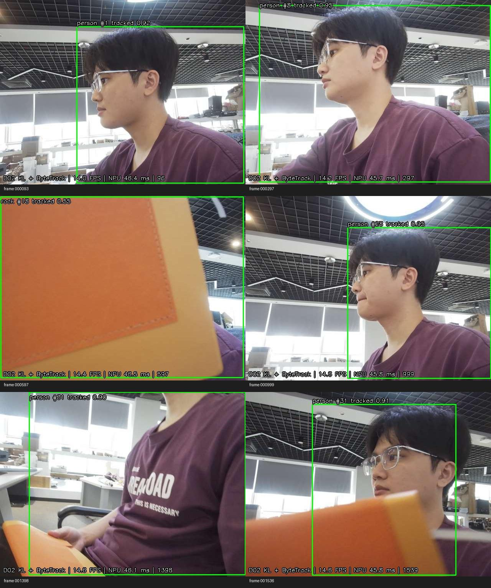

# STORY #34635 障碍物检测 ByteTrack 接入与跟踪状态验证

验证日期：2026-11-04。平台：独立 AM970，192.168.8.11。模型：已选定的 D02 KL 混合量化八类模型。

## 1. 当前结论

**已完成 C++ ByteTrack 接入、板端运行、轨迹状态检查、三段实时摄像头记录及确定性回放验证。当前属于接入与初步实测交付，尚不能判定全部现场跟踪场景验收通过。**

- 三段各约两分钟，合计 **5,266 帧**，均正常结束；板端摄像头测试已停止。
- 使用最终跟踪程序回放三段保存的检测和时间戳，**5,266/5,266 帧的 ID、类别、状态、置信度、坐标和观测时间完全一致**。
- 接入后的程序重新执行原固定 140 张静态测试图，**140/140 张检测结果文件与 D02 KL 原交付结果完全一致**。
- 清晰人员片段中，run3 的 **ID 31 在第 1110–1540 帧连续处于 tracked，共 431 帧、29.168 秒**，没有在这段内断轨。
- 初始参数下，第三段总处理速度 **14.65 FPS**；跟踪平均 **0.121 ms**、P95 **0.156 ms**。跟踪计算不是当前主要耗时。
- 已发现并保留：同一人员多框、多轨；手臂单独被检为人员；遮挡用的橙色物体被检为石头；部分遮挡时类别抖动及重新建轨。

本次没有改变训练、模型权重、公司工程或 ROS2 工程。没有把新增 ID 数量当成 ID Switch，没有计算无身份真值支持的 IDF1/MOTA，也没有宣称所有遮挡后保持原 ID。

## 2. 交付位置与版本

| 内容 | 位置 |
| --- | --- |
| 正式源码、参数和使用说明 | [src/deploy/am970](../../src/deploy/am970/README.md) |
| 板端程序目录 | `/root/d02_bytetrack/` |
| 本报告、测试记录及视频 | 本目录 |
| 最终二进制、编译命令、完整编译日志、配置和源码哈希 | [build](build/) |
| 自动状态检查结果 | [tracker_check.log](tracker_check.log) |
| 检测静态回归结果 | [static_regression.json](static_regression.json)、[运行日志](static_regression.log) |
| 三段实测汇总 | [summary.json](summary.json) |
| 可重复运行的统计脚本 | [analyze_runs.py](scripts/analyze_runs.py) |

模型沿用 `/root/d02_detect_static_20261103/delivery_D02_KL/network_binary.nb`，通过软链接引用，未重新量化或替换。

模型 SHA256：`ac7690b71345ab579ec6da1953ecc6cd8b91230d00a44412e1c81a422f09e916`。

最终 `detectTrack` SHA256：`5e1edb9ba79c8d38c1e75677ca9efbaa73e14adb1ca891927dae22a09813e932`。

ByteTrack 核心来源为官方 FoundationVision/ByteTrack 的 C++ 实现，固定提交 `d1bf0191adff59bc8fcfeaa0b33d3d1642552a99`。完整来源、MIT 许可与本地修改记录见 [PROVENANCE.md](../../src/deploy/am970/third_party/bytetrack/PROVENANCE.md)。本地适配包括阈值配置、按真实时间失效、类别隔离、状态输出、限制已移除轨迹历史，以及错误退出处理。

run1 使用首次集成二进制，随后仅修改 LAPJV 适配层的缓冲区管理与错误传播。最终版本重跑全部状态检查，并精确复现 run1 的全部 1,755 帧；run2、run3 直接使用最终二进制。各段保留对应可执行文件及哈希记录。编译成功，第三方代码/Eigen 的编译告警保留在日志中，未宣称无告警。

## 3. 检测和跟踪参数

| 项目 | 当前值及含义 |
| --- | --- |
| 类别 ID | 0 人、1 猫、2 狗、3 飞盘、4 运动球、5 玩具熊、6 软管、7 石头 |
| 摄像头输入 | MJPEG 640×480，申请采集 30 FPS；每次读取最新帧 |
| NPU 输入 | BGR UINT8，letterbox 640×640，补边 114，归一化由模型内预处理完成 |
| NMS | 按类别，IoU 0.7，最多 300 框，恢复原图坐标后跟踪 |
| 跟踪低分阈值 | 0.10，保留低分框参与第二阶段续接 |
| 高分阈值 | 0.25 |
| 新建轨迹阈值 | 0.35 |
| 第一阶段匹配代价上限 | 0.80，代价是 1−IoU，不是要求 IoU≥0.8 |
| 第二阶段 / 未确认轨迹匹配 | 沿用官方 C++ 代价上限 0.50 / 0.70 |
| 丢失保留 | 1000 ms，按实际单调时间；在关联前剔除超时轨迹 |
| 类别关联 | 八类别分别匹配，单进程全局唯一 ID；重启重新计数 |
| 新轨迹确认 | 首帧先 new，后续高分匹配后 tracked；低分检测不能创建或确认轨迹 |

参数归档在 [tracker.conf](build/tracker.conf)。此 C++ 版本采用 IoU 关联，不做检测分数融合，不能直接视为其他 ByteTrack 包默认参数的等价实现。

## 4. 输出状态与时间约定

输出 `class_id`、`track_id`、`state`、`confidence`、`observed`、`xyxy` 和 `last_observed_monotonic_ms`，同时保留图像采集时间戳、时钟类型、序号和帧号。

- **new**：新出现、尚未确认；不能与已确认轨迹等同。
- **tracked**：当前帧关联到了观测，包含低分续接。
- **lost**：当前帧没有观测，`observed=false`、`confidence=null`，框是预测值。
- **removed**：超时、未确认失配、重复轨迹剔除或流结束，输出一次后移除。

正常停止和异常退出会输出停止/错误状态；本次三段均有正常停止记录。强制 SIGKILL 或掉电无法写结束事件，下游仍须按帧号和时间检查断流。

原始检测框与跟踪滤波框分开记录。检测框已裁剪到图像内；Kalman 框可能越过边界，绘制时裁剪，下游使用时也应裁剪。不能把 lost 框用于宣称本帧检到了障碍物。

本次设备使用单调采集时间。Kalman 仍按每次推理帧一步预测，未加入变步长运动模型、外观 ReID 或相机运动补偿。尚未定义/发布 ROS2 消息；原始时间戳保留不等于 ROS2 接入验收完成。

## 5. 自动检查和可重复性

真实 C++ 跟踪核心在板端完成 **15 项检查**：低分不能建轨、两次高分确认、低分续接、空帧进入 lost、短遮挡恢复、不同类别不共用 ID、低分不能确认、真实时间超时、removed 只输出一次、长遮挡新 ID、长断流关联前失效、结束移除、同类输入顺序改变仍正确关联，以及长期空序列不留存轨迹。

此外，三段真实检测序列回放逐帧相同；这是确定性验证，不是跟踪精度得分。各段 `replay_verification.txt`、`replay_tracks.jsonl` 可与 `tracks.jsonl` 核对。

原 140 张静态图重跑结果完全一致，说明固定样本上的检测解码和输出未因接入发生变化。该结果不表示模型误检问题消失，也不扩大既有静态评估的适用范围。

## 6. 板端性能

| 指标 | run1：移动机位/桌面探索 | run2：桌面为主、末尾人员 | run3：人员及遮挡 |
| --- | ---: | ---: | ---: |
| 总帧数 | 1755 | 1752 | 1759 |
| 总时长（秒） | 120.030 | 120.041 | 120.033 |
| 总处理 FPS | 14.62 | 14.60 | 14.65 |
| NPU 平均（ms） | 45.687 | 45.719 | 45.726 |
| NPU P50 / P95（ms） | 45.631 / 46.149 | 45.676 / 46.129 | 45.683 / 46.213 |
| 跟踪平均（ms） | 0.117 | 0.044 | 0.121 |
| 跟踪 P50 / P95（ms） | 0.125 / 0.231 | 0.031 / 0.129 | 0.127 / 0.156 |
| 跟踪最大（ms） | 0.339 | 0.293 | 0.335 |

NPU 时间包含输入处理、推理、输出处理及结果拷贝；跟踪时间为分类别关联与状态整理。总 FPS 采用总帧数/完整运行时间，包含取帧、预处理、检测、跟踪、预览和记录。前 30 秒额外保存图片，不能用该 FPS 与另一次不同负载、不同画面直接做严格性能差分。预览约每三帧刷新，不等于实际跟踪帧率。

抽查进程 RSS：run1 约 15,212→13,128 KiB，run3 约 15,164→13,052 KiB，短时未见持续增长迹象；这不是长稳测试结论。原始图像及日志写入 `/dev/shm`，未持续向板端有限闪存写视频。

## 7. 实测轨迹与失败样本

| 统计（不等于身份精度） | run1 | run2 | run3 |
| --- | ---: | ---: | ---: |
| 新分配 ID 总数 | 97 | 31 | 42 |
| 至少一次进入 tracked 的 ID | 54 | 13 | 22 |
| 从未确认的 ID | 43 | 18 | 20 |
| 低于 0.25 的观测续接次数 | 130 | 4 | 25 |
| lost→tracked 状态转换次数 | 45 | 2 | 12 |
| 最长连续 tracked 帧数 | 118 | 58 | 431 |

上述次数来自状态日志。**97/31/42 不是 ID 切换次数，45/2/12 也不是已人工确认正确的遮挡重关联次数。** 同类多框、画面中的屏幕图像、类别抖动和真实进出都会影响它们。

### 正常可见时的连续性

run3 的 ID 31 在第 1110–1540 帧连续保持约 29.2 秒，片段中包含上半身、局部出画和姿态变化。随后第 1541 帧进入 lost，第 1555 帧移除，日志完整记录了状态转换。

### 一人多框会形成多轨迹

run3 第 231 帧，同一人员存在两个重叠 person 检测，手部还出现一个 person 小框，分别形成 ID 1、8、9。对应当前 NMS 0.7 及检测本身的框行为，不能通过隐藏 ID 把问题算作解决。

需要用固定片段比较更严格的同类 NMS/重复框处理，并加入两人重叠场景，防止为去重误删真实第二个人。本轮未未经评估就全局提高阈值，也未改变已交付检测参数。

### 遮挡物误检与类别抖动

第三段橙色遮挡物曾被识别为 rock；部分遮挡时还出现 cat 检测。类别隔离使它们不会直接继承 person 的 ID，但不能纠正检测分类。较长全遮挡或框形状变化较大时会新建人员 ID，符合当前纯运动/IoU 关联的限制。

第一段还有相机较大转动、近距离手臂及显示器递归预览画面，因此作为复杂问题样本保留，不拿来代替固定机位、多目标交叉的标准评估。

### 可查看的录像与原始数据

- [run1 预览采样录像](run1/preview_sample.mp4)：移动机位、屏幕干扰及局部人体。
- [run2 预览采样录像](run2/preview_sample.mp4)：桌面为主，末尾出现人员。
- [run3 预览采样录像](run3/preview_sample.mp4)：人员及遮挡主验证片段。
- 每段 `frames/`：前 30 秒每三帧的原图和跟踪图；这些图以程序帧号对应。
- 每段 `detections.txt`、`tracks.jsonl`：全程实际推理帧的检测、时间与状态。
- 每段 `track_statistics.csv`：各 ID 的逐帧状态统计；流结束时的移除事件另见 JSONL 最后一行。

MP4 由客户端采样到的预览图按时间重建为 5 FPS，存在开始前缺帧与采样间隔，不是 30 FPS 原始视频。客户端分别读取图片和 JSON，不保证两者事务同步；图片内印出的帧号才是画面帧号。不能用预览采样代替全部推理帧的精确状态统计。

## 8. 验收状态与后续

| 验收项 | 本次结果 |
| --- | --- |
| 连续检测接入并输出有效 ID | 已完成，板端三段实测及逐帧记录 |
| 正常连续可见时 ID 连续 | 有约 29.2 秒人员片段支持；多目标及室外场景尚未充分验证 |
| 新增、确认、丢失、移除规则 | 自动检查通过，真实序列有状态记录 |
| 遮挡及重现记录 | 已有人员遮挡记录，明确存在新 ID，不承诺所有遮挡恢复 |
| 阈值配套、参数和结果可追溯 | 已完成配置、源码哈希、日志和回放归档 |
| 单目标、多目标、交叉、进出等完整测试矩阵 | 尚缺受控双人交叉、全部八类代表目标及更完整进出场景 |

建议下一步先完成受控双人交叉/前后遮挡和同一人重复框的复测，再决定 NMS 与关联参数。确认逻辑稳定后接入 ROS2，将 new/lost 与当前有效观测明确区分。室外、运动相机、长时间运行和实车安全验收仍需单独进行。

**可交付代码和初步验证结果；不建议此时把整个 STORY 标成所有场景已通过。**

## 9. 十分钟复测补充：双人交换位置后身份互换

用户现场确认：两名人员最初分别对应 ID 376、382，交换位置后，两个编号对应的人员也交换。此项记录为**用户确认的身份关联失败（ID 互换）**，不能因轨迹编号仍存在而认定跟踪正确。

该段运行 600.026 秒、8743 帧、14.57 FPS，正常自动结束。全程检测与轨迹记录已保存至 [复测目录](d02_bytetrack_recheck_20261104_110821/)，相关轨迹提取见 [ids_376_382.json](d02_bytetrack_recheck_20261104_110821/ids_376_382.json)。ID 376 始于第 6956 帧，ID 382 始于第 8179 帧，两者都持续到运行结束；期间均出现短暂 lost 后重新关联。

这说明本例不能归结为“超过一秒导致旧 ID 被删除”。结合现有仅使用运动预测和 IoU 的实现，双人交叉时的错误关联是重点排查方向。当前保存的全程数据是检测框和轨迹，而原图仅保存前 30 秒，因此没有交叉发生时的完整原始视频，不能仅凭坐标日志独立确定身份交换的准确帧或将某一次 lost 恢复断定为交换点。

下一步应完整录制双人交叉片段，标明两个人的真实身份，检查交叉前后检测是否合框、漏框、框突变，以及关联选择。延长轨迹保留只能影响删除时机，不能解决身份区分；若交叉时仍需保持身份，应评估引入外观特征关联及其板端计算开销。当前参数下，双人交叉身份连续性未通过，原有单人连续片段不能替代此项验收。
