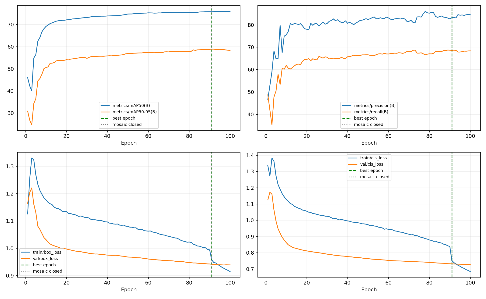
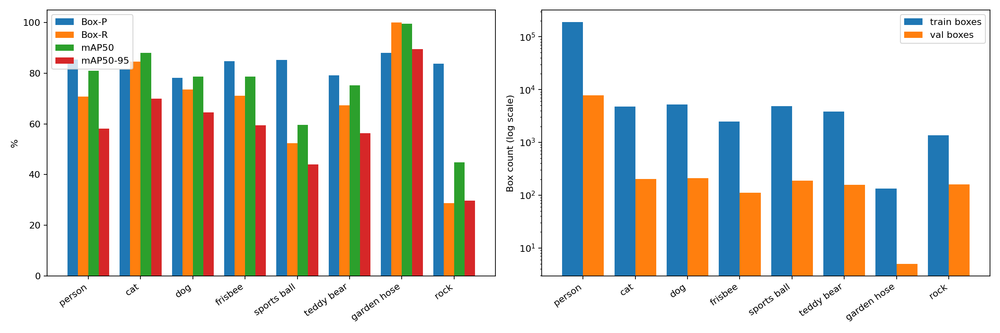

# STORY #25038 割草机器人 RGB 障碍物数据集构建交付报告

任务名称：割草机器人 RGB 障碍物数据采集、标注与数据集构建。  
父任务：#23580 割草机器人-RGB障碍物检测与ByteTrack目标跟踪开发。  
负责人：宋冬笋。交付日期：2026-10-28。  
关联训练任务：#25040 YOLOv8n割草机障碍物检测模型训练与评估。

## 1. 交付结论与本次范围

**按本次确认的交付范围，第一版八类障碍物数据集构建已完成，可作为 STORY #25038 的阶段交付成果。** 已交付图片、YOLO 检测标签、train/val/test 目录、数据集 YAML、类别分布、来源追溯和清洗/同步记录，并已被服务器上的检测训练成功加载。

本次以已整理的公开数据、园艺障碍物数据、岩石补充数据和两批 AI 合成软管数据为依据。按任务负责人本次确认，负样本补充、按采集地点或视频序列重新划分不列入本轮交付验收。本文记录实际已有数据及近期完成工作，不将 AI 合成图表述为项目相机实拍，也不将未开展的工作计入完成项。

交付包含两轮检测基线的衔接记录：D00 原始数据基线已完成并形成分析；D01 新增图片后的基线已启动，最终模型指标和训练时长待补充。D01 最终结果纳入关联训练任务，不阻塞本次数据集交付。

## 2. 当前数据集与目录

| 集合 | 图片数 | 检测框数 | 用途 |
| --- | ---: | ---: | --- |
| train | 66,844 | 214,135 | 八类检测训练 |
| val | 2,938 | 9,099 | 当前数据版本验证，包含本次新增合成样本 |
| test | 38 | 52 | 岩石专项测试，不作为八类综合测试集 |
| 合计 | **69,820** | **223,286** | 图片按实际文件数量统计 |

本地目录：`E:\cpp_project\lawn_mowing_robot_yolov8\mower_obstrast_check\data\yolo_check`。  
服务器目录：`/mnt/sdb-36T/sdsun/lawn_mowing_robot_yolov8/mower_obstrast_check/data/yolo_check`。

```text
yolo_check/
├── data.yaml
├── images/
│   ├── train/
│   ├── val/
│   └── test/
├── labels/
│   ├── train/
│   ├── val/
│   └── test/
└── 各批合并、去重及服务器同步记录.json
```

配置固定为 `nc: 8`；`train: images/train`、`val: images/val`、`test: images/test`。本地与服务器分别使用各自的绝对根目录。每张图片对应同名 TXT，标签格式为 `class_id x_center y_center width height`，坐标归一化。

## 3. 八类分布

| ID | 类别 | 中文 | train 图片 | train 框 | val 图片 | val 框 |
| ---: | --- | --- | ---: | ---: | ---: | ---: |
| 0 | person | 人员 | 58,849 | 189,711 | 2,467 | 7,835 |
| 1 | cat | 猫 | 4,133 | 4,756 | 188 | 206 |
| 2 | dog | 狗 | 4,297 | 5,237 | 180 | 218 |
| 3 | frisbee | 飞盘 | 2,038 | 2,461 | 83 | 111 |
| 4 | sports ball | 运动球类 | 3,604 | 4,863 | 139 | 188 |
| 5 | teddy bear | 玩具熊 | 2,048 | 3,852 | 88 | 158 |
| 6 | garden hose | 软管 | 502 | 514 | 100 | 100 |
| 7 | rock | 石块 | 700 | 2,741 | 61 | 283 |

同图可能同时存在软管、人员、猫、狗或石块，各类别图片数不能直接相加；各类框数可相加。test 38 张、52 个框均为 rock。

原十二类中的人员、猫、狗、飞盘、球、玩具熊编号 0～5 保持不变；原 ID 10 软管映射到 6，原 ID 11 石块映射到 7。已完成八类映射的数据不再次按旧编号处理。

## 4. 数据来源及近期完成工作

### 4.1 原有数据整理与八类收敛

- 使用已有 COCO 子集中的人员、猫、狗、飞盘、运动球类和玩具熊；COCO 类别编号 1、17、18、34、37、88 对应项目 ID 0～5。
- 保留既有园艺软管与 `rocks.v1i.yolov8` 岩石数据。来源及早期处理记录见[前期数据阶段报告](割草机器人障碍物检测数据阶段交付报告_20261015_20261016.md)。
- 将原十二类数据清洗为当前八类，移除仅含取消类别的训练图 460 张、验证图 39 张，重编号 333 份标签，保留有效框坐标。
- 八类清洗后形成 D00 数据快照：train 65,956 张 / 212,307 框，val 2,801 张 / 8,863 框。

### 4.2 新增岩石数据及重复处理

来源：`E:\割草机项目\割草机障碍物检测训练数据\按类别人工审核\岩石_Rock\Obstructions.v1i.yolov8`。

- 首次按来源划分加入 train 508 张 / 1,399 框，val 42 张 / 122 框，test 38 张 / 52 框。
- 源 ID 1 转为当前 rock ID 7；其中 33 行多边形转为轴对齐外接矩形检测框。
- 内容哈希检查发现 1 组同图跨 train/val：训练集 2 份副本、验证集 1 份副本。将训练集 2 张及其标签（共 33 个框）移到本地和服务器备份目录，保留验证图及标签不变。
- 去重后该批实际保留 train 506 张 / 1,366 框，val 42 张 / 122 框，test 38 张 / 52 框，共 586 张。该批已知精确跨集合重复组已清零；集合内部 7 个冗余副本保留。
- 岩石合并、去重及服务器同步均已完成，原来源文件保持不变。

### 4.3 两批 AI 软管数据整理与合并

原始来源：`E:\割草机项目\割草机障碍物检测训练数据\ai生成\软管`，根目录为第一批，`batch_02` 为第二批。独立整理目录为 `软管_两批整合_82_20261028`。

| 来源 | 已导出完整样本 | train | val |
| --- | ---: | ---: | ---: |
| 第一批 | 182 | 146 | 36 |
| 第二批固定快照 | 295 | 236 | 59 |
| 合计 | **477** | **382** | **95** |

- 仅纳入快照时完整的图片和标签，第二批后续生成或未导出的文件不计入本次交付。
- 按每批 seed=42 固定打乱后约 8:2 划分；总比例为 382/95，约 80.08%/19.92%。
- 先建立独立整理目录，再按用户确认合入正式 `yolo_check`，保留原 train/val 划分。
- 源软管 ID 10 在独立整理阶段转为当前 ID 6；合并时直接复制已转换标签，避免二次映射。人员、猫、狗、石块标注全部保留。

| 类别 | 本次 train 新增图片 / 框 | 本次 val 新增图片 / 框 |
| --- | ---: | ---: |
| 人员 | 26 / 26 | 6 / 6 |
| 猫 | 23 / 23 | 4 / 4 |
| 狗 | 19 / 19 | 9 / 9 |
| 软管 | 382 / 382 | 95 / 95 |
| 石块 | 5 / 12 | 0 / 0 |
| 实际集合增量 | **382 / 462** | **95 / 114** |

477 张源图哈希互不重复，与现有 train/val/test 经过文件大小和 SHA256 比对未发现内容完全相同的文件。复制的 954 个图片/标签文件完成哈希核验，原有标签未改、原始来源文件未改。

### 4.4 数据版本变化

| 阶段 | train 图片 / 框 | val 图片 / 框 | test 图片 / 框 |
| --- | ---: | ---: | ---: |
| D00 使用的八类快照 | 65,956 / 212,307 | 2,801 / 8,863 | 未建立本次 test |
| 新增岩石并处理跨集合重复 | 66,462 / 213,673 | 2,843 / 8,985 | 38 / 52 |
| 本次交付：再合入 AI 软管两批 | **66,844 / 214,135** | **2,938 / 9,099** | **38 / 52** |

## 5. 校验、备份与服务器交付

| 检查项 | 已完成结果 |
| --- | --- |
| 图片与标签对应 | 完整文件清单及同名配对核验通过 |
| 类别编号 | 当前使用连续 ID 0～7；软管 6、石块 7；同图其他类别均保留 |
| 标签结构与坐标 | 新增标签完成五列、类别范围、有限数值、正宽高及图像边界检查；软管合并未改变坐标 |
| 重复处理 | 已处理发现的岩石跨集合精确重复；本次软管内部及与原数据的精确重复检查通过 |
| 复制完整性 | 新增图片/标签逐文件 SHA256 核验；原有标签哈希保持一致 |
| 服务器一致性 | 新增软管 954 个文件哈希核验，完整 139,640 个图片/标签文件清单核验，分集合及分类框数一致 |
| 训练加载 | D01 成功扫描 train 66,844、val 2,938，损坏图片为 0，并进入双卡训练 |
| 缓存 | 同步完成时两端 `.cache` 数为 0；D01 启动后已正常重新生成 train.cache 和 val.cache |
| 可追溯与恢复 | 合并、同步、去重清单及原配置/标签哈希备份已保留 |

上述为实际已执行的格式、精确重复和工程加载检查；不将它表述为全量近重复或所有图像语义错漏标均已消除。原始元数据中人工审核状态仍按来源记录保留。

## 6. 原始数据基线 D00：已完成

实验名：`D00_ultralytics_default`。采用 YOLOv8n 预训练权重、八类检测头，训练 100 轮，最佳第 91 轮。GPU 3 单卡、batch=16、imgsz=640、scale=0.5、mosaic=1.0、close_mosaic=10、AMP=True、seed=0；optimizer=auto 实际为 MuSGD(lr=0.01, momentum=0.9)。总训练时长约 **10 小时 36 分 40 秒**，到达最佳轮累计约 **9 小时 44 分 43 秒**。

本仓库启用了按类别名迁移检测头参数，日志确认映射 6/8 类；这里的“基线”指本项目默认超参数基线，不表示未经修改的上游原版。其训练数据不包含本次新增岩石和 AI 软管图片。

下表为同一 `best.pt` 在原 2,801 张验证图、640 输入下的本地 FP32 复评结果。AP 计算使用 conf=0.001、NMS IoU=0.7，P/R 使用评估器选择的工作点（本次约 0.2763），不是固定 conf=0.25 的诊断统计。训练 CSV 最佳轮 AP50-95 为 58.879%，与本地复评 58.958% 的口径分开记录。

| 类别 | 验证图片 | GT 框 | Precision (%) | Recall (%) | AP50 (%) | AP50-95 (%) |
| --- | ---: | ---: | ---: | ---: | ---: | ---: |
| 人员 | 2,461 | 7,829 | 85.48 | 70.86 | 80.99 | 58.09 |
| 猫 | 184 | 202 | 81.43 | 84.67 | 88.14 | 69.95 |
| 狗 | 171 | 209 | 78.13 | 73.68 | 78.68 | 64.56 |
| 飞盘 | 83 | 111 | 84.79 | 71.17 | 78.76 | 59.51 |
| 运动球类 | 139 | 188 | 85.29 | 52.43 | 59.71 | 44.01 |
| 玩具熊 | 88 | 158 | 79.15 | 67.28 | 75.25 | 56.34 |
| 软管 | 5 | 5 | 88.01 | 100.00 | 99.50 | 89.50 |
| 石块 | 19 | 161 | 83.75 | 28.81 | 44.79 | 29.71 |
| **整体** | **2,801** | **8,863** | **83.25** | **68.61** | **75.73** | **58.96** |





### 已暴露的问题及本轮扩充依据

人员、猫、狗等 COCO 类已有较多训练样本；软管与石块的原验证支撑较少，不能只看整体 mAP。D00 固定 conf=0.25、同类 IoU≥0.5 时，人员小目标 Recall=35.34%，球=49.32%，石块=1.12%。小目标统一按原框缩放到长边 640 后面积小于 32² 定义，不是官方 COCO APs。

同权重改为 960 推理后，上述三类小目标 Recall 分别为 47.44%、56.08%、5.62%，但整体 AP50-95 从 58.96% 降至 44.66%，因此未直接采用 960 作为优化方案。原软管验证仅 5 张 / 5 框，本轮扩充后为 100 张 / 100 框；石块验证由 19 张 / 161 框增至 61 张 / 283 框。

当前决策是先用扩充后数据建立新的 640 基线，再在固定的新数据版本上评估注意力机制。此次扩充是否提升精度，以 D01 完成后的同口径复评为准。

## 7. 新增图片后基线 D01：训练中，最终结果待补充

实验名：`D01_data_expanded_baseline_2gpu`。截至 **2026-10-28 14:24:52（服务器 +08:00）**，已完成 2 轮，正在第 3/100 轮训练；启动与运行检查未发现 Traceback、CUDA OOM 或 DDP 子进程退出报错。这是时间点快照，不代表训练已完成。

| 项目 | D00 原始数据基线 | D01 扩充数据基线 |
| --- | --- | --- |
| 模型 | YOLOv8n，无新增注意力模块 | YOLOv8n，无新增注意力模块 |
| 初始化 | 原始 yolov8n.pt | 原始 yolov8n.pt，非接着 D00 继续训练 |
| 数据 | train 65,956 / val 2,801 | train 66,844 / val 2,938 |
| GPU | 3 单卡 | 2、3 双卡 DDP |
| 总 batch | 16 | 32，每卡 16 |
| epochs / patience | 100 / 100 | 100 / 100 |
| imgsz / scale / mosaic | 640 / 0.5 / 1.0 | 640 / 0.5 / 1.0 |
| close_mosaic / seed / AMP | 10 / 0 / True | 10 / 0 / True |
| optimizer 实际选择 | MuSGD，lr=0.01，momentum=0.9 | MuSGD，lr=0.01，momentum=0.9 |
| 状态 | 100 轮完成，最佳第 91 轮 | 训练中 |
| 最终训练时长 / 最佳轮次 | 约 10h36m40s / 91 | **待补充 / 待补充** |

本轮同时变化了数据、总 batch 和 GPU 数量，因此属于“新增数据后的工程基线”，不是严格只改变数据的单因素实验。将来注意力机制实验应固定 D01 数据、batch 及其他训练设置。

服务器结果目录：`/mnt/sdb-36T/sdsun/lawn_mowing_robot_yolov8/mower_obstrast_check/runs/detect/D01_data_expanded_baseline_2gpu`。  
服务器日志：`mower_obstrast_check/logs/D01_data_expanded_baseline_2gpu.log`。

### D01 最终逐类指标（待训练结束后补充）

| 类别 | Precision (%) | Recall (%) | AP50 (%) | AP50-95 (%) |
| --- | --- | --- | --- | --- |
| 人员 | 待补充 | 待补充 | 待补充 | 待补充 |
| 猫 | 待补充 | 待补充 | 待补充 | 待补充 |
| 狗 | 待补充 | 待补充 | 待补充 | 待补充 |
| 飞盘 | 待补充 | 待补充 | 待补充 | 待补充 |
| 运动球类 | 待补充 | 待补充 | 待补充 | 待补充 |
| 玩具熊 | 待补充 | 待补充 | 待补充 | 待补充 |
| 软管 | 待补充 | 待补充 | 待补充 | 待补充 |
| 石块 | 待补充 | 待补充 | 待补充 | 待补充 |
| 整体 | 待补充 | 待补充 | 待补充 | 待补充 |

完成后补充：实际完成轮数、最佳轮次、总训练时长、平均每轮耗时、最终权重与哈希、训练曲线、逐类指标、失败样例及相对 D00 的结论。

对比应区分两组口径：一是冻结的原 2,801 张验证图，用于与 D00 对比；二是当前 2,938 张完整验证图，用于描述新版本总体表现，并单列新增岩石和合成软管样本。不能直接用两个不同验证集的总体 mAP 差值证明模型提升。原固定验证集未因这次扩充而从数据中移除。

## 8. 交付文件与依据

| 交付项 | 位置 |
| --- | --- |
| 正式数据与 YAML | [yolo_check](../../data/yolo_check/)、[data.yaml](../../data/yolo_check/data.yaml) |
| 八类标签规范和分布 | [障碍物检测八类训练规范](障碍物检测八类训练规范_20261027.md) |
| 岩石合并明细 | [merge_obstructions_rock_20261028_report.json](../../data/yolo_check/merge_obstructions_rock_20261028_report.json) |
| 岩石去重及备份依据 | [dedup_rock_20261028_report.json](../../data/yolo_check/dedup_rock_20261028_report.json) |
| AI 软管合并与每文件哈希 | [merge_ai_hose_20261028_report.json](../../data/yolo_check/merge_ai_hose_20261028_report.json) |
| 最新服务器同步核验 | [sync_ai_hose_20261028_report.json](../../data/yolo_check/sync_ai_hose_20261028_report.json) |
| 备份目录 | [yolo_check_backups](../../data/yolo_check_backups/) |
| 统一训练日志 | [训练日志](../../runs/训练日志.md) |
| D00 配置与权重 | [args.yaml](../../runs/D00_ultralytics_default/args.yaml)、[best.pt](../../runs/D00_ultralytics_default/weights/best.pt) |
| D00 逐类复评原始指标 | [metrics.json](../../runs/D00_ultralytics_default/analysis_20261028/metrics.json) |
| D00 训练时长及最佳轮依据 | [training_analysis.json](../../runs/D00_ultralytics_default/analysis_20261028/training_analysis.json) |
| D00 小目标专项评估 | [640/960 评估报告](../../runs/D00_ultralytics_default/small_object_640_vs_960_20261028/评估结论.md) |
| D01 启动及当前状态快照 | [startup_status_20261028.json](../../runs/D01_data_expanded_baseline_2gpu/startup_status_20261028.json) |

数据、权重及运行产物按仓库规则独立保存，不随普通 Git 文档提交自动传输；本报告中的相对链接面向完整本地工作目录。

## 9. 可粘贴到任务系统的交付说明

已完成第一版八类 RGB 障碍物数据集构建，包含人员、猫、狗、飞盘、运动球、玩具熊、软管和石块。完成原十二类数据筛选及八类编号统一、岩石补充与已知跨集合重复清理、两批 AI 软管 477 张整合和 8:2 划分、同图多类标签保留、YOLO 格式检查、类别统计及服务器同步。当前 train 66,844 张 / 214,135 框，val 2,938 张 / 9,099 框，另保留岩石专项 test 38 张 / 52 框；数据 YAML、来源清单、哈希核验及恢复备份齐全。

D00 原始数据基线已训练完成，最佳权重在原验证集本地复评 AP50=75.73%、AP50-95=58.96%，训练约 10 小时 36 分 40 秒。新增数据基线 D01 已成功启动 GPU 2、3 双卡训练，总 batch=32、计划 100 轮，不加注意力机制；最终指标、训练时长和对比分析待训练完成后补充。按本轮确认范围，数据集构建交付完成，后续基线评估与注意力机制实验归入模型训练优化任务。
