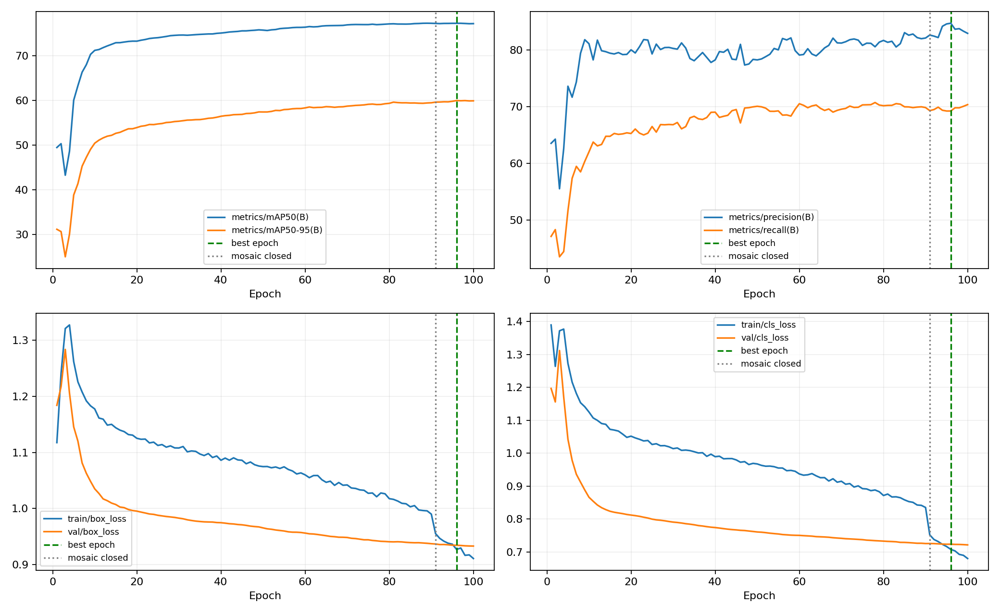
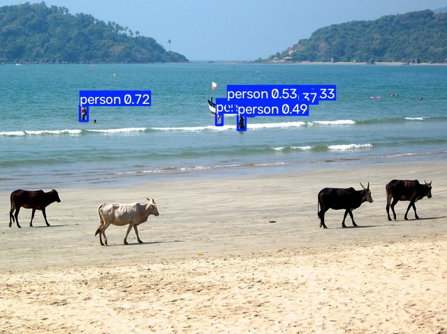
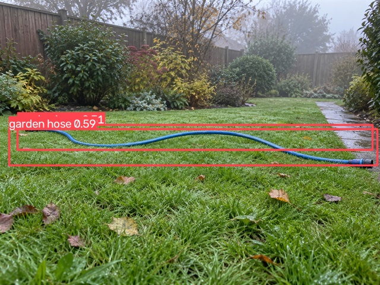
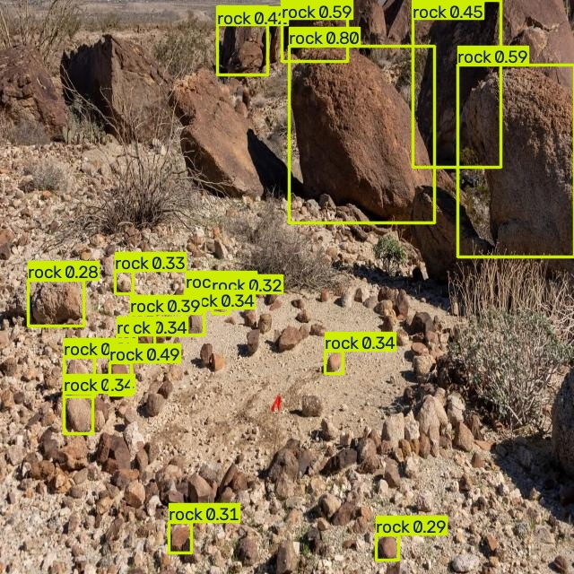

# STORY #34624：YOLOv8n 障碍物检测基线训练与配置归档交付报告

交付日期：2026-10-29  
父任务：#25040 YOLOv8n 割草机障碍物检测模型训练与评估  
负责人：宋冬笋  
交付实验：`D01_data_expanded_baseline_2gpu`  
交付结论：**基线训练、产物归档和基础推理检查完成，可按本任务范围验收。**

## 1. 任务范围与结论

本次交付采用新增岩石及 AI 软管数据后的 D01 八类检测基线。训练于 2026-10-28 完成 100 轮，日志耗时 7.059 小时（约 7 小时 3 分 32 秒），最佳权重对应第 96 轮。2026-10-29 完成本地产物核验与交付整理。

D01 为 YOLOv8n 无注意力模型。D00 为较早数据版本的历史对照；D02 为后续注意力优化实验，不属于本任务基线交付，也不是本任务验收的前置条件。本报告不判定模型已达到现场业务指标，不将分割模型结果混入检测任务。

## 2. 数据集及类别核对

| ID | 英文类别 | 中文 |
| --- | --- | --- |
| 0 | person | 人员 |
| 1 | cat | 猫 |
| 2 | dog | 狗 |
| 3 | frisbee | 飞盘 |
| 4 | sports ball | 运动球类 |
| 5 | teddy bear | 玩具熊 |
| 6 | garden hose | 软管 |
| 7 | rock | 石块 |

| 划分 | 图片数 | 标注框数 | 本轮用途 |
| --- | ---: | ---: | --- |
| train | 66,844 | 214,135 | 模型训练 |
| val | 2,938 | 9,099 | 每轮验证及最佳模型选择 |
| test | 38 | 52 | 独立岩石专项数据，未用于本轮验证 |

服务器配置：`/mnt/sdb-36T/sdsun/lawn_mowing_robot_yolov8/mower_obstrast_check/data/yolo_check/data.yaml`。划分路径为 `images/train`、`images/val`、`images/test`，对应 `labels` 子目录，类别 ID 连续为 0～7。

数据版本以“20261028 岩石重复处理后 + 两批 AI 软管 477 张合并版”标识。数据不是 Git 跟踪文件，追溯依据为合并、去重、同步清单及哈希，不能以代码提交号替代数据版本。

- [八类数据规范](../标签与数据规范/障碍物检测八类训练规范_20261027.md)
- [岩石跨集合重复处理记录](../../data/yolo_check/dedup_rock_20261028_report.json)
- [软管合并清单](../../data/yolo_check/merge_ai_hose_20261028_report.json)
- [软管服务器同步记录](../../data/yolo_check/sync_ai_hose_20261028_report.json)
- [验证集一致性核验](STORY34624_附件_20261029/data_verification.json)：2,938 张图片及对应标签，共 5,876 个文件，本地与服务器 SHA256 全部一致。

上述一致性检查为交付时核验，不等同于训练全程的数据快照。本轮日志扫描显示训练与验证数据均无损坏样本。

## 3. 模型、实际配置及运行环境

| 项目 | 本轮记录 |
| --- | --- |
| 模型 | YOLOv8n，未加注意力 |
| 初始化 | 原始 yolov8n.pt；非 D00 续训 |
| 检测头迁移 | cls_remap=True，按类别名称迁移 6/8 类 |
| GPU | 2、3，两张 NVIDIA RTX A6000，DDP |
| batch / workers | 总 batch 32、每卡 16；workers 8/进程 |
| epochs / patience | 100 / 100 |
| imgsz / seed | 640 / 0 |
| AMP / cache | True / False |
| scale / mosaic / close_mosaic | 0.5 / 1.0 / 10 |
| optimizer | 配置 auto；实际 MuSGD(lr=0.01, momentum=0.9) |
| 服务器环境 | Python 3.10.21；PyTorch 2.6.0+cu124；Ultralytics 8.4.128 |
| 代码版本追溯 | dev，baef8f3a4ca980e8fcb22e8988a76979fae00a84 |

完整参数见 [原始 args.yaml](STORY34624_附件_20261029/args.yaml)。auto 会覆盖部分参数：例如原始配置 momentum=0.937、warmup_bias_lr=0.1，而实际优化器 momentum=0.9，checkpoint 中 warmup_bias_lr=0.0；实际执行以日志及 [checkpoint 记录](STORY34624_附件_20261029/checkpoint.json) 为依据。

代码版本依据服务器 reflog 时间与训练时间交叉追溯，**未保存训练启动时完整工作区快照，不能证明当时没有未提交代码差异**。当前注意力代码提交 6df8cbe 是后续版本，不应填作 D01 的训练版本。详见 [版本追溯记录](STORY34624_附件_20261029/版本追溯.txt)。

服务器当前预训练 yolov8n.pt SHA256：`f59b3d833e2ff32e194b5bb8e08d211dc7c5bdf144b90d2c8412c47ccfc83b36`。此哈希为交付时补记，不是训练启动时采集。

## 4. 训练完成情况与基础趋势

| 项目 | 结果 |
| --- | --- |
| 完成轮数 | 100/100，正常结束 |
| 最佳轮数 | 96 |
| 日志总耗时 | 7.059 小时，约 7 小时 3 分 32 秒 |
| results.csv 总耗时 | 25,410.4 秒，约 7 小时 3 分 30 秒 |
| 平均每轮 | 254.1 秒，约 4 分 14 秒 |
| 最佳轮 AP50 / AP50-95 | 77.294% / 59.977%，训练 CSV 口径 |
| 最后轮 AP50 / AP50-95 | 77.223% / 59.915%，训练 CSV 口径 |
| 异常结论 | 未因断网、OOM 或 DDP 异常提前结束 |

日志小时数有舍入，与 CSV 累计秒数约差 2 秒；拉取、复评及整理时间不计入训练时长。前 10 轮 AP50-95 从 31.12% 上升到 50.42%，第 50 轮为 57.42%，后续增益逐渐减小。训练、验证损失总体下降，未见后段持续发散；第 91 轮关闭 Mosaic 后训练损失下降，不代表业务效果同步大幅提高。

当前完整验证集上 best.pt 本地 CPU 复评 AP50=77.32%、AP50-95=59.97%。该数值为运行状态和对照依据，不是业务合格判定。分类别详细评估沿用已有分析，作为父任务后续评估材料，本任务不展开重复验收。

## 5. 权重与训练产物归档

本地目录：`E:/cpp_project/lawn_mowing_robot_yolov8/mower_obstrast_check/runs/D01_data_expanded_baseline_2gpu`。

服务器目录：`/mnt/sdb-36T/sdsun/lawn_mowing_robot_yolov8/mower_obstrast_check/runs/detect/D01_data_expanded_baseline_2gpu`。

| 产物 | 说明与位置 |
| --- | --- |
| best.pt | [最佳权重](../../runs/D01_data_expanded_baseline_2gpu/weights/best.pt)，第 96 轮 |
| last.pt | [最终权重](../../runs/D01_data_expanded_baseline_2gpu/weights/last.pt)，第 100 轮 |
| args.yaml | [完整训练配置](STORY34624_附件_20261029/args.yaml) |
| server_train.log | [完整服务器训练日志](../../runs/D01_data_expanded_baseline_2gpu/server_train.log) |
| results.csv | [逐轮指标与时间](STORY34624_附件_20261029/results.csv) |
| results.png | [原始训练曲线](STORY34624_附件_20261029/results.png) |
| 下载清单 | [文件大小与 SHA256](STORY34624_附件_20261029/download_manifest_20261029.json) |
| 训练日志 | [实验记录](../../runs/训练日志.md) |
| 详细分析 | [D01 与 D00 对比](../../runs/D01_data_expanded_baseline_2gpu/analysis_20261029/D01训练分析与D00对比_20261029.md) |

下载的 25 个文件共 41,601,460 字节，交付整理时再次逐文件校验 SHA256，全部通过。

- best.pt SHA256：`814fd616094d5a01cf2ab55a4106f265f5b335d3ddb6fc424a85e472cf00b170`
- last.pt SHA256：`9521f63702936a5dd8073dcb53fd73a0806984a5d44e4c0a093452bc7c6496be`

best/last 为训练结束后清理过的推理权重，checkpoint 的 epoch=-1、optimizer 被清理并不代表训练未完成；轮数依据 results.csv 和完整日志确定，也不能承诺这些权重可恢复原优化器状态继续训练。

## 6. 基础推理验收

2026-10-29 直接加载本地 best.pt，使用 CPU FP32、imgsz=640、conf=0.25、NMS IoU=0.7、max_det=300，对 3 张验证图片执行独立 predict 检查。检查模型可加载、输出非空、类别在 0～7、置信度在 0～1、坐标为有限数且在图像范围内、框宽高为正。

| 样例 | 输入图片 | 输出框数 | 结构检查 |
| --- | --- | ---: | --- |
| 样例 1 | 000000389451.jpg | 6 | 通过 |
| 样例 2 | ai_garden_hose_b02_000114.png | 2 | 通过 |
| 样例 3 | rocks_DSC5033-e1658535326972_jpg.rf.d8c9490498bfe41099daa0f5dbe5828f.jpg | 18 | 通过 |

首个输出示例：类别 `person`（ID 0），置信度 0.7184，二维框 xyxy（原图像素）为 [114.78, 151.52, 125.73, 173.36]。

完整输出、输入哈希、实际 Python/PyTorch 环境见 [基础推理检查 JSON](STORY34624_附件_20261029/基础推理检查.json)。这是接口与运行完整性检查，不是八类精度验收；预测框存在漏检或重复框仍需后续专项评估。

## 7. 验收对照与交付边界

| 验收项 | 结论 | 依据 |
| --- | --- | --- |
| 训练正常完成或记录跨夜进度 | 通过：已完成 100 轮 | 完整日志、CSV |
| 模型可加载并输出检测结果 | 通过 | 本次 predict 输出及配图 |
| 训练产物完整并可追溯数据与配置 | 完成，追溯限制已披露 | 权重、原始配置、哈希清单、数据同步记录、环境记录；训练时完整代码及数据快照未留存 |
| 不提前判定业务达标 | 满足 | 本报告仅验收基线训练、归档和接口输出 |

下一阶段继续对人员、动物、低矮及小目标做分类别评估，并比较 D02 注意力实验。D02 已调整训练轮数和总 batch，与 D01 比较时须注明配置差异，不能将全部变化归因于注意力。

## 8. 可粘贴至任务系统的完成说明

已完成清洗后八类障碍物数据集的 YOLOv8n 基线训练与归档。D01 使用 66,844 张训练图片、2,938 张验证图片，双卡总 batch32，正常完成 100 轮，耗时约 7 小时 3 分钟，最佳模型为第 96 轮。已归档 best.pt、last.pt、训练配置、完整日志、逐轮指标及曲线，并完成文件哈希校验。已补充数据、代码和环境追溯记录，对未留存训练时完整快照的限制做了说明。基础推理检查通过，模型能够输出类别、置信度及二维框。本任务按基线训练与配置归档范围交付，不代表已达到业务指标；分类别评估及注意力优化在后续任务中继续。
