# STORY #34625：YOLOv8n障碍物检测基线评估与失败样本分析交付报告

交付日期：2026-10-30  
父任务：#25040 YOLOv8n割草机障碍物检测模型训练与评估  
负责人：宋冬笋  
评估对象：D01_data_expanded_baseline_2gpu（无注意力基线）  
交付结论：**固定验证集评估、重点目标统计和失败样本分析已完成，可按本任务范围验收；不代表现场业务指标已达标。**

## 1. 模型、数据版本及评估口径

D01已正常完成100轮，耗时7.059小时，最佳权重对应第96轮。本任务延续#34624的基线归档，使用同一best.pt；D02注意力及正在训练的D03属于后续优化，不替代本报告的基线。

- [best.pt](../../runs/D01_data_expanded_baseline_2gpu/weights/best.pt)，SHA256：`814fd616094d5a01cf2ab55a4106f265f5b335d3ddb6fc424a85e472cf00b170`。
- [原始训练配置](../../runs/D01_data_expanded_baseline_2gpu/args.yaml)：YOLOv8n预训练、GPU2/3、总batch32、imgsz640、100轮、seed0、scale0.5、mosaic1.0、AMP开启；optimizer=auto实际选择MuSGD。
- 数据版本：20261028新增岩石去重及两批AI软管合并版，train=66,844张/214,135框；本次固定val=2,938张/9,099框。原固定2,801张验证集保留作历史对照，不与主表混用。
- [输入文件清单及哈希](STORY34625_附件_20261030/input_manifest.json)、[服务器与本地一致性核验](STORY34625_附件_20261030/data_verification.json)：验证图片与标签共5,876文件一致。该核验不是训练全程数据快照。
- 本地评估环境：Ultralytics8.4.128、PyTorch2.14.0+cpu，CPU FP32。
- AP评估：imgsz=640、batch=32、rect=True、conf=0.001、NMS IoU=0.7、max_det=300。P/R为共同F1最优工作点，D01约conf=0.3203。
- 固定阈值诊断：conf=0.25、NMS IoU=0.7，同类别IoU≥0.5、一对一匹配。TP为命中GT，FP为未匹配预测，FN为未匹配GT。该口径与上面的F1工作点P/R分开报告。

## 2. 八类最终指标及样本支持量

| ID/类别 | 训练图片/框 | 验证图片/GT | P% | R% | AP50% | AP50-95% |
| --- | --- | --- | --- | --- | --- | --- |
| 0 人员 | 58849/189711 | 2467/7835 | 88.95 | 68.55 | 81.13 | 58.27 |
| 1 猫 | 4133/4756 | 188/206 | 83.03 | 86.41 | 89.22 | 71.79 |
| 2 狗 | 4297/5237 | 180/218 | 86.51 | 73.39 | 80.72 | 66.64 |
| 3 飞盘 | 2038/2461 | 83/111 | 86.32 | 70.27 | 77.99 | 58.72 |
| 4 运动球 | 3604/4863 | 139/188 | 82.21 | 48.40 | 57.85 | 43.38 |
| 5 玩具熊 | 2048/3852 | 88/158 | 81.87 | 65.82 | 76.80 | 56.66 |
| 6 软管 | 502/514 | 100/100 | 90.19 | 100.00 | 99.21 | 83.61 |
| 7 石块 | 700/2741 | 61/283 | 77.98 | 41.34 | 55.63 | 40.67 |

整体P=84.63%、R=69.27%、AP50=77.32%、AP50-95=59.97%，为评估器的类别平均指标，不是将全部目标框混在一起的微平均。图片可含多个类别，分类别图片数之和不是数据集总图片数。

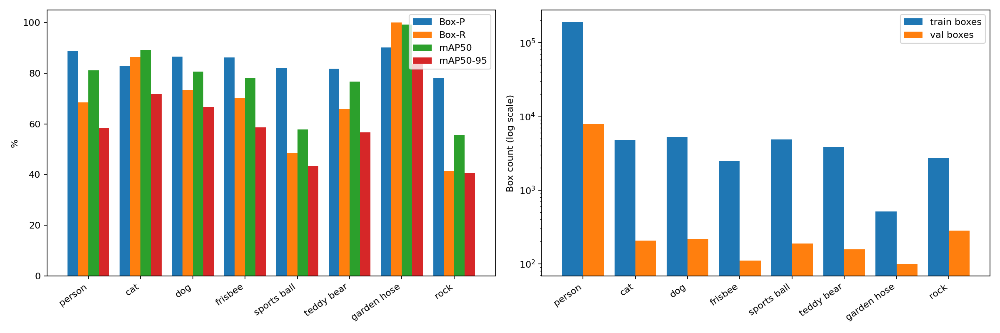

来源以COCO人物、猫狗、飞盘、球、玩具熊等公开图像为主，部分图像不是割草场景；软管验证100张中95张来自新增合成数据，旧软管仅5张。高软管指标不能代替真实现场泛化结论。

## 3. 人员、动物与低矮障碍物相关类别召回

以下均为conf=0.25的固定阈值统计。

| 类别 | GT | TP | FP | FN | Precision% | Recall% |
| --- | --- | --- | --- | --- | --- | --- |
| 人员 | 7835 | 5621 | 1029 | 2214 | 84.53 | 71.74 |
| 猫 | 206 | 179 | 50 | 27 | 78.17 | 86.89 |
| 狗 | 218 | 163 | 39 | 55 | 80.69 | 74.77 |
| 飞盘 | 111 | 79 | 19 | 32 | 80.61 | 71.17 |
| 运动球 | 188 | 96 | 32 | 92 | 75.00 | 51.06 |
| 玩具熊 | 158 | 108 | 31 | 50 | 77.70 | 68.35 |
| 软管 | 100 | 100 | 15 | 0 | 86.96 | 100.00 |
| 石块 | 283 | 127 | 45 | 156 | 73.84 | 44.88 |

| 重点组（按GT框汇总） | GT | TP | FP | FN | Recall% |
| --- | --- | --- | --- | --- | --- |
| 人员 | 7835 | 5621 | 1029 | 2214 | 71.74 |
| 猫狗合计 | 424 | 342 | 89 | 82 | 80.66 |
| 球、软管、石块合计 | 571 | 323 | 92 | 248 | 56.57 |

组合召回按TP之和除以GT之和计算，不是类别召回的简单平均。**“低矮”未提供实际物理高度标注**；本报告仅将球、软管、石块作为低矮障碍物相关类别单列，不能声称其全部实例都位于地面或低于某高度。飞盘、玩具熊仍在逐类别表内独立呈现。

## 4. 小目标统计口径与结果

将原图长边等比缩放到640后，以GT框面积划分：small<32²、medium为32²～96²、large≥96²。下面是该尺寸分组的Recall@conf0.25、IoU0.5；不是COCO APs，也不是目标真实尺寸。细长软管可能因外接框面积大而被归为large。

| 类别 | small GT/TP | small R% | medium GT/TP | medium R% | large GT/TP | large R% |
| --- | --- | --- | --- | --- | --- | --- |
| 人员 | 1893/662 | 34.97 | 2407/1757 | 73.00 | 3535/3202 | 90.58 |
| 猫 | 2/0 | 0.00 | 15/8 | 53.33 | 189/171 | 90.48 |
| 狗 | 7/2 | 28.57 | 40/27 | 67.50 | 171/134 | 78.36 |
| 飞盘 | 42/24 | 57.14 | 53/42 | 79.25 | 16/13 | 81.25 |
| 运动球 | 148/70 | 47.30 | 33/23 | 69.70 | 7/3 | 42.86 |
| 玩具熊 | 8/0 | 0.00 | 31/9 | 29.03 | 119/99 | 83.19 |
| 软管 | 0/0 | 无样本 | 0/0 | 无样本 | 100/100 | 100.00 |
| 石块 | 135/18 | 13.33 | 74/41 | 55.41 | 74/68 | 91.89 |

人员small仅662/1,893命中，球70/148，石块18/135。三者构成主要小目标短板。猫、狗、玩具熊small仅2、7、8个，不能把这些小样本召回率当作稳定泛化估计；软管small为0，不能声称已验证细小软管能力。

原固定2,801张验证集上，D01小石块8/89命中（8.99%）；当前完整集为18/135（13.33%）。这是不同数据组成，不应混为同一数字。固定旧集独立rect分批与完整集也可能产生少量预测差异。

## 5. 失败样本及可追溯证据

附件包含每例原图、GT标签、完整AP预测缓存NPZ、固定0.25阈值预测JSON与左右对照图；JSON记录原始文件名、路径、图片/标签SHA256、类别、置信度、原图像素xyxy及问题类型。所有案例均来自同一D01完整验证缓存，没有用D02结果替换。

| 案例 | 问题类型 | 关注类别TP/FP/FN | 原图文件 |
| --- | --- | --- | --- |
| person_small | 小人员漏检 | 0/0/11 | 000000528578.jpg |
| ball_small | 密集小球漏检 | 0/0/13 | 000000548246.jpg |
| rock_small | 密集石块漏检与FP | 13/6/54 | rocks_DSC5033-e1658535326972_jpg.rf.d8c9490498bfe41099daa0f5dbe5828f.jpg |
| hose_duplicate | 软管重复框 | 1/3/0 | ai_garden_hose_b02_000114.png |
| dog_cat | 类别混淆：狗→猫 | 0/0/1 | 000000309938.jpg |
| frisbee_ball | 类别混淆：飞盘→球 | 0/0/2 | 000000185250.jpg |
| person_box | 框范围不一致/定位失败 | 1/1/1 | 000000482436.jpg |
| rock_fp | 石块统计FP/标注口径 | 23/18/3 | obstructions_rock_istockphoto-1136990430-612x612_jpg.rf.9771193ce74742bbc2cf841ae76b92ad.jpg |

框定位与分类错误按当前GT判断；部分COCO标注的可见区域/遮挡口径与预测不同，不能把所有未匹配框直接判为模型幻觉。候选由缓存筛选后结合原图查看，案例展示不是随机样本，不能由案例数量推断错误发生率。

### 小人员漏检

密集远处人员场景；按GT和固定阈值统计漏检，不能用单张图代表整类。

[原图](STORY34625_附件_20261030/person_small/original.jpg) · [GT标签](STORY34625_附件_20261030/person_small/ground_truth.txt) · [预测及问题记录](STORY34625_附件_20261030/person_small/result.json)

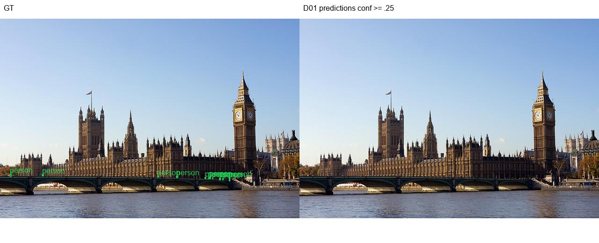

### 密集小球漏检

网球筐内13个小球在该阈值下均未匹配，密集小目标是明确短板。

[原图](STORY34625_附件_20261030/ball_small/original.jpg) · [GT标签](STORY34625_附件_20261030/ball_small/ground_truth.txt) · [预测及问题记录](STORY34625_附件_20261030/ball_small/result.json)

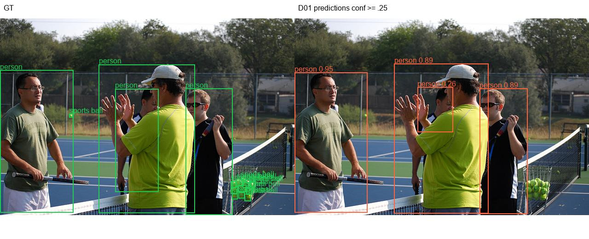

### 密集石块漏检与FP

67个GT的密集岩石图，远处小石块漏检明显。

[原图](STORY34625_附件_20261030/rock_small/original.jpg) · [GT标签](STORY34625_附件_20261030/rock_small/ground_truth.txt) · [预测及问题记录](STORY34625_附件_20261030/rock_small/result.json)

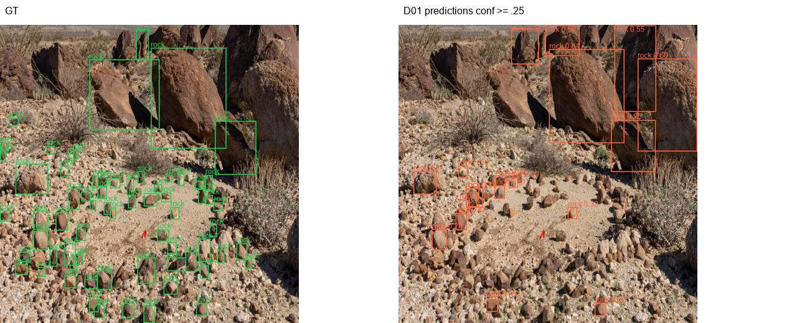

### 软管重复框

一个软管目标出现多个重叠预测框；重复框按一对一规则计为FP。

[原图](STORY34625_附件_20261030/hose_duplicate/original.png) · [GT标签](STORY34625_附件_20261030/hose_duplicate/ground_truth.txt) · [预测及问题记录](STORY34625_附件_20261030/hose_duplicate/result.json)

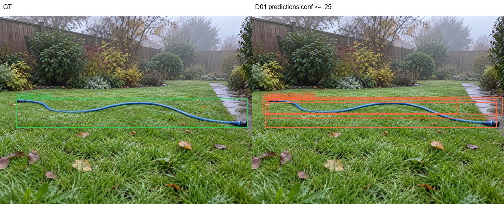

### 类别混淆：狗→猫

图中小型犬被判为猫；对应预测置信度0.8364、与狗GT的IoU约0.965，框位置正确但类别错误。

[原图](STORY34625_附件_20261030/dog_cat/original.jpg) · [GT标签](STORY34625_附件_20261030/dog_cat/ground_truth.txt) · [预测及问题记录](STORY34625_附件_20261030/dog_cat/result.json)

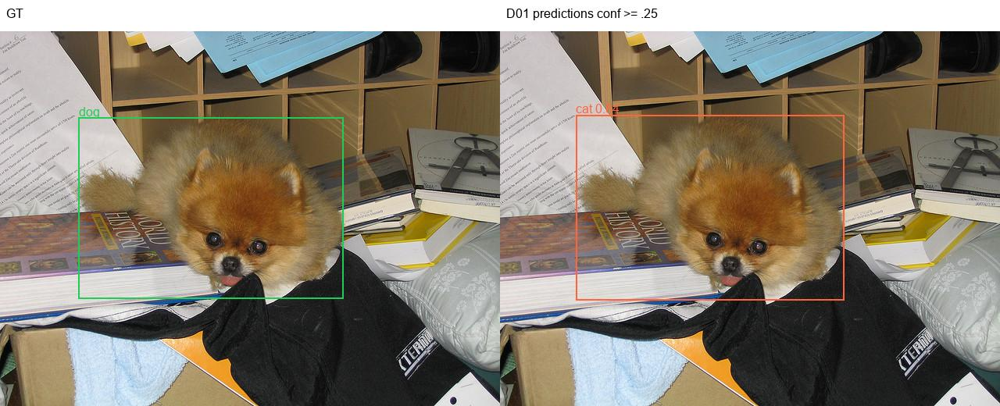

### 类别混淆：飞盘→球

飞盘被判为运动球，置信度0.7253、IoU约0.888；轮廓相似导致的类别混淆样例。

[原图](STORY34625_附件_20261030/frisbee_ball/original.jpg) · [GT标签](STORY34625_附件_20261030/frisbee_ball/ground_truth.txt) · [预测及问题记录](STORY34625_附件_20261030/frisbee_ball/result.json)

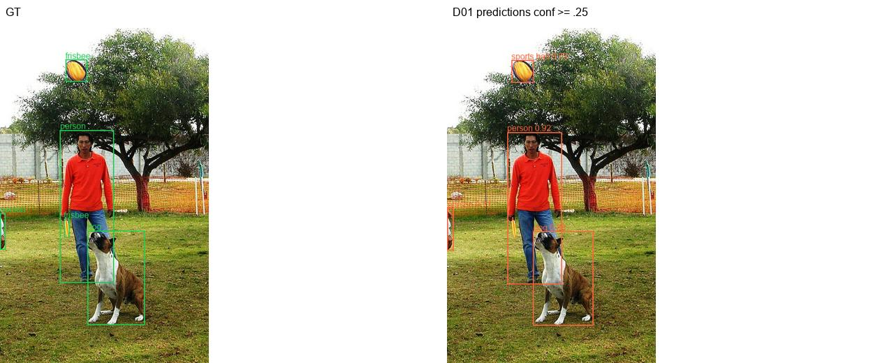

### 框范围不一致/定位失败

柜台后人员的GT主要覆盖上半身，预测延伸至下方反射/遮挡区域；对应置信度0.8746、IoU约0.361。该例说明相对现有标注的定位失败，不据此断言所有框差异都是模型错误。

[原图](STORY34625_附件_20261030/person_box/original.jpg) · [GT标签](STORY34625_附件_20261030/person_box/ground_truth.txt) · [预测及问题记录](STORY34625_附件_20261030/person_box/result.json)

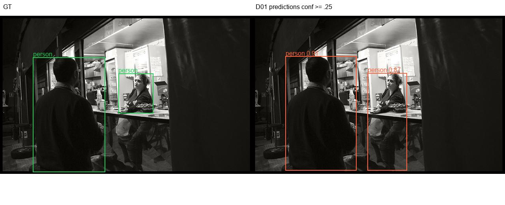

### 石块统计FP/标注口径

碎石近景存在大量未标出的可见小石块；统计FP包含定位不符或未标注实例，不能全部叫作背景幻觉。

[原图](STORY34625_附件_20261030/rock_fp/original.jpg) · [GT标签](STORY34625_附件_20261030/rock_fp/ground_truth.txt) · [预测及问题记录](STORY34625_附件_20261030/rock_fp/result.json)

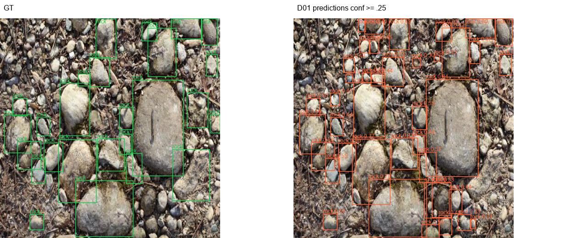

## 6. 误检与定位问题的进一步区分

完整验证集的软管15个FP中，14个与已有同类GT高度重叠（IoU≥0.5，属于重复/竞争匹配），1个为部分重叠；优先检查NMS及重复框抑制，而不是简单补数据。

石块45个FP中，3个高度重叠，6个部分重叠（0.1≤IoU<0.5），36个与已有同类GT的IoU<0.1。这36个不能全部等同于背景误检：有的碎石场景存在未标注的可见石子。详见[重叠诊断](STORY34625_附件_20261030/extra_diagnostics.json)。类别混淆案例中的狗→猫、飞盘→球则有很高的框重叠，是明确的类别判别问题。

## 7. 主要问题与优化优先级

| 优先级 | 问题与依据 | 建议及验证方式 |
| --- | --- | --- |
| P0 | 人员召回71.74%，小人员34.97% | 固定人员阈值曲线及漏检场景回归，分远处小人、遮挡与局部人体；同时约束FP，不仅看总AP |
| P0 | 石块召回44.88%，small13.33%；球small47.30% | 优先比较小目标特征方案与增强配置，每次控制变量；固定旧验证集与新测试集分开报告，检查召回增加是否以更多FP为代价 |
| P1 | 猫狗合计仍有漏检，存在狗猫混淆 | 保留明确混淆及低照度样例，分别统计分类错误、定位不符和完全漏检；猫狗small样本不足须注明 |
| P1 | 软管15个FP主要为重复框 | 不重训先比较NMS阈值，在保留长软管召回的同时降低重复；不能把合成100%召回当作现场通过 |
| P1 | GT框与预测范围不符、碎石图部分标注 | 对已定位的案例做有限人工核对，区分标注口径与模型定位问题；保留原标注版本，避免评估中途静默改标签 |
| P2 | COCO及合成数据与现场分布有差异 | 增加独立场景口径，单列来源及样本量，不使用少量好图代替整体结论 |

本任务不要求现在启动新训练。D02已经有独立对照报告，D03仍在训练；它们不能替代本报告的D01基线数据，也不能把不同训练预算造成的收益全部归因于注意力。

## 8. 新增140张合成测试集：D01 best.pt实测结果

评估日期：2026-10-30。本节使用与前文完全相同的D01基线best.pt（第96轮，无注意力），不是D02或正在训练的D03。权重SHA256与第1节一致。固定测试快照为140张/231框，原90张/100框、混合50张/131框；模型未在本批图片上训练，本次也未按测试结果更改阈值或权重。

已分别运行all140、base90、mixed50的`split=test`验证，输入640、batch32、rect=True、CPU FP32、conf=.001、NMS IoU=.7、max_det300。P/R使用各评估集的共同F1工作点（全量约0.4264），固定部署诊断另用conf=.25；AP与固定阈值召回不能混用。全量140张原图和标签哈希均与登记清单一致。

### 8.1 全量及子集整体结果

| 测试口径 | 图片/GT | P% | R% | AP50% | AP50-95% |
| --- | --- | --- | --- | --- | --- |
| all140 | 140/231 | 87.11 | 77.28 | 86.22 | 81.24 |
| base90 | 90/100 | 86.92 | 76.97 | 86.23 | 81.29 |
| mixed50 | 50/131 | 91.02 | 78.77 | 86.73 | 81.58 |

三组分别独立评估，子集AP不能平均成全量AP；rect分批不同也可能产生少量预测差异。本次全量AP50-95为81.24%，高于旧验证集59.97%，**这不代表模型提升了21个百分点**：两者是不同数据分布、目标尺寸和难度，应分别看待。

### 8.2 八类独立指标与固定阈值表现

| 类别 | 图片/GT | P% | R% | AP50% | AP50-95% | conf.25 TP/FP/FN | conf.25 R% |
| --- | --- | --- | --- | --- | --- | --- | --- |
| 人员 | 35/47 | 95.86 | 98.65 | 99.17 | 96.63 | 47/3/0 | 100.00 |
| 猫 | 26/26 | 98.47 | 96.15 | 99.19 | 95.70 | 25/0/1 | 96.15 |
| 狗 | 26/26 | 93.82 | 92.31 | 97.89 | 94.22 | 24/3/2 | 92.31 |
| 飞盘 | 26/27 | 76.29 | 59.59 | 80.48 | 75.07 | 18/5/9 | 66.67 |
| 运动球 | 26/26 | 99.41 | 38.46 | 80.83 | 75.55 | 11/1/15 | 42.31 |
| 玩具熊 | 26/26 | 91.25 | 100.00 | 99.13 | 97.15 | 26/5/0 | 100.00 |
| 软管 | 26/26 | 51.75 | 92.31 | 68.65 | 54.71 | 25/36/1 | 96.15 |
| 石块 | 26/27 | 90.04 | 40.74 | 64.40 | 60.91 | 11/3/16 | 40.74 |

人员、猫、狗、玩具熊在这批合成样例上较好；飞盘、球、石块仍存在漏检，软管的Precision和AP明显偏低。此前完整验证集中软管AP50-95约83.61%，本测试仅54.71%，说明此前合成样例上的高指标不能代表所有软管场景。这里仍只是合成场景测试，用户标注复核待完成，不替代真实相机测试。

### 8.3 小目标与局部人体

尺寸口径与前文一致，按原图长边缩放至640的GT框面积，small<32²、medium<96²，其余large。

| 类别 | small GT/TP | medium GT/TP | large GT/TP |
| --- | --- | --- | --- |
| 人员 | 0/0 | 5/5 | 42/42 |
| 猫 | 0/0 | 0/0 | 26/25 |
| 狗 | 0/0 | 0/0 | 26/24 |
| 飞盘 | 0/0 | 4/2 | 23/16 |
| 运动球 | 0/0 | 7/4 | 19/7 |
| 玩具熊 | 0/0 | 2/2 | 24/24 |
| 软管 | 0/0 | 0/0 | 26/25 |
| 石块 | 0/0 | 3/0 | 24/11 |

| 原90张中的人员场景（源metadata） | 图片 | 人员GT | 命中 | Recall@.25% |
| --- | --- | --- | --- | --- |
| feet_lower_legs | 5 | 5 | 5 | 100.00 |
| hands_forearms | 5 | 5 | 5 | 100.00 |
| full_body | 5 | 5 | 5 | 100.00 |
| multiple_people | 5 | 14 | 14 | 100.00 |

**本批231个GT中small数量为0，主要为medium/large；不能用本批测试证明小目标短板已解决。**

局部人体分组仅用于描述这批样例；每种场景仅5张，不能据此宣布真实手脚场景已通过。不能用合成测试的高总体指标覆盖原验证集的密集小人员、小球及小石块漏检结论。

### 8.4 测试集逐图预测及代表样例

已保存全部140张GT/预测对照图与预测JSON。完整索引及统计见[测试结果汇总](STORY34625_附件_20261030/test140/summary.json)，所有图片见[预测可视化目录](STORY34625_附件_20261030/test140/visualizations/)，每个预测含类别、置信度、原图像素xyxy与源图哈希，见[逐图JSON](STORY34625_附件_20261030/test140/predictions/)。AP原始低阈值缓存保留在`runs/d01test140_20261030/predictions`，避免只保存最终筛选框而丢失复查依据。

以下按每类优先选漏检最多、其次FP最多的有GT图片；不保证每例都有失败，若TP覆盖全部GT且FP=0则为成功对照。

**人员：test90_c0_009.png**，该类TP/FP/FN=1/2/0。[预测记录](STORY34625_附件_20261030/test140/predictions/test90_c0_009.json)

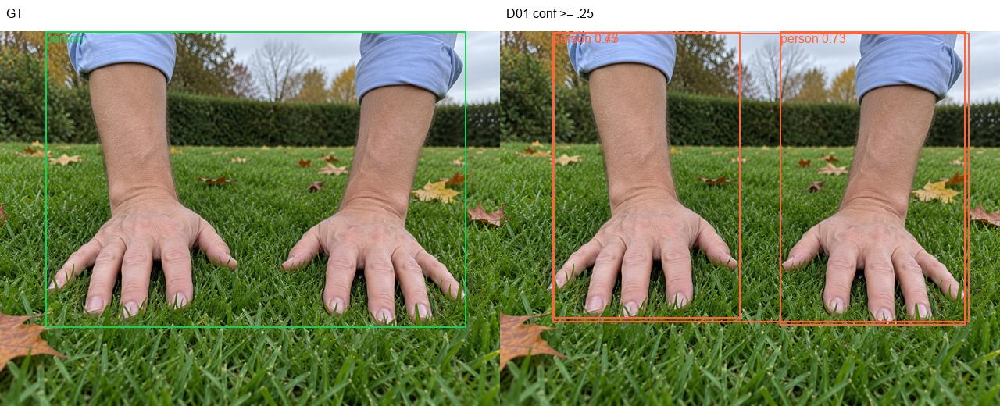

**猫：testmix_030.png**，该类TP/FP/FN=0/0/1。[预测记录](STORY34625_附件_20261030/test140/predictions/testmix_030.json)

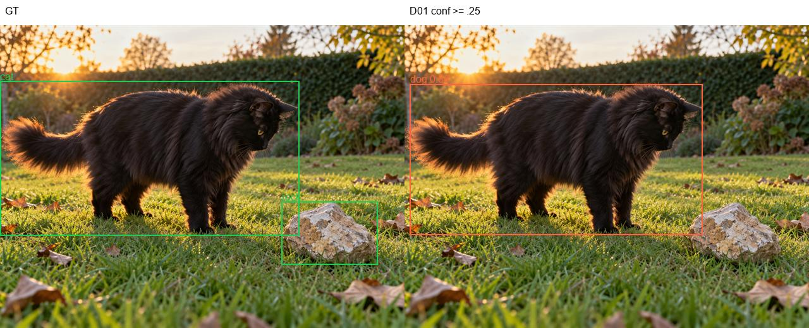

**狗：test90_c2_004.png**，该类TP/FP/FN=0/0/1。[预测记录](STORY34625_附件_20261030/test140/predictions/test90_c2_004.json)

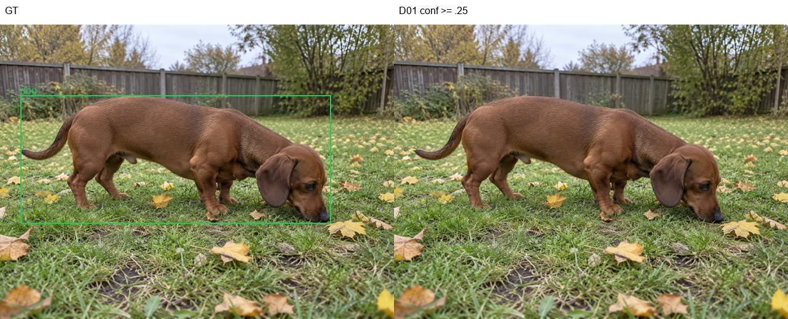

**飞盘：test90_c3_002.png**，该类TP/FP/FN=0/0/1。[预测记录](STORY34625_附件_20261030/test140/predictions/test90_c3_002.json)

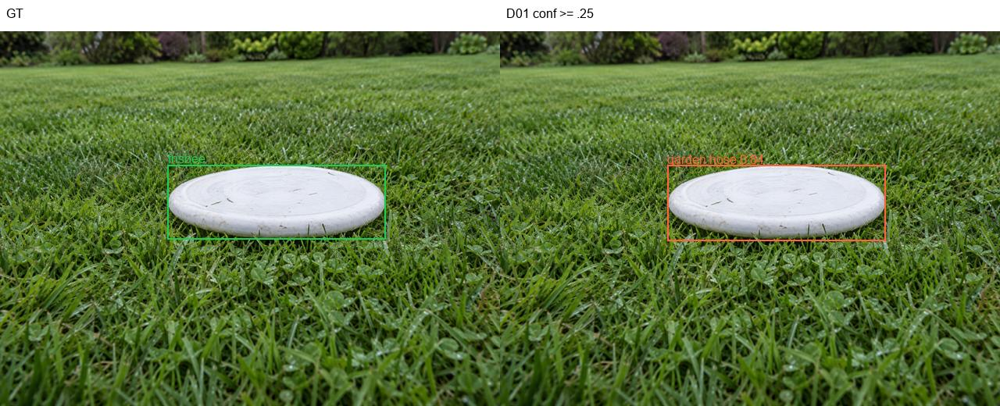

**运动球：test90_c4_001.png**，该类TP/FP/FN=0/0/1。[预测记录](STORY34625_附件_20261030/test140/predictions/test90_c4_001.json)

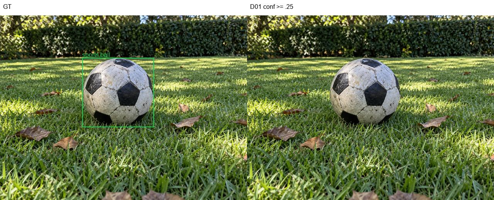

**玩具熊：test90_c5_002.png**，该类TP/FP/FN=1/2/0。[预测记录](STORY34625_附件_20261030/test140/predictions/test90_c5_002.json)

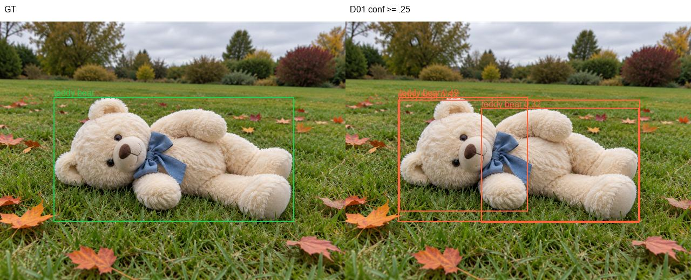

**软管：testmix_015.png**，该类TP/FP/FN=0/0/1。[预测记录](STORY34625_附件_20261030/test140/predictions/testmix_015.json)

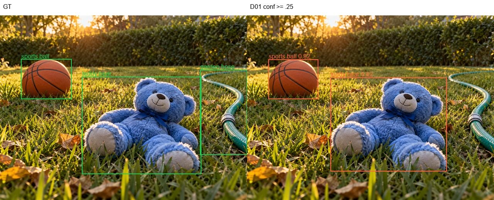

**石块：test90_c7_010.png**，该类TP/FP/FN=1/0/1。[预测记录](STORY34625_附件_20261030/test140/predictions/test90_c7_010.json)

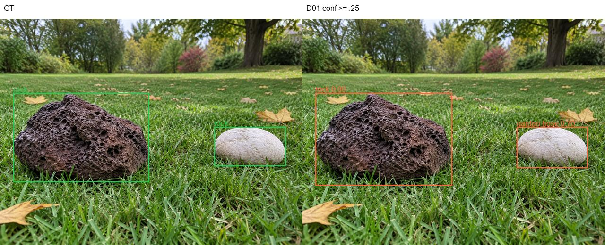

### 测试图片复核发现

- `test90_c4_001.png` 的足球外接框约185×180像素，属于large目标，仍未在conf=.25下输出匹配结果，说明这批测试的问题并不只是“小目标太小”。
- `testmix_015.png` 中篮球与玩具熊可检出，但画面右侧软管漏检，属于同图多类表现不一致。
- `test90_c7_010.png` 的右侧浅色石块被判为软管（约0.70），而左侧深色岩石正确检出，是类别混淆，不是单纯框定位失败。
- 软管36个FP中，仅2个与同类GT高度重叠、2个部分重叠，32个与已有软管GT的IoU<.1。进一步按其他类GT最高IoU≥.5查看，软管FP中20个框覆盖飞盘、6个覆盖球、3个覆盖石块；这是预测框计数，不能当作独立被错分GT数量。本批软管问题以跨类别误判为主，不能套用旧验证集“主要是重复框”的结论。

### 8.5 后续优先级与独立性说明

优先核对软管多余框及框范围、石块/球的低置信度或漏检、飞盘和球的混淆；先依据这些具体样例诊断，不直接把优化建议归结为补数据。子集和完整集每类仅26～47个GT，精度高也不应推断大范围泛化。

该集未参与本次D01的训练或best选择；此后若依据测试结果反复改训练、增强或阈值，应将其称为固定回归集，最终验收另留独立数据。现有38张岩石专项test与本次140张不合并。

原始结果：[all140指标](STORY34625_附件_20261030/test140/140/metrics.json)、[base90指标](STORY34625_附件_20261030/test140/90/metrics.json)、[mixed50指标](STORY34625_附件_20261030/test140/50/metrics.json)。三组每类指标CSV、权重和输入清单均随附件保存；评估耗时记录在各metrics.json，不能当作NPU单帧延迟。

## 9. 交付清单与验收

| 验收项 | 结果 | 证据 |
| --- | --- | --- |
| 8类独立指标和样本数量 | 完成 | 第2节及metrics.json、per_class_metrics.csv |
| 重点目标单独召回且口径明确 | 完成 | 第3～4节及diagnostics.json，区分图像尺寸与物理低矮 |
| 权重、数据版本、尺寸和阈值明确 | 完成 | 第1节、checkpoint.json、输入哈希清单 |
| 失败样本关联原图、预测与类型 | 完成 | 第5节及8组完整附件、案例清单.json |
| 小样本局限明确 | 完成 | 猫狗玩具熊small、软管合成比例、真实场景局限单独说明 |

本报告主附件：[分类别原始指标](STORY34625_附件_20261030/metrics.json)、[阈值/尺寸诊断](STORY34625_附件_20261030/diagnostics.json)、[失败案例清单](STORY34625_附件_20261030/案例清单.json)。完整训练对照分析见[D01报告](../../runs/D01_data_expanded_baseline_2gpu/analysis_20261029/D01训练分析与D00对比_20261029.md)。

## 10. 可粘贴至任务系统的完成说明

已完成D01八类YOLOv8n基线best.pt在固定2,938张验证集上的评估，输出每类Precision、Recall、AP50、AP50-95及图片/目标数量。已单列人员、猫狗、球/软管/石块相关类别和小目标召回，明确固定conf=0.25、IoU=0.5及尺寸划分口径。已整理8组可追溯失败样本，覆盖漏检、重复框、类别混淆和框范围不一致，并保存原图、GT、预测JSON及可视化。主要短板为小人员、小球和石块漏检，另有软管重复框及动物类别混淆；已形成分级优化清单。已补充同一best.pt在新增140张合成测试集及90/50子集的独立评估，保存全部140张预测图和JSON；全量AP50=86.22%、AP50-95=81.24%，软管、球、石块等仍存在问题。合成测试不替代真实现场泛化结论。按本任务范围完成交付。
