# 障碍物检测训练日志

更新日期：2026-11-03。后续每次训练在本文追加独立记录，同时更新总表；失败、主动停止和正常完成的实验分别记录，不能用中途指标代替最终结果。原始训练目录、权重、配置和日志保留，不覆盖旧实验。

**最新状态（2026-11-03）：** D08、D09已停止并复评；用户决定不再训练，统一比较现有候选后最终推荐D02第194轮best.pt。D09保留作小目标对照，最终选型及已知限制见本文末尾。

## 实验总表

| 实验 | 状态 | 模型 | 实际轮数 / 最佳轮 | 训练总时长 | 最佳轮 AP50 / AP50-95 | 当前判断 |
| --- | --- | --- | --- | --- | --- | --- |
| D00_ultralytics_default | 2026-10-27 正常完成，2026-10-28 下载复评 | YOLOv8n，8 类 | 100 / 91 | **10.611 小时（约 10 小时 36 分 40 秒）** | 75.740% / 58.879% | 保留为优化对照基线；重点解决石块、运动球和小目标漏检 |
| D01_data_expanded_baseline_2gpu | 2026-10-28 正常完成，2026-10-29 下载复评 | YOLOv8n，8 类，GPU 2/3，总 batch=32 | 100 / 96 | **7.059 小时（约 7 小时 3 分 32 秒）** | 77.294% / 59.977% | 新数据基线；旧固定集 AP50-95=59.59%，石块改善，球类及部分小目标仍需优化 |
| D02_CA_200ep_3gpu | 2026-10-29正常完成并下载复评 | YOLOv8n P3通道注意力，GPU1/2/3，总batch48 | 200 / 194 | **12.151小时（约12小时9分4秒）** | 78.115% / 60.463% | 完整集小幅提升，旧小石块仍弱，固定阈值石块FP增加 |
| D02_CA_200ep_2gpu（主动停止） | 用户要求停止并换三卡重跑 | 相同注意力结构，GPU3/4，总batch32 | 1个完整epoch，非最终模型 | 未计入三卡耗时 | 不作最终比较 | 保留原服务器目录；本轮从预训练重新开始 |
| D04_CA_AdamW_400ep_3gpu | 2026-10-31第100轮早停 | P3通道注意力，AdamW，batch48 | 100 / 70 | **8.997小时（约8h59m49s）** | 77.601% / 59.477% | 未进入低学习率及关闭Mosaic阶段；未全面超过D02 |
| D05_CA_AdamW_200ep_noearly_3gpu | 2026-11-01正常完成并复评 | P3通道注意力，AdamW，batch48 | 200 / 163 | **18.410小时（约18h24m36s）** | 78.205% / 59.833% | 完成低lr及关闭Mosaic阶段；未超D02完整验证 |
| D06_CA_AdamW_300ep_scale03_mosaic05_gpu47 | 2026-11-02用户主动停止并复评 | P3注意力，AdamW，scale.3/mosaic.5 | 282 / 110 | **CSV 21h16m40s** | 78.100% / 59.926% | 后期退化；最佳权重另按固定口径复评 |
| D07_P2_CA_AdamW_300ep_scale03_mosaic05_3gpu | 完成193轮后主动停止并复评 | P2四尺度＋P3注意力，AdamW | 193 / 135 | CSV 15.244小时 | 77.656% / 60.050% | 后期退化；best独立复评见末尾 |
| D08_CA_AdamW_300ep_cls075_augstrong_gpu67 | 2026-11-03主动停止并复评 | P3注意力，AdamW，cls0.75 | 290 / 124 | CSV 23.703小时 | 78.173% / 59.600% | 后期无收益；best按五种范围复评，见末尾 |
| D09_P2_CA_AdamW_300ep_cls075_augstrong_gpu23 | 2026-11-03主动停止并复评 | P2四尺度＋P3注意力，AdamW，cls0.75 | 227 / 124 | CSV 18.157小时 | 78.873% / 60.281% | 后期无收益；best按五种范围复评，见末尾 |
| D01_8cls（先前尝试） | 会话中曾出现启动失败，之后用户要求停止并改用默认基线 | YOLOv8n | 未核实完整产物 | 未核实，不估填 | 不填 | 2026-10-28 首次清点仅检出 D00；此失败尝试与后续 D01_data_expanded_baseline_2gpu 不同 |

总表指标取训练 CSV 的最佳轮。下文另列训练结束后 best.pt 的服务器验证结果与本地高精度复评，两者口径清楚区分。

## D00：当前仓库默认参数基线

### 1. 产物与训练是否正常

- [最佳权重](../../../../runs/D00_ultralytics_default/weights/best.pt)、[最后权重](../../../../runs/D00_ultralytics_default/weights/last.pt)、[训练配置](../../../../runs/D00_ultralytics_default/args.yaml)、[逐轮 CSV](../../../../runs/D00_ultralytics_default/results.csv)、[完整服务器日志](../../../../runs/D00_ultralytics_default/server_train.log)、[最终验证摘录](../../../../runs/D00_ultralytics_default/final_validation.txt)。
- 服务器原路径：`/mnt/sdb-36T/sdsun/lawn_mowing_robot_yolov8/runs/detect/mower_obstrast_check/runs/detect/D00_ultralytics_default`。已完整下载 24 个训练产物，共 20,733,289 字节，另保存完整控制台日志；全部与服务器 SHA256 一致，见[下载校验](../../../../runs/D00_ultralytics_default/download_manifest.json)。
- 完整运行 100 轮，日志记载耗时 **10.611 小时**；不是断网退出，也不是早停。最佳为第 **91** 轮；checkpoint 已 strip，内部 epoch=-1，不能拿它当最佳轮数，轮数依据 results.csv 与选优指标确定。
- 时长依据：服务器日志 `100 epochs completed in 10.611 hours`，换算约 **10 小时 36 分 40 秒**（原值已四舍五入）。CSV 最后一轮累计 `time=38198.2` 秒，约 **10 小时 36 分 38 秒**；第 91 轮累计 `35083.1` 秒，约 **9 小时 44 分 43 秒**。CSV 平均每轮约 **6 分 22 秒**，包含该训练循环的验证等耗时，不是纯 GPU 计算时间。日志训练时长不包含其后单独验证 best.pt、本次下载与本地复评耗时；两种计时口径分别保留。
- best.pt SHA256：`1dfb21b55a966842bf004a15ebb9034ecd3a176a9754bbcaf1d43fcfca5058d9`。
- 本次只拉取、评估和分析，没有启动下一轮训练、修改标签、改变类别或替换部署模型。

### 2. 实际配置，而非只看“default”名称

| 项目 | 实际值 |
| --- | --- |
| 初始化 / 类别 | yolov8n.pt / 8 类 |
| epochs / patience | 100 / 100 |
| batch / imgsz / workers | 16 / 640 / 8 |
| GPU / seed | GPU 3 / 0 |
| optimizer | auto；日志实际选择 **MuSGD(lr=0.01, momentum=0.9)** |
| weight_decay / lrf | 0.0005 / 0.01 |
| AMP | true |
| Mosaic / close_mosaic | 1.0 / 10；第 91 轮开始关闭 |
| HSV / scale / translate | 0.015 / 0.7 / 0.4；scale=0.5，translate=0.1 |
| fliplr / mixup / copy_paste | 0.5 / 0 / 0 |
| 验证 NMS / max_det | 0.7 / 300 |

`optimizer=auto` 的实际算法以日志为准，不能写成 AdamW 或普通 SGD。日志记录 `Remapped 6/8 cls head rows from pretrained weights by class name`，迁移 322/355 个权重项；当前仓库开启了自定义 `cls_remap`。因此这是**当前仓库的默认超参数基线**，不能严称未经修改的官方 Ultralytics 原版基线。后续消融要固定代码版本和此迁移行为。

### 3. 数据来源与支撑量

当前八类 ID 是连续 0～7。人、猫、狗、飞盘、运动球、玩具熊来自 COCO；软管与石块来自项目补充来源，不能把八类当成同一分布的数据。

| ID | 类别 | 来源 | train 图片 / 框 | val 图片 / 框 |
| ---: | --- | --- | ---: | ---: |
| 0 | person 人员 | COCO | 58,823 / 189,685 | 2,461 / 7,829 |
| 1 | cat 猫 | COCO | 4,110 / 4,733 | 184 / 202 |
| 2 | dog 狗 | COCO | 4,278 / 5,218 | 171 / 209 |
| 3 | frisbee 飞盘 | COCO | 2,038 / 2,461 | 83 / 111 |
| 4 | sports ball 运动球 | COCO | 3,604 / 4,863 | 139 / 188 |
| 5 | teddy bear 玩具熊 | COCO | 2,048 / 3,852 | 88 / 158 |
| 6 | garden hose 软管 | 项目指定软管 / Obstructions 整合来源 | 120 / 132 | 5 / 5 |
| 7 | rock 石块 | Roboflow rocks.v1i，原包含增强图 | 189 / 1,363 | 19 / 161 |

实际合计 train **65,956 张 / 212,307 框**，val **2,801 张 / 8,863 框**；同图可以有多个类别，因此各类图片数不能相加。当前无空标签纯背景图，但正样本中的背景区域仍参与训练。人员约占训练框的 89.3%，说明训练实例支撑严重不均衡；**mAP 按类别平均，不能把人员框占比等同于人员对 mAP 的权重**。

本地重新扫描了全部 train/val 标签，见[数量统计](../../../../runs/D00_ultralytics_default/analysis_20261028/dataset_counts.json)。服务器当前验证集 5,602 个图片/标签文件逐文件 SHA256 与本地一致，见[数据校验](../../../../runs/D00_ultralytics_default/analysis_20261028/data_verification.json)。这证明当前复评输入相同，不等于重建了缺失的训练时全数据快照。

另外，将 2,777 张 COCO 来源验证图的六类标签与本地保存的原始 `instances_val2017.json` 按原转换规则逐框核对，**全部一致**，见[COCO 溯源核查](../../../../runs/D00_ultralytics_default/analysis_20261028/coco_source_audit.json)。转换代码排除了含目标类别 crowd 标注的整图。下文个别特殊框来自原始标注，不是本次八类重编号把框转换坏了；原始标注一致也不代表它完全符合机器人业务定义。

### 4. 训练趋势

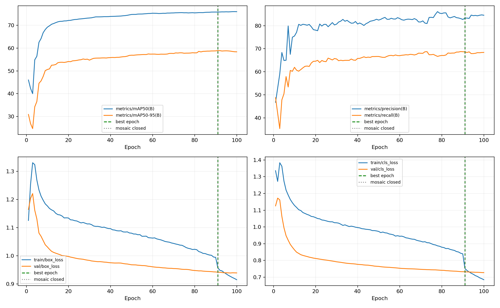

| 轮次 | AP50 | AP50-95 | Precision | Recall |
| ---: | ---: | ---: | ---: | ---: |
| 1 | 46.012% | 30.929% | 46.754% | 48.759% |
| 10 | 69.137% | 50.605% | 75.519% | 61.935% |
| 25 | 72.704% | 54.787% | 80.556% | 64.398% |
| 50 | 74.700% | 56.861% | 82.417% | 66.640% |
| 75 | 75.436% | 57.726% | 83.613% | 67.403% |
| 90 | 75.761% | 58.758% | 82.695% | 68.701% |
| **91，最佳** | **75.740%** | **58.879%** | **83.233%** | **68.642%** |
| 100，最后 | 75.930% | 58.342% | 84.522% | 68.387% |

前 25 轮提升较快，后半程增益收窄。91→100 轮，训练 cls loss 从 0.75246 降到 0.68490，验证 cls loss 也从 0.73231 降到 0.72730，但 AP50-95 下降 **0.537 个百分点**；AP50 略升、Recall 略降。说明“loss 继续下降”不代表严格定位指标继续改善。现有曲线不足以认定严重过拟合，但不支持把单纯加到 200 轮当作第一优化手段。

第 91 轮恰好是关闭 Mosaic 的开始，也是最佳轮；这里只记录时间对应关系，不能凭一次实验认定 Mosaic 是唯一原因。当前应使用 **best.pt**，而不是最后一轮 last.pt。

### 5. 训练结束时 best.pt 的各类别最终结果

以下是**服务器最后验证 best.pt 的原始日志数值**，日志本身只保留约三位有效数字，不能人为补出更高精度。P/R 取 Ultralytics 的公共最佳平均 F1 工作点，不是固定 conf=0.25；AP 是置信度扫描结果。

| 类别 | val 图片 | val 框 | Precision | Recall | AP50 | AP50-95 |
| --- | ---: | ---: | ---: | ---: | ---: | ---: |
| all（类别均值） | 2,801 | 8,863 | 83.2% | 68.7% | 75.7% | 58.9% |
| person | 2,461 | 7,829 | 85.5% | 70.9% | 81.0% | 58.0% |
| cat | 184 | 202 | 82.2% | 84.7% | 88.2% | 70.0% |
| dog | 171 | 209 | 78.0% | 73.7% | 78.7% | 64.6% |
| frisbee | 83 | 111 | 84.8% | 71.2% | 78.8% | 59.1% |
| sports ball | 139 | 188 | 84.6% | 52.7% | 59.7% | 43.7% |
| teddy bear | 88 | 158 | 79.2% | 67.4% | 75.3% | 56.5% |
| garden hose | 5 | 5 | 88.0% | 100.0% | 99.5% | 89.5% |
| rock | 19 | 161 | 83.8% | 28.9% | 44.8% | 29.6% |

为获得可追溯的精确逐类数据，本次对同一 best.pt 和全部 2,801 张验证图重新评估。**以下是独立的本地 FP32 复评结果，不冒充服务器原始精确值**：Ultralytics 8.4.128、PyTorch 2.14.0 CPU，imgsz=640、rect=True、batch=32、conf=0.001、NMS=0.7、max_det=300。服务器为 PyTorch 2.6.0 CUDA；数值环境与执行路径不同，有小幅差异。整体 AP50-95 为 **58.957669%**，没有覆盖原训练 CSV 的 58.879%。

| 类别 | Precision | Recall | AP50 | AP50-95 |
| --- | ---: | ---: | ---: | ---: |
| person | 85.475187% | 70.864734% | 80.985383% | 58.086762% |
| cat | 81.432021% | 84.672870% | 88.139672% | 69.952686% |
| dog | 78.128661% | 73.684211% | 78.677447% | 64.560138% |
| frisbee | 84.785890% | 71.171171% | 78.756065% | 59.510177% |
| sports ball | 85.288686% | 52.425241% | 59.714065% | 44.010072% |
| teddy bear | 79.151710% | 67.281745% | 75.250173% | 56.335064% |
| garden hose | 88.014887% | 100.000000% | 99.500000% | 89.500000% |
| rock | 83.750814% | 28.814704% | 44.789382% | 29.706450% |

复评公共最佳平均 F1 对应置信度约 **0.276276**。完整数值见[逐类 CSV](../../../../runs/D00_ultralytics_default/analysis_20261028/per_class_metrics.csv)和[指标 JSON](../../../../runs/D00_ultralytics_default/analysis_20261028/metrics.json)。小数位用于复现，不代表这么高的统计可信度，尤其软管只有 5 个验证目标。

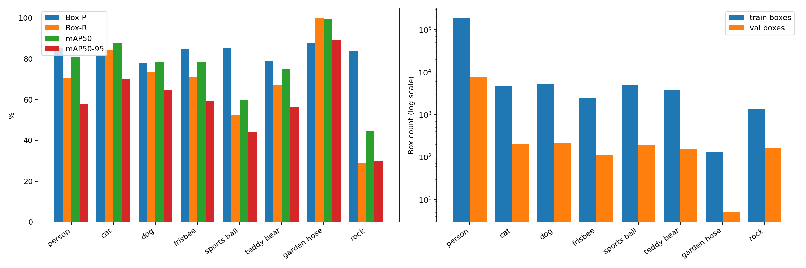

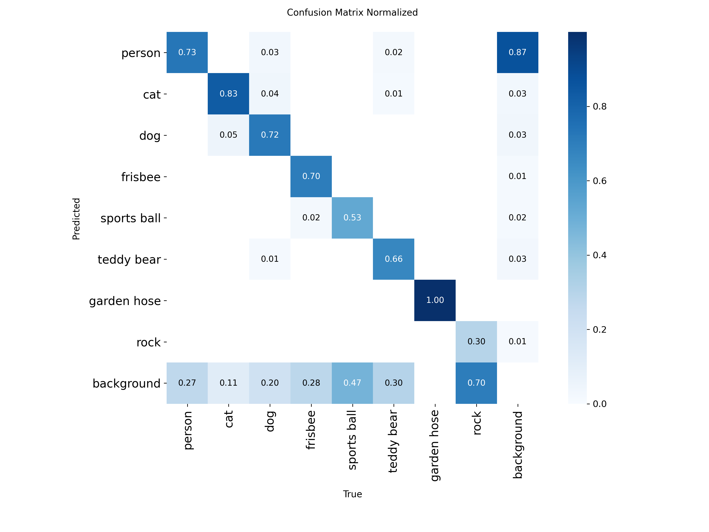

矩阵横轴是真实类别，纵轴是预测类别。石块、球的 background 行明显，主要表现为未匹配到检测，而不是大量互相错分类。最后一列按未匹配预测归一化，person 的 0.87 **不是“87% 背景图误报人员”**；矩阵对框的匹配规则也不同于下方固定 IoU=0.5 的自定义诊断，不能直接当同一张召回表使用。

### 6. 固定阈值下，具体漏了多少

此节使用本地缓存预测，conf=0.25、NMS=0.7、同类框 IoU≥0.5 一对一匹配；TP/FP/FN 是框计数，P/R 与上面的最佳 F1 工作点不同。

| 类别 | TP | FP | FN | Precision | Recall |
| --- | ---: | ---: | ---: | ---: | ---: |
| person | 5,639 | 1,087 | 2,190 | 83.84% | 72.03% |
| cat | 173 | 45 | 29 | 79.36% | 85.64% |
| dog | 156 | 48 | 53 | 76.47% | 74.64% |
| frisbee | 79 | 16 | 32 | 83.16% | 71.17% |
| sports ball | 99 | 19 | 89 | 83.90% | 52.66% |
| teddy bear | 108 | 31 | 50 | 77.70% | 68.35% |
| garden hose | 5 | 0 | 0 | 100.00% | 100.00% |
| rock | 47 | 12 | 114 | 79.66% | 29.19% |

把阈值从 0.25 降到 0.10：人员 Recall 从 72.03% 升到 80.09%，但 FP 从 1,087 增至 3,693；球 Recall 从 52.66% 升到 60.11%，FP 从 19 增至 91；石块 Recall 从 29.19% 升到 35.40%，FP 从 12 增至 32。**单纯降低统一阈值不能补回石块的大量漏检**。提高到 0.50 时石块只剩 19.88% Recall，不能因为 Precision=100% 就认定更好。

按目标尺寸进一步统计，尺寸指原图按长边缩放到 640 后的框面积：小 <32²、中 <96²、大 ≥96²。下面是诊断分组，**不是官方 COCO APs/APm/APl**。

| 类别 | 小目标：匹配 / 总数 | 中目标：匹配 / 总数 | 大目标：匹配 / 总数 |
| --- | ---: | ---: | ---: |
| person | 669 / 1,893 | 1,768 / 2,404 | 3,202 / 3,532 |
| cat | 0 / 2 | 7 / 15 | 166 / 185 |
| dog | 2 / 7 | 25 / 38 | 129 / 164 |
| frisbee | 24 / 42 | 42 / 53 | 13 / 16 |
| sports ball | 73 / 148 | 22 / 33 | 4 / 7 |
| teddy bear | 0 / 8 | 7 / 31 | 101 / 119 |
| garden hose | 0 / 0 | 0 / 0 | 5 / 5 |
| rock | **1 / 89** | **20 / 41** | **26 / 31** |

关键发现：石块大目标 Recall=83.87%，小目标仅 1.12%；不能笼统说“石块完全没学到”。球有 148/188=78.72% 的小目标；人员小目标 Recall=35.34%，大目标 90.66%。目前证据首先指向**尺寸、密集目标与局部细节**，还不足以证明更强颜色增强或单纯延长训练是答案。

### 7. 逐类图片解释

以下每类选取固定 conf=0.25 下漏检框数最多的一张，软管选取一个正确示例；它们是刻意挑选的失败案例，不代表整类平均表现。左侧绿色为该类标注，右侧橙色为**该类**预测，其他类别不显示。FN 表示未达到同类 IoU≥0.5 匹配，不一定表示完全没有输出框。

**人员：远处小人和局部遮挡。** `000000389451.jpg` 有 12 个人员标注，全部属于小目标，仅 1 个达到匹配标准，11 个未匹配。可见预测框存在，但部分位置、尺寸与标注不符；不能只通过“图上出现了人框”判断检测成功。

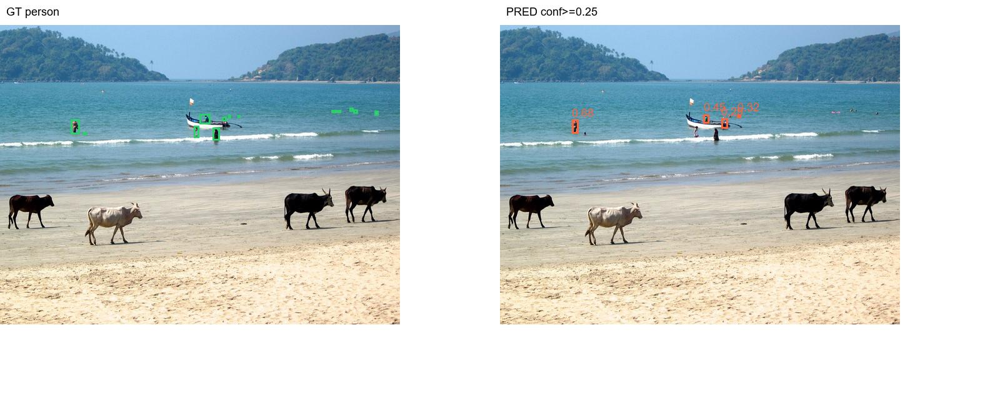

**猫：夜间低照度。** `000000375493.jpg` 的 3 个猫目标均未匹配，属于暗场和背景混淆的具体问题；猫类整体 Recall 较好不代表夜间也可靠。

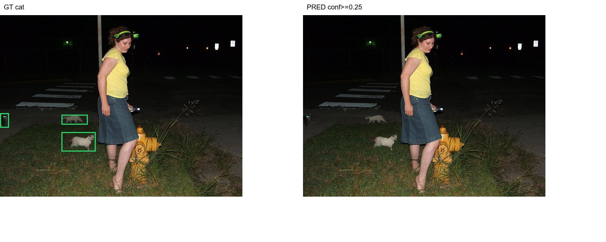

**狗：COCO 标注语义与机器人场景需要区分。** `000000262938.jpg` 中 4 个 dog 标注覆盖毛绒狗和书页里的狗图案，并非 4 只真实动物。原始 COCO JSON 已核对一致；模型实际输出了两个 teddy bear 框（约 0.461、0.282），图中因只画 dog 而未显示。这例不能直接等价成“真实狗全部漏检”，也不能未经审核就删除原始标注来提高分数。

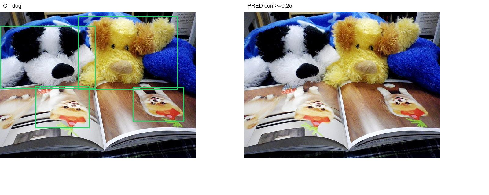

**飞盘：手持侧面目标与特殊大框。** `000000437239.jpg` 有 4 个 frisbee 标注，0 个达到匹配标准；图中却有两个可见飞盘被预测到。左侧大框跨越较宽区域，现有框与原始 COCO 一致，属于需要人工核对的标注/实例边界问题，不能把本例直接归因于模型没识别飞盘，也不是八类映射造成的坐标错误。

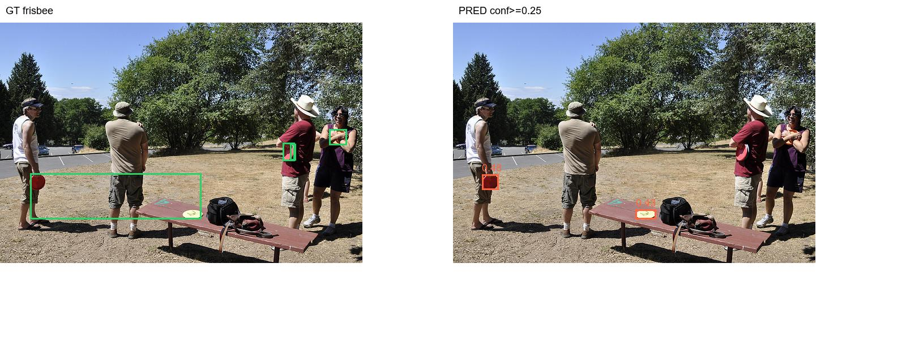

**运动球：密集小球。** `000000548246.jpg` 有 13 个球标注，全部是小目标，均未匹配；篮内密集网球、远处小球与草坪近距离单球不是同一种难度。优化优先看尺寸与密集遮挡，而不是把它解释为缺少“球”这个类别。


**玩具熊：橱窗反光与小目标。** `000000094185.jpg` 有 11 个目标，匹配 3 个、漏匹配 8 个，其中 6 个是小目标。大熊已检出，橱窗内部、反光和小熊更困难，说明类别并非整体不可识别。

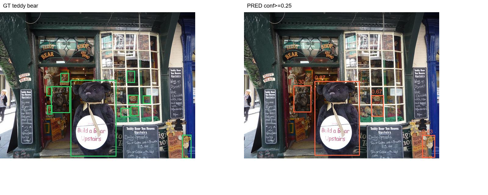

**软管：成功样例，但验证覆盖很窄。** 下图是大面积盘绕软管，检出正常。当前 5 个验证框全部属于大目标，不能把 99.5% AP50 外推为“细长、展开、贴地、被草遮挡的软管也稳定”。

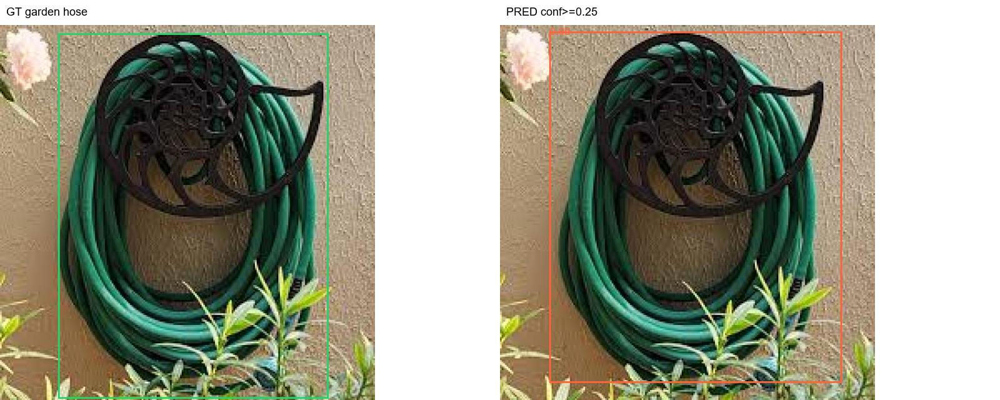

**石块：一张密集场景就占全类大量实例。** 下图 67 个框中匹配 5 个、漏匹配 62 个；54 个是小目标。该图占全部石块验证框的 **41.61%**，能明显影响全类召回。要保留这一难例，同时单独报告近距离可碰撞石块和远处碎石，不能通过删图把问题隐藏。

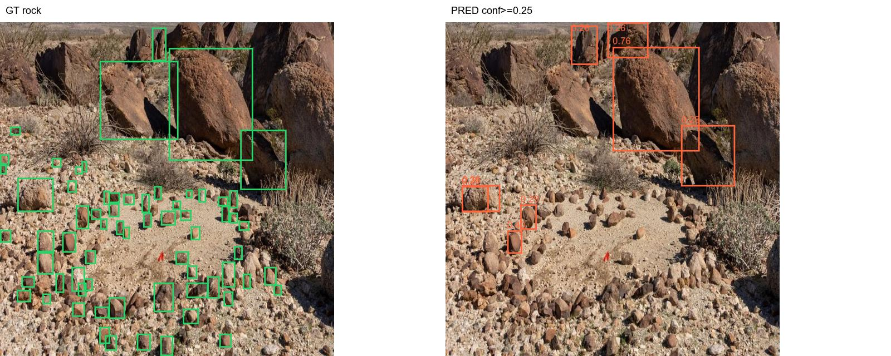

全部样例名称、框数与统计见[样例索引](../../../../runs/D00_ultralytics_default/analysis_20261028/cases/index.json)、[逐图诊断](../../../../runs/D00_ultralytics_default/analysis_20261028/image_diagnostics.csv)。

### 8. 对 COCO 来源数据的结论

COCO 六类已有大量训练目标，不能把当前问题简单概括成“每类再补几百张”。六类有预训练知识基础和现成标注，但 COCO 的场景、拍摄距离、目标尺寸、玩具/图案定义并不自动等于割草机低机位近场障碍物任务。当前验证主要说明 COCO 子集与补充来源上的效果，尚没有证明割草现场的召回和误报率。

原有 COCO 验证集继续保持为固定通用能力对照；业务口径应另行明确真实动物、玩具、印刷图案、贴地小物体以及最小可碰撞目标。可以先审核已有图和采集记录，不要求立即重新采集。若建立业务子集，必须完整保存选择依据和全量结果，不能只保留容易的图片后宣称整体提升。

### 9. 下一步优化建议（尚未执行）

| 优先级 | 实验或检查 | 原因与对照方式 | 判断依据 |
| --- | --- | --- | --- |
| 1，先评估无需重训 | 用同一 D00 best.pt 比较 640 / 960 输入；先关注石块、球、人员小目标 | 验证“小目标分辨率不足”假设；权重、图像、阈值不变 | 分尺寸 Recall、每类 FP、推理耗时；若板端必须 640，960 只能作诊断，不能直接作为部署提升 |
| 2，COCO 迁移对照 | 原始 yolov8n.pt 按六类名称映射，在相同 COCO 验证子集复评 | 判断微调后六类是改善还是损失；不比较原模型不存在的软管/石块 | 每类 AP、固定阈值 P/R 和失败图；现阶段不能无证据认定灾难性遗忘 |
| 3，首个训练消融候选 | 保持 n 模型、640、100 轮、种子和优化器策略，只将 mosaic 从 1.0 降到 0.3；close_mosaic 仍为 10 | 现有小目标在 Mosaic 中可能被进一步缩小；这是待验证假设，不是已证明原因 | 石块/球/人员小目标 Recall 是否提升，同时查看 COCO 六类 AP 和 FP 是否退化 |
| 4，独立采样消融 | 在固定增强下增加现有石块、球和其他弱类图片的抽样曝光，保留图中全部类别标签 | 人员实例占比高、石块只有 189 张；先使用已有数据，不默认要求扩采 | 不与上个消融同时改；关注少数类增益与人员/动物回退，重复增强图不等于增加独立场景 |
| 5，部署阈值 | 按类别扫描阈值，选定可接受 FP 后再决定 Recall 工作点 | 统一降到 0.1 带来明显误报，且石块仍大量漏检 | 在固定业务回归集上确认；不能仅凭本验证集最佳 F1 宣布最终部署阈值 |

如果输入分辨率与采样消融都无法改善，再评估 n→s 模型容量，届时同时测目标芯片延迟和内存。暂不同时叠加注意力模块、修改损失、换优化器和强化多种增强；一次改变多个因素会失去对照价值。

**当前推荐顺序：保留 D00 → 先做同权重分辨率/原始预训练对照 → 再决定单因素训练。**当前不是“训练没跑好”，而是正常收敛后暴露出小目标、类别支撑量和业务语义的具体短板。最终目标应兼顾人员/动物召回、低矮目标检出和背景误报，不只追求总体 mAP。

## 后续每轮记录模板

1. 实验 ID、日期、状态（完成 / 主动停止 / 失败）及原因；数据和代码版本、权重 SHA256。
2. 相对上一基线改变的唯一因素；实际启动参数与实际 optimizer，不仅记录命令默认值。
3. 必填训练总时长（小时及可读时分秒）、计时来源、CSV 平均每轮耗时、达到最佳轮的累计时长；有可靠日志时记录开始/结束时间及其时区。中断或失败实验记录已运行时长，无法核实则标明未知。下载、本地复评和导出耗时单独记录，不混入训练时长。另记实际轮数、最佳轮、最佳与最后一轮的区别、曲线和异常情况。
4. best.pt 最终八类 P、R、AP50、AP50-95、验证图片数与实例数；标明阈值及精度口径。
5. 固定部署阈值 TP/FP/FN、尺寸分组、人员/动物/低矮目标回归结果；不要将类别 Recall 当成独立低矮目标测量。
6. 固定同一组失败图的前后对照，以及新增退化图；图上区分 GT 与预测。
7. 是否优于 D00、是否推荐部署、剩余限制、下一步建议。未验证内容标为待验证。

原始依据：[实验清单](../../../../runs/server_experiment_inventory.json)、[配置与逐轮分析](../../../../runs/D00_ultralytics_default/analysis_20261028/training_analysis.json)、[固定阈值及尺寸统计](../../../../runs/D00_ultralytics_default/analysis_20261028/diagnostics.json)、[预测缓存](../../../../runs/D00_ultralytics_default/analysis_20261028/predictions)、[复评输入哈希](../../../../runs/D00_ultralytics_default/analysis_20261028/input_manifest.json)。


## 2026-10-28：D00 小目标专项复评（640 / 960）

状态：已完成评估；没有新增训练，训练时长为 0；没有同步服务器。沿用 D00 best.pt 和原始 2,801 张验证图，新加入的 42 张石块验证图未参与。960 成功评估调用耗时 230.43 秒，640 使用已核验缓存，整理和失败重试不计入训练时长。

固定 conf=0.25、同类 IoU≥0.5，尺寸统一按长边 640 定义：人员小目标 Recall 35.34%→47.44%，球 49.32%→56.08%，石块 1.12%→5.62%。石块全尺寸 TP 仍为 47/161，FP 12→20；所有净增加的小石块检出集中在同一张密集图，其他石块图片 TP 42→37。

整体 AP50 75.73%→68.94%，AP50-95 58.96%→44.66%；CPU batch=1 纯前向平均 27.29→58.87 ms，约 2.16 倍，不能外推为 NPU 耗时。**不推荐直接改成 960 推理。** 本次只检验了输入分辨率，不代表 960 训练无效，也没有证明 Mosaic 是根因。

[完整报告：八类 P/R/AP、分尺寸召回、改善与退化图片、候选框分析及后续建议](../../../../runs/D00_ultralytics_default/small_object_640_vs_960_20261028/评估结论.md)。

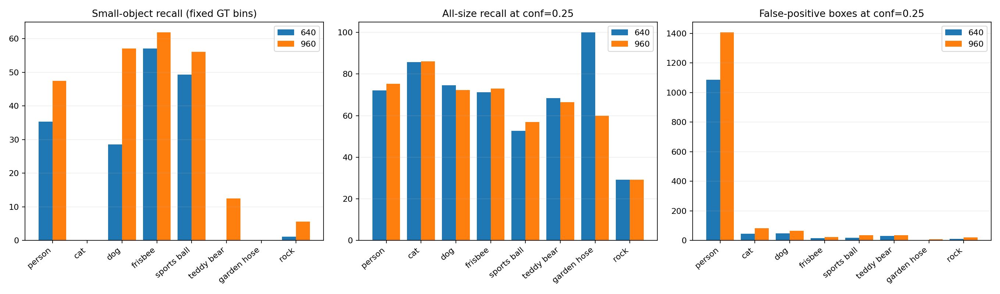

下一步建议先做原始 COCO 权重六类对照，再决定 640 下 Mosaic 1.0→0.3 单因素训练。新石块数据需先解决跨划分重复；数据扩充和增强调整分开比较。上述后续实验均未启动。


## 2026-10-28：新 rock 数据跨集合去重

本地和服务器均已将同图的 2 张训练副本及标签移到备份，保留验证图及其标签不变；移出 33 个 rock 框。当前 train 66,462 张 / 213,673 框，rock train 695 张 / 2,729 框；val 2,843 张 / 8,985 框不变。本批新增数据的已知跨划分重复组已清零，集合内部冗余副本保留。历史合并/同步记录为处理前快照，当前以[去重记录](../../../../data/yolo_check/dedup_rock_20261028_report.json)和[服务器去重记录](../../../../data/yolo_check/dedup_rock_20261028_server_report.json)为准；未启动训练。


## 2026-10-28：AI 软管两批合并（仅本地，未训练）

已按既定 382/95 划分加入 477 张合成图，保留同图人员、猫、狗及石块标注。当前本地 train 66,844 张 / 214,135 框，val 2,938 张 / 9,099 框，test 38 张 / 52 框。服务器尚未同步本次增量。历史 D00 指标保持原 2,801 张验证口径，新增合成验证样本不能替代真实现场评估；尚未启动新基线或注意力训练。详见[合并记录](../../../../data/yolo_check/merge_ai_hose_20261028_report.json)。


## 2026-10-28：AI 软管服务器同步完成

新增 477 张图片及对应标签已同步至服务器主项目，954 个新增文件 SHA256 核验通过，全量图片/标签清单及各类框数一致。当前两端 train 66,844 张 / 214,135 框，val 2,938 张 / 9,099 框，test 38 张 / 52 框。数据集 .cache 已检查清理，未启动训练。详见[同步记录](../../../../data/yolo_check/sync_ai_hose_20261028_report.json)。


## 2026-10-28：D01_data_expanded_baseline_2gpu 已启动

已确认 GPU 2、3 双 DDP 进程，epochs=100、batch=32（每卡16）、imgsz=640、workers=8/进程、scale=0.5、mosaic=1.0、close_mosaic=10、seed=0、AMP=True。optimizer=auto 实际为 MuSGD(lr=0.01,momentum=0.9)，从 yolov8n.pt 开始，不加注意力。采用扩充后 train 66,844 / val 2,938；相对 D00 同时改变数据、总 batch 和设备数量，并非严格的数据单因素消融。启动检查已进入第1轮，DDP PID 531827/531828；暂未完成，最终训练时长、每类指标及旧验证集对照待补。


## D01 新增数据双卡基线：训练结果与 D00 对照分析（2026-10-29）

分析日期：2026-10-29。实验：`D01_data_expanded_baseline_2gpu`。状态：**100 轮正常完成，最佳第 96 轮，未使用注意力机制**。

### 1. 结论与当前推荐

**D01 可以作为后续注意力机制实验的新数据基线。** 原 2,801 张验证图上，AP50-95 从 D00 的 58.96% 升至 59.59%，提升 0.63 个百分点；石块 AP50-95 从 29.71% 升至 33.83%，提升 4.13 个百分点。收益不是仅由增加容易的验证图片造成，但整体改善幅度有限，飞盘和球类存在回退。

本轮同时扩充数据、将总 batch 从 16 改为 32、从单卡改为双卡，因此不能把收益全部归因于补图，也不是注意力模块的效果。建议保留 D00 和 D01 两个权重；下一轮使用相同 D01 数据及配置，只改变注意力结构。

### 2. 拉取、权重及数据核验

- 服务器结果目录：`/mnt/sdb-36T/sdsun/lawn_mowing_robot_yolov8/mower_obstrast_check/runs/detect/D01_data_expanded_baseline_2gpu`。
- 已下载 25 个文件（训练产物和完整日志），合计 41,601,460 字节；压缩传输包和解包文件均通过 SHA256 核验。
- `best.pt` SHA256：`814fd616094d5a01cf2ab55a4106f265f5b335d3ddb6fc424a85e472cf00b170`。
- 当前 train 66,844 张 / 214,135 框；val 2,938 张 / 9,099 框。与 D00 相比新增 train 888 张，val 137 张：验证新增岩石 42 张、合成软管 95 张。岩石专项 test 38 张未参与本轮 val。
- 服务器当前验证图及标签共 5,876 个文件与本地 SHA256 完全一致。原验证 2,801 张的图像/标签哈希和 GT 坐标也与 D00 缓存逐一核对一致。服务器核验代表当前数据一致性，不能替代不存在的训练全程文件快照。
- 日志确认 100 epochs completed、best.pt 最终验证完成；没有因断网、显存不足或 DDP 报错提前结束。

### 3. 实际配置与训练耗时

| 项目 | D00 | D01 |
| --- | --- | --- |
| 模型/初始化 | YOLOv8n / 原始 yolov8n.pt | 相同；从预训练重新开始，不从 D00 续训 |
| 检测头迁移 | cls_remap=True，6/8 类 | 相同 |
| GPU / 总 batch | 3 / 16 | 2、3 DDP / 32（每卡16） |
| epochs / patience | 100 / 100 | 100 / 100 |
| imgsz / scale / mosaic | 640 / 0.5 / 1.0 | 相同 |
| close_mosaic / seed / AMP | 10 / 0 / True | 相同 |
| workers | 8 | 8/进程 |
| 实际 optimizer | MuSGD(lr=0.01, momentum=0.9) | 相同，auto 选择 |
| 最佳轮次 | 91 | 96 |
| 日志总训练时长 | 10.611 h ≈ 10h36m40s | 7.059 h ≈ 7h03m32s |
| CSV 最终累计时间 | 38,198.2 s | 25,410.4 s（7h03m30s） |
| CSV 平均每轮 | 381.982 s（6m22s） | 254.104 s（4m14s） |
| 到最佳轮累计时间 | 35,083.1 s（9h44m43s） | 24,528.2 s（6h48m48s） |

总训练用时减少约 33.5%，对应约 1.50 倍实际吞吐收益，不能表述为双卡速度翻倍。两轮还存在数据量、batch 和共享服务器负载差异，这不是独占硬件的严格性能基准。下载、CPU 复评和报告整理时间不计入训练时长。日志小时值经过舍入，与 CSV 秒数约有 2 秒差异。

本轮是当前仓库的默认超参数基线；实际优化器是 MuSGD，不是 AdamW。虽然配置含 lr0=0.01、momentum=0.937，日志明确 auto 会重新选择优化器参数，最终 momentum=0.9。

### 4. 收敛过程与 best / last

| 轮次 | 累计时间(s) | AP50(%) | AP50-95(%) | train box / cls | val box / cls |
| --- | --- | --- | --- | --- | --- |
| 1 | 283.8 | 49.45 | 31.12 | 1.1175 / 1.3894 | 1.1840 / 1.1967 |
| 10 | 2575.5 | 71.23 | 50.42 | 1.1775 / 1.1251 | 1.0350 / 0.8664 |
| 25 | 6411.8 | 74.07 | 54.73 | 1.1125 / 1.0266 | 0.9878 / 0.7999 |
| 50 | 12857.4 | 75.77 | 57.42 | 1.0747 / 0.9674 | 0.9654 / 0.7609 |
| 75 | 19532.5 | 77.00 | 59.13 | 1.0271 / 0.8925 | 0.9441 / 0.7375 |
| 90 | 23172.0 | 77.30 | 59.48 | 0.9899 / 0.8353 | 0.9372 / 0.7257 |
| 91 | 23416.5 | 77.27 | 59.63 | 0.9552 / 0.7520 | 0.9366 / 0.7258 |
| 96 | 24528.2 | 77.29 | 59.98 | 0.9269 / 0.7080 | 0.9343 / 0.7238 |
| 100 | 25410.4 | 77.22 | 59.91 | 0.9107 / 0.6803 | 0.9329 / 0.7217 |

前 10 轮 AP50-95 由 31.12% 升到 50.42%；第 50 轮为 57.42%，第 75 轮为 59.13%，后段增益逐渐变小。第 91 轮关闭 Mosaic 后训练损失明显下降，但验证 AP50-95 从第 90 轮的 59.48% 到最佳轮 59.98% 只提升约 0.50 个百分点，不能将损失下降全部理解为识别能力大幅跃升。

第 96 轮训练 CSV 的 AP50-95=59.977%，第 100 轮=59.915%，仅相差 0.062 个百分点。最后一轮 Recall 略高而 Precision 较低，按既定 fitness 仍选择 best.pt。训练和验证损失总体下降，没有出现明显的后段验证损失持续发散；也没有证据说明单纯延长训练就能解决密集小目标。

前 10 轮平均 257.55 s/轮，中段 11～90 轮 257.46 s/轮，最后 10 轮 223.84 s/轮；这一变化与增强关闭和运行负载均可能有关，不单独作因果归因。

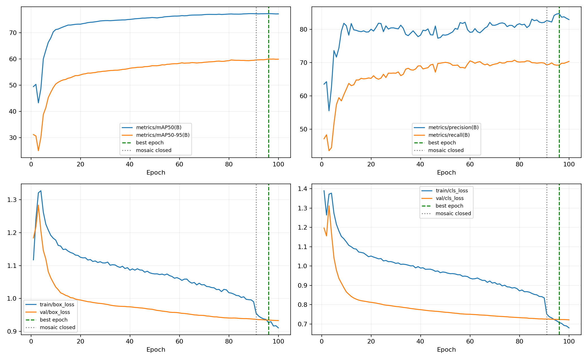

### 5. 最终八类指标：当前完整验证集

下表使用下载的 best.pt，在本地 CPU FP32、imgsz=640、batch=32、rect=True、conf=0.001、NMS IoU=0.7、max_det=300 下复评。torch=2.14.0+cpu，Ultralytics=8.4.128。P/R 采用评估器选择的共同 F1 工作点（本次约 0.3203），不是固定 0.25 的部署统计。

| 类别 | 验证图片 | GT 框 | P(%) | R(%) | AP50(%) | AP50-95(%) |
| --- | --- | --- | --- | --- | --- | --- |
| 人员 | 2467 | 7835 | 88.95 | 68.55 | 81.13 | 58.27 |
| 猫 | 188 | 206 | 83.03 | 86.41 | 89.22 | 71.79 |
| 狗 | 180 | 218 | 86.51 | 73.39 | 80.72 | 66.64 |
| 飞盘 | 83 | 111 | 86.32 | 70.27 | 77.99 | 58.72 |
| 运动球 | 139 | 188 | 82.21 | 48.40 | 57.85 | 43.38 |
| 玩具熊 | 88 | 158 | 81.87 | 65.82 | 76.80 | 56.66 |
| 软管 | 100 | 100 | 90.19 | 100.00 | 99.21 | 83.61 |
| 石块 | 61 | 283 | 77.98 | 41.34 | 55.63 | 40.67 |
| 整体 | 2938 | 9099 | 84.63 | 69.27 | 77.32 | 59.97 |

服务器 GPU 最终验证日志四舍五入为 P=84.5%、R=69.2%、AP50=77.3%、AP50-95=59.9%；本地完整复评为上表值。两者存在精度、batch/实现执行环境与输出舍入差异；不能将训练 CSV、服务器打印及本地复评混成同一条精确数值。

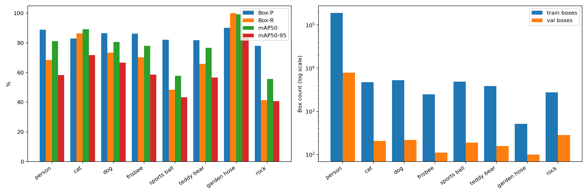

### 6. 与 D00 的同口径对照

#### 6.1 固定原验证集：2,801 张 / 8,863 框

两轮权重使用同一组原始图像、标签及相同评估参数。P/R 的最佳 F1 阈值会随模型改变，因此主要用 AP 对照，并在下一节使用固定阈值比较召回与误检。

| 类别 | D00 AP50 | D01 AP50 | 变化(pp) | D00 AP50-95 | D01 AP50-95 | 变化(pp) |
| --- | --- | --- | --- | --- | --- | --- |
| 人员 | 80.99 | 81.13 | +0.14 | 58.09 | 58.21 | +0.12 |
| 猫 | 88.14 | 88.91 | +0.77 | 69.95 | 71.07 | +1.11 |
| 狗 | 78.68 | 79.71 | +1.04 | 64.56 | 64.95 | +0.39 |
| 飞盘 | 78.76 | 78.02 | -0.73 | 59.51 | 58.75 | -0.76 |
| 运动球 | 59.71 | 57.96 | -1.75 | 44.01 | 43.43 | -0.58 |
| 玩具熊 | 75.25 | 76.73 | +1.48 | 56.34 | 56.84 | +0.50 |
| 软管 | 99.50 | 99.50 | +0.00 | 89.50 | 89.63 | +0.13 |
| 石块 | 44.79 | 49.55 | +4.76 | 29.71 | 33.83 | +4.13 |

整体 AP50：75.73%→76.44%；AP50-95：58.96%→59.59%。石块是主要增益来源，猫、狗、人员、玩具熊有小幅增益；飞盘和球下降。旧软管只有 5 个框，AP50 都是 99.5%，无法靠这 5 个样本证明整体软管泛化已充分解决。

#### 6.2 两个权重在当前完整 2,938 张验证图上复评

| 模型 | P(%) | R(%) | AP50(%) | AP50-95(%) |
| --- | --- | --- | --- | --- |
| D00 当前完整集 | 82.22 | 57.17 | 64.46 | 48.83 |
| D01 当前完整集 | 84.63 | 69.27 | 77.32 | 59.97 |

该表也固定了图像集合，避免拿 D00 的旧验证集总分和 D01 的新验证集总分直接相减。较大提升主要与 D00 对新增合成软管的低识别能力有关，不能外推为所有旧场景均大幅提升。新增来源的结果见下一节。

### 7. 新增来源拆分：岩石与 AI 软管

矩形 batch 分组会随验证集合变化，因此固定旧集单独复评与完整新集中提取旧样本可能有少量框级差异；主对照始终使用独立冻结旧集复评，新增子集使用完整集缓存。

从两模型完整复评的相同预测缓存中，使用官方 IoU 0.50～0.95 匹配/AP 计算方法，分别统计新增来源；主类别的 AP 仅统计该来源子集，FP 列为该子集内固定 conf=0.25 的同类未匹配预测。子集 AP 不与全量 AP 直接混比。

| 来源 | 模型 | 图片 | GT | TP | FP | FN | Recall@.25 | AP50(%) | AP50-95(%) |
| --- | --- | --- | --- | --- | --- | --- | --- | --- | --- |
| 新增岩石 | D00 | 42 | 122 | 46 | 1 | 76 | 37.70% | 50.16 | 37.01 |
| 新增岩石 | D01 | 42 | 122 | 75 | 30 | 47 | 61.48% | 68.34 | 52.60 |
| 新增 AI 软管 | D00 | 95 | 95 | 2 | 1 | 93 | 2.11% | 9.78 | 5.74 |
| 新增 AI 软管 | D01 | 95 | 95 | 95 | 15 | 0 | 100.00% | 99.19 | 83.55 |

新增合成软管：D00 仅匹配 2/95，D01 为 95/95，改善明确。新图里的人员 6/6、猫 4/4、狗 9/9 在 D01 固定阈值下均匹配，但样本很少，不替代原 COCO 对照。新增岩石：TP 46→75、FP 1→30、FN 76→47；新增 46 个小石块由 0 个匹配增至 10 个，仍有 36 个未匹配。

合成软管图和真实来源数据分开解释：识别合成图上的软管不等同于真实相机现场验证。按当前框面积定义，完整验证集中 100 个软管框全部属于“大目标”；盘绕或展开的软管虽然自身细，但外接框面积大，所以“软管 Recall 高”不能证明细小远处软管也能检出。

### 8. 固定 conf=0.25：旧验证集召回与误检

使用与 D00 日志相同的一对一、同类 IoU≥0.5 匹配。FN 表示未达匹配标准，不一定是完全没有输出框；FP 包含误分类、重复框、定位不够准确或与现有标注不匹配的预测。

| 类别 | D00 TP/FP/FN | D01 TP/FP/FN | D00 Recall | D01 Recall | FP 变化 |
| --- | --- | --- | --- | --- | --- |
| 人员 | 5639/1087/2190 | 5618/1027/2211 | 72.03% | 71.76% | -60 |
| 猫 | 173/45/29 | 175/50/27 | 85.64% | 86.63% | +5 |
| 狗 | 156/48/53 | 153/37/56 | 74.64% | 73.21% | -11 |
| 飞盘 | 79/16/32 | 79/19/32 | 71.17% | 71.17% | +3 |
| 运动球 | 99/19/89 | 96/32/92 | 52.66% | 51.06% | +13 |
| 玩具熊 | 108/31/50 | 108/32/50 | 68.35% | 68.35% | +1 |
| 软管 | 5/0/0 | 5/0/0 | 100.00% | 100.00% | +0 |
| 石块 | 47/12/114 | 52/15/109 | 29.19% | 32.30% | +3 |

人员 TP 减少 21，但 FP 也减少 60；狗 TP 减少 3、FP 减少 11，体现工作点取舍。球 TP 减少 3、FP 增加 13，属于需要重点监控的回退。旧石块 TP 47→52、FP 12→15；其中密集碎石图 TP 5→13，其余 18 张合计 TP 42→39。按 19 张图分别算 Recall 再平均，74.45%→69.88%，说明收益集中，不能宣称每种石块场景都改善。宏平均仅作补充，不替代逐实例指标。

### 原验证集小目标：固定尺寸分组

GT 框按长边缩放到 640 后面积 <32² 为小、32²～96² 为中、≥96² 为大；两个模型使用相同分组。这是诊断性 Recall，不是官方 COCO APs，也不代表物体真实高度或碰撞距离。

| 类别 | 小目标 GT | D00 小 TP/Recall | D01 小 TP/Recall | 中目标 TP/GT | 大目标 TP/GT |
| --- | --- | --- | --- | --- | --- |
| 人员 | 1893 | 669 / 35.34% | 663 / 35.02% | 1768→1755 / 2404 | 3202→3200 / 3532 |
| 猫 | 2 | 0 / 0.00% | 0 / 0.00% | 7→8 / 15 | 166→167 / 185 |
| 狗 | 7 | 2 / 28.57% | 2 / 28.57% | 25→25 / 38 | 129→126 / 164 |
| 飞盘 | 42 | 24 / 57.14% | 24 / 57.14% | 42→42 / 53 | 13→13 / 16 |
| 运动球 | 148 | 73 / 49.32% | 70 / 47.30% | 22→23 / 33 | 4→3 / 7 |
| 玩具熊 | 8 | 0 / 0.00% | 0 / 0.00% | 7→9 / 31 | 101→99 / 119 |
| 软管 | 0 | 0 / 不适用 | 0 / 不适用 | 0→0 / 0 | 5→5 / 5 |
| 石块 | 89 | 1 / 1.12% | 8 / 8.99% | 20→18 / 41 | 26→26 / 31 |

石块小目标匹配从 1/89 增至 8/89（1.12%→8.99%），有所改善但仍远未解决。人员小目标 669/1,893→663/1,893（35.34%→35.02%），球 73/148→70/148（49.32%→47.30%）；本轮没有解决人员和球的小目标短板。当前完整验证集中的小石块为 18/135（13.33%），其分母包含新增来源，不与旧 89 个框混比。

猫、狗、玩具熊的小目标 GT 仅 2、7、8 个，不应对小样本波动过度解读；人员、球和石块仍是主要观察项。既要关注石块收益，也要防止以人员/球类回退换取整体分数。

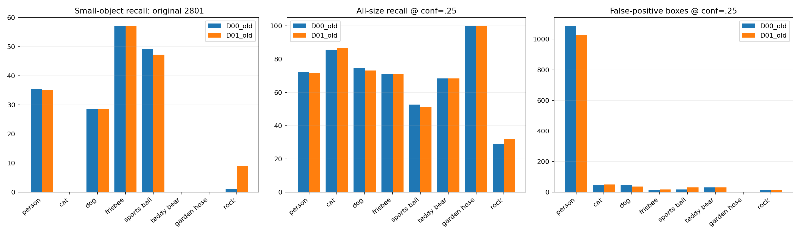

### 阈值变化的代价（当前完整验证集）

| conf | 类别 | TP | FP | FN | Precision | Recall |
| --- | --- | --- | --- | --- | --- | --- |
| 0.1 | 人员 | 6256 | 3595 | 1579 | 63.51% | 79.85% |
| 0.1 | 运动球 | 111 | 89 | 77 | 55.50% | 59.04% |
| 0.1 | 软管 | 100 | 22 | 0 | 81.97% | 100.00% |
| 0.1 | 石块 | 157 | 158 | 126 | 49.84% | 55.48% |
| 0.25 | 人员 | 5621 | 1029 | 2214 | 84.53% | 71.74% |
| 0.25 | 运动球 | 96 | 32 | 92 | 75.00% | 51.06% |
| 0.25 | 软管 | 100 | 15 | 0 | 86.96% | 100.00% |
| 0.25 | 石块 | 127 | 45 | 156 | 73.84% | 44.88% |
| 0.5 | 人员 | 4661 | 244 | 3174 | 95.03% | 59.49% |
| 0.5 | 运动球 | 76 | 7 | 112 | 91.57% | 40.43% |
| 0.5 | 软管 | 98 | 4 | 2 | 96.08% | 98.00% |
| 0.5 | 石块 | 88 | 8 | 195 | 91.67% | 31.10% |

降低阈值能换取部分召回，但必须同时接受误检增长；本表只是验证集工作点，不据此直接宣布最终部署阈值。

软管 15 个 FP 中，14 个仍与某个同类 GT 的 IoU≥0.5，主要属于同一目标上的重复/竞争框；另 1 个与 GT 部分重叠，没有完全不沾同类标注的预测。图中可见同一根软管被多个长框重复覆盖，因此更像后处理去重问题，不能全部解释成“把草识别为软管”。石块 45 个 FP 中，3 个属于同类重叠竞争、6 个部分重叠、36 个与同类 GT 的 IoU<0.1；密集岩石图可见标注只覆盖部分可见石块，需保留“可能存在标注覆盖差异”的解释，不能直接断言 36 个都是背景误识别。细分见 extra_diagnostics.json。

### 9. 逐图对照与失败类型

以下图片均为左侧 GT、中间 D00、右侧 D01，只显示对应类别；预测阈值固定 0.25。旧样例沿用前次报告，不重新挑选全部容易样例。新来源样例使用两个权重在同一完整验证集上的缓存。

**海滩远处人员：远处小人和遮挡仍是难点。** `000000389451.jpg`：GT=12，D00 TP/FP/FN=1/3/11，D01=3/3/9。


**夜间低照度猫：整体猫类指标提高不代表这张暗场难例已解决。** `000000375493.jpg`：GT=3，D00 TP/FP/FN=0/0/3，D01=0/0/3。


**COCO 玩具/图案狗：原始 COCO 标签已核对，包含毛绒狗和书页图案；不能等同于真实动物漏检率。** `000000262938.jpg`：GT=4，D00 TP/FP/FN=0/0/4，D01=0/0/4。


**飞盘：手持侧面目标及特殊跨度标注；原 COCO 标签一致，不能把定位不匹配全部算作“没有看见飞盘”。** `000000437239.jpg`：GT=4，D00 TP/FP/FN=0/2/4，D01=0/2/4。


**密集网球：篮内密集小球和远处单球仍困难，保留原 13 个小球的难例。** `000000548246.jpg`：GT=13，D00 TP/FP/FN=0/0/13，D01=0/0/13。

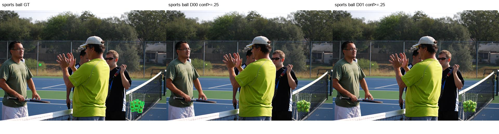

**橱窗玩具熊：反光、遮挡和小熊混杂，需同时检查框与置信度。** `000000094185.jpg`：GT=11，D00 TP/FP/FN=3/1/8，D01=2/1/9。

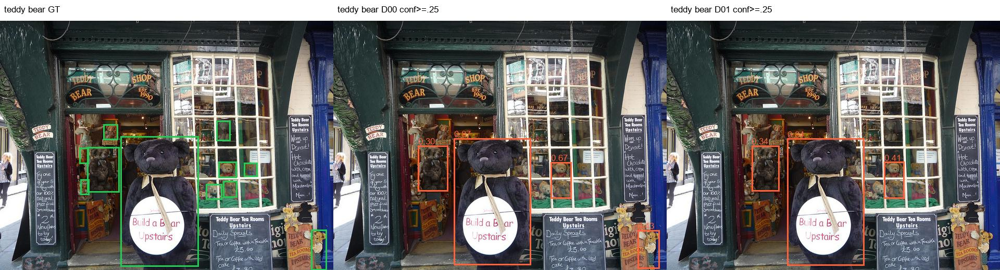

**旧软管样例：检查原来成功的盘绕软管是否保持。** `obstructions_images-2-_jpeg.rf.e1522481cdef46ace47c8099d423ffb7.jpg`：GT=1，D00 TP/FP/FN=1/0/0，D01=1/0/0。

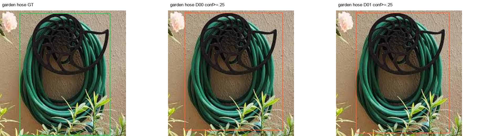

**旧密集岩石样例：67 个框，占原石块 GT 的 41.61%；不能只依据这张图的改善判断整个类别。** `rocks_DSC5033-e1658535326972_jpg.rf.d8c9490498bfe41099daa0f5dbe5828f.jpg`：GT=67，D00 TP/FP/FN=5/3/62，D01=13/6/54。

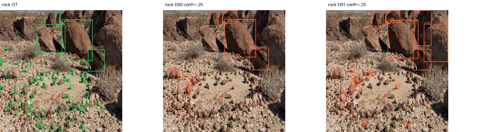

**石块：新增来源样例（本轮该类最大漏匹配数）。** `obstructions_rock_IMG0131_JPG.rf.25f00a5b25a576025e4f0be57df4e872.jpg`：GT=30，D00 TP/FP/FN=0/0/30，D01=6/2/24。

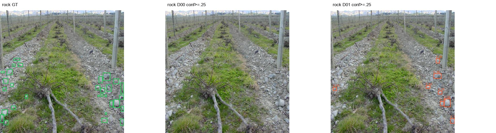

**石块：新增来源的未匹配预测样例。** `obstructions_rock_istockphoto-1136990430-612x612_jpg.rf.9771193ce74742bbc2cf841ae76b92ad.jpg`：GT=26，D00 TP/FP/FN=13/1/13，D01=23/18/3。

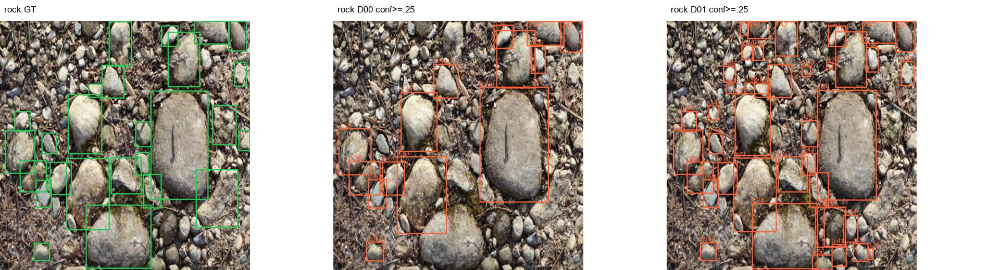

**软管：新增来源样例（本轮该类最大漏匹配数）。** `ai_garden_hose_b02_000181.png`：GT=1，D00 TP/FP/FN=0/0/1，D01=1/0/0。

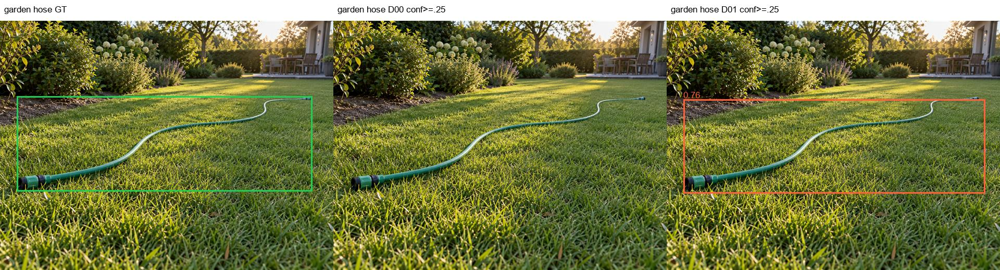

**软管：新增来源的未匹配预测样例。** `ai_garden_hose_b02_000114.png`：GT=1，D00 TP/FP/FN=0/0/1，D01=1/3/0。

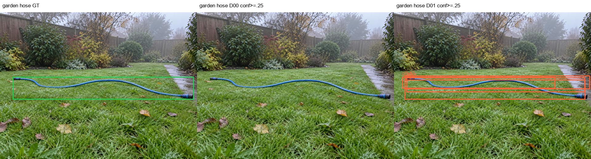

**人员：旧验证集退化样例。** `000000210273.jpg`：GT=13，D00 TP/FP/FN=6/2/7，D01=3/3/10。

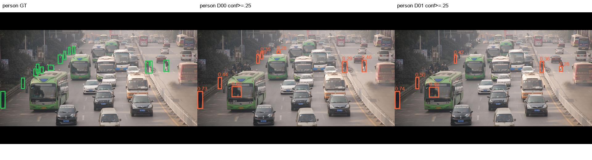

**运动球：旧验证集退化样例。** `000000566282.jpg`：GT=1，D00 TP/FP/FN=1/0/0，D01=0/0/1。

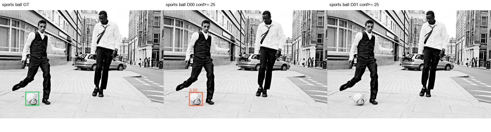

**石块：旧验证集退化样例。** `rocks_22sci-boulders1-videoSixteenByNine3000_jpg.rf.b9cead25e65614855f7457c780e73215.jpg`：GT=34，D00 TP/FP/FN=16/3/18，D01=13/4/21。

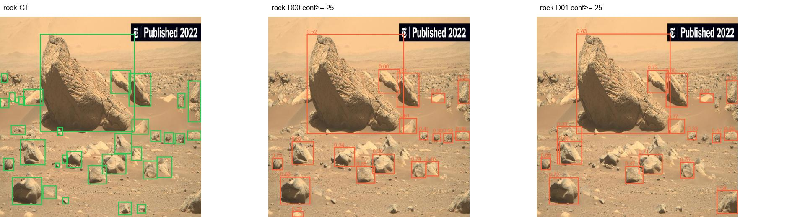

D01 当前完整验证集的最难人员图另见下图：伦敦桥上的 11 个远处人员框全部为小目标，固定阈值下均未匹配。它说明类别整体 AP 略升不等于远处小人问题得到解决。

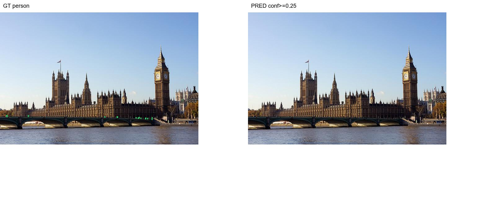

### 10. 下一轮建议与比较规则

1. **以 D01 为新数据基线做注意力对照。** 固定本次 train/val 清单、原始预训练初始化、100 轮、batch=32、双卡、640、scale=0.5、mosaic=1.0、优化器策略及 seed，只改注意力结构和实验名称；不同时改 scale、Mosaic、损失函数或采样。
2. **判断依据优先用原验证集的小目标召回与误检。** 石块 AP/Recall 的收益要保留，同时监控人员和球类；新增合成软管 Recall 接近饱和，更应看定位 AP50-95、误检数量及旧软管样例，而不是只看 Recall。
3. **完整新验证集、旧固定验证集、新岩石、新合成软管分开报告。** 注意力实验最终也按相同分组复评，并复用本次失败样例。不要把合成样例上的高分当作实车泛化证明。
4. **优先验证现有结构假设，不把补数据作为本轮默认结论。** 如注意力没有稳定收益，再单独比较 scale 0.5→0.2 或 Mosaic 强度；这些仍是待验证假设，本轮没有进行。
   软管重复框可另做不重训的 NMS 阈值对照，例如保持权重和 conf 不变，仅比较 NMS IoU 0.7 与 0.5；同时检查是否误压相邻真实目标。本轮未执行该实验，不与注意力训练混成一次改动。
5. 保留 `best.pt`，以第 96 轮为 D01 推荐对照权重。当前可以作为训练优化基线，但不据本轮验证直接宣布部署验收通过。

### 11. 原始记录与复现入口

- [下载清单及 SHA256](../../../../runs/D01_data_expanded_baseline_2gpu/download_manifest_20261029.json)、[完整服务器日志](../../../../runs/D01_data_expanded_baseline_2gpu/server_train.log)、[服务器最终验证](../../../../runs/D01_data_expanded_baseline_2gpu/final_validation.txt)。
- [实际参数](../../../../runs/D01_data_expanded_baseline_2gpu/args.yaml)、[逐轮 CSV](../../../../runs/D01_data_expanded_baseline_2gpu/results.csv)、[最佳权重](../../../../runs/D01_data_expanded_baseline_2gpu/weights/best.pt)、[最后权重](../../../../runs/D01_data_expanded_baseline_2gpu/weights/last.pt)。
- [训练统计](../../../../runs/D01_data_expanded_baseline_2gpu/analysis_20261029/training_analysis.json)、[服务器与本地数据核验](../../../../runs/D01_data_expanded_baseline_2gpu/analysis_20261029/data_verification.json)、[当前验证文件哈希](../../../../runs/D01_data_expanded_baseline_2gpu/analysis_20261029/server_val_manifest.json)。
- [D01 完整复评](../../../../runs/d01full_20261029/metrics.json)、[D01 旧集复评](../../../../runs/d01old_20261029/metrics.json)、[D00 当前完整集复评](../../../../runs/d00full_20261029/metrics.json)。
- [分组指标、阈值及尺寸统计](../../../../runs/D01_data_expanded_baseline_2gpu/analysis_20261029/comparison.json)、[旧验证逐图配对](../../../../runs/D01_data_expanded_baseline_2gpu/analysis_20261029/paired_images.csv)、[案例索引](../../../../runs/D01_data_expanded_baseline_2gpu/analysis_20261029/cases/index.json)、[本轮脚本](../../../../runs/D01_data_expanded_baseline_2gpu/analysis_20261029/scripts)。
- [重复框及重叠细分](../../../../runs/D01_data_expanded_baseline_2gpu/analysis_20261029/extra_diagnostics.json)、[本地复评及分析日志](../../../../runs/D01_data_expanded_baseline_2gpu/analysis_20261029/logs)。
- 每次本地复评的 elapsed_seconds 单独记录在对应 metrics.json，均不是训练时长。缓存子集 AP 与直接完整验证 AP 已做一致性核对，差异限制在 0.001 以内。


## D02 三卡通道注意力：训练结果与 D01 对照分析（2026-10-29）

分析日期：2026-10-29。实验：`D02_CA_200ep_3gpu`。**200 轮正常完成，最佳第 194 轮；未触发早停。**

### 1. 结论：有小幅收益，但还没有突破小石块瓶颈

本轮不是只跑了 100 轮，也不是异常中止。训练上限确实是 200，patience=30，最佳第 194 轮后只剩 6 轮，因此结束原因是达到 epochs 上限。
D02 在相同完整验证集上的 AP50-95 从 D01 的 **59.97% 提升到 60.47%（+0.50 个百分点）**，AP50 从 77.32% 到 78.15%。固定原 2,801 张验证图上 AP50-95 从 **59.59% 到 59.84%（+0.25 个百分点）**。属于增量改善，不能称作明显突破。
固定 conf=0.25 时，完整集小人员召回 34.97%→39.73%，小球 47.30%→51.35%，小石块 13.33%→25.19%；但石块统计 FP 从 **45 增至 124**，旧集小石块只从 **8/89 到 9/89**。因此“更敢检出”同时伴随误检代价，不能只报召回提高。
本轮同时改变注意力、epochs、batch 和 GPU 数；训练梯度累积与权重衰减缩放也随 batch 改变。结果只能证明这套整体方案的变化，不能证明全部收益来自注意力。

### 2. 产物、模型结构与数据核验

- 25 个服务器产物及完整日志已下载至 `mower_obstrast_check/runs/D02_CA_200ep_3gpu`，合计 63,780,830 字节；压缩包及逐文件 SHA256 均通过。
- 服务器路径：`/mnt/sdb-36T/sdsun/lawn_mowing_robot_yolov8/mower_obstrast_check/runs/detect/D02_CA_200ep_3gpu`。
- best.pt SHA256：`388902aeff6d18f3b8313fef38a5ad548a4099abc73ec7d256fe7b4798339d5f`。
- last.pt SHA256：`e7be60ac3303f1d1b63d1130ffef9d2fc670d67b6b3ce8bb2abe71e907f207b8`。
- 已直接加载 best.pt，确认第 15 层为 `C2fChannelAttention`，不是仅修改了实验名。该层是 P3/8 融合后的通道注意力，也参与后续 P4/P5 融合。
- 当前 train 66,844 张/214,135 框；val 2,938 张/9,099 框；岩石专项 test 38 张未用于本次复评。
- 服务器与本地当前验证图片、标签共 5,876 文件 SHA256 一致；D01/D02 完整集输入 manifest 一致，旧集 2,801 张输入也一致。该检查证明当前复评口径一致，不代替训练启动时未保存的全程数据快照。
- 先前 `D02_CA_200ep_2gpu` 是用户主动停止的尝试，服务器 CSV 仅有 1 个完整 epoch 记录。它没有继续到本轮，也不计入本轮训练耗时；原目录保留。本次三卡从 yolov8n.pt 重新开始。

### 3. 实际配置、环境及耗时

| 项目 | D01 基线 | D02 三卡注意力 |
| --- | --- | --- |
| 模型 | YOLOv8n | YOLOv8n + P3 C2fChannelAttention |
| 初始化 | 原始 yolov8n.pt | 原始 yolov8n.pt，非续训 D01/旧 D02 |
| GPU / 总 batch / 每卡 | 2、3 / 32 / 16 | 1、2、3 / 48 / 16 |
| epochs / patience | 100 / 100 | 200 / 30 |
| imgsz / seed / workers | 640 / 0 / 每进程8 | 相同 |
| scale / mosaic / close_mosaic | 0.5 / 1.0 / 10 | 相同，但关闭 Mosaic 推迟到第191轮 |
| AMP / cache | True / False | 相同 |
| optimizer=auto 的实际选择 | MuSGD(lr=.01,momentum=.9) | 相同 |
| 分类头迁移 | cls_remap=True，6/8类 | 相同 |
| 最佳轮次 | 96 | 194 |
| 日志耗时 | 7.059 h，约7h03m32s | 12.151 h，约12h09m04s |
| CSV累计秒数 | 25,410.4 | 43,743.9 |
| 平均每轮 | 254.10秒 | 218.72秒 |
| 至最佳轮累计时间 | 24,528.2秒 | 41,687.7秒（11h34m48s） |
| 训练环境 | Python3.10.21 / torch2.6.0+cu124 / Ultralytics8.4.128 | 相同 |
| 代码版本依据 | 服务器reflog追溯 baef8f3 | 本会话同步核验后启动 6df8cbe |

代码版本为既有同步/启动记录，不宣称训练全程完整工作区快照。服务器最终推理速度来自验证时批量运行，不可直接用作单帧部署 FPS 或 NPU 性能。
本仓库训练器以 nbs=64 计算 warmup 后累积次数：D01 为 round(64/32)=2，D02 为 round(64/48)=1；按源码计算，对应常规阶段有效 batch 约 64 与 48，权重衰减分别约 0.0005 与 0.000375。不是“每卡 batch 一样就完全相同优化过程”。
D02 前 100 轮用时 18,522.4 秒（约5h08m42s），平均185.22秒，比 D01 的每轮时间少约27.1%。但全程平均只快约13.9%，轮数翻倍后总用时多约72.1%。这是本次实测，不是独占三卡加速比。

| 轮次区间 | 平均秒/轮 |
| --- | --- |
| 1～50 | 188.09 |
| 51～100 | 182.35 |
| 101～150 | 191.65 |
| 151～180 | 293.68 |
| 181～190 | 340.04 |
| 191～200 | 342.79 |

后段训练明显变慢，连最后 10 轮关闭 Mosaic 后仍约343秒/轮。日志能证明耗时变化，但没有连续资源监控证据来确定是其他任务抢算力、磁盘还是 CPU，不能仅凭曲线断言原因。下载与本地复评时间不计入训练时长。

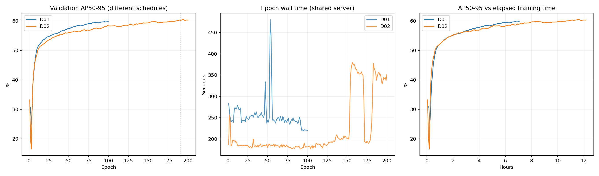

### 4. epochs 是否设小：有继续验证空间，但不是明显欠训练

| 轮次 | 累计时间(s) | AP50(%) | AP50-95(%) | train box / cls | val box / cls |
| --- | --- | --- | --- | --- | --- |
| 1 | 186.3 | 52.26 | 33.23 | 1.1016 / 1.3944 | 1.1601 / 1.2667 |
| 10 | 2032.9 | 70.10 | 48.60 | 1.1799 / 1.1374 | 1.0238 / 0.8587 |
| 50 | 9404.7 | 75.39 | 56.08 | 1.1044 / 1.0093 | 0.9664 / 0.7610 |
| 100 | 18522.4 | 77.08 | 58.35 | 1.0763 / 0.9650 | 0.9495 / 0.7319 |
| 125 | 23129.6 | 77.42 | 58.59 | 1.0511 / 0.9200 | 0.9393 / 0.7219 |
| 150 | 28105.1 | 77.69 | 59.36 | 1.0219 / 0.8789 | 0.9284 / 0.7080 |
| 175 | 35930.5 | 77.93 | 59.74 | 0.9977 / 0.8374 | 0.9200 / 0.6984 |
| 180 | 36915.6 | 78.01 | 59.89 | 0.9788 / 0.8195 | 0.9182 / 0.6967 |
| 190 | 40316.0 | 78.08 | 60.21 | 0.9637 / 0.7892 | 0.9159 / 0.6946 |
| 191 | 40666.4 | 78.08 | 60.24 | 0.9265 / 0.7072 | 0.9146 / 0.6942 |
| 194 | 41687.7 | 78.11 | 60.46 | 0.9197 / 0.6843 | 0.9152 / 0.6927 |
| 195 | 42023.9 | 78.16 | 60.41 | 0.9044 / 0.6747 | 0.9154 / 0.6927 |
| 200 | 43743.9 | 77.99 | 60.28 | 0.8982 / 0.6593 | 0.9166 / 0.6925 |

- 第100轮 AP50-95=58.350%，第150轮59.356%，第180轮59.888%，第194轮60.463%。按本次200轮学习率计划，后100轮确实继续改善，不能说100轮已经够。
- 第190轮60.215%到最佳60.463%，增幅仅0.248个百分点；第200轮60.283%，比最佳低0.180个百分点。最佳发生在靠近尾部，并不等同于尾部仍在快速上升。
- 最后10轮平均 AP50-95 约60.316%，高于181～190轮平均60.059%；存在小幅收益，尚不能证明增加到300/400轮就能明显突破。
- val box 在194轮为0.91524，200轮0.91663；val cls 为0.69271→0.69252，基本平台。train cls 仍下降，单看训练loss会高估继续训练价值。
- 本轮第191轮才关闭Mosaic，200轮刚结束10轮精修；如果要验证训练预算，应将“延长轮数”和“更早关闭Mosaic”作为分开的实验，避免一次再改多项。
- patience=30 没有机会在194轮后完整观察30轮，所以不能说“早停已经证明收敛”；也不能说“训练异常提前终止”。
- D01第100轮与D02第100轮处于不同学习率阶段、Mosaic阶段，不能当成等条件的注意力消融。

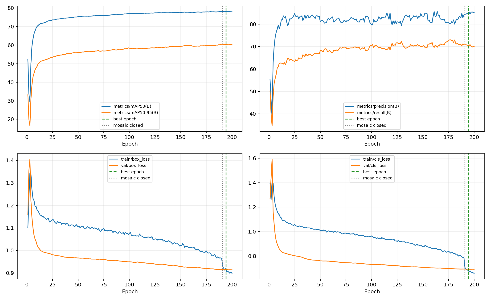

### 5. 当前完整验证集：每类最终结果

统一在本地 CPU FP32、imgsz640、batch32、rect=True、conf=.001、NMS IoU=.7、max_det300 复评，torch2.14.0+cpu、Ultralytics8.4.128。下表 P/R 为评估器选定的共同 F1 工作点；D01约.3203，D02约.3884，不能当作相同置信度阈值的部署 P/R。AP 为全置信度范围统计。

| 类别 | 图片/GT | D02 P% | D02 R% | D02 AP50% | D01 AP50-95% | D02 AP50-95% | 变化(pp) |
| --- | --- | --- | --- | --- | --- | --- | --- |
| 人员 | 2467/7835 | 89.91 | 68.78 | 81.98 | 58.27 | 59.08 | +0.81 |
| 猫 | 188/206 | 86.26 | 86.41 | 89.82 | 71.79 | 72.26 | +0.47 |
| 狗 | 180/218 | 83.77 | 74.31 | 81.09 | 66.64 | 65.95 | -0.69 |
| 飞盘 | 83/111 | 89.86 | 71.87 | 80.27 | 58.72 | 60.44 | +1.72 |
| 运动球 | 139/188 | 80.71 | 51.60 | 59.04 | 43.38 | 44.56 | +1.18 |
| 玩具熊 | 88/158 | 86.51 | 64.95 | 77.13 | 56.66 | 57.41 | +0.74 |
| 软管 | 100/100 | 94.10 | 100.00 | 99.22 | 83.61 | 83.83 | +0.22 |
| 石块 | 61/283 | 70.92 | 47.35 | 56.62 | 40.67 | 40.21 | -0.46 |

| 数据集/模型 | P% | R% | AP50% | AP50-95% |
| --- | --- | --- | --- | --- |
| d01full | 84.63 | 69.27 | 77.32 | 59.97 |
| d02full | 85.26 | 70.66 | 78.15 | 60.47 |
| d01old | 80.61 | 69.05 | 76.44 | 59.59 |
| d02old | 85.27 | 68.21 | 77.34 | 59.84 |

人员、猫、飞盘、球和玩具熊的 AP50-95 提升，狗与石块回退。石块 AP50 提升而 AP50-95 回落，提示在更严格 IoU 和整个置信度排序上的质量没有同步提高，不能仅用召回增加来判断定位已改善。
服务器最终验证 AP50/AP50-95 约78.1%/60.4%；CSV最佳为78.115%/60.463%；本地复评为78.147%/60.467%。环境、精度、验证batch及舍入导致小差异，本文不混用这些口径。

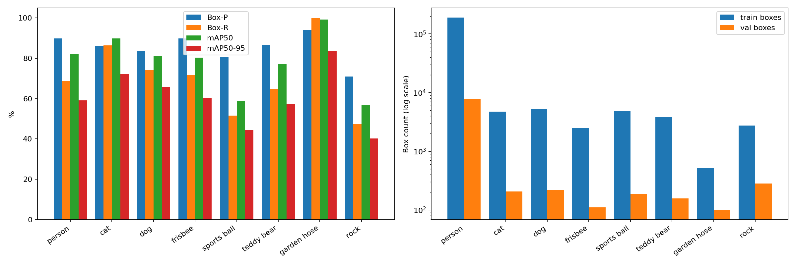

### 6. 固定旧验证集与新增来源分组

| 类别 | D01旧集 AP50-95% | D02旧集 AP50-95% | 变化(pp) |
| --- | --- | --- | --- |
| 人员 | 58.21 | 59.03 | +0.82 |
| 猫 | 71.07 | 71.70 | +0.63 |
| 狗 | 64.95 | 64.08 | -0.86 |
| 飞盘 | 58.75 | 60.51 | +1.77 |
| 运动球 | 43.43 | 44.61 | +1.19 |
| 玩具熊 | 56.84 | 57.41 | +0.57 |
| 软管 | 89.63 | 87.94 | -1.70 |
| 石块 | 33.83 | 33.43 | -0.41 |

旧集整体AP50-95仅提升0.25个百分点，石块33.83%→33.43%，狗64.95%→64.08%。旧软管只有5张，5个框均能检出，但AP50-95从89.63%到87.94%，小样本定位波动不能代表真实软管泛化下降。
以下新增来源 AP 用相同完整集预测缓存按来源重算，仅比较该类别；P/R使用固定conf=.25。缓存重算AP与直接验证存在不足0.001绝对值的数值差异，整体验证主表以上节直接结果为准。

| 来源 | 模型 | 图片 | GT | TP/FP/FN | P% | R% | AP50% | AP50-95% |
| --- | --- | --- | --- | --- | --- | --- | --- | --- |
| new_rock | D01_full | 42 | 122 | 75/30/47 | 71.43 | 61.48 | 68.34 | 52.60 |
| new_rock | D02_full | 42 | 122 | 92/101/30 | 47.67 | 75.41 | 71.40 | 53.08 |
| new_hose | D01_full | 95 | 95 | 95/15/0 | 86.36 | 100.00 | 99.19 | 83.55 |
| new_hose | D02_full | 95 | 95 | 95/6/0 | 94.06 | 100.00 | 99.21 | 84.08 |

新增岩石42张中，命中75→92、FP30→101；新增软管95张均命中，FP15→6。软管改善主要表现为重复框减少；合成场景结果不替代真实现场测试。旧集和完整集使用独立rect分批验证，旧图片在两次验证中会因批次填充形状不同出现少量预测差异，因此旧集对比使用独立旧集缓存，完整集来源组使用完整缓存。

### 7. 固定阈值：召回改善的代价

匹配规则：固定 conf=.25、NMS IoU=.7；同类别 IoU≥.5，一对一匹配。下表全部是当前2,938张验证图，不与共同F1工作点的P/R混用。

| 类别 | D01 TP/FP/FN | D02 TP/FP/FN | D01 P%→D02 P% | D01 R%→D02 R% |
| --- | --- | --- | --- | --- |
| 人员 | 5621/1029/2214 | 5839/1293/1996 | 84.53→81.87 | 71.74→74.52 |
| 猫 | 179/50/27 | 180/44/26 | 78.17→80.36 | 86.89→87.38 |
| 狗 | 163/39/55 | 171/39/47 | 80.69→81.43 | 74.77→78.44 |
| 飞盘 | 79/19/32 | 85/19/26 | 80.61→81.73 | 71.17→76.58 |
| 运动球 | 96/32/92 | 102/38/86 | 75.00→72.86 | 51.06→54.26 |
| 玩具熊 | 108/31/50 | 110/33/48 | 77.70→76.92 | 68.35→69.62 |
| 软管 | 100/15/0 | 100/6/0 | 86.96→94.34 | 100.00→100.00 |
| 石块 | 127/45/156 | 155/124/128 | 73.84→55.56 | 44.88→54.77 |

人员多检出218个GT，同时多264个FP；石块多检出28个GT，同时多79个FP。当前不能以同一个0.25阈值直接宣布D02全面优于D01。软管仍全召回，FP减少9个，属于更明确的改善。

| 模型 | 石块conf | TP/FP/FN | P% | R% |
| --- | --- | --- | --- | --- |
| D01_full | 0.1 | 157/158/126 | 49.84 | 55.48 |
| D01_full | 0.25 | 127/45/156 | 73.84 | 44.88 |
| D01_full | 0.5 | 88/8/195 | 91.67 | 31.10 |
| D02_full | 0.1 | 182/381/101 | 32.33 | 64.31 |
| D02_full | 0.25 | 155/124/128 | 55.56 | 54.77 |
| D02_full | 0.5 | 119/22/164 | 84.40 | 42.05 |

D02石块提高conf到.5后，FP124→22，召回54.77%→42.05%；D01在.25为FP45、召回44.88%。这说明应比较各自阈值上的取舍，但不能直接宣称.5就是推荐部署阈值，也不能把这次验证集调参当作独立测试结果。
D02的124个石块FP中，2个与同类GT IoU≥.5（重复/竞争匹配），17个IoU在.1～.5，105个IoU<.1。部分图像包含大量未被标出的可见碎石，因此“评估FP”不全等同于语义上不存在的石头。另一方面旧密集岩石图出现植被区域预测，说明也不能把增加的FP全部归因于标注。软管6个FP均属于与同类GT高度重叠的重复/竞争框。

### 8. 小目标是否真正改善

尺寸口径：把原图长边等比缩放至640后，GT框面积小于32²为small，32²～96²为medium，其他为large。下表是固定阈值召回诊断，不是COCO APs，也不等价于物体真实高度；软管细长但框面积可能很大。

| 类别 | 旧集small GT | 旧集命中 | 旧集R% | 完整small GT | 完整命中 | 完整R% |
| --- | --- | --- | --- | --- | --- | --- |
| 人员 | 1893 | 663→754 | 35.02→39.83 | 1893 | 662→752 | 34.97→39.73 |
| 猫 | 2 | 0→0 | 0.00→0.00 | 2 | 0→0 | 0.00→0.00 |
| 狗 | 7 | 2→2 | 28.57→28.57 | 7 | 2→2 | 28.57→28.57 |
| 飞盘 | 42 | 24→27 | 57.14→64.29 | 42 | 24→27 | 57.14→64.29 |
| 运动球 | 148 | 70→76 | 47.30→51.35 | 148 | 70→76 | 47.30→51.35 |
| 玩具熊 | 8 | 0→1 | 0.00→12.50 | 8 | 0→1 | 0.00→12.50 |
| 软管 | 0 | 0→0 | 无small GT | 0 | 0→0 | 无small GT |
| 石块 | 89 | 8→9 | 8.99→10.11 | 135 | 18→34 | 13.33→25.19 |

最需要区分的是石块：完整集 small 从18/135升至34/135，但旧集仅8/89→9/89，仍有80个旧小石块漏检。新增岩石small从10/46→25/46贡献了主要增量，不能用完整集25.19%的召回来宣称所有小石块场景都有同等改善。
旧石块19张的逐图平均召回从69.88%到80.74%，旧集整体TP52→63；但AP50-95略降，说明召回、误检、定位质量三个维度的变化方向不同。猫、狗、玩具熊small支持量只有2、7、8个，不做强泛化结论。

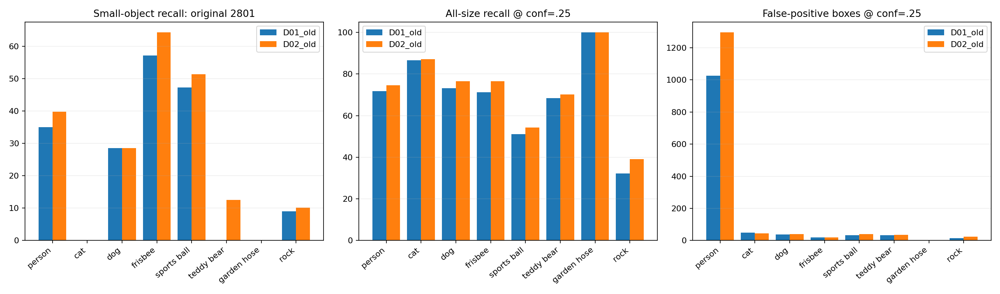

### 9. 图片对照：改善与退化都保留

每张图从左到右是GT、D01、D02，同一类别、conf≥.25。完整案例索引含全部自动选出的样例，以下挑选历史难例、明显改善和回退样例；不是随机代表性样本。

#### 人员：previous_hard

原图：`000000389451.jpg`，GT=12。D01 TP/FP/FN=3/3/9；D02=2/3/10。历史海滩人员难例，命中反而减少；不是所有小人员场景都改善。

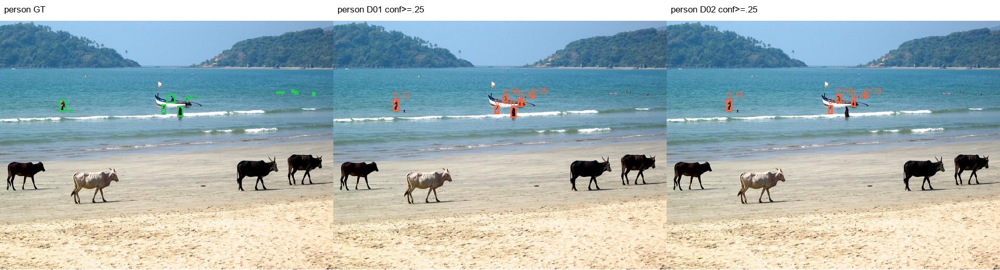

#### 人员：gain

原图：`000000051938.jpg`，GT=11。D01 TP/FP/FN=3/1/8；D02=8/0/3。滑雪场远处人员更多被检出，说明小人员召回收益有对应的具体图像。

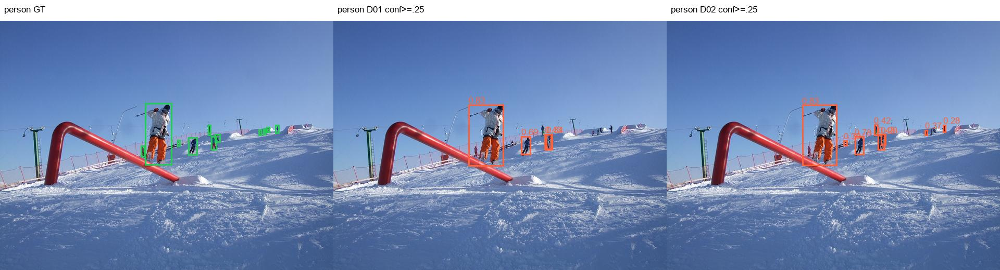

#### 猫：previous_hard

原图：`000000375493.jpg`，GT=3。D01 TP/FP/FN=0/0/3；D02=0/0/3。夜间多猫场景仍全部漏检。


#### 狗：previous_hard

原图：`000000262938.jpg`，GT=4。D01 TP/FP/FN=0/0/4；D02=0/0/4。COCO dog 标签含玩具/图案语义，不能将该图直接当作实际动物避障风险。

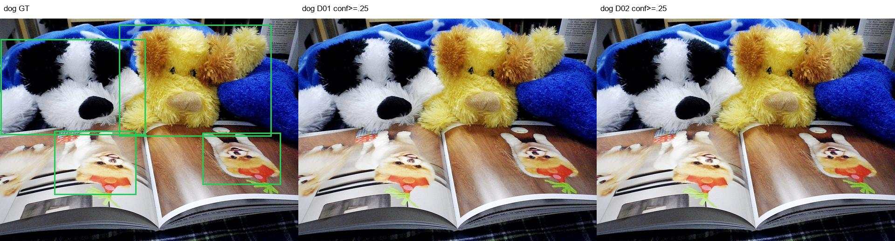

#### 飞盘：previous_hard

原图：`000000437239.jpg`，GT=4。D01 TP/FP/FN=0/2/4；D02=0/2/4。可见飞盘与原COCO框定义存在差异，出现预测框也不一定匹配GT。


#### 运动球：previous_hard

原图：`000000548246.jpg`，GT=13。D01 TP/FP/FN=0/0/13；D02=0/0/13。网球筐内13个小球仍全部漏检，是结构性难例尚未突破的证据。


#### 运动球：gain

原图：`000000566282.jpg`，GT=1。D01 TP/FP/FN=0/0/1；D02=1/0/0。D01漏掉的球在本轮检出，但不能替代整类统计。

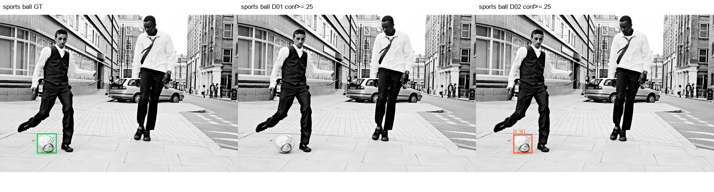

#### 玩具熊：previous_hard

原图：`000000094185.jpg`，GT=11。D01 TP/FP/FN=2/1/9；D02=3/2/8。玩具熊展示柜命中略增，同时多一个FP。

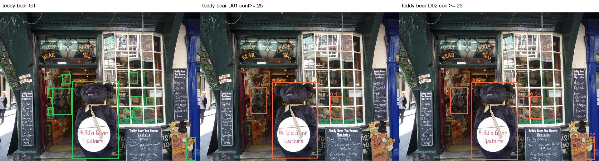

#### 玩具熊：regression

原图：`000000350054.jpg`，GT=3。D01 TP/FP/FN=3/1/0；D02=0/0/3。玩具熊存在局部明显回退，保留作为后续回归样例。

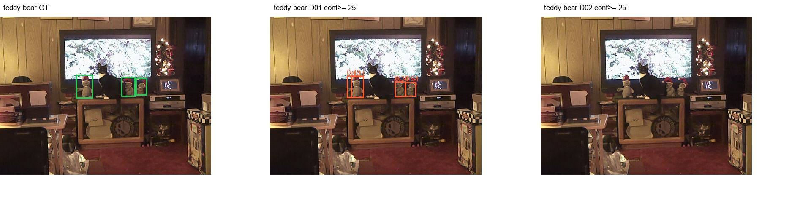

#### 软管：previous_hard

原图：`obstructions_images-2-_jpeg.rf.e1522481cdef46ace47c8099d423ffb7.jpg`，GT=1。D01 TP/FP/FN=1/0/0；D02=1/0/0。旧真实软管样例两轮均命中。


#### 石块：previous_hard

原图：`rocks_DSC5033-e1658535326972_jpg.rf.d8c9490498bfe41099daa0f5dbe5828f.jpg`，GT=67。D01 TP/FP/FN=13/6/54；D02=17/12/50。67个GT的密集岩石场景命中13→17，仍漏50个，并出现更多背景/植物区域框。

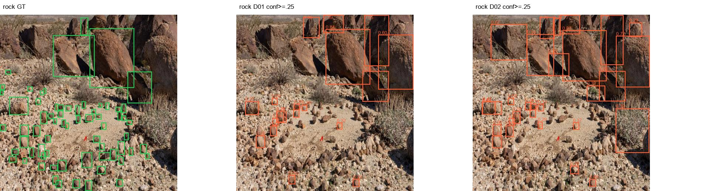

#### 石块：gain

原图：`rocks_22sci-boulders1-videoSixteenByNine3000_jpg.rf.b9cead25e65614855f7457c780e73215.jpg`，GT=34。D01 TP/FP/FN=13/4/21；D02=18/4/16。历史岩石图命中13→18且FP不增加，属于局部改善。

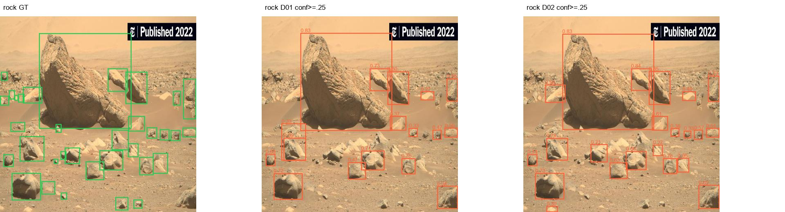

#### 石块：new_hard

原图：`obstructions_rock_IMG0131_JPG.rf.25f00a5b25a576025e4f0be57df4e872.jpg`，GT=30。D01 TP/FP/FN=6/2/24；D02=14/16/16。葡萄园碎石场景命中6→14，同时FP2→16；不能只展示多出的框作为成功。

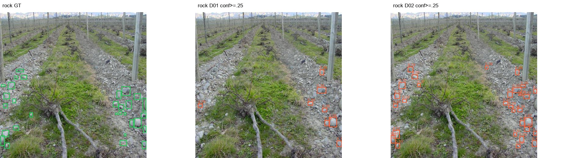

#### 石块：new_fp

原图：`obstructions_rock_istockphoto-1136990430-612x612_jpg.rf.9771193ce74742bbc2cf841ae76b92ad.jpg`，GT=26。D01 TP/FP/FN=23/18/3；D02=24/30/2。碎石近景只多命中1个GT，却多12个FP；图中也有未标出的可见石子，需区分标注口径与真误检。

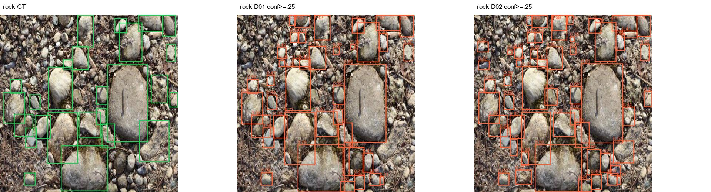

#### 软管：new_fp

原图：`ai_garden_hose_b02_000323.png`，GT=1。D01 TP/FP/FN=1/1/0；D02=1/1/0。新增软管样例仍有重复框，整体重复数量已降低，但没有完全消失。

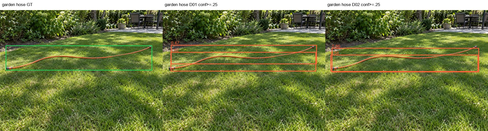

### 10. 下一步建议与是否继续增加轮数

1. **先保留D01和D02两个best，不覆盖基线。** D02可以作为召回偏高的候选，但不是已经全面胜出的部署模型；本轮重点风险是石块FP增加。
2. **先做不重训的阈值对比。** 按相同误检预算或相同召回要求比较D01/D02，尤其是人员和石块。现有.1/.25/.5三点已显示取舍明显，不建议直接套用全类统一阈值。对岩石FP图做有限人工复核，区分框定位偏差、真实背景误检和未标出的可见石子，不把“继续补数据”当作默认结论。
3. **若要验证epochs不足，做受控预算实验，而非直接跳到400/500。** 可以将下一轮上限设300、patience30～50，但固定同一结构、数据、batch和其他参数，并明确学习率调度会随epochs改变。结果必须同时检查石块FP和固定旧集small召回；最佳轮194只支持“有继续验证空间”，不保证延长会明显改善。
4. **若目的是确认注意力收益，需要同配置无注意力对照。** 采用相同batch48、200轮及其他配置，与D02比较，避免把更多训练、不同有效batch和注意力混在一起。此项与“加长轮数”实验目的不同，应择一推进。
5. **训练结束的best/last已strip。** epoch=-1、优化器状态已清理，不能把它们当作可无缝resume的第200轮训练状态；从best加载再训练属于微调，新实验须另记。
6. 当前未启动任何新训练，也未修改数据、阈值或部署模型。下一步应先决定优先目标是降低石块漏检、控制误检，还是验证更长训练预算。

### 11. 证据与复现入口

- [下载校验](../../../../runs/D02_CA_200ep_3gpu/download_manifest_20261029.json)、[服务器完整日志](../../../../runs/D02_CA_200ep_3gpu/server_train.log)、[最终服务器验证摘录](../../../../runs/D02_CA_200ep_3gpu/final_validation.txt)。
- [训练配置](../../../../runs/D02_CA_200ep_3gpu/args.yaml)、[逐轮指标](../../../../runs/D02_CA_200ep_3gpu/results.csv)、[best.pt](../../../../runs/D02_CA_200ep_3gpu/weights/best.pt)、[last.pt](../../../../runs/D02_CA_200ep_3gpu/weights/last.pt)。
- [D02完整集复评](../../../../runs/d02full_20261029/metrics.json)、[D02固定旧集复评](../../../../runs/d02old_20261029/metrics.json)、[D01完整集](../../../../runs/d01full_20261029/metrics.json)、[D01旧集](../../../../runs/d01old_20261029/metrics.json)。
- [小目标和阈值统计](../../../../runs/D02_CA_200ep_3gpu/analysis_20261029/comparison.json)、[逐图配对](../../../../runs/D02_CA_200ep_3gpu/analysis_20261029/paired_images.csv)、[FP重叠诊断](../../../../runs/D02_CA_200ep_3gpu/analysis_20261029/extra_diagnostics.json)、[案例索引](../../../../runs/D02_CA_200ep_3gpu/analysis_20261029/cases/index.json)。
- [训练统计](../../../../runs/D02_CA_200ep_3gpu/analysis_20261029/training_analysis.json)、[数据统计](../../../../runs/D02_CA_200ep_3gpu/analysis_20261029/dataset_counts.json)、[服务器数据一致性](../../../../runs/D02_CA_200ep_3gpu/analysis_20261029/data_verification.json)、[复评脚本](../../../../runs/D02_CA_200ep_3gpu/analysis_20261029/scripts)、[本地执行日志](../../../../runs/D02_CA_200ep_3gpu/analysis_20261029/logs)。
- 每次本地复评耗时单独在metrics.json记录，不计入训练时长。缓存AP复算与直接AP误差已校验小于0.001；固定阈值匹配和尺寸统计独立于AP工作点。


## 2026-10-30：新增独立合成测试集口径（尚未评估）

新增固定快照 `data/test_sets/synthetic_8cls_140_20261030`：140张、231框，包含原90张和mixed_50的50张。标签ID0～7，图片及标签完整，内部无精确重复，与现有69,820张图片无文件SHA256重复；未做跨集合近重复审核。源记录用户复核待完成。

后续D01/D02/D03报告独立增加all140主口径及base90、mixed50子集，保持imgsz640、FP32、batch32；AP使用conf=.001，固定阈值诊断使用conf=.25，NMS IoU=.7。不混入train/val，不用于早停和选epoch。当前仅登记，未产生测试成绩。详见[测试集口径规范](../../../标签与数据规范/独立合成测试集口径_20261030.md)。


## 2026-10-30：D01新增合成测试集首次评估

D01第96轮best.pt完成140张/231框测试：AP50=86.22%、AP50-95=81.24%；原90张为86.23%/81.29%，混合50张为86.73%/81.58%。全部按imgsz640、batch32、CPU FP32、conf=.001、NMS IoU=.7评估，固定阈值诊断另用conf=.25。已保存140张预测图和JSON，详细表格、尺寸统计、局部人体及问题案例见[更新的#34625交付报告](../../STORY34625_基线评估与失败样本分析交付报告_20261030.md)。这不是D02/D03成绩，不与原验证指标混算。


## 2026-10-30：停止D03，启动D04 AdamW完整重训

18:12按用户要求停止D03_CA_800ep_3gpu，完成222轮，CSV累计65707.4秒（约18小时15分7秒），最佳216轮AP50-95=57.169%。服务器权重、日志保留，stopped_20261030.json记录停止原因；不是早停或正常跑满800轮。

从原始yolov8n.pt重新启动D04_CA_AdamW_400ep_3gpu，保留P3通道注意力，GPU2/3/7，总batch48，imgsz640，workers8，epochs400，patience30，AdamW lr0=.001、momentum=.9、lrf=.01、cos_lr=True、weight_decay=.0005，mosaic1、close_mosaic50、scale.5、AMP开启、seed0、warmup_bias_lr=0、save_period25。主进程PID1405923，已进入第1轮并推进batch。显式AdamW取代auto，不是从D03或D02微调。服务器当前为共享GPU高负载，未承诺训练时长。早停若早于第351轮，不会进入计划的关闭Mosaic阶段。


## D04 AdamW三卡重训：结果与历史口径对比（2026-10-31）

分析日期：2026-10-31。实验：`D04_CA_AdamW_400ep_3gpu`。**计划400轮，第100轮触发patience=30早停，最佳第70轮；不是跑满400轮，也不是崩溃。**

### 1. 核心结论

D04完整验证集AP50=77.58%，AP50-95=59.47%；相对D02的60.47%，变化-0.99个百分点。AdamW前期按epoch提升较快，但本轮最终未超过D02，不能称作全口径升级。
新增140张合成测试AP50-95：D01=81.24%，D02=85.11%，D04=79.62%。测试与验证分别判断，不能混合平均。
第70轮后30轮未刷新fitness触发早停，但第100轮学习率仍为0.000857756，约初始值的85.8%；计划第351轮才关闭Mosaic，实际没有发生。本轮不能作为“AdamW充分降学习率并精修后的最终上限”证据。
这次400轮余弦调度与30轮早停的组合，未能实现预期的后期低学习率训练；这是配置计划的局限，不能把结果简单归因于AdamW不行，也不能把解决办法简化为继续拉大epochs。

### 2. 下载、权重和输入核验

- 已下载26个文件，共136,343,661字节，压缩包及每个文件的SHA256均核验通过，含完整日志与周期检查点。
- 本地目录：`mower_obstrast_check/runs/D04_CA_AdamW_400ep_3gpu`；服务器目录：`/mnt/sdb-36T/sdsun/lawn_mowing_robot_yolov8/mower_obstrast_check/runs/detect/D04_CA_AdamW_400ep_3gpu`。
- best.pt SHA256：`d6d893b5c6c7382863147653704bfa89b96c3205dc2c7da41c8c905d09c07fb7`；last.pt SHA256：`cfc3b089a44db2405d44682de4241a0ecf9c58ced4495545e25805d75449dd49`。
- 实验结构为YOLOv8n P3 C2fChannelAttention，从原始yolov8n.pt重新训练，不从D02或D03微调。训练日志按类别迁移6/8类头权重。
- 当前完整val为2,938图/9,099框，旧固定val为2,801图/8,863框；当前服务器验证图片与标签5,876文件与本地哈希一致。三模型同口径输入manifest核对一致。
- 合成测试固定140图/231框，含90图/100框和50图/131框，全部与登记manifest的图像/标签哈希一致；未用于本轮训练、早停或选best。
- D03属于用户主动停止：222轮，最佳216轮57.169%，不作为正常完成的D04或D02来混报；本次未重新评估D03中间权重。

### 3. 实际参数与训练时长

| 参数 | D01 | D02 | D04 |
| --- | --- | --- | --- |
| 注意力 | 无 | P3通道注意力 | P3通道注意力 |
| 总batch / GPU | 32 / 2,3 | 48 / 1,2,3 | 48 / 2,3,7 |
| 计划epochs / patience | 100 / 100 | 200 / 30 | 400 / 30 |
| 完成轮数 / 最佳 | 100 / 96 | 200 / 194 | 100 / 70 |
| 优化器 | auto→MuSGD | auto→MuSGD | 显式AdamW |
| 实际初始学习率 | 0.01（参数组可有倍率） | 0.01（参数组可有倍率） | 0.001 |
| lrf / 调度 | 0.01 / 线性 | 0.01 / 线性 | 0.01 / 余弦 |
| mosaic / close_mosaic | 1 / 10 | 1 / 10 | 1 / 50 |
| 实际关闭Mosaic | 第91轮 | 第191轮 | 未发生（计划351轮） |
| imgsz / scale / seed | 640 / .5 / 0 | 相同 | 相同 |
| AMP / workers | True / 8每进程 | 相同 | 相同 |
| momentum | 实际.9 | 实际.9 | .9（AdamW beta1） |
| weight_decay配置 / 实际缩放 | 0.0005 / 0.0005 | 0.0005 / 0.000375 | 0.0005 / 0.000375 |
| 训练环境 | Python3.10.21 / torch2.6.0+cu124 / Ultralytics8.4.128 | 相同 | 相同 |
| 日志总时长 | 7.059h | 12.151h | 8.997h（约8h59m49s） |
| CSV总秒数 | 25,410.4 | 43,743.9 | 32388.6 |
| 平均每轮(s) | 254.10 | 218.72 | 323.89 |
| 到最佳轮用时 | 6h48m48s | 11h34m48s | 7h25m17s |

D04按源码batch/nbs缩放weight_decay为0.000375，日志已确认。400轮不是实际完成轮数；运行时间受共享服务器负载影响，不能将本次每轮耗时作为AdamW与MuSGD速度基准。下载与复评不计入训练时长。代码为先前同步的dev 6df8cbe启动记录，未声称保留了启动时完整工作区快照。

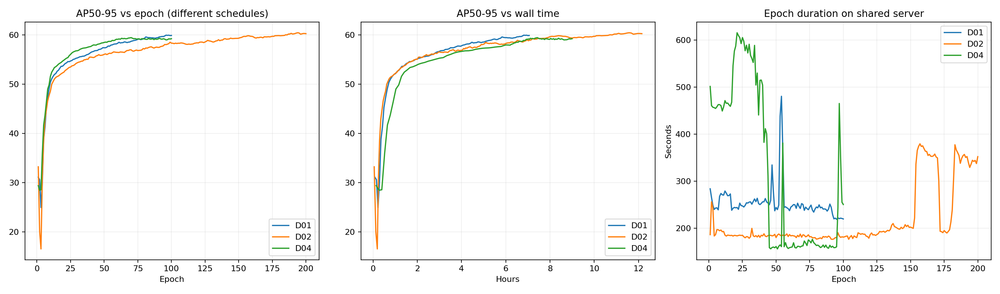

### 4. 收敛过程与早停判断

| epoch | AP50% | AP50-95% | train box/cls | val box/cls | lr |
| --- | --- | --- | --- | --- | --- |
| 1 | 48.74 | 29.41 | 1.1238/1.5035 | 1.2017/1.2644 | 0.00033309 |
| 10 | 72.10 | 51.61 | 1.1358/1.0634 | 1.0048/0.8290 | 0.00099876 |
| 25 | 75.40 | 56.07 | 1.0706/0.9527 | 0.9640/0.7701 | 0.00099123 |
| 50 | 76.91 | 58.50 | 1.0204/0.8758 | 0.9377/0.7242 | 0.00096379 |
| 60 | 77.59 | 59.13 | 1.0142/0.8636 | 0.9324/0.7158 | 0.00094780 |
| 70 | 77.60 | 59.48 | 1.0088/0.8513 | 0.9286/0.7115 | 0.00092908 |
| 80 | 77.58 | 59.20 | 1.0015/0.8422 | 0.9258/0.7070 | 0.00090774 |
| 90 | 77.44 | 59.19 | 0.9963/0.8360 | 0.9266/0.7062 | 0.00088391 |
| 100 | 77.26 | 59.25 | 0.9894/0.8307 | 0.9234/0.7014 | 0.00085776 |

D04第50轮AP50-95=58.498%，D02同期56.077%，按epoch早期效率提高约2.42个百分点；但共享服务器前期负载较高，不能直接说达到相同指标所需墙钟时间更短。D04最佳59.477%，最后59.254%，后30轮轻微波动且没有刷新。
验证box/cls从70轮0.92859/0.71152降至100轮0.92338/0.70143，损失仍在下降而AP平台。不能称作典型持续发散或已经证明严重过拟合。早停条件监控fitness而不是loss，只要AP未刷新就会终止，即使loss还有下降。
第70轮lr=0.000929075，第100轮0.000857756，距离计划终点0.00001很远；本轮验证了“该调度+该早停预算下的结果”，没有验证“AdamW完整400轮的效果”。

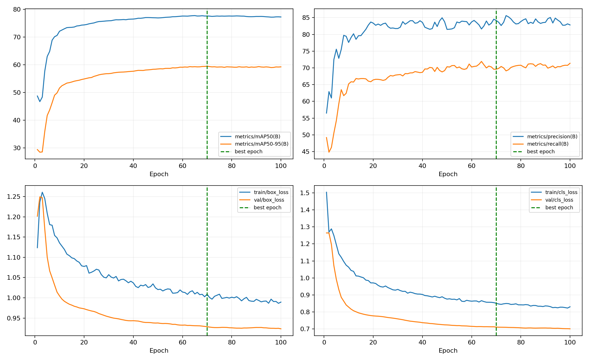

### 5. 完整验证集与固定旧验证集对照

全部本地CPU FP32、imgsz640、batch32、rect=True、conf=.001、NMS IoU=.7、max_det300；torch2.14.0+cpu、Ultralytics8.4.128。P/R为每个评估集的共同F1工作点，不是统一conf=.25；后续固定阈值表另列。

| 口径 | 模型 | P% | R% | AP50% | AP50-95% |
| --- | --- | --- | --- | --- | --- |
| full | D01 | 84.63 | 69.27 | 77.32 | 59.97 |
| full | D02 | 85.26 | 70.66 | 78.15 | 60.47 |
| full | D04 | 84.14 | 69.57 | 77.58 | 59.47 |
| old | D01 | 80.61 | 69.05 | 76.44 | 59.59 |
| old | D02 | 85.27 | 68.21 | 77.34 | 59.84 |
| old | D04 | 82.68 | 68.76 | 76.20 | 58.79 |

| 类别 | 图/GT | D04 P% | D04 R% | D04 AP50% | D01 AP50-95% | D02 AP50-95% | D04 AP50-95% | D04-D02 pp |
| --- | --- | --- | --- | --- | --- | --- | --- | --- |
| 人员 | 2467/7835 | 89.92 | 66.80 | 81.06 | 58.27 | 59.08 | 58.10 | -0.97 |
| 猫 | 188/206 | 85.73 | 86.89 | 89.48 | 71.79 | 72.26 | 72.09 | -0.17 |
| 狗 | 180/218 | 81.07 | 73.39 | 81.69 | 66.64 | 65.95 | 65.93 | -0.02 |
| 飞盘 | 83/111 | 88.14 | 66.67 | 80.23 | 58.72 | 60.44 | 61.16 | +0.72 |
| 运动球 | 139/188 | 83.68 | 52.13 | 59.20 | 43.38 | 44.56 | 43.38 | -1.18 |
| 玩具熊 | 88/158 | 83.21 | 65.89 | 75.26 | 56.66 | 57.41 | 53.84 | -3.57 |
| 软管 | 100/100 | 92.56 | 99.55 | 99.04 | 83.61 | 83.83 | 82.29 | -1.54 |
| 石块 | 61/283 | 68.80 | 45.23 | 54.72 | 40.67 | 40.21 | 38.99 | -1.22 |

| 类别 | D01旧集AP50-95% | D02旧集AP50-95% | D04旧集AP50-95% |
| --- | --- | --- | --- |
| 人员 | 58.21 | 59.03 | 58.07 |
| 猫 | 71.07 | 71.70 | 71.52 |
| 狗 | 64.95 | 64.08 | 64.22 |
| 飞盘 | 58.75 | 60.51 | 61.24 |
| 运动球 | 43.43 | 44.61 | 43.44 |
| 玩具熊 | 56.84 | 57.41 | 53.90 |
| 软管 | 89.63 | 87.94 | 88.30 |
| 石块 | 33.83 | 33.43 | 29.64 |

服务器日志最终AP50/AP50-95约77.6%/59.5%，CSV最佳77.601%/59.477%；本地精确值以上表为准。运行精度、batch及舍入差异不能混成一个精确值。

### 6. 固定阈值、尺寸及新增来源分析

诊断使用conf=.25、同类IoU≥.5一对一匹配。small是GT长边缩放至640后面积<32²；medium<96²，其余large，不是物理高度，也不是COCO APs。

| 类别 | D02 TP/FP/FN | D04 TP/FP/FN | D02→D04 P% | D02→D04 R% |
| --- | --- | --- | --- | --- |
| 人员 | 5839/1293/1996 | 5857/1521/1978 | 81.87→79.38 | 74.52→74.75 |
| 猫 | 180/44/26 | 185/53/21 | 80.36→77.73 | 87.38→89.81 |
| 狗 | 171/39/47 | 168/66/50 | 81.43→71.79 | 78.44→77.06 |
| 飞盘 | 85/19/26 | 87/22/24 | 81.73→79.82 | 76.58→78.38 |
| 运动球 | 102/38/86 | 107/57/81 | 72.86→65.24 | 54.26→56.91 |
| 玩具熊 | 110/33/48 | 116/47/42 | 76.92→71.17 | 69.62→73.42 |
| 软管 | 100/6/0 | 100/12/0 | 94.34→89.29 | 100.00→100.00 |
| 石块 | 155/124/128 | 151/165/132 | 55.56→47.78 | 54.77→53.36 |

| 类别 | 完整small GT | D02→D04命中 | 完整R%变化 | 旧集small GT | 旧集D02→D04命中 |
| --- | --- | --- | --- | --- | --- |
| 人员 | 1893 | 752→784 | 39.73→41.42 | 1893 | 754→785 |
| 猫 | 2 | 0→0 | 0.00→0.00 | 2 | 0→0 |
| 狗 | 7 | 2→4 | 28.57→57.14 | 7 | 2→4 |
| 飞盘 | 42 | 27→27 | 64.29→64.29 | 42 | 27→27 |
| 运动球 | 148 | 76→81 | 51.35→54.73 | 148 | 76→81 |
| 玩具熊 | 8 | 1→0 | 12.50→0.00 | 8 | 1→0 |
| 软管 | 0 | 0→0 | 无small样本 | 0 | 0→0 |
| 石块 | 135 | 34→35 | 25.19→25.93 | 89 | 9→11 |

固定conf=.25时，D02→D04的人员TP5839→5857但FP1293→1521；球TP102→107、FP38→57；石块TP155→151、FP124→165。软管均100个GT全命中，FP6→12。小人员命中752→784，小球76→81，小石块34→35，但额外预测代价明显，不能只报局部召回提升。

猫/狗/玩具熊small仅2/7/8个，软管small为0，不作小样本泛化结论。原旧验证集与完整集分别rect分批，少量预测可能不同，旧集对比必须使用旧集专用缓存。

| 来源 | 模型 | GT | TP/FP/FN | R% | AP50-95% |
| --- | --- | --- | --- | --- | --- |
| new_rock | D02_full | 122 | 92/101/30 | 75.41 | 53.08 |
| new_rock | D04_full | 122 | 91/123/31 | 74.59 | 53.36 |
| new_hose | D02_full | 95 | 95/6/0 | 100.00 | 84.08 |
| new_hose | D04_full | 95 | 95/12/0 | 100.00 | 82.24 |

来源组使用完整缓存重算AP，数值重算与直接验证AP误差已核验小于0.001；主表使用直接验证结果。新增岩石42张、软管95张，后者属于合成数据，不能当作真实现场测试。

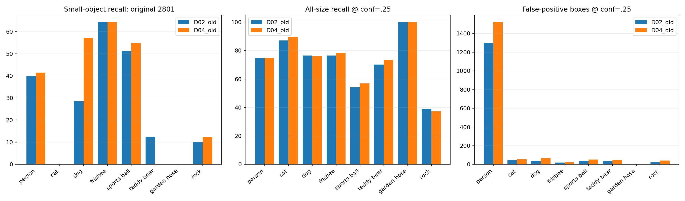

### 7. 新140张合成测试及90/50子集

D01既有结果复用；D02此前未在该集评估，本次补测；D04为本次首次评估。所有结果使用各自已有best权重，不按本测试结果选epoch。三模型全量及子集均独立执行split=test，参数与前述本地评估一致。

| 口径 | 模型 | P% | R% | AP50% | AP50-95% |
| --- | --- | --- | --- | --- | --- |
| 140 | D01 | 87.11 | 77.28 | 86.22 | 81.24 |
| 140 | D02 | 89.94 | 82.55 | 90.11 | 85.11 |
| 140 | D04 | 85.66 | 78.83 | 84.24 | 79.62 |
| 90 | D01 | 86.92 | 76.97 | 86.23 | 81.29 |
| 90 | D02 | 85.62 | 83.42 | 91.36 | 85.50 |
| 90 | D04 | 80.75 | 84.11 | 89.63 | 83.51 |
| 50 | D01 | 91.02 | 78.77 | 86.73 | 81.58 |
| 50 | D02 | 91.46 | 82.66 | 88.37 | 83.85 |
| 50 | D04 | 87.05 | 77.42 | 83.14 | 79.57 |

| 类别 | 图/GT | D04 P% | D04 R% | D04 AP50% | D01 AP50-95% | D02 AP50-95% | D04 AP50-95% |
| --- | --- | --- | --- | --- | --- | --- | --- |
| 人员 | 35/47 | 93.76 | 95.74 | 98.47 | 96.63 | 96.41 | 95.54 |
| 猫 | 26/26 | 96.84 | 96.15 | 97.46 | 95.70 | 95.14 | 94.38 |
| 狗 | 26/26 | 94.84 | 100.00 | 98.94 | 94.22 | 95.15 | 97.35 |
| 飞盘 | 26/27 | 66.24 | 65.44 | 68.56 | 75.07 | 89.07 | 64.77 |
| 运动球 | 26/26 | 100.00 | 60.59 | 91.63 | 75.55 | 82.27 | 84.37 |
| 玩具熊 | 26/26 | 88.55 | 100.00 | 99.04 | 97.15 | 95.77 | 93.23 |
| 软管 | 26/26 | 45.06 | 88.46 | 59.66 | 54.71 | 80.32 | 49.10 |
| 石块 | 26/27 | 100.00 | 24.22 | 60.15 | 60.91 | 46.75 | 58.21 |

| 类别 | D01 TP/FP/FN | D02 TP/FP/FN | D04 TP/FP/FN |
| --- | --- | --- | --- |
| 人员 | 47/3/0 | 47/4/0 | 46/8/1 |
| 猫 | 25/0/1 | 25/0/1 | 25/1/1 |
| 狗 | 24/3/2 | 24/1/2 | 26/2/0 |
| 飞盘 | 18/5/9 | 27/8/0 | 19/10/8 |
| 运动球 | 11/1/15 | 13/0/13 | 16/0/10 |
| 玩具熊 | 26/5/0 | 26/6/0 | 26/5/0 |
| 软管 | 25/36/1 | 25/16/1 | 24/35/2 |
| 石块 | 11/3/16 | 8/0/19 | 8/0/19 |

合成测试上，D04球类AP50-95为84.37%、狗为97.35%，存在局部收益；但飞盘64.77%、软管49.10%、石块58.21%，整体未胜出。固定conf=.25时，D02→D04飞盘TP27→19、软管FP16→35；球TP13→16，石块仍仅8/27命中。额外框中有20个软管预测覆盖飞盘GT，10个飞盘预测覆盖球GT，说明跨类别混淆仍突出（这是框数，不是唯一错分目标数）。

图片复核：testmix_003中D04对草地/飞盘所在区域输出多个额外软管框；test90_c7_010中两块大石头D04均未检出，D02也未命中，而D01仍命中左侧深色石块。testmix_015中D04、D02检出了D01漏掉的软管，属于局部改善。密集岩石场景的GT口径和未标出的碎石也影响FP计数，不能把所有未匹配框都称为背景幻觉。

全量140张/231框，90张/100框，50张/131框；不能平均两个子集AP来得到全量AP。该批按现有面积口径没有small GT，多为较大的合成目标，不能拿较高合成AP掩盖旧验证集小目标问题。源标注用户复核仍待完成，且已有测试结果参与讨论优化方向，后续应作为固定回归集，不宣称最终盲测泛化。

#### 跨类别预测框混淆（conf=.25）

以下统计未匹配预测与其他类GT最高IoU≥.5的框数，不是唯一错分目标数，也不是完整混淆矩阵。

| 模型 | 混淆框计数 |
| --- | --- |
| D01 | {'cat->dog': 3, 'frisbee->sports ball': 1, 'frisbee->garden hose': 20, 'sports ball->frisbee': 5, 'sports ball->garden hose': 6, 'sports ball->rock': 3, 'rock->garden hose': 3, 'dog->teddy bear': 2} |
| D02 | {'frisbee->garden hose': 7, 'sports ball->frisbee': 7, 'rock->frisbee': 1, 'dog->teddy bear': 2, 'cat->dog': 1, 'sports ball->garden hose': 1} |
| D04 | {'cat->dog': 2, 'frisbee->garden hose': 20, 'sports ball->frisbee': 10, 'rock->garden hose': 2, 'dog->teddy bear': 2, 'rock->teddy bear': 1, 'sports ball->garden hose': 1} |

### 8. 代表图片对比

验证图依次为GT、D02、D04，均固定conf=.25。案例按历史难例及本轮改善/退化自动筛选，不是随机抽样；原图名及TP/FP/FN保存在案例索引。

**人员 / previous_hard**：`000000389451.jpg`。GT=12；D02={'tp': 2, 'fp': 3, 'fn': 10}，D04={'tp': 3, 'fp': 3, 'fn': 9}。


**猫 / previous_hard**：`000000375493.jpg`。GT=3；D02={'tp': 0, 'fp': 0, 'fn': 3}，D04={'tp': 0, 'fp': 0, 'fn': 3}。


**狗 / previous_hard**：`000000262938.jpg`。GT=4；D02={'tp': 0, 'fp': 0, 'fn': 4}，D04={'tp': 0, 'fp': 0, 'fn': 4}。


**飞盘 / previous_hard**：`000000437239.jpg`。GT=4；D02={'tp': 0, 'fp': 2, 'fn': 4}，D04={'tp': 0, 'fp': 1, 'fn': 4}。

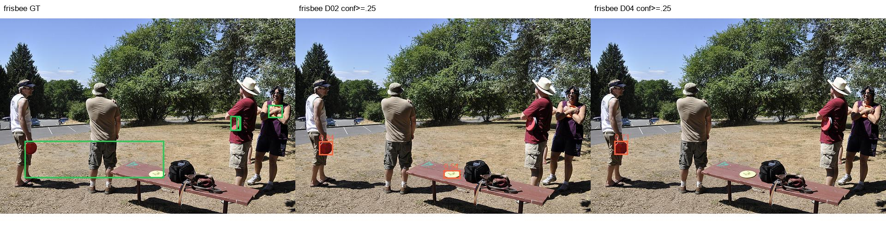

**运动球 / previous_hard**：`000000548246.jpg`。GT=13；D02={'tp': 0, 'fp': 0, 'fn': 13}，D04={'tp': 0, 'fp': 0, 'fn': 13}。


**玩具熊 / previous_hard**：`000000094185.jpg`。GT=11；D02={'tp': 3, 'fp': 2, 'fn': 8}，D04={'tp': 3, 'fp': 1, 'fn': 8}。

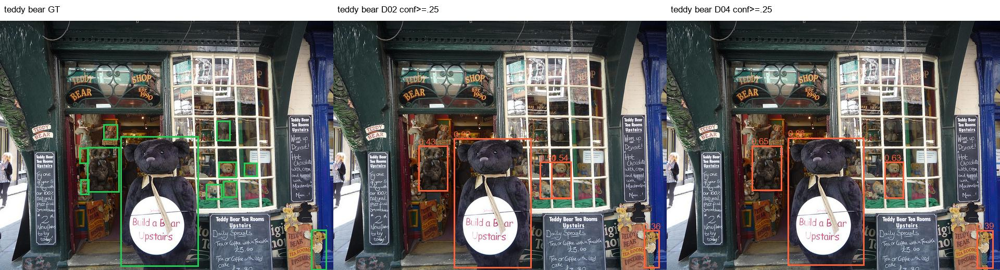

**软管 / previous_hard**：`obstructions_images-2-_jpeg.rf.e1522481cdef46ace47c8099d423ffb7.jpg`。GT=1；D02={'tp': 1, 'fp': 0, 'fn': 0}，D04={'tp': 1, 'fp': 0, 'fn': 0}。


**石块 / previous_hard**：`rocks_DSC5033-e1658535326972_jpg.rf.d8c9490498bfe41099daa0f5dbe5828f.jpg`。GT=67；D02={'tp': 17, 'fp': 12, 'fn': 50}，D04={'tp': 15, 'fp': 13, 'fn': 52}。

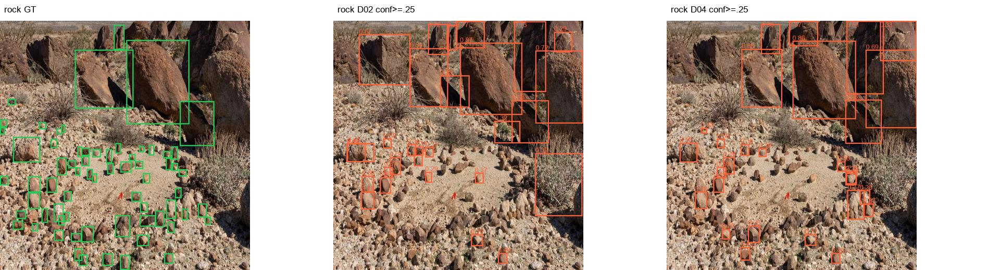

**石块 / new_hard**：`obstructions_rock_IMG0131_JPG.rf.25f00a5b25a576025e4f0be57df4e872.jpg`。GT=30；D02={'tp': 14, 'fp': 16, 'fn': 16}，D04={'tp': 13, 'fp': 13, 'fn': 17}。

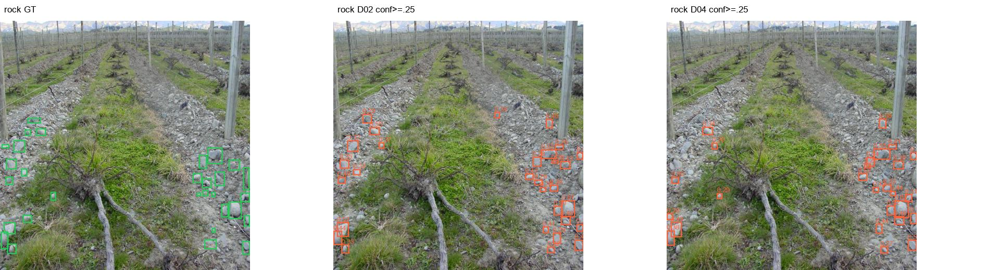

**石块 / new_fp**：`obstructions_rock_istockphoto-1136990430-612x612_jpg.rf.9771193ce74742bbc2cf841ae76b92ad.jpg`。GT=26；D02={'tp': 24, 'fp': 30, 'fn': 2}，D04={'tp': 24, 'fp': 55, 'fn': 2}。


**软管 / new_hard**：`ai_garden_hose_b02_000181.png`。GT=1；D02={'tp': 1, 'fp': 0, 'fn': 0}，D04={'tp': 1, 'fp': 0, 'fn': 0}。

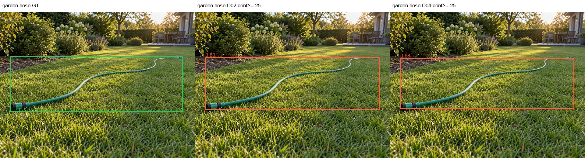

**软管 / new_fp**：`ai_garden_hose_b02_000323.png`。GT=1；D02={'tp': 1, 'fp': 1, 'fn': 0}，D04={'tp': 1, 'fp': 2, 'fn': 0}。

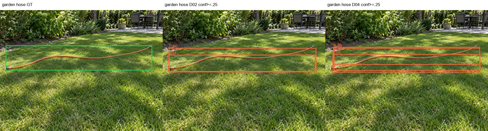

合成测试图依次为GT、D01、D02、D04。仍保留先前足球漏检、软管漏检、石块错分为软管的同图回归，避免只展示新模型的好样例。

**人员 / miss**：`test90_c0_009.png`；D01={'tp': 1, 'fp': 2, 'fn': 0}，D02={'tp': 1, 'fp': 2, 'fn': 0}，D04={'tp': 0, 'fp': 2, 'fn': 1}。


**猫 / miss**：`testmix_030.png`；D01={'tp': 0, 'fp': 0, 'fn': 1}，D02={'tp': 0, 'fp': 0, 'fn': 1}，D04={'tp': 0, 'fp': 0, 'fn': 1}。


**狗 / miss**：`test90_c2_001.png`；D01={'tp': 1, 'fp': 0, 'fn': 0}，D02={'tp': 1, 'fp': 0, 'fn': 0}，D04={'tp': 1, 'fp': 0, 'fn': 0}。


**飞盘 / miss**：`test90_c3_002.png`；D01={'tp': 0, 'fp': 0, 'fn': 1}，D02={'tp': 1, 'fp': 0, 'fn': 0}，D04={'tp': 0, 'fp': 0, 'fn': 1}。


**运动球 / miss**：`test90_c4_001.png`；D01={'tp': 0, 'fp': 0, 'fn': 1}，D02={'tp': 0, 'fp': 0, 'fn': 1}，D04={'tp': 0, 'fp': 0, 'fn': 1}。


**玩具熊 / miss**：`test90_c5_001.png`；D01={'tp': 1, 'fp': 0, 'fn': 0}，D02={'tp': 1, 'fp': 0, 'fn': 0}，D04={'tp': 1, 'fp': 0, 'fn': 0}。


**软管 / miss**：`testmix_043.png`；D01={'tp': 1, 'fp': 0, 'fn': 0}，D02={'tp': 1, 'fp': 1, 'fn': 0}，D04={'tp': 0, 'fp': 1, 'fn': 1}。


**石块 / miss**：`test90_c7_010.png`；D01={'tp': 1, 'fp': 0, 'fn': 1}，D02={'tp': 0, 'fp': 0, 'fn': 2}，D04={'tp': 0, 'fp': 0, 'fn': 2}。


**软管 / previous_case**：`testmix_015.png`；D01={'tp': 0, 'fp': 0, 'fn': 1}，D02={'tp': 1, 'fp': 0, 'fn': 0}，D04={'tp': 1, 'fp': 0, 'fn': 0}。


**石块 / previous_case**：`test90_c7_010.png`；D01={'tp': 1, 'fp': 0, 'fn': 1}，D02={'tp': 0, 'fp': 0, 'fn': 2}，D04={'tp': 0, 'fp': 0, 'fn': 2}。


**运动球 / previous_case**：`test90_c4_001.png`；D01={'tp': 0, 'fp': 0, 'fn': 1}，D02={'tp': 0, 'fp': 0, 'fn': 1}，D04={'tp': 0, 'fp': 0, 'fn': 1}。


### 9. 建议与实验边界

1. **保留D01/D02/D04，不替换既有最佳模型。** 选模型要同时看验证、固定旧集、合成回归和固定阈值误检；本轮总体不足以宣布D04全面优于D02。
2. **先修正训练计划与停止条件的配合，再决定下一轮。** 400轮余弦计划的前100轮仍接近初始lr，patience30却已结束训练。应让学习率下降和计划关闭增强的阶段有机会发生，而不是只增加epochs。可以单独验证更紧凑的调度，或明确延迟早停判断；这些都是待设计的实验，本次未改训练代码。
3. **不把更大patience当作必然提升。** 100轮时loss仍下降而AP未刷新，继续训练可能改善，也可能只是更久的平台；需要用固定口径复核，不承诺更长就更好。
4. **区分优化器、学习率曲线和预算影响。** D02与D04同时改变MuSGD→AdamW、线性→余弦、200→400计划及Mosaic关闭时机，不是纯优化器消融。
5. best/last已strip，不能假装可直接恢复原训练优化器状态；周期检查点epoch0/25/50/75仍保留，若要恢复需先检查状态和配置。本次只下载、评估、归档，未启动任何新训练。

### 10. 原始记录与复现

- [下载清单与哈希](../../../../runs/D04_CA_AdamW_400ep_3gpu/download_manifest_20261031.json)、[服务器训练日志](../../../../runs/D04_CA_AdamW_400ep_3gpu/server_train.log)、[最终验证摘录](../../../../runs/D04_CA_AdamW_400ep_3gpu/final_validation.txt)、[配置](../../../../runs/D04_CA_AdamW_400ep_3gpu/args.yaml)、[逐轮指标](../../../../runs/D04_CA_AdamW_400ep_3gpu/results.csv)。
- [best](../../../../runs/D04_CA_AdamW_400ep_3gpu/weights/best.pt)、[last](../../../../runs/D04_CA_AdamW_400ep_3gpu/weights/last.pt)、[本地训练统计](../../../../runs/D04_CA_AdamW_400ep_3gpu/analysis_20261031/training_analysis.json)、[数据一致性核验](../../../../runs/D04_CA_AdamW_400ep_3gpu/analysis_20261031/data_verification.json)。
- [完整验证指标](../../../../runs/d04full_20261031/metrics.json)、[固定旧集指标](../../../../runs/d04old_20261031/metrics.json)、[验证诊断](../../../../runs/D04_CA_AdamW_400ep_3gpu/analysis_20261031/comparison.json)、[验证案例索引](../../../../runs/D04_CA_AdamW_400ep_3gpu/analysis_20261031/cases/index.json)。
- [三模型测试集对比及案例索引](../../../../runs/D04_CA_AdamW_400ep_3gpu/analysis_20261031/test_comparison.json)、[D04全量140指标](../../../../runs/d04test140_20261031/metrics.json)、[D04原90指标](../../../../runs/d04test90_20261031/metrics.json)、[D04混合50指标](../../../../runs/d04test50_20261031/metrics.json)。
- [复评与分析脚本](../../../../runs/D04_CA_AdamW_400ep_3gpu/analysis_20261031/scripts)、[本地执行日志](../../../../runs/D04_CA_AdamW_400ep_3gpu/analysis_20261031/logs)。各复评缓存含逐图预测、输入哈希，便于回查；本地elapsed_seconds不是训练耗时，也不是NPU延迟。


## 2026-10-31：D05完整200轮AdamW重训已启动

09:44启动D05_CA_AdamW_200ep_noearly_3gpu，主进程4161091，服务器代码6df8cbeb0f699b17368122ea95bc1b8a86099f84。GPU2/3/7在启动前连续采样0%利用率、每卡4MiB且无计算进程。以原始yolov8n.pt重新初始化P3通道注意力，非续训D04。

AdamW lr0=.001、lrf=.01、cos_lr=True；epochs200、patience0禁用早停、mosaic1、close_mosaic30（计划第171轮关闭）、batch48每卡16、imgsz640、workers8每进程、scale.5、seed0、AMP=True、cache=False、momentum.9、weight_decay配置.0005（实际缩放.000375）、warmup_bias_lr=0、save_period25。仅使用现有train/val，独立合成测试集不参与训练及选best。

已确认AdamW日志和三卡训练进入第1轮，174/1393 batch，瞬时约10.8it/s，无启动异常。该速度为启动阶段快照，不是全程时长承诺；结果待训练完成后按既有口径评估。服务器启动命令及时间保存在logs/D05_CA_AdamW_200ep_noearly_3gpu_launch.json。


## 2026-11-01：D05第148轮阶段检查（尚未完成）


核查时间：2026-11-01 00:31，服务器时间。训练进程及 GPU 2/3/7 仍在运行，CSV 已完成148/200轮，日志没有200轮完成标志。本目录为阶段快照，不是最终模型归档。

| 训练 | 当前最佳轮次 | 最佳 mAP50 | 最佳 mAP50-95 | 状态 |
|---|---:|---:|---:|---|
| D01 | 96 | 77.294% | 59.977% | 完成100轮 |
| D02 | 194 | 78.115% | 60.463% | 完成200轮 |
| D04 | 70 | 77.601% | 59.477% | 第100轮早停 |
| D05 | 133 | 78.349% | 59.807% | 完成148轮，仍在训练 |

以上均为训练期间CSV记录，非本地统一复评；配置不同，不能据此把差异单独归因于优化器。

## 趋势与判断

- D05最佳 mAP50-95 比D04高0.330个百分点，比D02低0.656个百分点，比D01低0.170个百分点；mAP50略高于D02，但更严格的定位指标尚未超过D02。
- 第50/100/133/148轮 mAP50-95 为58.795%/59.678%/59.807%/59.621%。100轮以后提升很小，第148轮比最佳低0.186个百分点，当前表现为平台附近波动，不能称为持续改善。
- 第100→148轮训练box loss由0.97491降至0.94170，训练cls loss由0.80738降至0.75791；验证box loss由0.92372变为0.92305，基本持平，验证cls loss由0.70011降至0.69249。训练拟合仍改善，但验证定位收益有限，尚不足以断言严重过拟合。
- 第148轮学习率为0.000171859，已降至初始0.001的17.19%。因此目前不能再简单归因于“学习率一直降不下来”。
- close_mosaic=30，计划第171轮进入关闭Mosaic阶段；patience=0。当前尚未走到本次实验要验证的最后30轮，应先完成原定200轮，不中断、不改参数。
- 训练CSV累计53049.5秒，即14小时44分10秒。最近10轮平均181.41秒/轮，若速度不变，剩余52轮约2小时37分钟，约03:09完成；这是估算，受共享GPU、I/O及后续训练阶段影响，不保证。


图中学习率为各训练的pg0；优化器及参数组不同，数值不能直接视为同等更新强度。

## 已拉取及待完成

已拉取[逐轮指标](../../../../runs/D05_CA_AdamW_200ep_noearly_3gpu/progress_20261101/results.csv)、[配置](../../../../runs/D05_CA_AdamW_200ep_noearly_3gpu/progress_20261101/args.yaml)、[服务器阶段记录](../../../../runs/D05_CA_AdamW_200ep_noearly_3gpu/progress_20261101/snapshot.json)。保留独立阶段目录，避免与最终结果混淆。

尚未进行最终best.pt下载与复评。训练结束后，需按完整验证集2938张、固定旧验证集2801张、合成测试集140张（含90/50子集）的既有口径，补齐8类Precision/Recall/AP50/AP50-95、固定阈值召回与误检、失败样本图及最终耗时。当前CSV不含8类逐类指标，不能据此编造最终分类别结论。合成测试集也不能替代真实场景泛化结论。


## D05：完整200轮AdamW训练与同口径复评（2026-11-01）


分析日期：2026-11-01。实验：`D05_CA_AdamW_200ep_noearly_3gpu`。正常完成200轮，最佳第163轮，无早停；本报告取代此前“仍在训练”的阶段判断。

## 1. 结论

本地FP32完整验证集AP50=78.23%，AP50-95=59.79%；固定旧集AP50-95=59.36%；合成140张AP50-95=83.18%。三个口径分别评价，不混成一个平均分。
D05已经走完学习率下降和关闭Mosaic阶段，仍未超过D02的完整验证AP。前面担心的“D04早停太早、没到低学习率尾段”本轮已得到实际验证，不能继续用相同理由解释全部差距。也不能据一次训练判定AdamW本身不适合：D02和D05的优化器、调度及关闭Mosaic时机并不相同。

## 2. 归档及评估口径

- 下载33个训练产物，合计258,624,159字节；压缩包及逐文件SHA256全部通过。包含best/last、周期检查点、args、CSV、曲线和完整训练日志，另归档启动记录及模型YAML。
- best.pt SHA256：`f4e04e28fdcf04366408c7141306fffab5cce16ed68f93b2df0b3d7eaffd2826`；last.pt SHA256：`f64fff3dce8e4715a655cea63a87f747e8a2d33dae19b697f1bd7ed63502b3e2`。
- 当前本地与服务器val的5,876个图片/标签文件哈希一致。完整val为2,938图/9,099框，固定旧val为2,801图/8,863框，新增42张石块图与95张软管图另作来源子集诊断。未重建不存在的训练时完整数据快照。
- 合成测试集140图/231框，拆分原90图/100框与混合50图/131框；逐文件与登记manifest一致。未进入训练、早停或best选优，但已用于多轮分析，是固定合成回归集，不是未见过的最终盲测，也不代表真实相机泛化。
- 四模型复评统一CPU FP32、imgsz=640、batch=32、rect=True、workers=0、NMS IoU=0.7、max_det=300；AP候选阈值conf=0.001。D01/D02/D04复用已有同口径预测缓存，D05重新推理。
- 常规P/R取验证器平滑平均F1峰值对应置信度，非固定0.25；固定阈值另列。同类IoU≥0.5、贪心一对一匹配统计TP/FP/FN，延续历史口径。
- 小目标定义：GT框按原图长边等比缩放至640后面积<32²；中目标<96²，其余为大目标。是诊断尺寸桶，不是COCO APs，也不代表物理高度。140张合成图没有该定义的小目标。
- D05复评版本：{'torch': '2.14.0+cpu', 'ultralytics': '8.4.128'}。本地与服务器最终验证可能因精度、批次及数值差异略有不同；横向结论采用本地统一复评，不混用CSV最佳值。

## 3. 配置、训练时长与收敛

| 项目 | D02 | D04 | D05 |
| --- | --- | --- | --- |
| 结构 | YOLOv8n P3通道注意力 | 相同 | 相同；由原始yolov8n.pt重新训练 |
| optimizer | auto实际MuSGD | 显式AdamW | 显式AdamW |
| lr0 / lrf | 0.01 / 0.01 | 0.001 / 0.01 | 0.001 / 0.01 |
| 学习率曲线 | 线性200轮 | 余弦400轮 | 余弦200轮 |
| epochs / patience | 200 / 30 | 400 / 30 | 200 / 0 |
| 完成 / 最佳轮 | 200 / 194 | 100 / 70 | 200 / 163 |
| close_mosaic | 10（191轮） | 50（未到351轮） | 30（171轮） |
| batch / imgsz / scale | 48 / 640 / 0.5 | 相同 | 相同 |
| GPU | 1,2,3 | 2,3,7 | 2,3,7 |
| seed / AMP / workers | 0 / True / 8每进程 | 相同 | 相同 |
| momentum / weight_decay配置 | 0.9 / 0.0005 | 相同 | 相同；实际decay=0.000375 |
| 日志训练时长 | 12.151h | 8.997h | 18.410h（约18h24m36s） |
| CSV累计时间(s) | 43743.9 | 32388.6 | 66275.3 |
| 平均每轮(s) | 218.72 | 323.89 | 331.38 |
| 达到最佳累计时间 | 约11h34m48s | 约7h25m17s | 15h33m19s |

训练环境：Python3.10.21、torch2.6.0+cu124、Ultralytics8.4.128、RTX A6000；启动记录代码版本6df8cbe。无完整启动时工作区快照，不能把commit当作所有未提交文件的证明。GPU共享负载导致每轮时长波动，不能据总时长得出AdamW一定慢于MuSGD。下载、最终独立验证和本地复评不计入CSV训练耗时。


| 轮次 | AP50% | AP50-95% | train box/cls | val box/cls | lr |
| --- | --- | --- | --- | --- | --- |
| 50 | 77.44 | 58.79 | 1.01490/0.86797 | 0.93284/0.72177 | 0.00086047 |
| 100 | 78.35 | 59.68 | 0.97491/0.80738 | 0.92372/0.70011 | 0.00051278 |
| 133 | 78.35 | 59.81 | 0.94911/0.76845 | 0.92085/0.69313 | 0.00026653 |
| 150 | 78.11 | 59.63 | 0.93984/0.75195 | 0.92418/0.69298 | 0.00016052 |
| 163 | 78.20 | 59.83 | 0.94394/0.74995 | 0.92186/0.69223 | 0.00009560 |
| 170 | 78.34 | 59.71 | 0.93246/0.74220 | 0.92147/0.69173 | 0.00006754 |
| 171 | 78.25 | 59.73 | 0.89829/0.66401 | 0.92189/0.69066 | 0.00006395 |
| 180 | 77.78 | 59.82 | 0.88138/0.63623 | 0.92473/0.69034 | 0.00003669 |
| 190 | 77.69 | 59.67 | 0.88352/0.63270 | 0.92628/0.69018 | 0.00001737 |
| 200 | 77.66 | 59.63 | 0.88107/0.63339 | 0.92652/0.68966 | 0.00001006 |

最佳163轮AP50-95=59.833%，末轮59.628%；关闭Mosaic后的最佳为180轮59.823%，距离全程最佳仅0.010个百分点，属于接近平台，不能说关闭Mosaic导致明显崩溃。170→171轮训练loss下降还包含训练分布变简单的因素，不能直接解读为泛化提升。
第100轮59.678%到全程最佳只提升0.155个百分点；末轮lr=0.0000100611，已接近计划最低值。验证box loss由163轮0.92186到200轮0.92652略升，训练loss继续下降；说明后期训练收益有限，但不足以证明严重过拟合或整个架构上限。


## 4. 完整与固定旧验证集

| 模型 | 完整P% | 完整R% | 完整AP50% | 完整AP50-95% | 旧集AP50% | 旧集AP50-95% |
| --- | --- | --- | --- | --- | --- | --- |
| D01 | 84.63 | 69.27 | 77.32 | 59.97 | 76.44 | 59.59 |
| D02 | 85.26 | 70.66 | 78.15 | 60.47 | 77.34 | 59.84 |
| D04 | 84.14 | 69.57 | 77.58 | 59.47 | 76.20 | 58.79 |
| D05 | 83.73 | 71.91 | 78.23 | 59.79 | 77.49 | 59.36 |

D05完整集P/R报告点conf≈0.4094，旧集conf≈0.3974。以下为完整验证集8类指标；Δ为D05−D02，单位百分点。

| ID/类别 | 含类图/框 | P% | R% | AP50% | AP50-95% | D02 AP50-95% | Δ |
| --- | --- | --- | --- | --- | --- | --- | --- |
| 0/人员 | 2467/7835 | 89.36 | 68.96 | 81.58 | 58.32 | 59.08 | -0.75 |
| 1/猫 | 188/206 | 84.17 | 83.98 | 87.40 | 69.62 | 72.26 | -2.64 |
| 2/狗 | 180/218 | 82.65 | 76.46 | 80.75 | 66.16 | 65.95 | +0.20 |
| 3/飞盘 | 83/111 | 89.08 | 75.68 | 82.01 | 62.15 | 60.44 | +1.71 |
| 4/运动球 | 139/188 | 83.20 | 52.70 | 62.12 | 44.48 | 44.56 | -0.08 |
| 5/玩具熊 | 88/158 | 80.30 | 65.19 | 75.31 | 55.42 | 57.41 | -1.99 |
| 6/软管 | 100/100 | 95.36 | 100.00 | 99.39 | 82.85 | 83.83 | -0.99 |
| 7/石块 | 61/283 | 65.75 | 52.30 | 57.26 | 39.29 | 40.21 | -0.92 |


固定旧验证集（与D02输入哈希一致）：

| 类别 | 图/框 | P% | R% | AP50% | AP50-95% | D02 AP50-95% |
| --- | --- | --- | --- | --- | --- | --- |
| 人员 | 2461/7829 | 88.82 | 69.49 | 81.58 | 58.29 | 59.03 |
| 猫 | 184/202 | 83.18 | 83.66 | 87.26 | 68.94 | 71.70 |
| 狗 | 171/209 | 81.71 | 75.60 | 79.80 | 64.61 | 64.08 |
| 飞盘 | 83/111 | 88.87 | 75.68 | 81.95 | 62.11 | 60.51 |
| 运动球 | 139/188 | 81.87 | 53.72 | 62.09 | 44.51 | 44.61 |
| 玩具熊 | 88/158 | 80.46 | 65.82 | 75.42 | 55.43 | 57.41 |
| 软管 | 5/5 | 90.73 | 100.00 | 99.50 | 87.63 | 87.94 |
| 石块 | 19/161 | 80.64 | 36.65 | 52.31 | 33.32 | 33.43 |

旧集软管仅5框，不能用其高低得分证明泛化；新增软管集与COCO类别来源不同，不宜把软管高分推广至真实混合场景。

## 5. 固定阈值召回、小目标与新增来源

以下conf=0.25，IoU≥0.5，TP/FP/FN均为框数。完整集主表：

| 类别 | D02 TP/FP/FN | D04 TP/FP/FN | D05 TP/FP/FN | D05 P% | D05 R% |
| --- | --- | --- | --- | --- | --- |
| 人员 | 5839/1293/1996 | 5857/1521/1978 | 5980/1572/1855 | 79.18 | 76.32 |
| 猫 | 180/44/26 | 185/53/21 | 178/62/28 | 74.17 | 86.41 |
| 狗 | 171/39/47 | 168/66/50 | 174/65/44 | 72.80 | 79.82 |
| 飞盘 | 85/19/26 | 87/22/24 | 89/22/22 | 80.18 | 80.18 |
| 运动球 | 102/38/86 | 107/57/81 | 113/41/75 | 73.38 | 60.11 |
| 玩具熊 | 110/33/48 | 116/47/42 | 117/59/41 | 66.48 | 74.05 |
| 软管 | 100/6/0 | 100/12/0 | 100/8/0 | 92.59 | 100.00 |
| 石块 | 155/124/128 | 151/165/132 | 167/197/116 | 45.88 | 59.01 |

人员、猫狗合计、低矮类别分开统计；猫狗合计为按实例加权召回，不是两类召回均值。低矮类按类别展示，不推断实际物理高度：

| 组 | D02 TP/GT/R% | D05 TP/GT/R% |
| --- | --- | --- |
| 人员 | 5839/7835/74.52 | 5980/7835/76.32 |
| 猫狗合计 | 351/424/82.78 | 352/424/83.02 |
| 飞盘 | 85/111/76.58 | 89/111/80.18 |
| 球 | 102/188/54.26 | 113/188/60.11 |
| 玩具熊 | 110/158/69.62 | 117/158/74.05 |
| 软管 | 100/100/100.00 | 100/100/100.00 |
| 石块 | 155/283/54.77 | 167/283/59.01 |

| 类别 | 完整小目标数 | D02小TP/R% | D05小TP/R% | 旧小目标数 | D02旧小TP/R% | D05旧小TP/R% |
| --- | --- | --- | --- | --- | --- | --- |
| 人员 | 1893 | 752/39.73 | 828/43.74 | 1893 | 754/39.83 | 828/43.74 |
| 猫 | 2 | 0/0.00 | 0/0.00 | 2 | 0/0.00 | 0/0.00 |
| 狗 | 7 | 2/28.57 | 4/57.14 | 7 | 2/28.57 | 4/57.14 |
| 飞盘 | 42 | 27/64.29 | 30/71.43 | 42 | 27/64.29 | 30/71.43 |
| 运动球 | 148 | 76/51.35 | 85/57.43 | 148 | 76/51.35 | 85/57.43 |
| 玩具熊 | 8 | 1/12.50 | 0/0.00 | 8 | 1/12.50 | 0/0.00 |
| 软管 | 0 | 0/不适用 | 0/不适用 | 0 | 0/不适用 | 0/不适用 |
| 石块 | 135 | 34/25.19 | 46/34.07 | 89 | 9/10.11 | 14/15.73 |

猫、狗、玩具熊小目标仅2/7/8框，结论不稳定；软管0小框，不能填100%小目标召回。石块集中于少数密集图，实例统计受这些图影响明显。


阈值敏感性（完整验证集；只作诊断，不直接定为部署阈值）：

| 类别 | conf | D02 TP/FP/FN | D05 TP/FP/FN | D05 R% |
| --- | --- | --- | --- | --- |
| 人员 | 0.1 | 6436/4226/1399 | 6504/5040/1331 | 83.01 |
| 人员 | 0.25 | 5839/1293/1996 | 5980/1572/1855 | 76.32 |
| 人员 | 0.5 | 4938/315/2897 | 5066/399/2769 | 64.66 |
| 运动球 | 0.1 | 115/107/73 | 120/120/68 | 63.83 |
| 运动球 | 0.25 | 102/38/86 | 113/41/75 | 60.11 |
| 运动球 | 0.5 | 88/12/100 | 96/11/92 | 51.06 |
| 软管 | 0.1 | 100/9/0 | 100/18/0 | 100.00 |
| 软管 | 0.25 | 100/6/0 | 100/8/0 | 100.00 |
| 软管 | 0.5 | 100/5/0 | 100/3/0 | 100.00 |
| 石块 | 0.1 | 182/381/101 | 189/563/94 | 66.78 |
| 石块 | 0.25 | 155/124/128 | 167/197/116 | 59.01 |
| 石块 | 0.5 | 119/22/164 | 124/42/159 | 43.82 |

新增数据子集诊断。AP由完整预测缓存筛选后重建，存在数值舍入差异；仅报告该子集实际存在的类别，不能把子集均值当完整8类均值：

### new_rock：42张

| 类别 | 图/框 | D05 P% | D05 R% | D05 AP50% | D05 AP50-95% | D02 AP50-95% |
| --- | --- | --- | --- | --- | --- | --- |
| rock | 42/122 | 94.49 | 56.24 | 74.00 | 52.08 | 53.08 |

### new_hose：95张

| 类别 | 图/框 | D05 P% | D05 R% | D05 AP50% | D05 AP50-95% | D02 AP50-95% |
| --- | --- | --- | --- | --- | --- | --- |
| person | 6/6 | 95.16 | 100.00 | 99.50 | 97.90 | 99.50 |
| cat | 4/4 | 94.03 | 100.00 | 99.50 | 96.38 | 96.38 |
| dog | 9/9 | 97.20 | 100.00 | 99.50 | 96.63 | 97.79 |
| garden hose | 95/95 | 97.87 | 96.54 | 99.39 | 83.05 | 84.08 |

### 主要变化的解释

完整验证集相对D02，AP50-95明显下降集中在猫（约−2.64个百分点）、玩具熊（约−1.99）、软管（约−0.99）、石块（约−0.92）和人员（约−0.75）；飞盘提高约1.71，狗提高约0.20。并不是所有类别都退化。
固定阈值0.25下，D05人员TP从5839增至5980，但FP从1293增至1572；石块TP从155增至167，FP从124增至197。球TP从102增至113，FP从38增至41，球的这一阈值收益更清晰。
完整集小目标人员TP由752/1893升至828/1893（39.73%→43.74%），球由76/148升至85/148（51.35%→57.43%），石块由34/135升至46/135（25.19%→34.07%）。所以D05有小目标召回价值，但较高FP与较低AP说明还不能宣布综合优于D02。不同模型置信度标定不同，同阈值的差异不等于同误报预算下的差异。
D05的AP50略高而AP50-95更低，说明更严格IoU下的综合排序/定位表现没有同步提高；不能仅凭这两个均值断定每个框都定位更差。

## 6. 合成测试集140/90/50张

| 模型 | 140 AP50% | 140 AP50-95% | 90 AP50% | 90 AP50-95% | 50 AP50% | 50 AP50-95% |
| --- | --- | --- | --- | --- | --- | --- |
| D01 | 86.22 | 81.24 | 86.23 | 81.29 | 86.73 | 81.58 |
| D02 | 90.11 | 85.11 | 91.36 | 85.50 | 88.37 | 83.85 |
| D04 | 84.24 | 79.62 | 89.63 | 83.51 | 83.14 | 79.57 |
| D05 | 87.34 | 83.18 | 90.98 | 85.74 | 85.36 | 81.80 |

### 140张：8类结果

| 类别 | 图/框 | P% | R% | AP50% | AP50-95% | D02 AP50-95% |
| --- | --- | --- | --- | --- | --- | --- |
| 人员 | 35/47 | 94.02 | 97.87 | 98.23 | 95.91 | 96.41 |
| 猫 | 26/26 | 91.89 | 96.15 | 96.50 | 94.25 | 95.14 |
| 狗 | 26/26 | 89.61 | 96.15 | 98.15 | 96.51 | 95.15 |
| 飞盘 | 26/27 | 78.80 | 88.89 | 91.27 | 88.18 | 89.07 |
| 运动球 | 26/26 | 100.00 | 61.44 | 85.63 | 79.32 | 82.27 |
| 玩具熊 | 26/26 | 86.27 | 100.00 | 99.19 | 95.54 | 95.77 |
| 软管 | 26/26 | 59.13 | 84.62 | 79.16 | 68.18 | 80.32 |
| 石块 | 26/27 | 100.00 | 23.34 | 50.63 | 47.55 | 46.75 |

### 90张：8类结果

| 类别 | 图/框 | P% | R% | AP50% | AP50-95% | D02 AP50-95% |
| --- | --- | --- | --- | --- | --- | --- |
| 人员 | 20/29 | 91.85 | 96.55 | 97.57 | 96.09 | 95.65 |
| 猫 | 10/10 | 89.87 | 100.00 | 99.50 | 93.86 | 93.89 |
| 狗 | 10/10 | 91.15 | 100.00 | 99.50 | 97.05 | 94.55 |
| 飞盘 | 10/10 | 69.17 | 80.00 | 88.17 | 83.60 | 73.61 |
| 运动球 | 10/10 | 100.00 | 38.89 | 67.05 | 60.75 | 64.72 |
| 玩具熊 | 10/10 | 73.97 | 100.00 | 99.50 | 95.52 | 96.22 |
| 软管 | 10/10 | 50.98 | 100.00 | 86.90 | 75.55 | 88.68 |
| 石块 | 10/11 | 100.00 | 56.35 | 89.68 | 83.50 | 76.66 |

### 50张：8类结果

| 类别 | 图/框 | P% | R% | AP50% | AP50-95% | D02 AP50-95% |
| --- | --- | --- | --- | --- | --- | --- |
| 人员 | 15/18 | 96.21 | 100.00 | 99.50 | 95.98 | 97.69 |
| 猫 | 16/16 | 100.00 | 93.38 | 93.50 | 93.50 | 96.20 |
| 狗 | 16/16 | 94.01 | 98.17 | 98.44 | 97.25 | 97.06 |
| 飞盘 | 16/17 | 82.93 | 85.79 | 94.57 | 92.44 | 93.93 |
| 运动球 | 16/16 | 100.00 | 77.77 | 93.50 | 87.45 | 88.60 |
| 玩具熊 | 16/16 | 100.00 | 99.80 | 99.50 | 95.90 | 95.00 |
| 软管 | 16/16 | 78.43 | 68.23 | 83.34 | 71.49 | 75.95 |
| 石块 | 16/16 | 100.00 | 0.00 | 20.56 | 20.35 | 26.38 |

140张固定conf=0.25：

| 类别 | D01 TP/FP/FN | D02 TP/FP/FN | D04 TP/FP/FN | D05 TP/FP/FN |
| --- | --- | --- | --- | --- |
| 人员 | 47/3/0 | 47/4/0 | 46/8/1 | 46/3/1 |
| 猫 | 25/0/1 | 25/0/1 | 25/1/1 | 25/2/1 |
| 狗 | 24/3/2 | 24/1/2 | 26/2/0 | 26/3/0 |
| 飞盘 | 18/5/9 | 27/8/0 | 19/10/8 | 24/8/3 |
| 运动球 | 11/1/15 | 13/0/13 | 16/0/10 | 16/0/10 |
| 玩具熊 | 26/5/0 | 26/6/0 | 26/5/0 | 26/4/0 |
| 软管 | 25/36/1 | 25/16/1 | 24/35/2 | 24/20/2 |
| 石块 | 11/3/16 | 8/0/19 | 8/0/19 | 6/0/21 |

D05未匹配预测中与异类GT重叠IoU≥0.5的框数（可能多框对应同一GT，不能解读为独立目标数）：

| GT→预测类 | 预测框数 |
| --- | --- |
| sports ball->frisbee | 7 |
| frisbee->garden hose | 6 |
| cat->dog | 2 |
| sports ball->garden hose | 2 |
| person->dog | 1 |
| sports ball->teddy bear | 1 |
| rock->teddy bear | 1 |
| rock->garden hose | 1 |
| rock->frisbee | 1 |

### 合成集与可视化解释

D05合成140张AP50-95=83.18%，较D04的79.62%恢复，但仍低于D02的85.11%。原90张为85.74%，略高于D02的85.50%；混合50张81.80%，低于D02的83.85%。只看原90张会掩盖混合场景退化，且拆分子集AP不能按图片数加权得到全量AP。
固定0.25下，D05合成球TP由D02的13增至16、FP仍为0，狗TP由24增至26；但飞盘27→24，软管25→24且FP16→20，石块8→6。验证集小石块召回改善，并未转化成合成石块改善，二者不是同一分布或尺寸。
查看test90_c0_009：GT用一个框包含双手，D05分别框出两只手、未保留覆盖双手的大框，因此统计为0TP/2FP/1FN。这里是现有标注口径下的拆框/定位不匹配，不是完全没有人员响应；不改标签，也不把这个现象夸成真实安全漏检率。
查看testmix_015：D02能框出右侧软管，D05在0.25阈值下漏掉，球和玩具熊仍被检出，是混合场景软管退化的直接例子。
查看新增石块IMG0131：D05从14TP/16FP变为19TP/35FP，既增加匹配也增加未匹配框；画面有大量可见碎石并非全部标注，FP需结合标签完整性解释，不能全部称为识别背景。

## 7. 失败、改善和退化图片

每张验证图为GT/D02/D05，展示对应类别；测试图为GT/D01/D02/D05，展示全部类别。阈值均为0.25。案例按最大漏检、误检或新旧变化选取，不能替代全量统计。miss表示按漏检数选取的候选：若FN=0，则是全检出对照而不是漏检案例。FP是相对现有标签的未匹配框，密集石块图中可能包含未标注可见石块，不能全解释成背景幻觉。

### 人员 / previous_hard

原图：`000000389451.jpg`；范围：old；GT=12；D02 TP/FP/FN=2/3/10；D05=4/3/8。


### 人员 / gain

原图：`000000262048.jpg`；范围：old；GT=10；D02 TP/FP/FN=4/2/6；D05=9/0/1。


### 人员 / regression

原图：`000000045550.jpg`；范围：old；GT=7；D02 TP/FP/FN=5/2/2；D05=2/2/5。


### 猫 / previous_hard

原图：`000000375493.jpg`；范围：old；GT=3；D02 TP/FP/FN=0/0/3；D05=0/0/3。


### 猫 / gain

原图：`000000117374.jpg`；范围：old；GT=2；D02 TP/FP/FN=1/0/1；D05=2/0/0。


### 猫 / regression

原图：`000000269314.jpg`；范围：old；GT=1；D02 TP/FP/FN=1/0/0；D05=0/1/1。


### 狗 / previous_hard

原图：`000000262938.jpg`；范围：old；GT=4；D02 TP/FP/FN=0/0/4；D05=0/0/4。


### 狗 / gain

原图：`000000065485.jpg`；范围：old；GT=1；D02 TP/FP/FN=0/0/1；D05=1/1/0。


### 狗 / regression

原图：`000000182805.jpg`；范围：old；GT=2；D02 TP/FP/FN=1/0/1；D05=0/0/2。


### 飞盘 / previous_hard

原图：`000000437239.jpg`；范围：old；GT=4；D02 TP/FP/FN=0/2/4；D05=0/2/4。


### 飞盘 / gain

原图：`000000533493.jpg`；范围：old；GT=1；D02 TP/FP/FN=0/0/1；D05=1/0/0。


### 飞盘 / regression

原图：`000000261036.jpg`；范围：old；GT=3；D02 TP/FP/FN=2/0/1；D05=1/0/2。


### 运动球 / previous_hard

原图：`000000548246.jpg`；范围：old；GT=13；D02 TP/FP/FN=0/0/13；D05=0/0/13。


### 运动球 / gain

原图：`000000383384.jpg`；范围：old；GT=1；D02 TP/FP/FN=0/0/1；D05=1/0/0。


### 运动球 / regression

原图：`000000320490.jpg`；范围：old；GT=1；D02 TP/FP/FN=1/0/0；D05=0/0/1。


### 玩具熊 / previous_hard

原图：`000000094185.jpg`；范围：old；GT=11；D02 TP/FP/FN=3/2/8；D05=2/1/9。


### 玩具熊 / gain

原图：`000000350054.jpg`；范围：old；GT=3；D02 TP/FP/FN=0/0/3；D05=3/0/0。


### 玩具熊 / regression

原图：`000000050638.jpg`；范围：old；GT=1；D02 TP/FP/FN=1/0/0；D05=0/0/1。


### 软管 / previous_hard

原图：`obstructions_images-2-_jpeg.rf.e1522481cdef46ace47c8099d423ffb7.jpg`；范围：old；GT=1；D02 TP/FP/FN=1/0/0；D05=1/0/0。


### 石块 / previous_hard

原图：`rocks_DSC5033-e1658535326972_jpg.rf.d8c9490498bfe41099daa0f5dbe5828f.jpg`；范围：old；GT=67；D02 TP/FP/FN=17/12/50；D05=19/15/48。


### 石块 / gain

原图：`rocks_DSC5033-e1658535326972_jpg.rf.d8c9490498bfe41099daa0f5dbe5828f.jpg`；范围：old；GT=67；D02 TP/FP/FN=17/12/50；D05=19/15/48。


### 石块 / regression

原图：`rocks_images-4-_jpg.rf.490b28a2242d41bc58ad7b1891b1b580.jpg`；范围：old；GT=2；D02 TP/FP/FN=2/0/0；D05=1/0/1。


### 石块 / new_hard

原图：`obstructions_rock_IMG0131_JPG.rf.25f00a5b25a576025e4f0be57df4e872.jpg`；范围：full；GT=30；D02 TP/FP/FN=14/16/16；D05=19/35/11。


### 石块 / new_fp

原图：`obstructions_rock_Batch2-IMG0131_JPG.rf.52c42f68a19dbd046ba0941c3f1345a1.jpg`；范围：full；GT=8；D02 TP/FP/FN=5/25/3；D05=5/49/3。


### 软管 / new_hard

原图：`ai_garden_hose_b02_000181.png`；范围：full；GT=1；D02 TP/FP/FN=1/0/0；D05=1/0/0。


### 软管 / new_fp

原图：`ai_garden_hose_b02_000323.png`；范围：full；GT=1；D02 TP/FP/FN=1/1/0；D05=1/1/0。


### 合成：人员 / miss

原图：`test90_c0_009.png`；D02={'tp': 1, 'fp': 2, 'fn': 0}；D05={'tp': 0, 'fp': 2, 'fn': 1}。


### 合成：人员 / fp

原图：`test90_c0_009.png`；D02={'tp': 1, 'fp': 2, 'fn': 0}；D05={'tp': 0, 'fp': 2, 'fn': 1}。


### 合成：猫 / miss

原图：`testmix_030.png`；D02={'tp': 0, 'fp': 0, 'fn': 1}；D05={'tp': 0, 'fp': 0, 'fn': 1}。


### 合成：猫 / fp

原图：`testmix_008.png`；D02={'tp': 1, 'fp': 0, 'fn': 0}；D05={'tp': 1, 'fp': 1, 'fn': 0}。


### 合成：狗 / miss

原图：`test90_c2_001.png`；D02={'tp': 1, 'fp': 0, 'fn': 0}；D05={'tp': 1, 'fp': 0, 'fn': 0}。


### 合成：飞盘 / miss

原图：`test90_c3_007.png`；D02={'tp': 1, 'fp': 0, 'fn': 0}；D05={'tp': 0, 'fp': 0, 'fn': 1}。


### 合成：运动球 / miss

原图：`test90_c4_001.png`；D02={'tp': 0, 'fp': 0, 'fn': 1}；D05={'tp': 0, 'fp': 0, 'fn': 1}。


### 合成：玩具熊 / miss

原图：`test90_c5_001.png`；D02={'tp': 1, 'fp': 0, 'fn': 0}；D05={'tp': 1, 'fp': 0, 'fn': 0}。


### 合成：玩具熊 / fp

原图：`test90_c5_002.png`；D02={'tp': 1, 'fp': 2, 'fn': 0}；D05={'tp': 1, 'fp': 1, 'fn': 0}。


### 合成：软管 / miss

原图：`testmix_003.png`；D02={'tp': 1, 'fp': 1, 'fn': 0}；D05={'tp': 0, 'fp': 1, 'fn': 1}。


### 合成：软管 / fp

原图：`test90_c6_003.png`；D02={'tp': 1, 'fp': 0, 'fn': 0}；D05={'tp': 1, 'fp': 1, 'fn': 0}。


### 合成：石块 / miss

原图：`test90_c7_010.png`；D02={'tp': 0, 'fp': 0, 'fn': 2}；D05={'tp': 0, 'fp': 0, 'fn': 2}。


### 合成：软管 / previous_case

原图：`testmix_015.png`；D02={'tp': 1, 'fp': 0, 'fn': 0}；D05={'tp': 0, 'fp': 0, 'fn': 1}。


### 合成：石块 / previous_case

原图：`test90_c7_010.png`；D02={'tp': 0, 'fp': 0, 'fn': 2}；D05={'tp': 0, 'fp': 0, 'fn': 2}。


### 合成：运动球 / previous_case

原图：`test90_c4_001.png`；D02={'tp': 0, 'fp': 0, 'fn': 1}；D05={'tp': 0, 'fp': 0, 'fn': 1}。


## 8. 下一步：结合前面几轮作决策

1. **保留D02作为目前完整验证集的优先对照，D05保留归档，不直接替换部署模型。** 选型同时查看合成集、重点类别召回与误检；单次AP不足以证明业务达标。当前不启动新训练。
2. **不再把下一轮简单改成400/800轮，也不继续把所有差距归因于没学够。** D03的800轮线性计划在222轮主动停止，不能代表800轮最终结果；D04因400轮余弦搭配30早停没到低lr尾段；D05已经完成200轮余弦、无早停和30轮无Mosaic，平台仍在。三个问题必须分开。
3. **若继续从头训练，优先做一轮明确的优化器对照。** 以D05为控制组，只将优化器配置改为显式`MuSGD, lr0=0.01, momentum=0.9`，保持200轮、patience=0、cos_lr=true、lrf=0.01、close_mosaic=30、P3注意力、imgsz640、batch48、scale0.5、seed0及数据版本不变，仍从原始yolov8n.pt初始化。AdamW与MuSGD不能机械使用同一个lr0；这是“优化器及其配套初始lr”的对照，不是纯算法独立消融。MuSGD并非普通SGD，当前仓库显式支持且D01/D02实际使用过，不再让auto隐式决定。
4. **这轮对照的判定提前固定。** 与D05判断优化器配置是否改善；与D02判断能否超过现有最好方案。如果只超过D05仍不及D02，则保留D02的线性/close10组合，不继续追着余弦加轮数。一次相近分数不宣称显著优势；提升还应同时检查旧集、人员/球/石块小目标召回及FP，合成软管和飞盘不得出现明显退化。
5. **之后才做针对小目标的单项增强试验。** 依据先前讨论，可固定选定优化器/调度，将scale从0.5改为0.3单独验证，先不同时改变mosaic、输入尺寸和模型结构。随机缩放范围由约0.5～1.5变为0.7～1.3，减少极端缩小，也减少放大，可能损失尺度泛化；不能承诺必升。mosaic仍会改变目标尺度，scale0.3不是小目标问题的充分解。若优先业务效果而无时间做因果对照，也可直接以D02为基础只改scale，但要明确跳过了优化器诊断。
6. **不重复已失败的直接改大推理尺寸，也不盲目叠加注意力。** 历史D00同一640训练权重直接960推理，AP50-95由58.96%降至44.66%，不能据此建议上线960；这也不等于960重新训练无效。后续若考虑P2或更大模型，需独立评估板端算力和兼容性，不与本轮优化器对照混做。
7. **本轮不把“再补数据”作为默认答案。** 先用现有冻结数据检验优化器与尺度方案。公开COCO类别与合成软管/石块存在来源差异，合成测试表现不能保证现场效果；密集石块标注完整性作为评估局限保留。阈值只在明确误报容忍度后选择，不用降低阈值掩盖AP或定位问题。

## 9. 可追溯文件

- [best.pt](../../../../runs/D05_CA_AdamW_200ep_noearly_3gpu/weights/best.pt)、[last.pt](../../../../runs/D05_CA_AdamW_200ep_noearly_3gpu/weights/last.pt)、[训练配置](../../../../runs/D05_CA_AdamW_200ep_noearly_3gpu/args.yaml)、[逐轮CSV](../../../../runs/D05_CA_AdamW_200ep_noearly_3gpu/results.csv)、[完整日志](../../../../runs/D05_CA_AdamW_200ep_noearly_3gpu/server_train.log)、[服务器最终验证](../../../../runs/D05_CA_AdamW_200ep_noearly_3gpu/final_validation.txt)。
- [下载哈希](../../../../runs/D05_CA_AdamW_200ep_noearly_3gpu/download_manifest_20261101.json)、[数据核验](../../../../runs/D05_CA_AdamW_200ep_noearly_3gpu/data_verification.json)、[启动记录](../../../../runs/D05_CA_AdamW_200ep_noearly_3gpu/launch.json)、[模型结构](../../../../runs/D05_CA_AdamW_200ep_noearly_3gpu/model.yaml)。
- [完整验证](../../../../runs/d05full_20261101/metrics.json)、[固定旧验证](../../../../runs/d05old_20261101/metrics.json)、[合成140](../../../../runs/d05test140_20261101/metrics.json)、[原90](../../../../runs/d05test90_20261101/metrics.json)、[混合50](../../../../runs/d05test50_20261101/metrics.json)。
- [阈值/尺寸/来源诊断](../../../../runs/D05_CA_AdamW_200ep_noearly_3gpu/analysis_20261101/comparison.json)、[逐图变化](../../../../runs/D05_CA_AdamW_200ep_noearly_3gpu/analysis_20261101/paired_images.csv)、[验证案例索引](../../../../runs/D05_CA_AdamW_200ep_noearly_3gpu/analysis_20261101/cases/index.json)、[合成诊断与案例索引](../../../../runs/D05_CA_AdamW_200ep_noearly_3gpu/analysis_20261101/test_comparison.json)。各复评目录含逐图预测、输入哈希及检查点元数据，可追溯原图和标签。
- [脚本归档](../../../../runs/D05_CA_AdamW_200ep_noearly_3gpu/analysis_20261101/scripts)、[执行日志](../../../../runs/D05_CA_AdamW_200ep_noearly_3gpu/analysis_20261101/logs)、[文件校验清单](../../../../runs/D05_CA_AdamW_200ep_noearly_3gpu/analysis_20261101/SHA256SUMS_20261101.txt)。


## 2026-11-01补充：以D05指标提升为目标的错误诊断与方案

按用户最新要求，后续主线调整为直接解决D05问题。上文“优先复现优化器对照”的训练顺序不再作为下一轮建议；历史模型仅用于衡量提升，不作为必须复现的目标。本次未启动训练或改训练代码。

### 重新拆解D05漏检

使用已有FP32、640、conf≥0.001的NMS后预测缓存，以conf=0.25、同类IoU≥0.5一对一匹配确定漏检。对每个漏检GT按下列顺序互斥分类：高置信同类合格候选但匹配竞争；仅低置信同类合格候选；高置信异类合格候选；同类候选最高IoU在0.1～0.5；无同类IoU≥0.1候选。候选经过NMS和max_det=300，不能解释成网络内部完全没有响应；候选统计也不保证降低阈值就能全部恢复。

| 范围/类别 | 漏检GT数 | 同类定位合格但低置信度 | 定位不足 | 缺少同类IoU≥0.1候选 | 异类/匹配竞争 |
| --- | --- | --- | --- | --- | --- |
| 完整验证/人员 | 1855 | 1410 | 343 | 60 | 42 |
| 完整验证/球 | 75 | 28 | 13 | 34 | 0 |
| 完整验证/石块 | 116 | 72 | 27 | 17 | 0 |
| 合成140/石块 | 21 | 9 | 0 | 12 | 0 |
| 合成140/软管 | 2 | 2 | 0 | 0 | 0 |

1. 人员主要是置信度和定位质量问题：1410/1855约76.0%有位置合格的低分候选；小人员漏检1065个中，712低分、302定位不足。仅加epochs或降低阈值不能同时解决识别排序和FP。
2. 球的小尺度问题更突出：75个漏检中63个是小目标，其中31个缺少位置接近的候选、21个低分、11个定位不足。当前640训练下的小目标有效视觉信息值得优先改善。
3. 石块有两种问题：验证集小石块89个漏检中53低分、22定位不足、14缺少候选；合成石块没有定义上的小目标，却有12个缺少候选。因此不能把所有石块问题都归因于分辨率，也有外观/场景泛化不足。
4. 软管验证集100/100检出，其8个FP均为重复或匹配竞争；合成集20个FP中9个与其他类别GT重叠，另有5个无同类近邻、3个重复、3个局部重叠。完整验证集高分掩盖了混合场景的类别混淆，不能只强化软管单目标学习。

### 下一轮优先方案：保持D05主体，调整训练尺度与场景增强

建议下一轮沿用P3通道注意力YOLOv8n、AdamW、lr0=0.001、lrf=0.01、cos_lr=true、epochs=200、patience=0、close_mosaic=30、imgsz=640、总batch=48、seed=0、原有数据及损失权重，从原始yolov8n.pt重新训练。先改两个与错误直接相关的增强项：

| 参数 | D05 | 下一轮建议 | 目的及代价 |
| --- | --- | --- | --- |
| scale | 0.5 | 0.3 | 随机缩放范围约0.5～1.5收窄为0.7～1.3，减少进一步缩小小球/小人员；也会减少放大及尺度多样性 |
| mosaic | 1.0 | 0.5 | 前170轮由全部使用拼接改为约一半拼接，增加完整场景训练比例、减少拼接裁切影响，同时保留多目标组合增强 |

这是一组面向指标的尺度/场景联合调整，不是严格单因素实验。缓存错误支持优先关注这些方向，但还没有直接证明当前增强就是原因，不能承诺必升。Mosaic不总是将物体等比缩小四倍，scale也不是最终目标像素大小的唯一决定因素。此前“增强可能不足”的猜测需要修正：D05实际mosaic=1、scale=0.5已经有较强几何扰动，下一步是改善增强分布，而不是无差别加大增强。

本轮不同时修改优化器、输入分辨率、注意力位置、损失权重或拉长到800轮，避免再引入多个无证据变量。保持AdamW并非认定它最优，而是先集中解决已发现的尺度、定位和场景区分问题。置信度阈值调整属于推理工作点，不等价于提升AP。

### 后续优先级与验收

- 先看下一轮完整验证与旧固定集AP50-95是否改善，再看人员/球/石块小目标召回和FP是否同时改善；固定0.25之外，必要时比较相同误报预算下的召回，防止只因置信度整体升高而显得“检出更多”。合成140及混合50只作固定回归检查，不拿它们参与训练采样。
- 如果小球仍大量没有有效候选，下一步优先评估P2高分辨率检测头，继续使用640输入，而不是再叠注意力；P2是待验证结构方案，需要单独核对NPU算子支持、计算量和端侧延迟，不能预先保证兼容或收益。也可考虑重新以更高分辨率训练，但不能把以前D00直接960推理的退化当作高分辨率训练必然无效。
- 如果主要剩余问题仍是软管/石块混淆，则从现有训练集筛选真实困难场景和多类共现图，考虑温和提高其采样权重；只用训练集筛选，先检查密集石块漏标，不盲目重复所有合成单目标图，更不将验证/测试错误图回流训练。本次尚未做训练集难例挖掘，不虚报已确定采样名单。
- 不默认要求增加新数据，不直接换部署权重；以D05为当前方案的起点，历史实验仅用于确认是否获得实际收益。

诊断证据：`error_decomposition.json`，含8类完整验证及合成140的漏检、误检和匹配IoU统计；`scripts/diagnose_d05_errors.py`为计算脚本。


## 2026-11-01：D06 300轮与尺度增强联合调整已启动

11:51:28服务器时间启动 D06_CA_AdamW_300ep_scale03_mosaic05_gpu47，主PID=3845，DDP双进程。GPU4为空闲卡，GPU7启动前持续采样利用率0%、已有其他进程约4.2GB显存占用，属于共享低负载卡，并非独占。未停止任何其他用户进程。

配置：由原始yolov8n.pt重新训练，P3 C2fChannelAttention，AdamW lr0=0.001/lrf=0.01/cos_lr=True，epochs=300、patience=0，scale=0.3、mosaic=0.5、close_mosaic=30（计划第271轮关闭），imgsz640、总batch48/每卡24、workers8每进程、seed0、AMP=True、cache=False、weight_decay配置0.0005实际0.000375、warmup_bias_lr=0、save_period25。代码6df8cbeb0f699b17368122ea95bc1b8a86099f84。

本轮按用户要求同时扩大训练预算并调整两项增强，衡量综合指标提升，不作为严格单因素消融。数据未改动，测试集不参与训练。两卡相比D05三卡使每卡batch由16变24，虽总batch不变，BatchNorm及随机增强执行次序等仍可能不同，应记录为额外实验差异。

首次11:50在GPU1/4启动的独立目录D06_CA_AdamW_300ep_scale03_mosaic05_2gpu，于CUDA初始化阶段失败，没有完成任何训练轮次。实际单卡探测显示0、1无法创建CUDA上下文，4、7正常；原因尚未定位到驱动/权限层，不声称只是被抢占。失败日志和启动记录保留，未删除或覆盖。

11:52核查成功实验已进入1/300轮，AdamW参数已确认，模型YAML含P3 C2fChannelAttention。启动阶段速度不可据此估计完整训练耗时。nohup、独立session、stdin=/dev/null，SSH断开不影响进程。

本地启动记录、实际args、模型结构及状态快照：[D06归档](../../../../runs/D06_CA_AdamW_300ep_scale03_mosaic05_gpu47)。服务器日志：mower_obstrast_check/logs/D06_CA_AdamW_300ep_scale03_mosaic05_gpu47.log。


## 2026-11-01：D07 P2四尺度检测并行训练

23:21:18正式启动D07_P2_CA_AdamW_300ep_scale03_mosaic05_3gpu，主PID2103481，GPU2/3/5（三卡启动前均0%、4MiB，实际CUDA分配成功），总batch48/每卡16。23:22检查已完成268/1393个batch，约8.2it/s，loss有限，无报错。启动速度仅为瞬时观测，不预估总耗时。D06仍在GPU4/7推进至149轮，未停止或改写其代码。

### 模型和配置

复用仓库yolov8-p2.yaml的n尺度，检测输出P2/P3/P4/P5（步长4/8/16/32）。640输入下P2特征图160×160。P3融合输出第21层保留C2fChannelAttention，P2本身不额外叠加注意力。8类模型2,931,776参数，实际持久化YAML下载后重新构建验证通过。相较原模型不只是追加一个独立输出：采用现有P2配置的颈部重连及四尺度头，需以真实训练结果评价。

从原始yolov8n.pt迁移219/439个state_dict项（不是参数数量比例），新分支和不匹配的头重新初始化；未加载D05/D06最佳权重。300轮、patience0、AdamW lr0=.001/lrf=.01/cos_lr=True、scale=.3、mosaic=.5、close_mosaic30（第271轮）、imgsz640、workers8每进程、seed0、AMP=True、cache=False、decay配置.0005实际.000375、save_period25。数据YAML与D06相同，未改数据、划分或标签。

总batch虽相同，但D06双卡每卡24，D07三卡每卡16；此外预训练迁移范围及颈部结构不同，因此不能把全部差异视为只增加P2输出这一单因素的因果结论。

### 代码提交与服务器目录

- dev已推送bbcf8e6（P2结构定位P3注意力），以及9d606e7dc69877ef93c5c55b4f342f7f01e60f2c（持久化YAML保留选择的n尺度）。
- D06代码仍为 /mnt/sdb-36T/sdsun/lawn_mowing_robot_yolov8，HEAD保持6df8cbe，未在正在训练的工作目录执行pull/checkout。
- 现有另一目录 /mnt/sdb-36T/sdsun/lawn_mowing_robot_yolov8_B09_CA 留有分割修改，保持原样。
- D07代码独立检出在 /mnt/sdb-36T/sdsun/lawn_mowing_robot_yolov8/.p2-stage/D07_P2_code，HEAD为9d606e7；PYTHONPATH与工作目录均指向此处，实际import路径已验证。此目录是活动训练代码，不可当临时文件清理。
- 数据继续使用主目录 mower_obstrast_check/data/yolo_check/data.yaml；D07产物仍归主目录 mower_obstrast_check/runs/detect/D07_P2_CA_AdamW_300ep_scale03_mosaic05_3gpu，日志在 mower_obstrast_check/logs/同名.log。代码、GPU及输出隔离，但CPU/内存/I/O仍共享，不能承诺完全没有吞吐影响。

### 启动检查与已处理的问题

首次启动因独立检出缺少Git未跟踪的AMP自检bus.jpg而退出；从主目录复制原有assets后解决，未禁用AMP。第二次启动核查发现临时YAML默认按键排序，而模型加载器重新推断文件名尺度，导致选择l而非n；已单独停止D07，修正训练入口将scales限制为实际所选尺度，提交并同步后重新训练。两次记录保留在服务器实验目录和日志的_startup_failed、_scale_check_stopped后缀中，不当作最终实验。

验证：普通三尺度与P2模型真实前向/反向均有限；P2通过真实CLI小样本1轮训练、验证、权重保存和重载（8张训练、2张验证，128输入，仅功能检查，不评判模型指标）。最终服务器持久化配置再次核验n尺度、P3注意力、8类参数量和四个stride；DDP三卡正式训练进度持续推进。

本地记录：[D07目录](../../../../runs/D07_P2_CA_AdamW_300ep_scale03_mosaic05_3gpu)，含启动命令、args、模型YAML、结构核验、状态快照和失败日志。通过nohup及独立session后台启动，可另开终端tail日志；本次未创建依赖交互终端存活的训练进程。


## 2026-11-02 09:08：D06退化与D07阶段检查

两个训练进程仍在运行，当前日志没有异常；阶段CSV及状态已拉取至各实验progress_20261102目录。

| 实验 | 正在运行 | 已完成 | 最佳AP50-95 / 轮次 | 最新AP50-95 | CSV累计耗时 |
| --- | --- | --- | --- | --- | --- |
| D06 | 282/300，约86% | 281轮 | 59.926% / 110 | 58.831% | 21h13m07s |
| D07 P2 | 114/300，约86% | 113轮 | 59.831% / 92 | 59.540% | 9h42m35s |

D06已经171个完成轮次未刷新最佳。AP50-95在150/200/250/281轮分别为59.145%/58.975%/58.848%/58.831%，相对最佳下降1.095个百分点。110→270轮（关闭Mosaic前），train box由0.94627降至0.87924，val box却由0.94418升至0.96430，表明泛化退化在关闭增强之前就已出现；符合过拟合迹象，不能只解释为最后几轮的随机波动。271轮关闭Mosaic后到281轮没有恢复。train loss在271轮的骤降也包含输入分布改变，不能作为泛化变好的证据。lr已到约0.0000208，不能继续归因于学习率未降下来。

D06最佳59.926%仅较D05训练CSV最佳59.833%高0.093个百分点，不足以宣称明确收益；当前末轮退化不代表保存的best.pt被替换成更差模型。延长预算与减弱增强的联合方案目前没有显示明确整体AP改善，不能继续推荐只加epochs。该轮同时改变调度、增强、卡数/每卡batch，不能单独断定scale或mosaic某一个参数造成退化。

D07已21轮未刷新最佳，最近109～113轮AP50-95为59.585%/59.691%/59.708%/59.729%/59.540%，目前属于平台附近波动；验证box约0.963，分类与DFL损失较92轮并未全面恶化，尚不能套用D06长期退化的结论。当前P2总AP未显示突破。结构与预训练迁移范围不同，不能用两模型loss绝对值直接比较优劣；P2是否改善小球/小石块需同口径分类别和尺寸复评，当前CSV无法证明。

保持现有训练未进行停止或改参。D06已接近结束，按最近10轮约210秒/轮，剩余约1小时；D07约267秒/轮，剩余约14小时。均为共享服务器当前速度估算，不保证。D06结束后优先复评best而非只看last；D07继续观察其自身趋势，不预承诺P2一定提升。


图为便于观察后段而限制纵轴范围，早期低AP/高loss可能被裁掉。不同结构loss量级不可直接作为模型排名。


## 2026-11-02 09:10：按用户要求停止D06

已核验主PID3845及其进程组仅对应D06，发送SIGTERM后确认该组无存活非僵尸进程。D07主PID2103481及独立进程组保持运行，训练日志继续推进。

D06完成282轮，第283轮中途停止；CSV累计76600.3秒（约21h16m40s）。最佳第110轮mAP50-95=59.926%，最后完成轮58.828%。属于用户主动停止，不是早停或正常跑满300轮。

停止前将服务器weights/best.pt复制为weights/best_before_stop_20261102.pt，SHA256校验一致；通过YOLO加载验证8类、checkpoint epoch=109（零基，对应第110轮）、参数全部有限。SHA256为34d1993632a7924f814a94856ef16d686407fe69442726c40dca6bd952017e93。原best及其他产物保留，未进行最终验证或全量结果拉取。

停止记录：[stopped_20261102.json](../../../../runs/D06_CA_AdamW_300ep_scale03_mosaic05_gpu47/stopped_20261102.json)。备份权重目前在服务器，后续可据此完成统一复评；不能因手动停止的退出日志将其误报为权重损坏。


## D06：主动停止后归档及同口径复评（2026-11-02）


日期：2026-11-02。实验：`D06_CA_AdamW_300ep_scale03_mosaic05_gpu47`。**计划300轮，完成282轮，第283轮中途按用户要求停止；不是自动早停，也不是正常跑满。**

## 1. 结果摘要与事实边界

本报告评估保存的第110轮best.pt：完整验证AP50=78.20%，AP50-95=59.93%；相对D05同口径变化+0.144个百分点。旧固定集AP50-95=58.25%；合成140张AP50-95=77.48%。以下不把小幅差异宣称为显著提升。
最佳训练CSV为110轮59.926%，最后完成轮282为58.828%，下降1.098个百分点。后期训练确实退化，但保存的最佳权重仍可用，不能把last的退化直接写成best的最终效果。
本轮“300轮更长预算＋scale0.3＋mosaic0.5”的目标是提升D05，不是复现旧模型。报告以D05为主要对照，同时保留其他历史模型作为参照；不能将任何单项好看结果包装成全面升级。

## 2. 下载、停止与权重有效性

- 已下载服务器26个文件，合计432,415,136字节；压缩包和逐文件SHA256一致。包括best、last、周期检查点、停止前备份、args、逐轮CSV、已生成图像及完整日志。
- best.pt SHA256：`34d1993632a7924f814a94856ef16d686407fe69442726c40dca6bd952017e93`。与停止前备份完全一致；checkpoint零基epoch=109，明确对应第110轮。
- 2026-11-02 09:10:44服务器时间对核实后的D06进程组3845发送SIGTERM，并确认退出；D07独立进程组保持运行。退出信息由人为停止造成，不是训练数值异常或权重损坏。
- 手动停止没有执行正常训练结束时的最终验证和全部绘图。本报告曲线由保存的CSV重建，评估由本地best.pt单独执行；不伪造服务器“300 epochs completed”或最终分类别验证日志。
- best/last不是正常收尾后统一strip的文件，不能沿用以往epoch=-1的说明；best保留的checkpoint轮次已核对。是否能resume及其恢复参数不在本次验证范围。

## 3. 数据、版本与复评口径

- 完整验证集2938图/9099框；旧固定验证集2801图/8863框；当前服务器与本地5876个验证图片/标签文件SHA256一致。D01/D02/D04/D05/D06同口径输入manifest逐文件一致。当前一致性不等于已重建训练开始时不存在的全数据快照。
- 固定合成测试140图/231框，原90图/100框、混合50图/131框，均与登记manifest及历史评估输入一致，未参与训练或best选择。它已多次用于分析，是回归集，不是未见过的盲测或真实现场测试。
- 统一CPU FP32、imgsz640、batch32、workers0、rect=True、NMS IoU0.7、max_det300。AP使用conf0.001；常规P/R取平滑平均F1峰值对应报告点，固定阈值诊断单独列出。
- 固定阈值conf0.25、同类别IoU≥0.5贪心一对一匹配；同时列0.1/0.5敏感性。小目标为原图长边等比缩到640后GT面积<32²，中目标<96²，大目标其余。不是COCO APs，也不是实际物理高度。
- 本地复评版本：{'torch': '2.14.0+cpu', 'ultralytics': '8.4.128'}；训练Python3.10.21/torch2.6.0+cu124/Ultralytics8.4.128。历史模型复用已验证的相同配置缓存，D06实际重新推理5个范围，共6019次图片输入（包含子集重复）。
- AP按各集合独立计算，不能用90/50张AP加权得140张AP。旧验证单独推理与完整验证中筛出的旧图可能因rect批次组合略有数值差异，比较始终使用同一范围。

## 4. 实际训练配置、时长及趋势

| 项目 | D05 | D06 |
| --- | --- | --- |
| 初始化/结构 | 原始yolov8n.pt＋P3通道注意力 | 相同，不是续训D05 |
| 优化器/学习率 | AdamW/.001/.01，余弦 | 相同，余弦按300轮展开 |
| 计划epochs/patience | 200/0 | 300/0 |
| 实际轮数/最佳 | 200/163 | 282/110（用户停止） |
| scale/mosaic | 0.5/1.0 | 0.3/0.5 |
| close_mosaic | 30，第171轮 | 30，第271轮 |
| 总batch/卡数/每卡batch | 48/3/16 | 48/2/24 |
| GPU | 2,3,7 | 4,7 |
| imgsz/seed/workers | 640/0/8每进程 | 相同 |
| AMP/cache | True/False | 相同 |
| momentum/warmup_bias_lr | 0.9/0 | 相同 |
| weight_decay配置/实际 | 0.0005/0.000375 | 相同 |
| CSV累计秒 | 66275.3 | 76600.3 |
| CSV累计时长 | 18h24m35s | 21h16m40s |
| 到最佳轮累计时间 | 15h33m19s | 8h13m42s |
| 平均每轮秒 | 331.38 | 271.63 |

D06启动于11月1日11:51:28，停止于11月2日09:10:44，启动至停止墙钟约21h19m16s，包含初始化及未完成的第283轮；CSV累计不含这部分。不能用正常结束日志时长代替本轮不存在的完成时间。下载/本地复评另计，GPU共享负载使耗时不能直接当作优化器或结构速度基准。代码为启动时6df8cbe；D07后续独立检出的改动未写入D06活动代码。


| 轮次 | AP50% | AP50-95% | train box/cls | val box/cls | lr |
| --- | --- | --- | --- | --- | --- |
| 25 | 76.00 | 57.02 | 1.03554/0.91136 | 0.96784/0.77165 | 0.00098445 |
| 50 | 77.51 | 58.98 | 0.99501/0.83808 | 0.94628/0.72321 | 0.00093625 |
| 75 | 77.88 | 59.45 | 0.97012/0.79494 | 0.94231/0.70820 | 0.00085866 |
| 100 | 77.86 | 59.65 | 0.95059/0.76278 | 0.94347/0.70149 | 0.00075698 |
| 110 | 78.10 | 59.93 | 0.94627/0.75629 | 0.94418/0.70278 | 0.00071106 |
| 150 | 77.44 | 59.15 | 0.92141/0.72059 | 0.95400/0.70217 | 0.00051018 |
| 200 | 77.60 | 58.98 | 0.89326/0.67965 | 0.95709/0.70123 | 0.00026200 |
| 250 | 77.60 | 58.85 | 0.87993/0.66012 | 0.96465/0.70194 | 0.00007893 |
| 270 | 77.57 | 59.04 | 0.87924/0.65710 | 0.96430/0.70241 | 0.00003585 |
| 271 | 77.46 | 59.00 | 0.83199/0.55963 | 0.96482/0.70280 | 0.00003423 |
| 282 | 77.29 | 58.83 | 0.82442/0.54896 | 0.96735/0.70358 | 0.00001977 |

110→270轮，训练box由0.94627降至0.87924，验证box由0.94418升至0.96430。退化在关闭Mosaic之前已持续出现，符合过拟合/泛化退化迹象，不能解释为只差最后几轮学习。271轮关闭Mosaic后的train loss骤降包含训练分布改变，验证指标并未同步恢复。末轮lr约0.0000198，已进入低lr尾段。
分段AP50-95均值：90～110轮59.706%，111～150轮59.474%，151～200轮59.050%，201～250轮58.904%，251～270轮58.889%，271～282轮58.878%。这支持持续退化/低位平台的判断，而非只挑选单个高点与低点。
我之前提出的延长预算与减弱增强方案，没有得到持续改善的曲线支持；不能继续把“没学够”当作默认解释。此轮同时改变训练预算、调度时间、增强和每卡batch，尚不能单独认定scale、mosaic或AdamW中的某一个造成退化。


## 5. 同口径总体与8类指标

| 模型 | 完整AP50% | 完整AP50-95% | 旧集AP50-95% | 合成140 AP50-95% | 合成90 AP50-95% | 合成50 AP50-95% |
| --- | --- | --- | --- | --- | --- | --- |
| D01 | 77.32 | 59.97 | 59.59 | 81.24 | 81.29 | 81.58 |
| D02 | 78.15 | 60.47 | 59.84 | 85.11 | 85.50 | 83.85 |
| D04 | 77.58 | 59.47 | 58.79 | 79.62 | 83.51 | 79.57 |
| D05 | 78.23 | 59.79 | 59.36 | 83.18 | 85.74 | 81.80 |
| D06 | 78.20 | 59.93 | 58.25 | 77.48 | 77.16 | 78.44 |

### 完整验证集

D06 P/R报告点置信度约0.4154；以下Δ均为D06−D05，单位百分点。

| 类别 | 含类图/框 | P% | R% | AP50% | AP50-95% | D05 AP50-95% | Δ |
| --- | --- | --- | --- | --- | --- | --- | --- |
| 人员 | 2467/7835 | 89.51 | 68.07 | 81.27 | 57.88 | 58.32 | -0.44 |
| 猫 | 188/206 | 86.65 | 81.91 | 87.36 | 69.03 | 69.62 | -0.59 |
| 狗 | 180/218 | 80.55 | 75.23 | 81.14 | 64.90 | 66.16 | -1.25 |
| 飞盘 | 83/111 | 85.62 | 79.28 | 81.61 | 61.05 | 62.15 | -1.10 |
| 运动球 | 139/188 | 81.98 | 53.72 | 60.83 | 44.55 | 44.48 | +0.07 |
| 玩具熊 | 88/158 | 84.71 | 68.35 | 77.39 | 54.23 | 55.42 | -1.19 |
| 软管 | 100/100 | 93.48 | 99.00 | 99.41 | 87.50 | 82.85 | +4.66 |
| 石块 | 61/283 | 73.47 | 42.08 | 56.57 | 40.30 | 39.29 | +1.00 |

### 固定旧验证集

D06 P/R报告点置信度约0.3784；以下Δ均为D06−D05，单位百分点。

| 类别 | 含类图/框 | P% | R% | AP50% | AP50-95% | D05 AP50-95% | Δ |
| --- | --- | --- | --- | --- | --- | --- | --- |
| 人员 | 2461/7829 | 88.07 | 69.69 | 81.25 | 57.84 | 58.29 | -0.45 |
| 猫 | 184/202 | 84.58 | 82.18 | 87.08 | 68.43 | 68.94 | -0.51 |
| 狗 | 171/209 | 78.61 | 75.60 | 80.09 | 63.09 | 64.61 | -1.52 |
| 飞盘 | 83/111 | 84.82 | 78.38 | 81.55 | 61.02 | 62.11 | -1.10 |
| 运动球 | 139/188 | 80.49 | 54.79 | 60.91 | 44.56 | 44.51 | +0.05 |
| 玩具熊 | 88/158 | 79.74 | 69.74 | 77.30 | 54.26 | 55.43 | -1.18 |
| 软管 | 5/5 | 88.56 | 100.00 | 99.50 | 84.43 | 87.63 | -3.20 |
| 石块 | 19/161 | 79.01 | 30.40 | 48.37 | 32.33 | 33.32 | -0.98 |


## 6. 重点目标、小目标与误检

完整验证集，conf0.25：

| 类别 | D05 TP/FP/FN | D06 TP/FP/FN | D05 R% | D06 R% | D06 P% |
| --- | --- | --- | --- | --- | --- |
| 人员 | 5980/1572/1855 | 5874/1521/1961 | 76.32 | 74.97 | 79.43 |
| 猫 | 178/62/28 | 176/46/30 | 86.41 | 85.44 | 79.28 |
| 狗 | 174/65/44 | 170/65/48 | 79.82 | 77.98 | 72.34 |
| 飞盘 | 89/22/22 | 88/22/23 | 80.18 | 79.28 | 80.00 |
| 运动球 | 113/41/75 | 111/47/77 | 60.11 | 59.04 | 70.25 |
| 玩具熊 | 117/59/41 | 117/54/41 | 74.05 | 74.05 | 68.42 |
| 软管 | 100/8/0 | 99/8/1 | 100.00 | 99.00 | 92.52 |
| 石块 | 167/197/116 | 150/94/133 | 59.01 | 53.00 | 61.48 |

人员与动物重点组（实例加权召回，不是类别均值）：

| 组 | D05 TP/GT/R% | D06 TP/GT/R% |
| --- | --- | --- |
| 人员 | 5980/7835/76.32 | 5874/7835/74.97 |
| 猫狗 | 352/424/83.02 | 346/424/81.60 |

| 类别 | 完整小GT | D05小TP/R% | D06小TP/R% | 旧小GT | D05旧小TP/R% | D06旧小TP/R% |
| --- | --- | --- | --- | --- | --- | --- |
| 人员 | 1893 | 828/43.74 | 776/40.99 | 1893 | 828/43.74 | 778/41.10 |
| 猫 | 2 | 0/0.00 | 0/0.00 | 2 | 0/0.00 | 0/0.00 |
| 狗 | 7 | 4/57.14 | 4/57.14 | 7 | 4/57.14 | 4/57.14 |
| 飞盘 | 42 | 30/71.43 | 29/69.05 | 42 | 30/71.43 | 29/69.05 |
| 运动球 | 148 | 85/57.43 | 81/54.73 | 148 | 85/57.43 | 81/54.73 |
| 玩具熊 | 8 | 0/0.00 | 0/0.00 | 8 | 0/0.00 | 0/0.00 |
| 软管 | 0 | 0/不适用 | 0/不适用 | 0 | 0/不适用 | 0/不适用 |
| 石块 | 135 | 46/34.07 | 32/23.70 | 89 | 14/15.73 | 10/11.24 |

猫/狗/熊小目标仅2/7/8框；软管没有该定义的小目标，不能填写100%小目标召回。石块分布集中，少数密集图对实例指标影响较大。现有合成集没有小目标，不能替代小目标验证。


| 类别 | 阈值 | D05 TP/FP/FN | D06 TP/FP/FN |
| --- | --- | --- | --- |
| 人员 | 0.1 | 6504/5040/1331 | 6445/4677/1390 |
| 人员 | 0.25 | 5980/1572/1855 | 5874/1521/1961 |
| 人员 | 0.5 | 5066/399/2769 | 5015/397/2820 |
| 运动球 | 0.1 | 120/120/68 | 118/141/70 |
| 运动球 | 0.25 | 113/41/75 | 111/47/77 |
| 运动球 | 0.5 | 96/11/92 | 95/10/93 |
| 软管 | 0.1 | 100/18/0 | 100/11/0 |
| 软管 | 0.25 | 100/8/0 | 99/8/1 |
| 软管 | 0.5 | 100/3/0 | 99/5/1 |
| 石块 | 0.1 | 189/563/94 | 174/284/109 |
| 石块 | 0.25 | 167/197/116 | 150/94/133 |
| 石块 | 0.5 | 124/42/159 | 114/21/169 |

阈值表说明召回/误检取舍，不直接确定部署阈值。两模型置信度标定不同，同阈值差异不等价于同误报预算下的差异。

## 7. 新增数据来源与合成测试

### new_rock：42张

| 类别 | 图/框 | P% | R% | AP50% | AP50-95% | D05 AP50-95% |
| --- | --- | --- | --- | --- | --- | --- |
| rock | 42/122 | 81.21 | 60.66 | 71.86 | 53.09 | 52.08 |

### new_hose：95张

| 类别 | 图/框 | P% | R% | AP50% | AP50-95% | D05 AP50-95% |
| --- | --- | --- | --- | --- | --- | --- |
| person | 6/6 | 95.45 | 100.00 | 99.50 | 94.60 | 97.90 |
| cat | 4/4 | 94.38 | 100.00 | 99.50 | 97.00 | 96.38 |
| dog | 9/9 | 99.42 | 100.00 | 99.50 | 99.50 | 96.63 |
| garden hose | 95/95 | 100.00 | 92.39 | 99.40 | 88.36 | 83.05 |

来源子集AP由完整缓存重算，只对该子集实际存在的类别展示，数值有小幅舍入误差；不能将子集均值当8类完整验证均值。

### 合成140张：8类结果

| 类别 | 图/框 | P% | R% | AP50% | AP50-95% | D05 AP50-95% |
| --- | --- | --- | --- | --- | --- | --- |
| 人员 | 35/47 | 92.57 | 97.87 | 98.97 | 94.93 | 95.91 |
| 猫 | 26/26 | 99.84 | 100.00 | 99.50 | 98.34 | 94.25 |
| 狗 | 26/26 | 96.13 | 95.44 | 99.09 | 96.54 | 96.51 |
| 飞盘 | 26/27 | 75.78 | 66.67 | 78.12 | 74.99 | 88.18 |
| 运动球 | 26/26 | 100.00 | 46.31 | 75.13 | 70.00 | 79.32 |
| 玩具熊 | 26/26 | 85.19 | 100.00 | 99.19 | 92.67 | 95.54 |
| 软管 | 26/26 | 46.56 | 80.77 | 58.45 | 48.08 | 68.18 |
| 石块 | 26/27 | 88.22 | 37.04 | 48.88 | 44.32 | 47.55 |

### 合成90张：8类结果

| 类别 | 图/框 | P% | R% | AP50% | AP50-95% | D05 AP50-95% |
| --- | --- | --- | --- | --- | --- | --- |
| 人员 | 20/29 | 90.36 | 96.95 | 98.64 | 95.14 | 96.09 |
| 猫 | 10/10 | 93.55 | 100.00 | 99.50 | 96.17 | 93.86 |
| 狗 | 10/10 | 100.00 | 99.13 | 99.50 | 96.20 | 97.05 |
| 飞盘 | 10/10 | 63.09 | 60.00 | 64.17 | 59.22 | 83.60 |
| 运动球 | 10/10 | 100.00 | 20.25 | 49.41 | 46.16 | 60.75 |
| 玩具熊 | 10/10 | 79.04 | 100.00 | 99.50 | 91.02 | 95.52 |
| 软管 | 10/10 | 37.44 | 100.00 | 62.19 | 53.70 | 75.55 |
| 石块 | 10/11 | 81.74 | 81.82 | 88.42 | 79.67 | 83.50 |

### 合成50张：8类结果

| 类别 | 图/框 | P% | R% | AP50% | AP50-95% | D05 AP50-95% |
| --- | --- | --- | --- | --- | --- | --- |
| 人员 | 15/18 | 91.21 | 100.00 | 99.24 | 94.58 | 95.98 |
| 猫 | 16/16 | 99.55 | 100.00 | 99.50 | 99.50 | 93.50 |
| 狗 | 16/16 | 94.08 | 99.44 | 98.79 | 96.62 | 97.25 |
| 飞盘 | 16/17 | 75.96 | 70.59 | 84.97 | 82.79 | 92.44 |
| 运动球 | 16/16 | 100.00 | 69.77 | 89.47 | 83.27 | 87.45 |
| 玩具熊 | 16/16 | 85.98 | 100.00 | 99.15 | 93.93 | 95.90 |
| 软管 | 16/16 | 51.79 | 68.75 | 61.95 | 50.48 | 71.49 |
| 石块 | 16/16 | 100.00 | 6.99 | 27.19 | 26.36 | 20.35 |

合成140固定conf0.25：

| 类别 | D05 TP/FP/FN | D06 TP/FP/FN |
| --- | --- | --- |
| 人员 | 46/3/1 | 46/5/1 |
| 猫 | 25/2/1 | 26/0/0 |
| 狗 | 26/3/0 | 26/2/0 |
| 飞盘 | 24/8/3 | 19/12/8 |
| 运动球 | 16/0/10 | 14/0/12 |
| 玩具熊 | 26/4/0 | 26/6/0 |
| 软管 | 24/20/2 | 22/33/4 |
| 石块 | 6/0/21 | 10/2/17 |

D06与异类GT重叠IoU≥0.5的未匹配预测框（可多框对应同一GT，非独立目标数）：

| GT→预测类 | 框数 |
| --- | --- |
| frisbee->garden hose | 15 |
| sports ball->frisbee | 10 |
| sports ball->garden hose | 6 |
| sports ball->rock | 2 |
| rock->frisbee | 2 |
| dog->teddy bear | 2 |
| sports ball->teddy bear | 1 |
| rock->teddy bear | 1 |
| cat->dog | 1 |
| rock->garden hose | 1 |

## 8. 逐图案例

验证图按GT/D05/D06排列，显示当前类别；合成图按GT/D02/D05/D06排列显示全部类别，阈值0.25。保留历史困难例，并同时展示改善和退化，不选图代替总体统计。miss是按漏检排序的候选，FN=0时属于全检出对照，不是漏检。FP是与现有标注未匹配的预测，不一定是背景幻觉，密集石块部分漏标可能影响统计。

### 人员 / previous_hard

原图：`000000389451.jpg`，范围old，GT=12；D05={'tp': 4, 'fp': 3, 'fn': 8}；D06={'tp': 2, 'fp': 5, 'fn': 10}。


### 人员 / gain

原图：`000000239274.jpg`，范围old，GT=13；D05={'tp': 5, 'fp': 3, 'fn': 8}；D06={'tp': 8, 'fp': 5, 'fn': 5}。


### 人员 / regression

原图：`000000262048.jpg`，范围old，GT=10；D05={'tp': 9, 'fp': 0, 'fn': 1}；D06={'tp': 5, 'fp': 0, 'fn': 5}。


### 猫 / previous_hard

原图：`000000375493.jpg`，范围old，GT=3；D05={'tp': 0, 'fp': 0, 'fn': 3}；D06={'tp': 0, 'fp': 0, 'fn': 3}。


### 猫 / gain

原图：`000000219578.jpg`，范围old，GT=1；D05={'tp': 0, 'fp': 0, 'fn': 1}；D06={'tp': 1, 'fp': 0, 'fn': 0}。


### 猫 / regression

原图：`000000366199.jpg`，范围old，GT=1；D05={'tp': 1, 'fp': 0, 'fn': 0}；D06={'tp': 0, 'fp': 0, 'fn': 1}。


### 狗 / previous_hard

原图：`000000262938.jpg`，范围old，GT=4；D05={'tp': 0, 'fp': 0, 'fn': 4}；D06={'tp': 0, 'fp': 0, 'fn': 4}。


### 狗 / gain

原图：`000000401991.jpg`，范围old，GT=2；D05={'tp': 1, 'fp': 1, 'fn': 1}；D06={'tp': 2, 'fp': 1, 'fn': 0}。


### 狗 / regression

原图：`000000338624.jpg`，范围old，GT=1；D05={'tp': 1, 'fp': 0, 'fn': 0}；D06={'tp': 0, 'fp': 0, 'fn': 1}。


### 飞盘 / previous_hard

原图：`000000437239.jpg`，范围old，GT=4；D05={'tp': 0, 'fp': 2, 'fn': 4}；D06={'tp': 0, 'fp': 1, 'fn': 4}。


### 飞盘 / gain

原图：`000000139883.jpg`，范围old，GT=4；D05={'tp': 0, 'fp': 0, 'fn': 4}；D06={'tp': 1, 'fp': 0, 'fn': 3}。


### 飞盘 / regression

原图：`000000533493.jpg`，范围old，GT=1；D05={'tp': 1, 'fp': 0, 'fn': 0}；D06={'tp': 0, 'fp': 0, 'fn': 1}。


### 运动球 / previous_hard

原图：`000000548246.jpg`，范围old，GT=13；D05={'tp': 0, 'fp': 0, 'fn': 13}；D06={'tp': 0, 'fp': 0, 'fn': 13}。


### 运动球 / gain

原图：`000000187055.jpg`，范围old，GT=2；D05={'tp': 0, 'fp': 0, 'fn': 2}；D06={'tp': 2, 'fp': 0, 'fn': 0}。


### 运动球 / regression

原图：`000000383384.jpg`，范围old，GT=1；D05={'tp': 1, 'fp': 0, 'fn': 0}；D06={'tp': 0, 'fp': 0, 'fn': 1}。


### 玩具熊 / previous_hard

原图：`000000094185.jpg`，范围old，GT=11；D05={'tp': 2, 'fp': 1, 'fn': 9}；D06={'tp': 2, 'fp': 1, 'fn': 9}。


### 玩具熊 / gain

原图：`000000335081.jpg`，范围old，GT=3；D05={'tp': 2, 'fp': 5, 'fn': 1}；D06={'tp': 3, 'fp': 4, 'fn': 0}。


### 玩具熊 / regression

原图：`000000249129.jpg`，范围old，GT=7；D05={'tp': 7, 'fp': 3, 'fn': 0}；D06={'tp': 6, 'fp': 2, 'fn': 1}。


### 软管 / previous_hard

原图：`obstructions_images-2-_jpeg.rf.e1522481cdef46ace47c8099d423ffb7.jpg`，范围old，GT=1；D05={'tp': 1, 'fp': 0, 'fn': 0}；D06={'tp': 1, 'fp': 0, 'fn': 0}。


### 石块 / previous_hard

原图：`rocks_DSC5033-e1658535326972_jpg.rf.d8c9490498bfe41099daa0f5dbe5828f.jpg`，范围old，GT=67；D05={'tp': 19, 'fp': 15, 'fn': 48}；D06={'tp': 15, 'fp': 16, 'fn': 52}。


### 石块 / gain

原图：`rocks_depositphotos_124278994-stock-photo-hovering-granite-boulder-in-hampi_jpg.rf.e08d1622423b217a2e38169bc5b2237c.jpg`，范围old，GT=5；D05={'tp': 1, 'fp': 0, 'fn': 4}；D06={'tp': 3, 'fp': 0, 'fn': 2}。


### 石块 / regression

原图：`rocks_DSC5033-e1658535326972_jpg.rf.d8c9490498bfe41099daa0f5dbe5828f.jpg`，范围old，GT=67；D05={'tp': 19, 'fp': 15, 'fn': 48}；D06={'tp': 15, 'fp': 16, 'fn': 52}。


### 石块 / new_hard

原图：`obstructions_rock_IMG0131_JPG.rf.25f00a5b25a576025e4f0be57df4e872.jpg`，范围full，GT=30；D05={'tp': 19, 'fp': 35, 'fn': 11}；D06={'tp': 12, 'fp': 6, 'fn': 18}。


### 石块 / new_fp

原图：`obstructions_rock_istockphoto-1136990430-612x612_jpg.rf.9771193ce74742bbc2cf841ae76b92ad.jpg`，范围full，GT=26；D05={'tp': 24, 'fp': 17, 'fn': 2}；D06={'tp': 24, 'fp': 25, 'fn': 2}。


### 软管 / new_hard

原图：`ai_garden_hose_000184.png`，范围full，GT=1；D05={'tp': 1, 'fp': 0, 'fn': 0}；D06={'tp': 0, 'fp': 0, 'fn': 1}。


### 软管 / new_fp

原图：`ai_garden_hose_b02_000323.png`，范围full，GT=1；D05={'tp': 1, 'fp': 1, 'fn': 0}；D06={'tp': 1, 'fp': 2, 'fn': 0}。


### 合成 人员 / miss

原图：`test90_c0_009.png`；D05={'tp': 0, 'fp': 2, 'fn': 1}；D06={'tp': 0, 'fp': 2, 'fn': 1}。


### 合成 人员 / fp

原图：`test90_c0_009.png`；D05={'tp': 0, 'fp': 2, 'fn': 1}；D06={'tp': 0, 'fp': 2, 'fn': 1}。


### 合成 猫 / miss

原图：`test90_c1_001.png`；D05={'tp': 1, 'fp': 0, 'fn': 0}；D06={'tp': 1, 'fp': 0, 'fn': 0}。


### 合成 狗 / miss

原图：`test90_c2_001.png`；D05={'tp': 1, 'fp': 0, 'fn': 0}；D06={'tp': 1, 'fp': 0, 'fn': 0}。


### 合成 飞盘 / miss

原图：`test90_c3_002.png`；D05={'tp': 1, 'fp': 0, 'fn': 0}；D06={'tp': 0, 'fp': 0, 'fn': 1}。


### 合成 飞盘 / fp

原图：`testmix_006.png`；D05={'tp': 1, 'fp': 0, 'fn': 0}；D06={'tp': 0, 'fp': 1, 'fn': 1}。


### 合成 运动球 / miss

原图：`test90_c4_001.png`；D05={'tp': 0, 'fp': 0, 'fn': 1}；D06={'tp': 0, 'fp': 0, 'fn': 1}。


### 合成 玩具熊 / miss

原图：`test90_c5_001.png`；D05={'tp': 1, 'fp': 0, 'fn': 0}；D06={'tp': 1, 'fp': 0, 'fn': 0}。


### 合成 玩具熊 / fp

原图：`test90_c5_002.png`；D05={'tp': 1, 'fp': 1, 'fn': 0}；D06={'tp': 1, 'fp': 1, 'fn': 0}。


### 合成 软管 / miss

原图：`testmix_003.png`；D05={'tp': 0, 'fp': 1, 'fn': 1}；D06={'tp': 0, 'fp': 1, 'fn': 1}。


### 合成 软管 / fp

原图：`testmix_014.png`；D05={'tp': 1, 'fp': 1, 'fn': 0}；D06={'tp': 0, 'fp': 2, 'fn': 1}。


### 合成 石块 / miss

原图：`test90_c7_004.png`；D05={'tp': 0, 'fp': 0, 'fn': 1}；D06={'tp': 0, 'fp': 0, 'fn': 1}。


### 合成 软管 / previous_case

原图：`testmix_015.png`；D05={'tp': 0, 'fp': 0, 'fn': 1}；D06={'tp': 0, 'fp': 0, 'fn': 1}。


### 合成 石块 / previous_case

原图：`test90_c7_010.png`；D05={'tp': 0, 'fp': 0, 'fn': 2}；D06={'tp': 1, 'fp': 0, 'fn': 1}。


### 合成 运动球 / previous_case

原图：`test90_c4_001.png`；D05={'tp': 0, 'fp': 0, 'fn': 1}；D06={'tp': 0, 'fp': 0, 'fn': 1}。


## 8.1 综合判断：微小的验证均值收益，未达成预期的小目标与泛化提升

**本轮不能认定为相对D05的综合升级，不建议替换现有模型。** 这不是因为手动停止而“没有有效结果”：第110轮best.pt已经完整复评；问题是这个最佳权重本身在多项关键口径上退化。D06的最后权重还进一步退化，但以下结论没有把last的分数冒充best。

### 完整集均值为什么略升，其他结果却下降

完整验证AP50-95由59.786%升至59.930%，提高0.144个百分点；旧固定验证由59.356%降至58.246%，下降1.110个百分点。完整集软管AP50-95提高4.659个百分点、石块提高1.004；但人员−0.445、猫−0.594、狗−1.254、飞盘−1.103、玩具熊−1.185，球仅+0.069。不能把宏平均的微小变化解读成8类都变好。

新增95张软管来源子集AP50-95由83.05%升至88.36%，而旧5张软管从87.63%降至84.43%。旧5张样本极少，不能据此单独推断泛化；但独立合成140张中软管由68.18%降至48.08%，说明新增验证来源上的高分没有迁移为这一固定回归集上的稳定表现。这是观察到的来源差异，不能仅凭此证明模型记忆了某些背景。

### 小目标目标没有实现，石块误检改善是真实的取舍

完整验证、固定conf0.25下，小人员TP从828/1893降至776/1893（43.74%→40.99%），小球85/148降至81/148（57.43%→54.73%），小石块46/135降至32/135（34.07%→23.70%）。因此“减少缩放和Mosaic可以改善这批小目标”的预期，在这轮联合设置下没有得到结果支持。

全尺寸人员TP由5980降至5874，FP由1572降至1521；球TP由113降至111、FP由41增至47。石块TP由167降至150，但FP由197降至94，精确率45.88%→61.48%，召回59.01%→53.00%。石块确实少报错了，但也漏掉更多标注目标，不能只报告其中一侧，也不能仅凭同阈值证明相同误报预算下的优劣。

### 合成集退化不能忽略，也保留改善案例

140张合成AP50-95由83.18%降至77.48%（−5.70个百分点），原90张85.74%→77.16%，混合50张81.80%→78.44%。这些是固定合成回归结果，不等价于真实相机业务指标。

合成140分类别AP50-95：软管68.18%→48.08%、飞盘88.18%→74.99%、球79.32%→70.00%、石块47.55%→44.32%；猫94.25%→98.34%、狗96.52%→96.54%，不能说全部退步。固定0.25下，猫26/26、狗26/26检出；石块TP由6增至10、FP由0增至2，然而石块全曲线AP仍下降，说明固定工作点和AP不能互相替代。

软管固定阈值TP从24降至22、FP从20增至33；飞盘TP从24降至19、FP从8增至12。异类GT上重叠的误检框中，飞盘→软管由6增至15，球→软管由2增至6，球→飞盘由7增至10。这些是框数，可能多框对应同一GT，不应写成同样数量的独立目标。

人工查看本次生成的对照图：

- `test90_c3_002.png`：D05仍有满足阈值的飞盘框，D06只保留软管类别预测，是类别混淆，不是图中没有候选响应。
- `testmix_014.png`：D06把软管及旁边飞盘覆盖进过大的软管框，还把飞盘预测为软管；软管统计0TP/2FP/1FN同时包含定位不匹配和类别混淆，不能简单说模型没看到软管。
- `test90_c7_010.png`：D06成功检出左侧深色石块，D05没检出；右侧浅色石块仍被D06预测成飞盘。这个改善案例保留，不能因为总体结论不佳而删掉。
- 旧密集石块图67个GT：D05为19TP/15FP，D06为15TP/16FP；旧密集球图13个GT两者均0TP。核心困难场景并未被此次训练解决。

### 对建议本身的修正

我此前建议scale0.3、mosaic0.5是待验证的假设；结合延长至300轮及双卡设置后的本轮结果，它没有兑现预期的小目标和合成场景收益。应如实记为一次效果不理想的联合实验，而不是继续用“再多跑一点就会好”解释。由于训练预算、学习率时间表、增强及每卡batch同时变化，现有证据不足以唯一归因于某个参数，也不证明所有更弱增强或所有300轮训练都无效。

D07正在使用相同增强组合，但结构不同，必须单独评估，不预先假定P2会消除这些混淆。本次不擅自改动它的参数。后续优先看它是否真正改善小目标及误检，再决定是否回调增强或进一步处理训练集困难场景。

另附[漏检与误检分解](../../../../runs/D06_CA_AdamW_300ep_scale03_mosaic05_gpu47/analysis_20261102/error_decomposition.json)：从conf≥0.001的NMS后缓存，按匹配竞争、低置信同类合格候选、异类重叠、同类定位不足、缺少同类近邻依次分类。它是互斥诊断而非根因证明；候选受NMS/max_det限制，不能把“缺少候选”写成网络内部完全没响应。


## 9. 下一步与本轮局限

1. **不继续延长D06，不从已退化的last盲目续训。** 第110轮以后长期不刷新且验证定位变差，已经不支持“只差训练时间”的解释。保留best、last、备份和检查点，不掩盖主动停止事实。
2. **不将之前的增强建议包装成已验证有效。** 总体AP、重点召回、FP及合成集各自如表；即使某类改善，也不等于联合方案达标。没有多seed重复，零点几个百分点的差异不宣称显著。
3. **先完成已在运行的D07 P2评估，不立即再开一轮无针对性的调参。** 它是否改善小目标需要同口径小球/小人员/小石块召回和误检证据，不能提前承诺。其预训练迁移、结构和每卡batch也变化，不能把全部差异归为单一P2输出。
4. 若D07改善小目标但混合场景仍弱，下一步针对现有训练集困难场景做筛选和采样，而不是默认要求补新数据；验证/测试图片不回流训练。若仍以框定位和分类排序为主要误差，再针对损失或结构设计有证据的实验，不同时叠加多个猜测。当前未完成训练集难例名单，不声称已确认具体可采样图片。
5. 停止D06不会影响D07。此次只拉取和离线评估，未修改训练数据、部署模型或启动新训练。

## 10. 证据与复现

- [最佳权重](../../../../runs/D06_CA_AdamW_300ep_scale03_mosaic05_gpu47/weights/best.pt)、[停止前备份](../../../../runs/D06_CA_AdamW_300ep_scale03_mosaic05_gpu47/weights/best_before_stop_20261102.pt)、[最后权重](../../../../runs/D06_CA_AdamW_300ep_scale03_mosaic05_gpu47/weights/last.pt)、[训练配置](../../../../runs/D06_CA_AdamW_300ep_scale03_mosaic05_gpu47/args.yaml)、[逐轮CSV](../../../../runs/D06_CA_AdamW_300ep_scale03_mosaic05_gpu47/results.csv)、[服务器日志](../../../../runs/D06_CA_AdamW_300ep_scale03_mosaic05_gpu47/server_train.log)。
- [停止记录](../../../../runs/D06_CA_AdamW_300ep_scale03_mosaic05_gpu47/stopped_20261102.json)、[下载校验](../../../../runs/D06_CA_AdamW_300ep_scale03_mosaic05_gpu47/download_manifest_20261102.json)、[数据一致性](../../../../runs/D06_CA_AdamW_300ep_scale03_mosaic05_gpu47/data_verification.json)、[启动记录](../../../../runs/D06_CA_AdamW_300ep_scale03_mosaic05_gpu47/launch.json)。
- [完整验证](../../../../runs/d06full_20261102/metrics.json)、[固定旧集](../../../../runs/d06old_20261102/metrics.json)、[合成140](../../../../runs/d06test140_20261102/metrics.json)、[原90](../../../../runs/d06test90_20261102/metrics.json)、[混合50](../../../../runs/d06test50_20261102/metrics.json)。
- [尺寸/阈值/来源统计](../../../../runs/D06_CA_AdamW_300ep_scale03_mosaic05_gpu47/analysis_20261102/comparison.json)、[逐图变化](../../../../runs/D06_CA_AdamW_300ep_scale03_mosaic05_gpu47/analysis_20261102/paired_images.csv)、[案例索引](../../../../runs/D06_CA_AdamW_300ep_scale03_mosaic05_gpu47/analysis_20261102/cases/index.json)、[合成统计](../../../../runs/D06_CA_AdamW_300ep_scale03_mosaic05_gpu47/analysis_20261102/test_comparison.json)、[脚本](../../../../runs/D06_CA_AdamW_300ep_scale03_mosaic05_gpu47/analysis_20261102/scripts)、[日志](../../../../runs/D06_CA_AdamW_300ep_scale03_mosaic05_gpu47/analysis_20261102/logs)、[SHA256清单](../../../../runs/D06_CA_AdamW_300ep_scale03_mosaic05_gpu47/analysis_20261102/SHA256SUMS_20261102.txt)。各评估目录含逐图预测、输入manifest与权重元数据。


## 2026-11-02：D08恢复增强并加强分类损失，已启动

用户要求继续分析并立即训练，不等待D07结束。D08于09:27:45启动，主PID3481046，GPU7单卡，总batch48；启动前GPU7利用率0%、已被其他进程占用约4.3GB显存，属于共享低负载卡，不是独占。GPU4已被其他任务占用，GPU1实际CUDA初始化仍失败，未停止其他进程或抢占D07的2/3/5号卡。

### 本轮目标和依据

D06合成140张的软管33个FP中，22个与异类GT重叠IoU≥0.5，飞盘/球/软管类别混淆突出；同时D06的小人员、小球、小石块召回均低于D05。因此恢复D05的scale0.5、mosaic1.0作为增强基底，并将cls损失权重从0.5提高至0.75，尝试加强类别区分。此次不是继续单纯增加epochs，也不是重新复现D02。

cls是全类别分类损失相对回归损失的权重，源码ultralytics/utils/loss.py对BCE分类项乘以self.hyp.cls；不是类别数量、分类头层数、置信度阈值，也不是仅对软管等少数类加权。它并不保证解决混淆，可能同时影响置信度排序和定位表现。权重提高后训练/验证cls loss绝对值不能直接与旧实验比较，需要用AP、固定阈值和误检分析判断。

### 实际配置

| 项目 | D06 | D08 |
| --- | --- | --- |
| 结构 | YOLOv8n＋P3通道注意力 | 保持三尺度P3/P4/P5＋P3注意力，不加P2 |
| 初始化 | 原始yolov8n.pt | 相同，从头开始，不续训D06 |
| scale | 0.3 | 0.5 |
| mosaic | 0.5 | 1.0 |
| cls | 0.5 | 0.75 |
| epochs / patience | 300 / 0 | 300 / 0 |
| optimizer / lr0 / lrf | AdamW / .001 / .01 | 相同 |
| cos_lr / close_mosaic | True / 30 | 相同，计划第271轮关闭 |
| box / dfl | 7.5 / 1.5 | 相同 |
| 总batch / GPU数 / 每卡batch | 48 / 2 / 24 | 48 / 1 / 48 |
| imgsz / seed / workers | 640 / 0 / 8每进程 | 640 / 0 / 8 |
| AMP / cache | True / False | 相同 |
| weight_decay配置 / 实际 | .0005 / .000375 | 相同 |
| warmup_bias_lr / save_period | 0 / 25 | 相同 |

保持300轮是沿用用户已经选定的预算，不代表认为更长必然有效。若再次出现长期退化，应据趋势及时沟通，不重复把所有问题解释为没学够。和D05相比，D08还改变了总轮数/调度时间及每卡batch，不是严格单因素消融。

### 运行与隔离

D08使用主目录 /mnt/sdb-36T/sdsun/lawn_mowing_robot_yolov8 的现有代码6df8cbeb0f699b17368122ea95bc1b8a86099f84；所需cls和增强参数已有原生支持，本次没有代码修改或新提交。D07继续使用其独立检出9d606e7；B09分割目录未变。数据YAML与现有train/val保持不变，合成测试集不进入训练或采样。

D08后台nohup＋独立session运行，输出和日志使用独立名称。09:28首轮已开始、loss有限，AdamW与P3注意力及实际args核对通过，无报错；首轮瞬时速度不作为总时长承诺。GPU/输出隔离，CPU/内存/磁盘仍共享。

### 评价顺序

优先看相对D05/D06是否减少软管/飞盘/球混淆、恢复人员及小目标召回，并同时检查FP与AP50-95；不能只看完整验证的软管单类高分。固定合成集是回归检查而非未见过的最终盲测。D07关注P2小目标分支，D08关注增强及分类损失，二者并行获取结果，不预承诺任何一轮必然提升。

[启动记录](../../../../runs/D08_CA_AdamW_300ep_cls075_augstrong_gpu7/launch.json)、[实际配置](../../../../runs/D08_CA_AdamW_300ep_cls075_augstrong_gpu7/args.yaml)、[运行快照](../../../../runs/D08_CA_AdamW_300ep_cls075_augstrong_gpu7/startup_status.json)。


## 2026-11-02 09:34：D08切换为6、7双卡

按用户至少两张GPU的要求，09:32:29停止原GPU7单卡D08（PID3481046）；它尚未完成任何epoch，未产生best/last权重，保留原目录及停止记录。09:32:30从原始预训练权重重新启动双卡实验D08_CA_AdamW_300ep_cls075_augstrong_gpu67，主PID3497566，DDP父进程3498077。不是断点续训。

GPU0、1虽显示低利用率，但实际torch CUDA设备选择/张量分配仍报“CUDA-capable device(s) is/are busy or unavailable”，暂不可用，不能单凭nvidia-smi利用率判定空闲。GPU4多次高负载；选择CUDA实测可用的6、7。两卡有其他任务，共享运行，不承诺双倍提速，不停止其他用户进程。

配置保持P3通道注意力、AdamW、300轮、patience0、scale0.5、mosaic1.0、cls0.75、cos_lr=True、lr0=0.001、lrf=0.01、close_mosaic=30。总batch48不变，双卡每卡24，workers8/进程。原单卡配置段作为历史记录保留，以本段及新args.yaml为当前配置。

09:34检查：双卡DDP已进入第1/300轮，279/1393批次，瞬时约6.2it/s，loss有限，日志未发现异常；首轮速度不用于估算最终耗时。D07独立任务仍正常运行至第120/300轮，GPU2/3/5配置未改动。

[双卡启动记录](../../../../runs/D08_CA_AdamW_300ep_cls075_augstrong_gpu67/launch.json)、[实际参数](../../../../runs/D08_CA_AdamW_300ep_cls075_augstrong_gpu67/args.yaml)、[启动检查](../../../../runs/D08_CA_AdamW_300ep_cls075_augstrong_gpu67/startup_status.json)、[原单卡停止记录](../../../../runs/D08_CA_AdamW_300ep_cls075_augstrong_gpu7/stopped_for_dual_gpu_20261102.json)。

服务器主目录下查看：

```bash
tail -f mower_obstrast_check/logs/D08_CA_AdamW_300ep_cls075_augstrong_gpu67.log
```


## 2026-11-02：D07 P2主动停止与同口径完整分析

# D07 P2检测头训练：主动停止、同口径评估与历史对比

日期：2026-11-02。实验：`D07_P2_CA_AdamW_300ep_scale03_mosaic05_3gpu`。

## 1. 结论与停止依据

计划300轮，完成193轮，第194轮中途主动停止；不是自动早停，也不是跑满。训练最佳第135轮，CSV AP50-95=60.050%，最后完成轮=59.385%，下降0.665个百分点，58轮未刷新最佳。
训练定位损失继续下降，而验证定位损失上升，最近连续几个阶段平均AP下降，支持“当前训练后期退化”的判断。不能证明未来任何学习率阶段都不可能恢复；本次是基于已有58轮趋势和计算成本作出停止决策。用户本次授权判断后停止，故未等待200轮。
最佳权重本地复评：完整验证AP50=77.660%，AP50-95=60.068%；旧固定集AP50-95=58.923%；合成140张=77.226%。后文评估均使用第135轮best，不能把last退化等同于best失效。

## 2. 训练配置、时长与归档

YOLOv8n-P2四尺度输出P2/P3/P4/P5（步长4/8/16/32），通道注意力放在P3而不是P2；8类，2,931,776参数。原始yolov8n.pt迁移219/439项，新分支并非完整预训练。代码9d606e7；独立工作目录`.p2-stage/D07_P2_code`，数据和输出放主项目目录。
GPU2/3/5，总batch48，每卡16；imgsz640、workers8/进程、AdamW、lr0=0.001、lrf=0.01、cos_lr=True、300轮、patience=0、scale=0.3、mosaic=0.5、close_mosaic=30、seed0、AMP=True、cache=False；momentum0.9、weight_decay配置0.0005（实际0.000375）、warmup_bias_lr=0、save_period25。
与D06相比，P2分支、参数规模、预训练迁移覆盖以及每卡batch都改变，不能把结果唯一归因于P2。与D05相比还存在增强强度和学习率时间表差异。
正式启动2026-11-01 23:21:18；最后完成轮CSV累计54878.4秒（15.244小时）。停止后复核时间2026-11-02T14:39:13.679026，该时间是复核时刻，不是精确发信号时刻。未将此前失败启动耗时混入正式训练CSV。
第271轮才计划关闭Mosaic，本次未到达该阶段，不能宣称完成低学习率末段或关闭Mosaic后的验证。手动停止未执行正常收尾绘图和最终验证，本报告曲线由CSV重建，评估独立运行。
归档服务器19个文件、308,330,282字节，压缩包和逐文件SHA256验证通过。best、last、周期权重、备份、args、CSV、日志与已有图像均保留。best SHA256：`f06ed0ed528bbaa79a618106231009bb09fc29bb6d7baedb84e0f2a5a416c445`；checkpoint epoch=134（零基），对应第135轮，已实际加载并推理。
首次停止后的进程审计没有完成，随后独立复核确认D07进程组无存活成员，补写停止记录；D08仍运行。没有发送全局kill命令，也没有停止其他用户进程。

## 3. 统一评估口径

完整验证2938图/9099框；旧固定验证2801图/8863框；新增来源42张岩石和95张AI软管图，后者也包含人猫狗。服务器与本地5876个验证图像/标签文件哈希一致；当前核对不等于重建训练开始时的完整数据快照。
固定合成测试140图/231框，拆分原90图/100框和混合50图/131框。历史输入manifest与此次逐文件一致，未用于训练；已反复用于诊断，应视为合成回归集，不能替代未见过的真实现场测试。
统一CPU FP32、imgsz640、batch32、workers0、rect=True、NMS IoU=0.7、max_det300。AP推理conf=0.001；表中常规P/R在平滑平均F1峰值报告点取得，并非固定conf0.25。固定阈值诊断另用conf0.25、同类别IoU≥0.5一对一匹配，同时考察0.1/0.5。
小目标定义：原图长边等比缩至640后，GT框面积<32²；中目标<96²，其余为大目标。这是尺寸分桶召回，不是COCO APs，也不等于实际物理高度。人员、猫狗和低矮类别不能仅凭类别名等同小目标。
本次运行环境：{'torch': '2.14.0+cpu', 'ultralytics': '8.4.128'}。5个评估范围共6019次图片输入，包含子集重复。历史缓存已核对配置与输入一致。

各范围F1峰值报告置信度：{'full': 0.41041041041041043, 'old': 0.3913913913913914, 'test140': 0.3863863863863864, 'test90': 0.3883883883883884, 'test50': 0.6496496496496497}。它是报告点，不直接作为推荐部署阈值。

## 4. 训练趋势

| 阶段 | 平均AP50-95(%) | 平均验证box loss |
| --- | --- | --- |
| 81–100 | 59.478 | 0.96203 |
| 101–120 | 59.631 | 0.96312 |
| 121–140 | 59.944 | 0.96305 |
| 141–160 | 59.627 | 0.96440 |
| 161–180 | 59.562 | 0.96777 |
| 181–193 | 59.457 | 0.96947 |

第135轮→193轮：train/box_loss 0.96094→0.92867，val/box_loss 0.96410→0.96987；学习率末次0.000294239。这是定位泛化变差的证据；P/R报告点会变化，不宜把单独R上升解读为整体改善。


## 5. 历史模型总指标

| 模型 | 完整AP50 | 完整AP50-95 | 旧集AP50-95 | 合成140 | 原90 | 混合50 |
| --- | --- | --- | --- | --- | --- | --- |
| D01 | 77.319 | 59.968 | 59.587 | 81.243 | 81.285 | 81.581 |
| D02 | 78.147 | 60.467 | 59.838 | 85.109 | 85.498 | 83.851 |
| D04 | 77.584 | 59.473 | 58.792 | 79.618 | 83.511 | 79.570 |
| D05 | 78.229 | 59.786 | 59.356 | 83.181 | 85.741 | 81.796 |
| D06 | 78.197 | 59.930 | 58.246 | 77.483 | 77.161 | 78.441 |
| D07 | 77.660 | 60.068 | 58.923 | 77.226 | 78.967 | 77.624 |

以上均为百分数，均评估各自best；D07训练中AMP的CSV值与CPU FP32复评有小差异属于不同执行口径。历史D02只作参照，下一步以当前误检、漏检证据决定，不要求机械复现D02。

## 完整验证集：8类独立指标

| 类别 | 含该类图数 | 框数 | P(%) | R(%) | AP50(%) | AP50-95(%) | 对D05 Δpp | 对D06 Δpp |
| --- | --- | --- | --- | --- | --- | --- | --- | --- |
| 人员 | 2467 | 7835 | 89.024 | 68.014 | 81.635 | 58.321 | -0.002 | +0.442 |
| 猫 | 188 | 206 | 88.441 | 83.495 | 89.286 | 69.183 | -0.438 | +0.157 |
| 狗 | 180 | 218 | 77.751 | 73.853 | 81.091 | 66.663 | +0.507 | +1.761 |
| 飞盘 | 83 | 111 | 87.158 | 72.973 | 80.894 | 61.971 | -0.179 | +0.925 |
| 运动球 | 139 | 188 | 79.028 | 52.128 | 60.311 | 44.877 | +0.394 | +0.325 |
| 玩具熊 | 88 | 158 | 79.559 | 68.354 | 76.070 | 53.952 | -1.468 | -0.282 |
| 软管 | 100 | 100 | 94.248 | 100.000 | 99.331 | 88.129 | +5.282 | +0.624 |
| 石块 | 61 | 283 | 74.582 | 41.343 | 52.664 | 37.444 | -1.847 | -2.851 |

### 固定conf0.25：TP/FP/FN与召回

| 类别 | D05 TP/FP/FN | D06 TP/FP/FN | D07 TP/FP/FN | D05 R% | D06 R% | D07 R% |
| --- | --- | --- | --- | --- | --- | --- |
| 人员 | 5980/1572/1855 | 5874/1521/1961 | 5882/1542/1953 | 76.324 | 74.971 | 75.073 |
| 猫 | 178/62/28 | 176/46/30 | 179/41/27 | 86.408 | 85.437 | 86.893 |
| 狗 | 174/65/44 | 170/65/48 | 169/79/49 | 79.817 | 77.982 | 77.523 |
| 飞盘 | 89/22/22 | 88/22/23 | 84/29/27 | 80.180 | 79.279 | 75.676 |
| 运动球 | 113/41/75 | 111/47/77 | 103/49/85 | 60.106 | 59.043 | 54.787 |
| 玩具熊 | 117/59/41 | 117/54/41 | 117/56/41 | 74.051 | 74.051 | 74.051 |
| 软管 | 100/8/0 | 99/8/1 | 100/6/0 | 100.000 | 99.000 | 100.000 |
| 石块 | 167/197/116 | 150/94/133 | 137/100/146 | 59.011 | 53.004 | 48.410 |

### 小目标命中数/GT与召回

| 类别 | D05 | D06 | D07 |
| --- | --- | --- | --- |
| 人员 | 828/1893（43.740%） | 776/1893（40.993%） | 806/1893（42.578%） |
| 猫 | 0/2（0.000%） | 0/2（0.000%） | 0/2（0.000%） |
| 狗 | 4/7（57.143%） | 4/7（57.143%） | 3/7（42.857%） |
| 飞盘 | 30/42（71.429%） | 29/42（69.048%） | 26/42（61.905%） |
| 运动球 | 85/148（57.432%） | 81/148（54.730%） | 78/148（52.703%） |
| 玩具熊 | 0/8（0.000%） | 0/8（0.000%） | 0/8（0.000%） |
| 软管 | N/A（0框） | N/A（0框） | N/A（0框） |
| 石块 | 46/135（34.074%） | 32/135（23.704%） | 24/135（17.778%） |

### 人员、动物与低矮类别汇总

| 范围 | TP/FP/FN | 召回% | 其中小目标命中/GT |
| --- | --- | --- | --- |
| 人员 | 5882/1542/1953 | 75.073 | 806/1893（42.578%） |
| 动物（猫狗） | 348/120/76 | 82.075 | 3/9（33.333%） |
| 低矮类别组（飞盘/球/熊/软管/石块） | 541/240/299 | 64.405 | 128/333（38.438%） |
低矮类别组是类别汇总；真正按尺寸划分的小目标见最后一列。图像可能多类别，类别图数不能直接相加当唯一图片数。

## 旧固定验证集：8类独立指标

| 类别 | 含该类图数 | 框数 | P(%) | R(%) | AP50(%) | AP50-95(%) | 对D05 Δpp | 对D06 Δpp |
| --- | --- | --- | --- | --- | --- | --- | --- | --- |
| 人员 | 2461 | 7829 | 88.381 | 68.898 | 81.646 | 58.305 | +0.011 | +0.461 |
| 猫 | 184 | 202 | 88.007 | 83.168 | 89.260 | 68.863 | -0.079 | +0.429 |
| 狗 | 171 | 209 | 75.744 | 72.727 | 80.142 | 65.277 | +0.665 | +2.185 |
| 飞盘 | 83 | 111 | 86.755 | 73.874 | 80.903 | 61.971 | -0.141 | +0.955 |
| 运动球 | 139 | 188 | 78.706 | 52.128 | 60.275 | 44.793 | +0.284 | +0.235 |
| 玩具熊 | 88 | 158 | 78.852 | 68.354 | 75.988 | 54.116 | -1.315 | -0.140 |
| 软管 | 5 | 5 | 90.982 | 100.000 | 99.500 | 89.700 | +2.067 | +5.267 |
| 石块 | 19 | 161 | 80.487 | 27.329 | 42.879 | 28.359 | -4.957 | -3.973 |

### 固定conf0.25：TP/FP/FN与召回

| 类别 | D05 TP/FP/FN | D06 TP/FP/FN | D07 TP/FP/FN | D05 R% | D06 R% | D07 R% |
| --- | --- | --- | --- | --- | --- | --- |
| 人员 | 5974/1576/1855 | 5870/1519/1959 | 5881/1544/1948 | 76.306 | 74.978 | 75.118 |
| 猫 | 174/61/28 | 172/45/30 | 175/40/27 | 86.139 | 85.149 | 86.634 |
| 狗 | 164/65/45 | 161/63/48 | 160/79/49 | 78.469 | 77.033 | 76.555 |
| 飞盘 | 89/22/22 | 88/23/23 | 84/30/27 | 80.180 | 79.279 | 75.676 |
| 运动球 | 113/39/75 | 111/44/77 | 103/48/85 | 60.106 | 59.043 | 54.787 |
| 玩具熊 | 117/59/41 | 117/56/41 | 117/56/41 | 74.051 | 74.051 | 74.051 |
| 软管 | 5/0/0 | 5/0/0 | 5/0/0 | 100.000 | 100.000 | 100.000 |
| 石块 | 67/31/94 | 61/26/100 | 51/24/110 | 41.615 | 37.888 | 31.677 |

### 小目标命中数/GT与召回

| 类别 | D05 | D06 | D07 |
| --- | --- | --- | --- |
| 人员 | 828/1893（43.740%） | 778/1893（41.099%） | 809/1893（42.736%） |
| 猫 | 0/2（0.000%） | 0/2（0.000%） | 0/2（0.000%） |
| 狗 | 4/7（57.143%） | 4/7（57.143%） | 3/7（42.857%） |
| 飞盘 | 30/42（71.429%） | 29/42（69.048%） | 26/42（61.905%） |
| 运动球 | 85/148（57.432%） | 81/148（54.730%） | 78/148（52.703%） |
| 玩具熊 | 0/8（0.000%） | 0/8（0.000%） | 0/8（0.000%） |
| 软管 | N/A（0框） | N/A（0框） | N/A（0框） |
| 石块 | 14/89（15.730%） | 10/89（11.236%） | 5/89（5.618%） |

### 人员、动物与低矮类别汇总

| 范围 | TP/FP/FN | 召回% | 其中小目标命中/GT |
| --- | --- | --- | --- |
| 人员 | 5881/1544/1948 | 75.118 | 809/1893（42.736%） |
| 动物（猫狗） | 335/119/76 | 81.509 | 3/9（33.333%） |
| 低矮类别组（飞盘/球/熊/软管/石块） | 360/158/263 | 57.785 | 109/287（37.979%） |
低矮类别组是类别汇总；真正按尺寸划分的小目标见最后一列。图像可能多类别，类别图数不能直接相加当唯一图片数。


## 新增数据来源与阈值敏感性

| 来源 | 模型 | 图数 | 目标类别AP50-95% | 目标类别TP/FP/FN |
| --- | --- | --- | --- | --- |
| new_rock | D05 | 42 | 52.077 | 100/166/22 |
| new_rock | D06 | 42 | 53.086 | 89/68/33 |
| new_rock | D07 | 42 | 52.302 | 86/76/36 |

| 来源 | 模型 | 图数 | 目标类别AP50-95% | 目标类别TP/FP/FN |
| --- | --- | --- | --- | --- |
| new_hose | D05 | 95 | 83.050 | 95/8/0 |
| new_hose | D06 | 95 | 88.363 | 94/8/1 |
| new_hose | D07 | 95 | 88.370 | 95/6/0 |

来源子集样本有限，尤其旧集软管仅5框，不能据此判定现场泛化。
| 类别 | 阈值 | TP | FP | FN | R% |
| --- | --- | --- | --- | --- | --- |
| 人员 | 0.1 | 6468 | 4888 | 1367 | 82.553 |
| 人员 | 0.25 | 5882 | 1542 | 1953 | 75.073 |
| 人员 | 0.5 | 5029 | 420 | 2806 | 64.186 |
| 运动球 | 0.1 | 119 | 121 | 69 | 63.298 |
| 运动球 | 0.25 | 103 | 49 | 85 | 54.787 |
| 运动球 | 0.5 | 91 | 18 | 97 | 48.404 |
| 软管 | 0.1 | 100 | 7 | 0 | 100.000 |
| 软管 | 0.25 | 100 | 6 | 0 | 100.000 |
| 软管 | 0.5 | 100 | 5 | 0 | 100.000 |
| 石块 | 0.1 | 163 | 256 | 120 | 57.597 |
| 石块 | 0.25 | 137 | 100 | 146 | 48.410 |
| 石块 | 0.5 | 103 | 25 | 180 | 36.396 |
降阈值可能提高召回，也会增加误检；不是提升模型AP的方法，部署阈值须结合实际风险另定。

## 合成测试140张：best.pt推理结果

| 类别 | 图数 | GT框数 | P% | R% | AP50% | AP50-95% | 对D05 Δpp | 对D06 Δpp | TP/FP/FN @.25 |
| --- | --- | --- | --- | --- | --- | --- | --- | --- | --- |
| 人员 | 35 | 47 | 90.128 | 97.135 | 98.782 | 95.184 | -0.723 | +0.256 | 46/6/1 |
| 猫 | 26 | 26 | 97.372 | 96.154 | 96.500 | 93.825 | -0.427 | -4.518 | 25/0/1 |
| 狗 | 26 | 26 | 94.806 | 96.154 | 98.053 | 96.195 | -0.319 | -0.346 | 25/2/1 |
| 飞盘 | 26 | 27 | 65.309 | 66.667 | 75.232 | 71.643 | -16.534 | -3.346 | 19/11/8 |
| 运动球 | 26 | 26 | 100.000 | 62.254 | 84.962 | 80.727 | +1.405 | +10.728 | 16/0/10 |
| 玩具熊 | 26 | 26 | 90.973 | 100.000 | 99.389 | 95.550 | +0.007 | +2.882 | 26/4/0 |
| 软管 | 26 | 26 | 44.902 | 84.615 | 59.083 | 46.692 | -21.488 | -1.386 | 23/34/3 |
| 石块 | 26 | 27 | 95.668 | 18.519 | 42.241 | 37.994 | -9.560 | -6.323 | 5/1/22 |

## 合成测试90张：best.pt推理结果

| 类别 | 图数 | GT框数 | P% | R% | AP50% | AP50-95% | 对D05 Δpp | 对D06 Δpp | TP/FP/FN @.25 |
| --- | --- | --- | --- | --- | --- | --- | --- | --- | --- |
| 人员 | 20 | 29 | 93.294 | 95.959 | 98.641 | 94.886 | -1.204 | -0.258 | 28/2/1 |
| 猫 | 10 | 10 | 93.616 | 100.000 | 99.500 | 96.722 | +2.865 | +0.556 | 10/0/0 |
| 狗 | 10 | 10 | 92.250 | 90.000 | 97.192 | 97.192 | +0.142 | +0.992 | 9/1/1 |
| 飞盘 | 10 | 10 | 40.915 | 50.000 | 48.853 | 46.295 | -37.307 | -12.929 | 5/7/5 |
| 运动球 | 10 | 10 | 100.000 | 41.777 | 84.738 | 80.821 | +20.068 | +34.662 | 4/0/6 |
| 玩具熊 | 10 | 10 | 79.613 | 100.000 | 98.591 | 94.116 | -1.408 | +3.096 | 10/3/0 |
| 软管 | 10 | 10 | 35.941 | 100.000 | 58.700 | 51.933 | -23.616 | -1.771 | 10/22/0 |
| 石块 | 10 | 11 | 95.912 | 45.455 | 77.199 | 69.773 | -13.727 | -9.896 | 5/1/6 |

## 合成测试50张：best.pt推理结果

| 类别 | 图数 | GT框数 | P% | R% | AP50% | AP50-95% | 对D05 Δpp | 对D06 Δpp | TP/FP/FN @.25 |
| --- | --- | --- | --- | --- | --- | --- | --- | --- | --- |
| 人员 | 15 | 18 | 97.762 | 100.000 | 99.500 | 96.594 | +0.615 | +2.012 | 18/4/0 |
| 猫 | 16 | 16 | 98.751 | 93.750 | 93.500 | 91.467 | -2.033 | -8.033 | 15/0/1 |
| 狗 | 16 | 16 | 93.943 | 97.037 | 98.029 | 95.080 | -2.167 | -1.535 | 16/1/0 |
| 飞盘 | 16 | 17 | 85.772 | 70.946 | 92.403 | 88.515 | -3.926 | +5.722 | 14/4/3 |
| 运动球 | 16 | 16 | 98.876 | 75.000 | 86.405 | 82.398 | -5.053 | -0.868 | 12/0/4 |
| 玩具熊 | 16 | 16 | 97.661 | 100.000 | 99.500 | 95.943 | +0.040 | +2.011 | 16/1/0 |
| 软管 | 16 | 16 | 72.317 | 75.000 | 70.423 | 51.746 | -19.745 | +1.267 | 13/12/3 |
| 石块 | 16 | 16 | 100.000 | 0.000 | 21.255 | 19.245 | -1.108 | -7.112 | 0/0/16 |

### 合成140张类别混淆框

| GT→预测 | D05 | D06 | D07 |
| --- | --- | --- | --- |
| cat->dog | 2 | 1 | 1 |
| dog->teddy bear | 0 | 2 | 0 |
| frisbee->garden hose | 6 | 15 | 13 |
| frisbee->rock | 0 | 0 | 1 |
| person->dog | 1 | 0 | 1 |
| rock->frisbee | 1 | 2 | 0 |
| rock->garden hose | 1 | 1 | 2 |
| rock->teddy bear | 1 | 1 | 1 |
| sports ball->frisbee | 7 | 10 | 10 |
| sports ball->garden hose | 2 | 6 | 3 |
| sports ball->rock | 0 | 2 | 0 |
| sports ball->teddy bear | 1 | 1 | 1 |
这是未匹配预测框与异类GT重叠IoU≥0.5的框数，多个预测框可能指向同一GT，不等同独立误分类目标数。合成集无上述尺寸定义的小目标，不能用其高分证明P2改善小目标。

## 失败与改善样本

完整保留同图GT和模型预测，橙色预测阈值conf0.25。验证案例按指定类别展示；合成案例展示所有类别。下表均为对应类别的TP/FP/FN，未将无误检的正例伪称为失败。

### 人员 / previous_hard / 000000389451.jpg

| 模型 | TP | FP | FN |
| --- | --- | --- | --- |
| D05 | 4 | 3 | 8 |
| D07 | 5 | 3 | 7 |


### 人员 / gain / 000000055167.jpg

| 模型 | TP | FP | FN |
| --- | --- | --- | --- |
| D05 | 2 | 5 | 4 |
| D07 | 5 | 2 | 1 |


### 人员 / regression / 000000119641.jpg

| 模型 | TP | FP | FN |
| --- | --- | --- | --- |
| D05 | 11 | 11 | 2 |
| D07 | 7 | 7 | 6 |


### 猫 / previous_hard / 000000375493.jpg

| 模型 | TP | FP | FN |
| --- | --- | --- | --- |
| D05 | 0 | 0 | 3 |
| D07 | 0 | 0 | 3 |


### 猫 / gain / 000000269314.jpg

| 模型 | TP | FP | FN |
| --- | --- | --- | --- |
| D05 | 0 | 1 | 1 |
| D07 | 1 | 0 | 0 |


### 猫 / regression / 000000492284.jpg

| 模型 | TP | FP | FN |
| --- | --- | --- | --- |
| D05 | 1 | 0 | 0 |
| D07 | 0 | 0 | 1 |


### 狗 / previous_hard / 000000262938.jpg

| 模型 | TP | FP | FN |
| --- | --- | --- | --- |
| D05 | 0 | 0 | 4 |
| D07 | 0 | 0 | 4 |


### 狗 / gain / 000000225670.jpg

| 模型 | TP | FP | FN |
| --- | --- | --- | --- |
| D05 | 0 | 0 | 1 |
| D07 | 1 | 0 | 0 |


### 狗 / regression / 000000022892.jpg

| 模型 | TP | FP | FN |
| --- | --- | --- | --- |
| D05 | 1 | 0 | 0 |
| D07 | 0 | 0 | 1 |


### 飞盘 / previous_hard / 000000437239.jpg

| 模型 | TP | FP | FN |
| --- | --- | --- | --- |
| D05 | 0 | 2 | 4 |
| D07 | 0 | 2 | 4 |


### 飞盘 / gain / 000000139883.jpg

| 模型 | TP | FP | FN |
| --- | --- | --- | --- |
| D05 | 0 | 0 | 4 |
| D07 | 1 | 0 | 3 |


### 飞盘 / regression / 000000283520.jpg

| 模型 | TP | FP | FN |
| --- | --- | --- | --- |
| D05 | 2 | 0 | 0 |
| D07 | 1 | 1 | 1 |


### 运动球 / previous_hard / 000000548246.jpg

| 模型 | TP | FP | FN |
| --- | --- | --- | --- |
| D05 | 0 | 0 | 13 |
| D07 | 0 | 0 | 13 |


### 运动球 / gain / 000000463690.jpg

| 模型 | TP | FP | FN |
| --- | --- | --- | --- |
| D05 | 0 | 0 | 1 |
| D07 | 1 | 0 | 0 |


### 运动球 / regression / 000000257624.jpg

| 模型 | TP | FP | FN |
| --- | --- | --- | --- |
| D05 | 2 | 0 | 0 |
| D07 | 0 | 0 | 2 |


### 玩具熊 / previous_hard / 000000094185.jpg

| 模型 | TP | FP | FN |
| --- | --- | --- | --- |
| D05 | 2 | 1 | 9 |
| D07 | 3 | 2 | 8 |


### 玩具熊 / gain / 000000349480.jpg

| 模型 | TP | FP | FN |
| --- | --- | --- | --- |
| D05 | 1 | 1 | 1 |
| D07 | 2 | 1 | 0 |


### 玩具熊 / regression / 000000310980.jpg

| 模型 | TP | FP | FN |
| --- | --- | --- | --- |
| D05 | 1 | 1 | 0 |
| D07 | 0 | 0 | 1 |


### 软管 / previous_hard / obstructions_images-2-_jpeg.rf.e1522481cdef46ace47c8099d423ffb7.jpg

| 模型 | TP | FP | FN |
| --- | --- | --- | --- |
| D05 | 1 | 0 | 0 |
| D07 | 1 | 0 | 0 |


### 石块 / previous_hard / rocks_DSC5033-e1658535326972_jpg.rf.d8c9490498bfe41099daa0f5dbe5828f.jpg

| 模型 | TP | FP | FN |
| --- | --- | --- | --- |
| D05 | 19 | 15 | 48 |
| D07 | 11 | 8 | 56 |


### 石块 / gain / rocks_360_F_498188975_HD0McYM42UzdfwJeXn9TKkxayi2hadxJ_jpg.rf.c7db99c35939d3f13bc770fed0e9efc0.jpg

| 模型 | TP | FP | FN |
| --- | --- | --- | --- |
| D05 | 1 | 3 | 1 |
| D07 | 2 | 3 | 0 |


### 石块 / regression / rocks_DSC5033-e1658535326972_jpg.rf.d8c9490498bfe41099daa0f5dbe5828f.jpg

| 模型 | TP | FP | FN |
| --- | --- | --- | --- |
| D05 | 19 | 15 | 48 |
| D07 | 11 | 8 | 56 |


### 石块 / new_hard / obstructions_rock_IMG0131_JPG.rf.25f00a5b25a576025e4f0be57df4e872.jpg

| 模型 | TP | FP | FN |
| --- | --- | --- | --- |
| D05 | 19 | 35 | 11 |
| D07 | 10 | 10 | 20 |


### 石块 / new_fp / obstructions_rock_istockphoto-1136990430-612x612_jpg.rf.9771193ce74742bbc2cf841ae76b92ad.jpg

| 模型 | TP | FP | FN |
| --- | --- | --- | --- |
| D05 | 24 | 17 | 2 |
| D07 | 23 | 23 | 3 |


### 软管 / new_hard / ai_garden_hose_b02_000181.png

| 模型 | TP | FP | FN |
| --- | --- | --- | --- |
| D05 | 1 | 0 | 0 |
| D07 | 1 | 0 | 0 |


### 软管 / new_fp / ai_garden_hose_b02_000323.png

| 模型 | TP | FP | FN |
| --- | --- | --- | --- |
| D05 | 1 | 1 | 0 |
| D07 | 1 | 1 | 0 |


### 人员 / miss / test90_c0_010.png

| 模型 | TP | FP | FN |
| --- | --- | --- | --- |
| D02 | 1 | 0 | 0 |
| D05 | 1 | 0 | 0 |
| D07 | 0 | 0 | 1 |


### 人员 / fp / test90_c0_009.png

| 模型 | TP | FP | FN |
| --- | --- | --- | --- |
| D02 | 1 | 2 | 0 |
| D05 | 0 | 2 | 1 |
| D07 | 1 | 2 | 0 |


### 猫 / miss / testmix_030.png

| 模型 | TP | FP | FN |
| --- | --- | --- | --- |
| D02 | 0 | 0 | 1 |
| D05 | 0 | 0 | 1 |
| D07 | 0 | 0 | 1 |


### 狗 / miss / test90_c2_004.png

| 模型 | TP | FP | FN |
| --- | --- | --- | --- |
| D02 | 0 | 0 | 1 |
| D05 | 1 | 0 | 0 |
| D07 | 0 | 0 | 1 |


### 飞盘 / miss / test90_c3_002.png

| 模型 | TP | FP | FN |
| --- | --- | --- | --- |
| D02 | 1 | 0 | 0 |
| D05 | 1 | 0 | 0 |
| D07 | 0 | 0 | 1 |


### 运动球 / miss / test90_c4_001.png

| 模型 | TP | FP | FN |
| --- | --- | --- | --- |
| D02 | 0 | 0 | 1 |
| D05 | 0 | 0 | 1 |
| D07 | 0 | 0 | 1 |


### 玩具熊 / miss / test90_c5_001.png

| 模型 | TP | FP | FN |
| --- | --- | --- | --- |
| D02 | 1 | 0 | 0 |
| D05 | 1 | 0 | 0 |
| D07 | 1 | 0 | 0 |


### 玩具熊 / fp / test90_c5_002.png

| 模型 | TP | FP | FN |
| --- | --- | --- | --- |
| D02 | 1 | 2 | 0 |
| D05 | 1 | 1 | 0 |
| D07 | 1 | 2 | 0 |


### 软管 / miss / testmix_014.png

| 模型 | TP | FP | FN |
| --- | --- | --- | --- |
| D02 | 1 | 1 | 0 |
| D05 | 1 | 1 | 0 |
| D07 | 0 | 1 | 1 |


### 软管 / fp / testmix_003.png

| 模型 | TP | FP | FN |
| --- | --- | --- | --- |
| D02 | 1 | 1 | 0 |
| D05 | 0 | 1 | 1 |
| D07 | 1 | 2 | 0 |


### 石块 / miss / test90_c7_004.png

| 模型 | TP | FP | FN |
| --- | --- | --- | --- |
| D02 | 0 | 0 | 1 |
| D05 | 0 | 0 | 1 |
| D07 | 0 | 0 | 1 |


### 软管 / previous_case / testmix_015.png

| 模型 | TP | FP | FN |
| --- | --- | --- | --- |
| D02 | 1 | 0 | 0 |
| D05 | 0 | 0 | 1 |
| D07 | 0 | 0 | 1 |


### 石块 / previous_case / test90_c7_010.png

| 模型 | TP | FP | FN |
| --- | --- | --- | --- |
| D02 | 0 | 0 | 2 |
| D05 | 0 | 0 | 2 |
| D07 | 1 | 0 | 1 |


### 运动球 / previous_case / test90_c4_001.png

| 模型 | TP | FP | FN |
| --- | --- | --- | --- |
| D02 | 0 | 0 | 1 |
| D05 | 0 | 0 | 1 |
| D07 | 0 | 0 | 1 |


## 结果解读与下一步

### 本轮有没有收益

D07有局部收益，但没有实现本轮“小目标改善”的目标，不建议替代现有整体参考模型。完整验证AP50-95为60.068%，对D05 +0.281个百分点、对D06 +0.137个百分点；旧固定集58.923%，对D05 -0.433个百分点、对D06 +0.677个百分点。固定合成140张77.226%，对D05 -5.955个百分点、对D06 -0.257个百分点。没有多seed重复，零点几个百分点不宣称显著提升。

完整验证的软管AP50-95为88.129%，高于D05的82.846%；狗66.663%，也比D05高约0.507个百分点。但石块只有37.444%，低于D05的39.291%和D06的40.296%；玩具熊53.952%，同样退步。旧集石块28.359%，比D05低4.958个百分点，说明总体均值掩盖了关键类别的下降。

### P2有没有改善小目标

固定conf0.25、完整验证的小石块命中：D05 46/135（34.074%）、D06 32/135（23.704%）、D07 24/135（17.778%）；小球85/148→81/148→78/148；小人员828/1893→776/1893→806/1893。D07相对D06改善小人员，但石块和球更差，不能写成P2普遍有效。猫狗等小目标样本极少，须保留2框、7框等分母，不能据此作泛化结论。

全部尺寸石块TP/FP/FN：D05 167/197/116，D06 150/94/133，D07 137/100/146。D07相对D05误检减少，但漏检增加；相对D06，TP更少而FP更多，固定阈值表现没有收益。球类AP稍升但固定阈值TP下降，表明AP排序指标和单点召回不能互相替代。

### 问题不仅是没有检测到，也包括置信度和定位

根据conf≥0.001、NMS后的候选缓存，对conf0.25漏检作互斥诊断：D07完整验证1953个人员漏检中，1617个存在同类别IoU≥0.5但低于0.25的候选；237个只有同类别IoU0.1–0.5的定位不足候选，另有匹配竞争和无近邻候选。石块146个漏检中，84个低置信候选、27个定位不足、34个缺少同类IoU≥0.1候选、1个异类重叠。小石块111个漏检中，56个低置信、21个定位不足、33个无近邻候选、1个异类重叠。

这支持下一步同时关注类别置信度、定位和难例，而非只增加尺度输出。低置信候选存在不等于简单降低阈值就能完成业务要求；会新增FP，应结合本报告0.1/0.25/0.5统计观察。候选已受NMS和max_det限制，缺少候选不能解释为网络内部完全没有响应。

### 合成测试暴露的跨场景问题

软管在完整验证conf0.25下100/100命中、6个FP，但合成140张只有23/26命中、34个FP，其中18个FP与异类GT重叠、9个缺少同类近邻、5个部分定位、2个重复/匹配问题。AP50-95只有46.691%左右（精确值见上表），不能用验证集88.129%来代表该类总体泛化。

合成石块仅5/27命中，22个漏检中13个有低置信合格候选、9个无同类近邻候选；混合50张石块AP50-95约19.25%。合成飞盘、软管、石块仍弱，不能将合成集的人员猫狗高分当作全部障碍物达标。合成测试140张已反复参与诊断，是回归集，不能作最终盲测结论；它也没有本口径的小目标，不能替代真实验证小目标统计。

### 已人工查看的典型图

旧验证岩石密集图`rocks_DSC5033-e1658535326972_jpg.rf.d8c9490498bfe41099daa0f5dbe5828f.jpg`共有67个石块GT。D05命中19、误检15、漏检48；D07命中11、误检8、漏检56。图中D07仍能框出部分大石块，但地面环状排列的多块小石头没有检出，不能因为画面上框少就理解成预测更准确。

`testmix_014.png`左侧为软管、右侧为白色飞盘。D07保留了飞盘预测，但软管输出的是覆盖软管和飞盘区域的大框，没有与软管GT达到匹配条件，软管统计为0TP/1FP/1FN。它是定位不准造成的漏检与误检，不是完全没有输出，也不能把所有失败样本都归类为类别混淆。对照D05仍有一个与软管GT匹配的框，同时也有一个多余大框。

### 下一步的执行优先级

1. 不继续延长D07，不从已退化的last继续堆轮数。保存第135轮best作为P2实验依据，不选它作为全面替代模型。300轮末段尚未完成，不能声称已经穷尽P2的潜力；只能说明本次配置没有兑现目标。
2. D08继续按当前三尺度＋P3注意力、恢复增强、cls0.75的计划运行，不在中途改参数。优先检查它是否真正减少软管/飞盘/球混淆，并恢复小石块、球和人员召回；D08也是待验证实验，不保证提高指标。
3. 如果D08仍弱，先用已有best做输入640/800/960的离线尺寸对照，记录AP、固定阈值TP/FP/FN和推理耗时。它能检验更多像素是否帮助现有小目标，但不能替代训练尺寸实验；确认有收益后再安排只改变输入尺寸的训练，避免再次同时改结构、增强、优化器和轮数。
4. 优先筛查现有训练集的石块/球/软管困难样本及类别共现、框质量，形成可复查的训练难例清单，再考虑针对性采样。此次未完成训练集逐图复核，不能声称已定位具体错标；验证和合成测试样本不得回流训练。不是默认要求再补数据。
5. 阈值调整只作为部署取舍实验，在验证集上比较相同FP预算下的召回，并固定到回归集复核；不靠调测试阈值制造AP提升。最终仍需真实相机现场数据验证。本次不额外启动新训练，也不改动D08或数据集。


## 证据与复现

[best.pt](../../../../runs/D07_P2_CA_AdamW_300ep_scale03_mosaic05_3gpu/weights/best.pt)、[last.pt](../../../../runs/D07_P2_CA_AdamW_300ep_scale03_mosaic05_3gpu/weights/last.pt)、[停止前best备份](../../../../runs/D07_P2_CA_AdamW_300ep_scale03_mosaic05_3gpu/weights/best_before_stop_20261102.pt)、[args.yaml](../../../../runs/D07_P2_CA_AdamW_300ep_scale03_mosaic05_3gpu/args.yaml)、[逐轮CSV](../../../../runs/D07_P2_CA_AdamW_300ep_scale03_mosaic05_3gpu/results.csv)、[完整训练日志](../../../../runs/D07_P2_CA_AdamW_300ep_scale03_mosaic05_3gpu/server_train.log)、[启动记录](../../../../runs/D07_P2_CA_AdamW_300ep_scale03_mosaic05_3gpu/launch.json)、[停止复核](../../../../runs/D07_P2_CA_AdamW_300ep_scale03_mosaic05_3gpu/stopped_20261102.json)、[下载哈希](../../../../runs/D07_P2_CA_AdamW_300ep_scale03_mosaic05_3gpu/download_manifest_20261102.json)、[数据核对](../../../../runs/D07_P2_CA_AdamW_300ep_scale03_mosaic05_3gpu/data_verification.json)。
[来源/尺寸/阈值统计](../../../../runs/D07_P2_CA_AdamW_300ep_scale03_mosaic05_3gpu/analysis_20261102/comparison.json)、[逐图命中变化](../../../../runs/D07_P2_CA_AdamW_300ep_scale03_mosaic05_3gpu/analysis_20261102/paired_images.csv)、[合成统计与逐图诊断](../../../../runs/D07_P2_CA_AdamW_300ep_scale03_mosaic05_3gpu/analysis_20261102/test_comparison.json)、[验证案例索引](../../../../runs/D07_P2_CA_AdamW_300ep_scale03_mosaic05_3gpu/analysis_20261102/cases/index.json)、[复评日志](../../../../runs/D07_P2_CA_AdamW_300ep_scale03_mosaic05_3gpu/analysis_20261102/logs)、[复现脚本](../../../../runs/D07_P2_CA_AdamW_300ep_scale03_mosaic05_3gpu/analysis_20261102/scripts)、[SHA256](../../../../runs/D07_P2_CA_AdamW_300ep_scale03_mosaic05_3gpu/analysis_20261102/SHA256SUMS_20261102.txt)。

[full评估指标](../../../../runs/d07full_20261102/metrics.json)；[输入manifest](../../../../runs/d07full_20261102/input_manifest.json)；[预测缓存](../../../../runs/d07full_20261102/predictions)。

[old评估指标](../../../../runs/d07old_20261102/metrics.json)；[输入manifest](../../../../runs/d07old_20261102/input_manifest.json)；[预测缓存](../../../../runs/d07old_20261102/predictions)。

[test140评估指标](../../../../runs/d07test140_20261102/metrics.json)；[输入manifest](../../../../runs/d07test140_20261102/input_manifest.json)；[预测缓存](../../../../runs/d07test140_20261102/predictions)。

[test90评估指标](../../../../runs/d07test90_20261102/metrics.json)；[输入manifest](../../../../runs/d07test90_20261102/input_manifest.json)；[预测缓存](../../../../runs/d07test90_20261102/predictions)。

[test50评估指标](../../../../runs/d07test50_20261102/metrics.json)；[输入manifest](../../../../runs/d07test50_20261102/input_manifest.json)；[预测缓存](../../../../runs/d07test50_20261102/predictions)。


## 2026-11-02：D09在D08配置上增加P2，双卡启动

用户要求在D08基础上增加P2另开任务。D09于15:00:26启动，主PID211194，DDP父进程212408，GPU2/3，总batch48、每卡24。与D08实际args逐项对比，仅model/device/name/save_dir不同；使用相同原始yolov8n.pt作为初始化，未接续D08中间权重。显式pretrained路径用于新P2 YAML的权重迁移。

结构为P2/P3/P4/P5四尺度，步长4/8/16/32，保留P3第21层C2fChannelAttention；实际构建验证2,931,776参数、n尺度，预训练迁移219/439项。新增结构及迁移覆盖变化属于本轮P2实验的一部分，不能声称所有分支同等预训练。

沿用D08：8类、640输入、300轮、patience0、AdamW、lr0=0.001、lrf=0.01、cos_lr=True、scale0.5、mosaic1.0、cls0.75、box7.5、dfl1.5、close_mosaic30、momentum0.9、weight_decay配置0.0005（实际0.000375）、warmup_bias_lr0、workers8/进程、seed0、AMP=True、cache=False、save_period25。

复用服务器已验证的独立代码目录`/mnt/sdb-36T/sdsun/lawn_mowing_robot_yolov8/.p2-stage/D07_P2_code`，commit9d606e7。该目录名是既有代码检出名，实际实验是D09；D07保持停止。无需修改代码或推送，D08使用的主代码目录未改动。输出仍统一在主目录mower_obstrast_check/runs/detect，日志在主目录mower_obstrast_check/logs，独立名称防止覆盖。

GPU2/3 CUDA分配测试通过，启动前分别已有约25.6GB/23.5GB显存占用，利用率约16%/16–29%，属于共享GPU而非独占；0/1探测未通过，未选用。未停止其他任务。15:02检查D09第1/300轮175/1393批次，瞬时约4.7it/s、loss有限，无异常；首轮速度不作最终耗时承诺。D08在6/7双卡继续运行，检查时第59轮，日志无异常。

Windows另开PowerShell日志窗口；训练为nohup独立session，即使查看窗口关闭训练仍继续。首个直接SSH查看窗口未保持运行，已改为PowerShell -NoExit方式打开，窗口展示是否可见取决于本地桌面会话。

本轮验证D08增强及分类损失设置下P2是否有收益。D07的失败结论保留；不能提前宣称D09会成功。继续用既定完整验证、旧固定验证、合成140/90/50和固定阈值小目标统计比较。

[启动记录](../../../../runs/D09_P2_CA_AdamW_300ep_cls075_augstrong_gpu23/launch.json)、[实际配置](../../../../runs/D09_P2_CA_AdamW_300ep_cls075_augstrong_gpu23/args.yaml)、[结构YAML](../../../../runs/D09_P2_CA_AdamW_300ep_cls075_augstrong_gpu23/model.yaml)、[结构验证](../../../../runs/D09_P2_CA_AdamW_300ep_cls075_augstrong_gpu23/architecture_verification.json)、[与D08参数差异](../../../../runs/D09_P2_CA_AdamW_300ep_cls075_augstrong_gpu23/config_comparison_with_D08.json)、[启动快照](../../../../runs/D09_P2_CA_AdamW_300ep_cls075_augstrong_gpu23/startup_status.json)。

服务器主目录下查看：

```bash
tail -f mower_obstrast_check/logs/D09_P2_CA_AdamW_300ep_cls075_augstrong_gpu23.log
```


## D08：2026-11-03主动停止与最终同口径分析

[独立完整报告](../../../../runs/D08_CA_AdamW_300ep_cls075_augstrong_gpu67/analysis_20261103/D08_主动停止训练分析与同口径对比_20261103.md)

日期：2026-11-03。实验：`D08_CA_AdamW_300ep_cls075_augstrong_gpu67`。


## 1. 训练结果与停止依据


计划300轮，完成290轮，第291轮中主动停止；不是自动早停或正常跑满。最佳第124轮，训练CSV AP50-95=59.600%，最后完成轮=59.025%，下降0.575个百分点，连续166轮未刷新最佳。

D08已进入第271轮关闭Mosaic后的阶段，仍未恢复最佳水平，继续等待剩余10轮的收益证据不足。

两轮进程组已确认退出，best与停止前备份哈希一致，并实际加载完成下述推理。停止不会使已保存best失效；last也保留，但本报告只用best作模型比较。日志末尾的DDP SignalException（signal 15）对应本次主动终止，不是新的训练失败。主动停止未执行正常收尾绘图与最终验证，本报告由CSV重绘曲线并独立复评best。


## 2. 配置、时间与可追溯记录


D08为YOLOv8n三尺度P3/P4/P5检测头＋P3通道注意力，3,016,568参数，GPU6/7。代码版本6df8cbe，主服务器目录。

共同参数：AdamW，lr0=0.001、lrf=0.01、cos_lr=True，epochs300、patience0；总batch48、每卡24，imgsz640、workers8/进程；scale0.5、mosaic1.0、close_mosaic30、cls0.75、box7.5、dfl1.5；seed0、AMP=True、cache=False、warmup_bias_lr0，save_period25。均从原始yolov8n.pt初始化，非断点续训。实际配置见[args.yaml](../../../../runs/D08_CA_AdamW_300ep_cls075_augstrong_gpu67/args.yaml)。

D08相对D05同时改变cls和学习率时间表；D09相对D08增加P2，但参数量、预训练覆盖随结构变化。单次实验不能把所有差异唯一归因于分类损失或P2。

最后完成轮CSV累计85332.3秒，即23.703小时（23小时42分12.3秒）；最佳轮累计11.744小时。包含该训练循环验证，不包含本次下载复评，亦不含中断轮的完整耗时。共享GPU条件不同，不直接作为结构速度基准。

正式启动：2026-11-02T09:32:30.471092。停止信号记录：2026-11-03T09:16:02.648645；进程退出复核：2026-11-03T09:16:04.817477（服务器时间）。D08先前单卡试启动未完成epoch，未混入本次正式双卡时长。

下载26个文件，压缩包和逐文件SHA256核验通过。best SHA256：`8cfac871ee339045b0572d997bc587af800e038a971f66a1ef5b67855f4eb586`；checkpoint epoch=123（零基，对应第124轮）。

[best.pt](../../../../runs/D08_CA_AdamW_300ep_cls075_augstrong_gpu67/weights/best.pt) · [last.pt](../../../../runs/D08_CA_AdamW_300ep_cls075_augstrong_gpu67/weights/last.pt) · [逐轮CSV](../../../../runs/D08_CA_AdamW_300ep_cls075_augstrong_gpu67/results.csv) · [服务器日志](../../../../runs/D08_CA_AdamW_300ep_cls075_augstrong_gpu67/server_train.log) · [停止记录](../../../../runs/D08_CA_AdamW_300ep_cls075_augstrong_gpu67/stopped_20261103.json) · [下载校验](../../../../runs/D08_CA_AdamW_300ep_cls075_augstrong_gpu67/download_manifest_20261103.json)


## 3. 统一口径与限制


完整验证2938图/9099框；旧固定验证2801图/8863框。新增来源拆分为42张岩石、95张AI软管图片（也包含人猫狗）。训练66844图/214135框，8类ID顺序为人员、猫、狗、飞盘、运动球、玩具熊、软管、石块。

合成测试140图/231框，另列原90图/100框、混合50图/131框。它已被多轮诊断使用，属于固定合成回归集，不是盲测或真实现场泛化证明。

本地与服务器验证集图片/标签核验；与历史评估逐文件manifest及推理配置一致。当前文件一致性不等于重建训练开始时的全量数据快照。

CPU FP32、imgsz640、batch32、workers0、rect=True，NMS IoU0.7、max_det300、AP推理conf0.001。环境：{'torch': '2.14.0+cpu', 'ultralytics': '8.4.128'}。每模型5范围共6019次图像输入，包含子集重复。

AP表中的P/R为平滑平均F1峰值报告点；固定阈值诊断使用conf0.25、同类别IoU≥0.5一对一匹配，另列0.1/0.5。小目标定义为原图等比例缩到长边640后GT面积<32²，中目标<96²，其余为大目标；不是COCO APs，也不等同物理低矮。合成集在此尺寸口径下没有小目标。

各范围F1报告点：{'full': 0.42342342342342343, 'old': 0.4014014014014014, 'test140': 0.5585585585585585, 'test90': 0.5945945945945946, 'test50': 0.6636636636636637}。不直接当作部署阈值。各范围独立推理，rect=True下批次长宽比填充可能不同，因此旧集独立预测与完整集中的旧图片预测可能有极少量差异，不将两次运行的TP直接相减来估计新增来源收益。新增来源表来自完整集同次预测。


## 4. 训练趋势


| 阶段 | 平均AP50-95(%) | 平均val box |
| --- | --- | --- |
| 76–100 | 59.418 | 0.94373 |
| 101–125 | 59.300 | 0.94131 |
| 126–150 | 59.402 | 0.94099 |
| 151–175 | 59.173 | 0.94134 |
| 176–200 | 59.289 | 0.94211 |
| 201–225 | 59.185 | 0.94322 |
| 226–250 | 59.019 | 0.94641 |
| 251–275 | 58.939 | 0.94741 |
| 276–290 | 59.019 | 0.94940 |


最佳→最后：train box 0.98071→0.87732；val box 0.94041→0.94917；val cls 1.05442→1.05425；最后lr=0.000013280。训练损失下降没有带来AP改善，不能只据loss下降认定模型仍在有效进步。D09的val box略低于最佳轮，不能写成所有验证损失均恶化。


## 5. 历史同口径总指标


| 模型 | 完整AP50 | 完整AP50-95 | 旧集AP50-95 | 合成140 | 原90 | 混合50 |
| --- | --- | --- | --- | --- | --- | --- |
| D01 | 77.319 | 59.968 | 59.587 | 81.243 | 81.285 | 81.581 |
| D02 | 78.147 | 60.467 | 59.838 | 85.109 | 85.498 | 83.851 |
| D04 | 77.584 | 59.473 | 58.792 | 79.618 | 83.511 | 79.570 |
| D05 | 78.229 | 59.786 | 59.356 | 83.181 | 85.741 | 81.796 |
| D06 | 78.197 | 59.930 | 58.246 | 77.483 | 77.161 | 78.441 |
| D07 | 77.660 | 60.068 | 58.923 | 77.226 | 78.967 | 77.624 |
| D08 | 78.131 | 59.720 | 58.507 | 79.929 | 85.458 | 77.268 |
| D09 | 79.023 | 60.389 | 59.462 | 80.296 | 83.842 | 78.567 |

单位均为百分数，使用各自best。本地CPU FP32复评与训练AMP CSV存在小幅数值差异，二者分别列出。D02仅保留作历史参考，不将复现D02作为优化目标。


## 6. D08与D09直接比较


| 类别 | D08完整AP50-95 | D09完整AP50-95 | D09−D08(pp) | D08合成140 | D09合成140 |
| --- | --- | --- | --- | --- | --- |
| 人员 | 58.652 | 59.170 | +0.518 | 93.227 | 95.613 |
| 猫 | 69.729 | 70.927 | +1.199 | 97.605 | 92.522 |
| 狗 | 64.933 | 66.208 | +1.275 | 95.240 | 96.736 |
| 飞盘 | 61.001 | 60.590 | -0.410 | 80.101 | 76.324 |
| 运动球 | 44.080 | 45.817 | +1.737 | 82.152 | 76.353 |
| 玩具熊 | 56.212 | 57.303 | +1.091 | 94.120 | 94.823 |
| 软管 | 84.754 | 83.458 | -1.296 | 53.296 | 55.469 |
| 石块 | 38.403 | 39.640 | +1.237 | 43.692 | 54.525 |


## 完整验证集：8类最终指标


| 类别 | 图片数 | 框数 | P% | R% | AP50% | AP50-95% | 对D05 Δpp |
| --- | --- | --- | --- | --- | --- | --- | --- |
| 人员 | 2467 | 7835 | 89.939 | 68.385 | 81.855 | 58.652 | +0.328 |
| 猫 | 188 | 206 | 87.065 | 85.437 | 89.474 | 69.729 | +0.109 |
| 狗 | 180 | 218 | 80.839 | 71.560 | 79.640 | 64.933 | -1.223 |
| 飞盘 | 83 | 111 | 83.781 | 72.973 | 81.012 | 61.001 | -1.149 |
| 运动球 | 139 | 188 | 86.500 | 54.787 | 61.371 | 44.080 | -0.403 |
| 玩具熊 | 88 | 158 | 79.182 | 70.253 | 76.187 | 56.212 | +0.792 |
| 软管 | 100 | 100 | 94.443 | 100.000 | 99.294 | 84.754 | +1.907 |
| 石块 | 61 | 283 | 72.843 | 46.290 | 56.212 | 38.403 | -0.888 |


| 类别 | D05 TP/FP/FN | D08 TP/FP/FN | D05召回% | D08召回% |
| --- | --- | --- | --- | --- |
| 人员 | 5980/1572/1855 | 5964/1615/1871 | 76.324 | 76.120 |
| 猫 | 178/62/28 | 182/54/24 | 86.408 | 88.350 |
| 狗 | 174/65/44 | 166/77/52 | 79.817 | 76.147 |
| 飞盘 | 89/22/22 | 89/26/22 | 80.180 | 80.180 |
| 运动球 | 113/41/75 | 107/41/81 | 60.106 | 56.915 |
| 玩具熊 | 117/59/41 | 121/49/37 | 74.051 | 76.582 |
| 软管 | 100/8/0 | 100/10/0 | 100.000 | 100.000 |
| 石块 | 167/197/116 | 160/161/123 | 59.011 | 56.537 |


重点类别按GT框加权汇总（低矮类别分组不等于尺寸小目标）：


| 分组 | TP/FP/FN | 召回% |
| --- | --- | --- |
| 人员 | 5964/1615/1871 | 76.120 |
| 猫狗 | 348/131/76 | 82.075 |
| 低矮类别（飞盘/球/玩具熊/软管/石块） | 577/287/263 | 68.690 |


小目标命中/GT及召回率：


| 类别 | D05 | D06 | D07 | D08 | D09 |
| --- | --- | --- | --- | --- | --- |
| 人员 | 828/1893 (43.740%) | 776/1893 (40.993%) | 806/1893 (42.578%) | 816/1893 (43.106%) | 855/1893 (45.166%) |
| 猫 | 0/2 (0.000%) | 0/2 (0.000%) | 0/2 (0.000%) | 0/2 (0.000%) | 0/2 (0.000%) |
| 狗 | 4/7 (57.143%) | 4/7 (57.143%) | 3/7 (42.857%) | 3/7 (42.857%) | 3/7 (42.857%) |
| 飞盘 | 30/42 (71.429%) | 29/42 (69.048%) | 26/42 (61.905%) | 30/42 (71.429%) | 26/42 (61.905%) |
| 运动球 | 85/148 (57.432%) | 81/148 (54.730%) | 78/148 (52.703%) | 81/148 (54.730%) | 89/148 (60.135%) |
| 玩具熊 | 0/8 (0.000%) | 0/8 (0.000%) | 0/8 (0.000%) | 0/8 (0.000%) | 0/8 (0.000%) |
| 软管 | N/A (0框) | N/A (0框) | N/A (0框) | N/A (0框) | N/A (0框) |
| 石块 | 46/135 (34.074%) | 32/135 (23.704%) | 24/135 (17.778%) | 42/135 (31.111%) | 38/135 (28.148%) |


阈值敏感性（每格TP/FP/FN）：


| 类别 | conf0.1 | conf0.25 | conf0.5 |
| --- | --- | --- | --- |
| 人员 | 6520/5041/1315 | 5964/1615/1871 | 5047/410/2788 |
| 猫 | 188/110/18 | 182/54/24 | 169/20/37 |
| 狗 | 183/145/35 | 166/77/52 | 153/30/65 |
| 飞盘 | 93/69/18 | 89/26/22 | 79/12/32 |
| 运动球 | 120/133/68 | 107/41/81 | 99/13/89 |
| 玩具熊 | 130/159/28 | 121/49/37 | 104/21/54 |
| 软管 | 100/20/0 | 100/10/0 | 100/5/0 |
| 石块 | 188/458/95 | 160/161/123 | 116/27/167 |


## 旧固定验证集：8类最终指标


| 类别 | 图片数 | 框数 | P% | R% | AP50% | AP50-95% | 对D05 Δpp |
| --- | --- | --- | --- | --- | --- | --- | --- |
| 人员 | 2461 | 7829 | 88.791 | 69.281 | 81.820 | 58.576 | +0.282 |
| 猫 | 184 | 202 | 84.340 | 86.139 | 89.292 | 69.181 | +0.239 |
| 狗 | 171 | 209 | 79.389 | 70.335 | 78.321 | 62.702 | -1.910 |
| 飞盘 | 83 | 111 | 83.308 | 73.874 | 81.484 | 61.458 | -0.654 |
| 运动球 | 139 | 188 | 84.542 | 54.787 | 61.417 | 44.083 | -0.426 |
| 玩具熊 | 88 | 158 | 78.265 | 71.519 | 76.334 | 56.272 | +0.840 |
| 软管 | 5 | 5 | 83.099 | 100.000 | 99.500 | 84.833 | -2.800 |
| 石块 | 19 | 161 | 71.509 | 34.297 | 49.453 | 30.951 | -2.366 |


| 类别 | D05 TP/FP/FN | D08 TP/FP/FN | D05召回% | D08召回% |
| --- | --- | --- | --- | --- |
| 人员 | 5974/1576/1855 | 5959/1617/1870 | 76.306 | 76.114 |
| 猫 | 174/61/28 | 178/54/24 | 86.139 | 88.119 |
| 狗 | 164/65/45 | 157/76/52 | 78.469 | 75.120 |
| 飞盘 | 89/22/22 | 89/26/22 | 80.180 | 80.180 |
| 运动球 | 113/39/75 | 107/39/81 | 60.106 | 56.915 |
| 玩具熊 | 117/59/41 | 121/49/37 | 74.051 | 76.582 |
| 软管 | 5/0/0 | 5/1/0 | 100.000 | 100.000 |
| 石块 | 67/31/94 | 69/38/92 | 41.615 | 42.857 |


重点类别按GT框加权汇总（低矮类别分组不等于尺寸小目标）：


| 分组 | TP/FP/FN | 召回% |
| --- | --- | --- |
| 人员 | 5959/1617/1870 | 76.114 |
| 猫狗 | 335/130/76 | 81.509 |
| 低矮类别（飞盘/球/玩具熊/软管/石块） | 391/153/232 | 62.761 |


小目标命中/GT及召回率：


| 类别 | D05 | D06 | D07 | D08 | D09 |
| --- | --- | --- | --- | --- | --- |
| 人员 | 828/1893 (43.740%) | 778/1893 (41.099%) | 809/1893 (42.736%) | 817/1893 (43.159%) | 855/1893 (45.166%) |
| 猫 | 0/2 (0.000%) | 0/2 (0.000%) | 0/2 (0.000%) | 0/2 (0.000%) | 0/2 (0.000%) |
| 狗 | 4/7 (57.143%) | 4/7 (57.143%) | 3/7 (42.857%) | 3/7 (42.857%) | 3/7 (42.857%) |
| 飞盘 | 30/42 (71.429%) | 29/42 (69.048%) | 26/42 (61.905%) | 30/42 (71.429%) | 26/42 (61.905%) |
| 运动球 | 85/148 (57.432%) | 81/148 (54.730%) | 78/148 (52.703%) | 81/148 (54.730%) | 89/148 (60.135%) |
| 玩具熊 | 0/8 (0.000%) | 0/8 (0.000%) | 0/8 (0.000%) | 0/8 (0.000%) | 0/8 (0.000%) |
| 软管 | N/A (0框) | N/A (0框) | N/A (0框) | N/A (0框) | N/A (0框) |
| 石块 | 14/89 (15.730%) | 10/89 (11.236%) | 5/89 (5.618%) | 18/89 (20.225%) | 11/89 (12.360%) |


阈值敏感性（每格TP/FP/FN）：


| 类别 | conf0.1 | conf0.25 | conf0.5 |
| --- | --- | --- | --- |
| 人员 | 6515/5060/1314 | 5959/1617/1870 | 5041/414/2788 |
| 猫 | 184/113/18 | 178/54/24 | 165/20/37 |
| 狗 | 174/145/35 | 157/76/52 | 143/30/66 |
| 飞盘 | 93/69/18 | 89/26/22 | 80/12/31 |
| 运动球 | 120/135/68 | 107/39/81 | 98/13/90 |
| 玩具熊 | 130/158/28 | 121/49/37 | 104/21/54 |
| 软管 | 5/1/0 | 5/1/0 | 5/0/0 |
| 石块 | 87/124/74 | 69/38/92 | 43/10/118 |


## 合成140张：8类最终指标


| 类别 | 图片数 | 框数 | P% | R% | AP50% | AP50-95% | 对D05 Δpp |
| --- | --- | --- | --- | --- | --- | --- | --- |
| 人员 | 35 | 47 | 95.618 | 92.871 | 97.539 | 93.227 | -2.679 |
| 猫 | 26 | 26 | 97.298 | 96.154 | 98.553 | 97.605 | +3.353 |
| 狗 | 26 | 26 | 96.202 | 97.444 | 99.241 | 95.240 | -1.275 |
| 飞盘 | 26 | 27 | 84.506 | 66.667 | 84.415 | 80.101 | -8.075 |
| 运动球 | 26 | 26 | 100.000 | 46.836 | 85.979 | 82.152 | +2.830 |
| 玩具熊 | 26 | 26 | 86.554 | 100.000 | 98.946 | 94.120 | -1.423 |
| 软管 | 26 | 26 | 57.041 | 86.842 | 65.979 | 53.296 | -14.884 |
| 石块 | 26 | 27 | 100.000 | 19.891 | 47.188 | 43.692 | -3.862 |


| 类别 | D05 TP/FP/FN | D08 TP/FP/FN | D05召回% | D08召回% |
| --- | --- | --- | --- | --- |
| 人员 | 46/3/1 | 45/6/2 | 97.872 | 95.745 |
| 猫 | 25/2/1 | 25/1/1 | 96.154 | 96.154 |
| 狗 | 26/3/0 | 26/2/0 | 100.000 | 100.000 |
| 飞盘 | 24/8/3 | 20/6/7 | 88.889 | 74.074 |
| 运动球 | 16/0/10 | 14/1/12 | 61.538 | 53.846 |
| 玩具熊 | 26/4/0 | 26/6/0 | 100.000 | 100.000 |
| 软管 | 24/20/2 | 24/40/2 | 92.308 | 92.308 |
| 石块 | 6/0/21 | 6/0/21 | 22.222 | 22.222 |


重点类别按GT框加权汇总（低矮类别分组不等于尺寸小目标）：


| 分组 | TP/FP/FN | 召回% |
| --- | --- | --- |
| 人员 | 45/6/2 | 95.745 |
| 猫狗 | 51/3/1 | 98.077 |
| 低矮类别（飞盘/球/玩具熊/软管/石块） | 90/53/42 | 68.182 |


阈值敏感性（每格TP/FP/FN）：


| 类别 | conf0.1 | conf0.25 | conf0.5 |
| --- | --- | --- | --- |
| 人员 | 45/11/2 | 45/6/2 | 43/2/4 |
| 猫 | 25/3/1 | 25/1/1 | 25/0/1 |
| 狗 | 26/4/0 | 26/2/0 | 25/1/1 |
| 飞盘 | 24/13/3 | 20/6/7 | 18/3/9 |
| 运动球 | 18/2/8 | 14/1/12 | 12/0/14 |
| 玩具熊 | 26/9/0 | 26/6/0 | 26/4/0 |
| 软管 | 25/59/1 | 24/40/2 | 23/21/3 |
| 石块 | 7/0/20 | 6/0/21 | 5/0/22 |


## 原90张：8类最终指标


| 类别 | 图片数 | 框数 | P% | R% | AP50% | AP50-95% | 对D05 Δpp |
| --- | --- | --- | --- | --- | --- | --- | --- |
| 人员 | 20 | 29 | 92.932 | 90.705 | 97.033 | 92.268 | -3.822 |
| 猫 | 10 | 10 | 94.588 | 100.000 | 99.500 | 97.500 | +3.643 |
| 狗 | 10 | 10 | 98.290 | 100.000 | 99.500 | 94.357 | -2.693 |
| 飞盘 | 10 | 10 | 76.529 | 70.000 | 83.281 | 77.481 | -6.121 |
| 运动球 | 10 | 10 | 100.000 | 20.073 | 88.667 | 84.714 | +23.961 |
| 玩具熊 | 10 | 10 | 82.350 | 100.000 | 98.591 | 94.540 | -0.983 |
| 软管 | 10 | 10 | 55.263 | 100.000 | 71.551 | 60.536 | -15.013 |
| 石块 | 10 | 11 | 100.000 | 47.696 | 89.231 | 82.270 | -1.230 |


| 类别 | D05 TP/FP/FN | D08 TP/FP/FN | D05召回% | D08召回% |
| --- | --- | --- | --- | --- |
| 人员 | 28/2/1 | 27/3/2 | 96.552 | 93.103 |
| 猫 | 10/1/0 | 10/1/0 | 100.000 | 100.000 |
| 狗 | 10/2/0 | 10/1/0 | 100.000 | 100.000 |
| 飞盘 | 8/4/2 | 9/3/1 | 80.000 | 90.000 |
| 运动球 | 4/0/6 | 2/0/8 | 40.000 | 20.000 |
| 玩具熊 | 10/3/0 | 10/2/0 | 100.000 | 100.000 |
| 软管 | 10/13/0 | 10/21/0 | 100.000 | 100.000 |
| 石块 | 6/0/5 | 6/0/5 | 54.545 | 54.545 |


重点类别按GT框加权汇总（低矮类别分组不等于尺寸小目标）：


| 分组 | TP/FP/FN | 召回% |
| --- | --- | --- |
| 人员 | 27/3/2 | 93.103 |
| 猫狗 | 20/2/0 | 100.000 |
| 低矮类别（飞盘/球/玩具熊/软管/石块） | 37/26/14 | 72.549 |


阈值敏感性（每格TP/FP/FN）：


| 类别 | conf0.1 | conf0.25 | conf0.5 |
| --- | --- | --- | --- |
| 人员 | 27/4/2 | 27/3/2 | 26/2/3 |
| 猫 | 10/2/0 | 10/1/0 | 10/0/0 |
| 狗 | 10/3/0 | 10/1/0 | 10/0/0 |
| 飞盘 | 9/7/1 | 9/3/1 | 7/2/3 |
| 运动球 | 5/1/5 | 2/0/8 | 2/0/8 |
| 玩具熊 | 10/4/0 | 10/2/0 | 10/2/0 |
| 软管 | 10/32/0 | 10/21/0 | 10/12/0 |
| 石块 | 7/0/4 | 6/0/5 | 5/0/6 |


## 混合50张：8类最终指标


| 类别 | 图片数 | 框数 | P% | R% | AP50% | AP50-95% | 对D05 Δpp |
| --- | --- | --- | --- | --- | --- | --- | --- |
| 人员 | 15 | 18 | 100.000 | 96.917 | 99.500 | 96.171 | +0.191 |
| 猫 | 16 | 16 | 98.147 | 93.750 | 98.833 | 98.300 | +4.800 |
| 狗 | 16 | 16 | 93.891 | 96.146 | 99.147 | 96.070 | -1.176 |
| 飞盘 | 16 | 17 | 91.386 | 62.529 | 87.272 | 83.792 | -8.649 |
| 运动球 | 16 | 16 | 100.000 | 65.129 | 85.513 | 82.209 | -5.242 |
| 玩具熊 | 16 | 16 | 91.340 | 93.750 | 98.833 | 93.927 | -1.976 |
| 软管 | 16 | 16 | 71.827 | 75.000 | 67.047 | 54.301 | -17.189 |
| 石块 | 16 | 16 | 100.000 | 0.000 | 13.982 | 13.374 | -6.979 |


| 类别 | D05 TP/FP/FN | D08 TP/FP/FN | D05召回% | D08召回% |
| --- | --- | --- | --- | --- |
| 人员 | 18/1/0 | 18/3/0 | 100.000 | 100.000 |
| 猫 | 15/1/1 | 15/0/1 | 93.750 | 93.750 |
| 狗 | 16/1/0 | 16/1/0 | 100.000 | 100.000 |
| 飞盘 | 16/4/1 | 11/3/6 | 94.118 | 64.706 |
| 运动球 | 12/0/4 | 12/1/4 | 75.000 | 75.000 |
| 玩具熊 | 16/1/0 | 16/4/0 | 100.000 | 100.000 |
| 软管 | 14/7/2 | 14/19/2 | 87.500 | 87.500 |
| 石块 | 0/0/16 | 0/0/16 | 0.000 | 0.000 |


重点类别按GT框加权汇总（低矮类别分组不等于尺寸小目标）：


| 分组 | TP/FP/FN | 召回% |
| --- | --- | --- |
| 人员 | 18/3/0 | 100.000 |
| 猫狗 | 31/1/1 | 96.875 |
| 低矮类别（飞盘/球/玩具熊/软管/石块） | 53/27/28 | 65.432 |


阈值敏感性（每格TP/FP/FN）：


| 类别 | conf0.1 | conf0.25 | conf0.5 |
| --- | --- | --- | --- |
| 人员 | 18/7/0 | 18/3/0 | 17/0/1 |
| 猫 | 15/1/1 | 15/0/1 | 15/0/1 |
| 狗 | 16/1/0 | 16/1/0 | 15/1/1 |
| 飞盘 | 15/6/2 | 11/3/6 | 11/1/6 |
| 运动球 | 13/1/3 | 12/1/4 | 10/0/6 |
| 玩具熊 | 16/5/0 | 16/4/0 | 16/2/0 |
| 软管 | 15/27/1 | 14/19/2 | 13/9/3 |
| 石块 | 0/0/16 | 0/0/16 | 0/0/16 |


## 新增来源与旧集分开观察


### new_rock（42图）


| 类别 | D05 TP/FP/FN | D08 TP/FP/FN | D08召回% |
| --- | --- | --- | --- |
| 人员 | 0/0/0 | 0/0/0 | N/A |
| 猫 | 0/0/0 | 0/0/0 | N/A |
| 狗 | 0/0/0 | 0/0/0 | N/A |
| 飞盘 | 0/0/0 | 0/0/0 | N/A |
| 运动球 | 0/3/0 | 0/0/0 | N/A |
| 玩具熊 | 0/0/0 | 0/0/0 | N/A |
| 软管 | 0/0/0 | 0/0/0 | N/A |
| 石块 | 100/166/22 | 91/123/31 | 74.590 |


| 类别 | 图片数 | GT框 | P% | R% | AP50% | AP50-95% |
| --- | --- | --- | --- | --- | --- | --- |
| rock | 42 | 122 | 76.248 | 63.153 | 70.000 | 50.693 |

### new_hose（95图）


| 类别 | D05 TP/FP/FN | D08 TP/FP/FN | D08召回% |
| --- | --- | --- | --- |
| 人员 | 6/0/0 | 6/1/0 | 100.000 |
| 猫 | 4/0/0 | 4/0/0 | 100.000 |
| 狗 | 9/0/0 | 9/0/0 | 100.000 |
| 飞盘 | 0/0/0 | 0/0/0 | N/A |
| 运动球 | 0/0/0 | 0/0/0 | N/A |
| 玩具熊 | 0/0/0 | 0/0/0 | N/A |
| 软管 | 95/8/0 | 95/9/0 | 100.000 |
| 石块 | 0/0/0 | 0/0/0 | N/A |


| 类别 | 图片数 | GT框 | P% | R% | AP50% | AP50-95% |
| --- | --- | --- | --- | --- | --- | --- |
| person | 6 | 6 | 95.732 | 100.000 | 99.500 | 97.900 |
| cat | 4 | 4 | 94.768 | 100.000 | 99.500 | 96.375 |
| dog | 9 | 9 | 97.914 | 100.000 | 99.500 | 99.500 |
| garden hose | 95 | 95 | 98.878 | 92.800 | 99.283 | 85.165 |


新增软管和岩石来源收益不能替代旧COCO/旧石块表现；来源小样本只能作诊断。人员、猫、狗、飞盘、球、玩具熊含大量COCO数据，图像主体大小和实际割草机视角存在差异。


## 漏检、误检与定位问题拆解


以下按conf0.25统计。漏检按匹配竞争→低置信度→其他类覆盖→同类定位不足→无同类候选的顺序互斥归类。候选经过NMS及max_det过滤，无候选不等于网络原始输出无响应。错误类别覆盖是诊断证据，不等于唯一根因。


### full


**漏检**


| 类别 | 数量分解 |
| --- | --- |
| 人员 | 置信度不足=1428；同类定位不足=341；匹配竞争=50；无同类IoU≥0.1候选=52 |
| 猫 | 置信度不足=19；同类定位不足=2；无同类IoU≥0.1候选=1；匹配竞争=2 |
| 狗 | 置信度不足=42；无同类IoU≥0.1候选=2；同类定位不足=6；其他类别框覆盖=2 |
| 飞盘 | 同类定位不足=4；无同类IoU≥0.1候选=4；置信度不足=14 |
| 运动球 | 置信度不足=38；无同类IoU≥0.1候选=31；同类定位不足=12 |
| 玩具熊 | 置信度不足=28；同类定位不足=5；其他类别框覆盖=2；无同类IoU≥0.1候选=2 |
| 软管 | 0 |
| 石块 | 置信度不足=81；无同类IoU≥0.1候选=18；同类定位不足=24 |


**小目标漏检**


| 类别 | 数量分解 |
| --- | --- |
| 人员 | 置信度不足=724；同类定位不足=301；匹配竞争=6；无同类IoU≥0.1候选=46 |
| 猫 | 置信度不足=2 |
| 狗 | 无同类IoU≥0.1候选=1；置信度不足=2；同类定位不足=1 |
| 飞盘 | 同类定位不足=4；置信度不足=6；无同类IoU≥0.1候选=2 |
| 运动球 | 置信度不足=30；无同类IoU≥0.1候选=26；同类定位不足=11 |
| 玩具熊 | 置信度不足=7；同类定位不足=1 |
| 软管 | 0 |
| 石块 | 置信度不足=59；无同类IoU≥0.1候选=16；同类定位不足=18 |


**误检**


| 类别 | 数量分解 |
| --- | --- |
| 人员 | 部分重叠定位不足=709；无同类重叠=599；重复框或匹配竞争=299；其他类别框覆盖=8 |
| 猫 | 无同类重叠=20；其他类别框覆盖=14；重复框或匹配竞争=11；部分重叠定位不足=9 |
| 狗 | 无同类重叠=28；部分重叠定位不足=11；重复框或匹配竞争=10；其他类别框覆盖=28 |
| 飞盘 | 无同类重叠=21；部分重叠定位不足=3；重复框或匹配竞争=2 |
| 运动球 | 无同类重叠=36；重复框或匹配竞争=2；部分重叠定位不足=1；其他类别框覆盖=2 |
| 玩具熊 | 部分重叠定位不足=18；无同类重叠=17；其他类别框覆盖=5；重复框或匹配竞争=9 |
| 软管 | 重复框或匹配竞争=8；部分重叠定位不足=2 |
| 石块 | 部分重叠定位不足=25；无同类重叠=132；重复框或匹配竞争=4 |


**匹配框定位**


| 类别 | 数量分解 |
| --- | --- |
| 人员 | matched_iou_50=5964；matched_iou_75=4864 |
| 猫 | matched_iou_50=182；matched_iou_75=155 |
| 狗 | matched_iou_50=166；matched_iou_75=153 |
| 飞盘 | matched_iou_50=89；matched_iou_75=81 |
| 运动球 | matched_iou_50=107；matched_iou_75=97 |
| 玩具熊 | matched_iou_50=121；matched_iou_75=98 |
| 软管 | matched_iou_50=100；matched_iou_75=96 |
| 石块 | matched_iou_50=160；matched_iou_75=119 |


### test140


**漏检**


| 类别 | 数量分解 |
| --- | --- |
| 人员 | 置信度不足=2 |
| 猫 | 置信度不足=1 |
| 狗 | 0 |
| 飞盘 | 置信度不足=7 |
| 运动球 | 置信度不足=10；其他类别框覆盖=2 |
| 玩具熊 | 0 |
| 软管 | 置信度不足=2 |
| 石块 | 置信度不足=11；无同类IoU≥0.1候选=10 |


**小目标漏检**


| 类别 | 数量分解 |
| --- | --- |
| 人员 | 0 |
| 猫 | 0 |
| 狗 | 0 |
| 飞盘 | 0 |
| 运动球 | 0 |
| 玩具熊 | 0 |
| 软管 | 0 |
| 石块 | 0 |


**误检**


| 类别 | 数量分解 |
| --- | --- |
| 人员 | 部分重叠定位不足=4；重复框或匹配竞争=1；无同类重叠=1 |
| 猫 | 无同类重叠=1 |
| 狗 | 其他类别框覆盖=2 |
| 飞盘 | 其他类别框覆盖=6 |
| 运动球 | 其他类别框覆盖=1 |
| 玩具熊 | 其他类别框覆盖=2；部分重叠定位不足=3；重复框或匹配竞争=1 |
| 软管 | 其他类别框覆盖=21；无同类重叠=12；重复框或匹配竞争=1；部分重叠定位不足=6 |
| 石块 | 0 |


**匹配框定位**


| 类别 | 数量分解 |
| --- | --- |
| 人员 | matched_iou_50=45；matched_iou_75=44 |
| 猫 | matched_iou_50=25；matched_iou_75=25 |
| 狗 | matched_iou_50=26；matched_iou_75=26 |
| 飞盘 | matched_iou_50=20；matched_iou_75=20 |
| 运动球 | matched_iou_50=14；matched_iou_75=14 |
| 玩具熊 | matched_iou_50=26；matched_iou_75=24 |
| 软管 | matched_iou_50=24；matched_iou_75=22 |
| 石块 | matched_iou_50=6；matched_iou_75=6 |


合成140的错误类别覆盖框计数（GT类别→错误预测类别）：


| 类别方向 | 错误框数 |
| --- | --- |
| frisbee->garden hose | 16 |
| sports ball->frisbee | 6 |
| sports ball->garden hose | 4 |
| person->dog | 1 |
| person->garden hose | 1 |
| sports ball->teddy bear | 1 |
| rock->sports ball | 1 |
| dog->teddy bear | 1 |
| cat->dog | 1 |


同一GT可能被多个错误框覆盖，此表为框数，不是独立错误图片数。

## 失败与改善样本逐图对照


验证集拼图：左GT、中D05、右D08，每图只显示标题指定类别；只比较conf0.25。所有原图文件名、GT、模型TP/FP/FN见[cases/index.json](../../../../runs/D08_CA_AdamW_300ep_cls075_augstrong_gpu67/analysis_20261103/cases/index.json)。


### 人员 / previous_hard

原图：`000000389451.jpg`；GT=12；D05={'tp': 4, 'fp': 3, 'fn': 8}；D08={'tp': 3, 'fp': 4, 'fn': 9}。


### 人员 / gain

原图：`000000288430.jpg`；GT=7；D05={'tp': 4, 'fp': 1, 'fn': 3}；D08={'tp': 7, 'fp': 0, 'fn': 0}。


### 人员 / regression

原图：`000000571598.jpg`；GT=10；D05={'tp': 7, 'fp': 1, 'fn': 3}；D08={'tp': 4, 'fp': 1, 'fn': 6}。


### 猫 / previous_hard

原图：`000000375493.jpg`；GT=3；D05={'tp': 0, 'fp': 0, 'fn': 3}；D08={'tp': 0, 'fp': 0, 'fn': 3}。


### 猫 / gain

原图：`000000279145.jpg`；GT=1；D05={'tp': 0, 'fp': 0, 'fn': 1}；D08={'tp': 1, 'fp': 0, 'fn': 0}。


### 猫 / regression

原图：`000000401991.jpg`；GT=1；D05={'tp': 1, 'fp': 0, 'fn': 0}；D08={'tp': 0, 'fp': 0, 'fn': 1}。


### 狗 / previous_hard

原图：`000000262938.jpg`；GT=4；D05={'tp': 0, 'fp': 0, 'fn': 4}；D08={'tp': 0, 'fp': 0, 'fn': 4}。


### 狗 / gain

原图：`000000182805.jpg`；GT=2；D05={'tp': 0, 'fp': 0, 'fn': 2}；D08={'tp': 1, 'fp': 0, 'fn': 1}。


### 狗 / regression

原图：`000000372819.jpg`；GT=4；D05={'tp': 4, 'fp': 0, 'fn': 0}；D08={'tp': 2, 'fp': 0, 'fn': 2}。


### 飞盘 / previous_hard

原图：`000000437239.jpg`；GT=4；D05={'tp': 0, 'fp': 2, 'fn': 4}；D08={'tp': 0, 'fp': 2, 'fn': 4}。


### 飞盘 / gain

原图：`000000139883.jpg`；GT=4；D05={'tp': 0, 'fp': 0, 'fn': 4}；D08={'tp': 1, 'fp': 1, 'fn': 3}。


### 飞盘 / regression

原图：`000000283520.jpg`；GT=2；D05={'tp': 2, 'fp': 0, 'fn': 0}；D08={'tp': 1, 'fp': 0, 'fn': 1}。


### 运动球 / previous_hard

原图：`000000548246.jpg`；GT=13；D05={'tp': 0, 'fp': 0, 'fn': 13}；D08={'tp': 1, 'fp': 0, 'fn': 12}。


### 运动球 / gain

原图：`000000320490.jpg`；GT=1；D05={'tp': 0, 'fp': 0, 'fn': 1}；D08={'tp': 1, 'fp': 0, 'fn': 0}。


### 运动球 / regression

原图：`000000383384.jpg`；GT=1；D05={'tp': 1, 'fp': 0, 'fn': 0}；D08={'tp': 0, 'fp': 0, 'fn': 1}。


### 玩具熊 / previous_hard

原图：`000000094185.jpg`；GT=11；D05={'tp': 2, 'fp': 1, 'fn': 9}；D08={'tp': 3, 'fp': 1, 'fn': 8}。


### 玩具熊 / gain

原图：`000000160556.jpg`；GT=2；D05={'tp': 0, 'fp': 0, 'fn': 2}；D08={'tp': 1, 'fp': 0, 'fn': 1}。


### 玩具熊 / regression

原图：`000000286458.jpg`；GT=2；D05={'tp': 1, 'fp': 0, 'fn': 1}；D08={'tp': 0, 'fp': 0, 'fn': 2}。


### 软管 / previous_hard

原图：`obstructions_images-2-_jpeg.rf.e1522481cdef46ace47c8099d423ffb7.jpg`；GT=1；D05={'tp': 1, 'fp': 0, 'fn': 0}；D08={'tp': 1, 'fp': 0, 'fn': 0}。


### 石块 / previous_hard

原图：`rocks_DSC5033-e1658535326972_jpg.rf.d8c9490498bfe41099daa0f5dbe5828f.jpg`；GT=67；D05={'tp': 19, 'fp': 15, 'fn': 48}；D08={'tp': 25, 'fp': 23, 'fn': 42}。


### 石块 / gain

原图：`rocks_DSC5033-e1658535326972_jpg.rf.d8c9490498bfe41099daa0f5dbe5828f.jpg`；GT=67；D05={'tp': 19, 'fp': 15, 'fn': 48}；D08={'tp': 25, 'fp': 23, 'fn': 42}。


### 石块 / regression

原图：`rocks_glaz_narzutowy_-_park_megalitow_w_krynkach_2_jpg.rf.91caa1ff63cc4d44f3fda2c1d0006ca6.jpg`；GT=10；D05={'tp': 6, 'fp': 1, 'fn': 4}；D08={'tp': 1, 'fp': 0, 'fn': 9}。


### 石块 / new_hard

原图：`obstructions_rock_IMG0131_JPG.rf.25f00a5b25a576025e4f0be57df4e872.jpg`；GT=30；D05={'tp': 19, 'fp': 35, 'fn': 11}；D08={'tp': 14, 'fp': 21, 'fn': 16}。


### 石块 / new_fp

原图：`obstructions_rock_Batch2-IMG0131_JPG.rf.52c42f68a19dbd046ba0941c3f1345a1.jpg`；GT=8；D05={'tp': 5, 'fp': 49, 'fn': 3}；D08={'tp': 5, 'fp': 30, 'fn': 3}。


### 软管 / new_hard

原图：`ai_garden_hose_b02_000181.png`；GT=1；D05={'tp': 1, 'fp': 0, 'fn': 0}；D08={'tp': 1, 'fp': 0, 'fn': 0}。


### 软管 / new_fp

原图：`ai_garden_hose_b02_000323.png`；GT=1；D05={'tp': 1, 'fp': 1, 'fn': 0}；D08={'tp': 1, 'fp': 1, 'fn': 0}。


### 合成测试典型样本


拼图从左至右：GT、D02、D05、D08；显示所有类别。TP/FP/FN仅对应本小节指定类别。


**人员 / miss**：`test90_c0_009.png`；D05={'tp': 0, 'fp': 2, 'fn': 1}；D08={'tp': 0, 'fp': 2, 'fn': 1}。


**人员 / fp**：`test90_c0_009.png`；D05={'tp': 0, 'fp': 2, 'fn': 1}；D08={'tp': 0, 'fp': 2, 'fn': 1}。


**猫 / miss**：`testmix_030.png`；D05={'tp': 0, 'fp': 0, 'fn': 1}；D08={'tp': 0, 'fp': 0, 'fn': 1}。


**狗 / miss**：`test90_c2_001.png`；D05={'tp': 1, 'fp': 0, 'fn': 0}；D08={'tp': 1, 'fp': 0, 'fn': 0}。


**飞盘 / miss**：`test90_c3_002.png`；D05={'tp': 1, 'fp': 0, 'fn': 0}；D08={'tp': 0, 'fp': 0, 'fn': 1}。


**运动球 / miss**：`test90_c4_001.png`；D05={'tp': 0, 'fp': 0, 'fn': 1}；D08={'tp': 0, 'fp': 0, 'fn': 1}。


**运动球 / fp**：`testmix_016.png`；D05={'tp': 1, 'fp': 0, 'fn': 0}；D08={'tp': 0, 'fp': 1, 'fn': 1}。


**玩具熊 / miss**：`test90_c5_001.png`；D05={'tp': 1, 'fp': 0, 'fn': 0}；D08={'tp': 1, 'fp': 0, 'fn': 0}。


**玩具熊 / fp**：`testmix_021.png`；D05={'tp': 1, 'fp': 0, 'fn': 0}；D08={'tp': 1, 'fp': 2, 'fn': 0}。


**软管 / miss**：`testmix_025.png`；D05={'tp': 1, 'fp': 0, 'fn': 0}；D08={'tp': 0, 'fp': 1, 'fn': 1}。


**软管 / fp**：`testmix_003.png`；D05={'tp': 0, 'fp': 1, 'fn': 1}；D08={'tp': 1, 'fp': 3, 'fn': 0}。


**石块 / miss**：`test90_c7_010.png`；D05={'tp': 0, 'fp': 0, 'fn': 2}；D08={'tp': 0, 'fp': 0, 'fn': 2}。


**软管 / previous_case**：`testmix_015.png`；D05={'tp': 0, 'fp': 0, 'fn': 1}；D08={'tp': 1, 'fp': 0, 'fn': 0}。


**石块 / previous_case**：`test90_c7_010.png`；D05={'tp': 0, 'fp': 0, 'fn': 2}；D08={'tp': 0, 'fp': 0, 'fn': 2}。


**运动球 / previous_case**：`test90_c4_001.png`；D05={'tp': 0, 'fp': 0, 'fn': 1}；D08={'tp': 0, 'fp': 0, 'fn': 1}。


## 综合判断与下一步


1. **D08没有形成整体收益，不建议据此替换当前候选模型。** 完整验证AP50-95为59.720%，相对D05的59.786%下降0.066个百分点；旧固定集58.507%，相对59.356%下降0.849个百分点；合成140为79.929%，相对83.181%下降3.252个百分点。完整集总体持平掩盖了来源与类别差异。分类损失提高到0.75不是本轮已经证实有效的改动。

2. **小目标召回没有全面改善。** 完整集固定conf0.25：人员小目标命中816/1893（D05为828），球81/148（D05为85），石块42/135（D05为46）。旧固定集小石块18/89比D05的14有改善，但新增岩石来源总命中91/122，低于D05的100；不能只展示旧集改善而忽略新增来源退步。旧集与完整集独立rect推理会造成少量同图预测差异。

3. **软管的主要问题不是召回不足，而是混合场景误检。** 完整验证100/100命中、10个FP；合成140仍有24/26命中，却有40个FP，D05为20个。40个FP中21个覆盖其他类别、12个无同类重叠、6个部分定位不足、1个重复/匹配竞争；其中飞盘→软管16个错误框，球→软管4个，人员→软管1个。合成软管AP50-95从D05的68.179%降到53.296%，验证来源表现良好不代表混合场景良好。

4. **查看实图后，石块问题也不能全部归为小目标。** `7_regression.jpg`中的近景大石块同样漏掉，D05为6TP/1FP/4FN，D08为1TP/0FP/9FN。另一方面，67个密集石块的历史难例从19TP/15FP变成25TP/23FP，检出增多同时误检也增多。合成石块6/27命中，21个FN中11个低分、10个无同类IoU≥0.1候选；这些合成石块不属于本报告定义的小目标。

5. **不再只加epochs，也不整体降低阈值。** D08最佳在124轮，持续到290轮以及关闭Mosaic后都没有恢复。合成集conf从0.25降至0.1，软管仅多命中1个，FP却由40升至59；石块只多命中1个。阈值只能改变工作点，不能替代分类排序和泛化能力的改善。

6. **下一步先针对现有数据与候选做有区分力的实验。** 优先从训练集筛选软管与圆形目标共现、石块多实例、球远距离等困难场景，核对框是否完整、其他类别是否漏标，再形成训练难例清单；这是使用现有训练数据，不是默认要求补数据。验证及合成测试图片不回流训练。先做温和困难样本采样的一项对照，其余优化器、增强、损失、输入尺寸和训练日程固定；cls0.75尚无收益依据，不继续盲目提高。预先要求完整/旧集AP、关键类固定阈值召回和FP均可解释，不能仅看总AP。

7. **把像素不足与场景识别问题分开处理。** 可先用候选best在640/800/960做离线诊断，比较小目标与非小目标收益和成本，再决定是否专门做高分辨率训练；不保证直接放大推理尺寸有效，历史D00直接960推理曾明显退化。针对合成大石块无候选、软管混淆，单加P2或分辨率没有充分依据，需要结合D09结果。后续若尝试更大模型或新结构，应单独安排并测板端成本，不与本次错误采样实验同时修改。

本次仅提出后续方案，尚未建立训练难例名单、完成新采样实现或启动下一轮；不把建议写成已经验证的收益。


## 归档索引


[机器可读训练分析](../../../../runs/D08_CA_AdamW_300ep_cls075_augstrong_gpu67/analysis_20261103/training_analysis.json) · [同口径比较数据](../../../../runs/D08_CA_AdamW_300ep_cls075_augstrong_gpu67/analysis_20261103/comparison.json) · [测试比较与样本索引](../../../../runs/D08_CA_AdamW_300ep_cls075_augstrong_gpu67/analysis_20261103/test_comparison.json) · [错误分解](../../../../runs/D08_CA_AdamW_300ep_cls075_augstrong_gpu67/analysis_20261103/error_decomposition.json)

各评估范围原始metrics、checkpoint、manifest和逐图预测：[full](../../../../runs/d08full_20261103/metrics.json) · [old](../../../../runs/d08old_20261103/metrics.json) · [test140](../../../../runs/d08test140_20261103/metrics.json) · [test90](../../../../runs/d08test90_20261103/metrics.json) · [test50](../../../../runs/d08test50_20261103/metrics.json)

本次没有改数据、部署模型或开启下一轮训练。所有结论仅覆盖上述权重、阈值、图像和统计口径。


## D09：2026-11-03主动停止与最终同口径分析

[独立完整报告](../../../../runs/D09_P2_CA_AdamW_300ep_cls075_augstrong_gpu23/analysis_20261103/D09_主动停止训练分析与同口径对比_20261103.md)

日期：2026-11-03。实验：`D09_P2_CA_AdamW_300ep_cls075_augstrong_gpu23`。


## 1. 训练结果与停止依据


计划300轮，完成227轮，第228轮中主动停止；不是自动早停或正常跑满。最佳第124轮，训练CSV AP50-95=60.281%，最后完成轮=59.107%，下降1.174个百分点，连续103轮未刷新最佳。

D09尚未到第271轮关闭Mosaic阶段；停止依据是持续103轮未刷新最佳及近期退化，不代表已验证关闭Mosaic后的效果。

两轮进程组已确认退出，best与停止前备份哈希一致，并实际加载完成下述推理。停止不会使已保存best失效；last也保留，但本报告只用best作模型比较。日志末尾的DDP SignalException（signal 15）对应本次主动终止，不是新的训练失败。主动停止未执行正常收尾绘图与最终验证，本报告由CSV重绘曲线并独立复评best。


## 2. 配置、时间与可追溯记录


D09为P2/P3/P4/P5四尺度检测头＋P3通道注意力（不是P2注意力），2,931,776参数，GPU2/3，预训练迁移219/439项。代码9d606e7，独立代码目录`.p2-stage/D07_P2_code`。

共同参数：AdamW，lr0=0.001、lrf=0.01、cos_lr=True，epochs300、patience0；总batch48、每卡24，imgsz640、workers8/进程；scale0.5、mosaic1.0、close_mosaic30、cls0.75、box7.5、dfl1.5；seed0、AMP=True、cache=False、warmup_bias_lr0，save_period25。均从原始yolov8n.pt初始化，非断点续训。实际配置见[args.yaml](../../../../runs/D09_P2_CA_AdamW_300ep_cls075_augstrong_gpu23/args.yaml)。

D08相对D05同时改变cls和学习率时间表；D09相对D08增加P2，但参数量、预训练覆盖随结构变化。单次实验不能把所有差异唯一归因于分类损失或P2。

最后完成轮CSV累计65366.6秒，即18.157小时（18小时9分26.6秒）；最佳轮累计9.827小时。包含该训练循环验证，不包含本次下载复评，亦不含中断轮的完整耗时。共享GPU条件不同，不直接作为结构速度基准。

正式启动：2026-11-02T15:00:26.556920。停止信号记录：未持久化精确时刻，不估填；进程退出复核：2026-11-03T09:16:05.295306（服务器时间）。D08先前单卡试启动未完成epoch，未混入本次正式双卡时长。

下载21个文件，压缩包和逐文件SHA256核验通过。best SHA256：`860624840d50af8a8e46696695aec7758dd4b8cf52862b6c914ae1a0b4a458b3`；checkpoint epoch=123（零基，对应第124轮）。

[best.pt](../../../../runs/D09_P2_CA_AdamW_300ep_cls075_augstrong_gpu23/weights/best.pt) · [last.pt](../../../../runs/D09_P2_CA_AdamW_300ep_cls075_augstrong_gpu23/weights/last.pt) · [逐轮CSV](../../../../runs/D09_P2_CA_AdamW_300ep_cls075_augstrong_gpu23/results.csv) · [服务器日志](../../../../runs/D09_P2_CA_AdamW_300ep_cls075_augstrong_gpu23/server_train.log) · [停止记录](../../../../runs/D09_P2_CA_AdamW_300ep_cls075_augstrong_gpu23/stopped_20261103.json) · [下载校验](../../../../runs/D09_P2_CA_AdamW_300ep_cls075_augstrong_gpu23/download_manifest_20261103.json)


## 3. 统一口径与限制


完整验证2938图/9099框；旧固定验证2801图/8863框。新增来源拆分为42张岩石、95张AI软管图片（也包含人猫狗）。训练66844图/214135框，8类ID顺序为人员、猫、狗、飞盘、运动球、玩具熊、软管、石块。

合成测试140图/231框，另列原90图/100框、混合50图/131框。它已被多轮诊断使用，属于固定合成回归集，不是盲测或真实现场泛化证明。

本地与服务器验证集图片/标签核验；与历史评估逐文件manifest及推理配置一致。当前文件一致性不等于重建训练开始时的全量数据快照。

CPU FP32、imgsz640、batch32、workers0、rect=True，NMS IoU0.7、max_det300、AP推理conf0.001。环境：{'torch': '2.14.0+cpu', 'ultralytics': '8.4.128'}。每模型5范围共6019次图像输入，包含子集重复。

AP表中的P/R为平滑平均F1峰值报告点；固定阈值诊断使用conf0.25、同类别IoU≥0.5一对一匹配，另列0.1/0.5。小目标定义为原图等比例缩到长边640后GT面积<32²，中目标<96²，其余为大目标；不是COCO APs，也不等同物理低矮。合成集在此尺寸口径下没有小目标。

各范围F1报告点：{'full': 0.38238238238238237, 'old': 0.3683683683683684, 'test140': 0.5375375375375375, 'test90': 0.21621621621621623, 'test50': 0.5915915915915916}。不直接当作部署阈值。各范围独立推理，rect=True下批次长宽比填充可能不同，因此旧集独立预测与完整集中的旧图片预测可能有极少量差异，不将两次运行的TP直接相减来估计新增来源收益。新增来源表来自完整集同次预测。


## 4. 训练趋势


| 阶段 | 平均AP50-95(%) | 平均val box |
| --- | --- | --- |
| 76–100 | 59.750 | 0.96938 |
| 101–125 | 59.990 | 0.96688 |
| 126–150 | 59.951 | 0.96413 |
| 151–175 | 59.969 | 0.96401 |
| 176–200 | 59.627 | 0.96363 |
| 201–225 | 59.364 | 0.96502 |
| 226–227 | 59.122 | 0.96405 |


最佳→最后：train box 1.01039→0.97168；val box 0.96509→0.96394；val cls 1.17286→1.16621；最后lr=0.000151336。训练损失下降没有带来AP改善，不能只据loss下降认定模型仍在有效进步。D09的val box略低于最佳轮，不能写成所有验证损失均恶化。


## 5. 历史同口径总指标


| 模型 | 完整AP50 | 完整AP50-95 | 旧集AP50-95 | 合成140 | 原90 | 混合50 |
| --- | --- | --- | --- | --- | --- | --- |
| D01 | 77.319 | 59.968 | 59.587 | 81.243 | 81.285 | 81.581 |
| D02 | 78.147 | 60.467 | 59.838 | 85.109 | 85.498 | 83.851 |
| D04 | 77.584 | 59.473 | 58.792 | 79.618 | 83.511 | 79.570 |
| D05 | 78.229 | 59.786 | 59.356 | 83.181 | 85.741 | 81.796 |
| D06 | 78.197 | 59.930 | 58.246 | 77.483 | 77.161 | 78.441 |
| D07 | 77.660 | 60.068 | 58.923 | 77.226 | 78.967 | 77.624 |
| D08 | 78.131 | 59.720 | 58.507 | 79.929 | 85.458 | 77.268 |
| D09 | 79.023 | 60.389 | 59.462 | 80.296 | 83.842 | 78.567 |

单位均为百分数，使用各自best。本地CPU FP32复评与训练AMP CSV存在小幅数值差异，二者分别列出。D02仅保留作历史参考，不将复现D02作为优化目标。


## 6. D08与D09直接比较


| 类别 | D08完整AP50-95 | D09完整AP50-95 | D09−D08(pp) | D08合成140 | D09合成140 |
| --- | --- | --- | --- | --- | --- |
| 人员 | 58.652 | 59.170 | +0.518 | 93.227 | 95.613 |
| 猫 | 69.729 | 70.927 | +1.199 | 97.605 | 92.522 |
| 狗 | 64.933 | 66.208 | +1.275 | 95.240 | 96.736 |
| 飞盘 | 61.001 | 60.590 | -0.410 | 80.101 | 76.324 |
| 运动球 | 44.080 | 45.817 | +1.737 | 82.152 | 76.353 |
| 玩具熊 | 56.212 | 57.303 | +1.091 | 94.120 | 94.823 |
| 软管 | 84.754 | 83.458 | -1.296 | 53.296 | 55.469 |
| 石块 | 38.403 | 39.640 | +1.237 | 43.692 | 54.525 |


## 完整验证集：8类最终指标


| 类别 | 图片数 | 框数 | P% | R% | AP50% | AP50-95% | 对D05 Δpp |
| --- | --- | --- | --- | --- | --- | --- | --- |
| 人员 | 2467 | 7835 | 88.028 | 70.101 | 82.656 | 59.170 | +0.846 |
| 猫 | 188 | 206 | 84.595 | 86.893 | 90.063 | 70.927 | +1.307 |
| 狗 | 180 | 218 | 78.592 | 76.606 | 80.451 | 66.208 | +0.052 |
| 飞盘 | 83 | 111 | 88.238 | 74.349 | 80.095 | 60.590 | -1.560 |
| 运动球 | 139 | 188 | 81.229 | 55.851 | 63.703 | 45.817 | +1.334 |
| 玩具熊 | 88 | 158 | 79.269 | 71.519 | 79.428 | 57.303 | +1.883 |
| 软管 | 100 | 100 | 93.198 | 100.000 | 99.305 | 83.458 | +0.611 |
| 石块 | 61 | 283 | 67.152 | 48.410 | 56.486 | 39.640 | +0.349 |


| 类别 | D05 TP/FP/FN | D09 TP/FP/FN | D05召回% | D09召回% |
| --- | --- | --- | --- | --- |
| 人员 | 5980/1572/1855 | 5955/1549/1880 | 76.324 | 76.005 |
| 猫 | 178/62/28 | 183/51/23 | 86.408 | 88.835 |
| 狗 | 174/65/44 | 173/73/45 | 79.817 | 79.358 |
| 飞盘 | 89/22/22 | 85/18/26 | 80.180 | 76.577 |
| 运动球 | 113/41/75 | 116/49/72 | 60.106 | 61.702 |
| 玩具熊 | 117/59/41 | 120/45/38 | 74.051 | 75.949 |
| 软管 | 100/8/0 | 100/10/0 | 100.000 | 100.000 |
| 石块 | 167/197/116 | 159/141/124 | 59.011 | 56.184 |


重点类别按GT框加权汇总（低矮类别分组不等于尺寸小目标）：


| 分组 | TP/FP/FN | 召回% |
| --- | --- | --- |
| 人员 | 5955/1549/1880 | 76.005 |
| 猫狗 | 356/124/68 | 83.962 |
| 低矮类别（飞盘/球/玩具熊/软管/石块） | 580/263/260 | 69.048 |


小目标命中/GT及召回率：


| 类别 | D05 | D06 | D07 | D08 | D09 |
| --- | --- | --- | --- | --- | --- |
| 人员 | 828/1893 (43.740%) | 776/1893 (40.993%) | 806/1893 (42.578%) | 816/1893 (43.106%) | 855/1893 (45.166%) |
| 猫 | 0/2 (0.000%) | 0/2 (0.000%) | 0/2 (0.000%) | 0/2 (0.000%) | 0/2 (0.000%) |
| 狗 | 4/7 (57.143%) | 4/7 (57.143%) | 3/7 (42.857%) | 3/7 (42.857%) | 3/7 (42.857%) |
| 飞盘 | 30/42 (71.429%) | 29/42 (69.048%) | 26/42 (61.905%) | 30/42 (71.429%) | 26/42 (61.905%) |
| 运动球 | 85/148 (57.432%) | 81/148 (54.730%) | 78/148 (52.703%) | 81/148 (54.730%) | 89/148 (60.135%) |
| 玩具熊 | 0/8 (0.000%) | 0/8 (0.000%) | 0/8 (0.000%) | 0/8 (0.000%) | 0/8 (0.000%) |
| 软管 | N/A (0框) | N/A (0框) | N/A (0框) | N/A (0框) | N/A (0框) |
| 石块 | 46/135 (34.074%) | 32/135 (23.704%) | 24/135 (17.778%) | 42/135 (31.111%) | 38/135 (28.148%) |


阈值敏感性（每格TP/FP/FN）：


| 类别 | conf0.1 | conf0.25 | conf0.5 |
| --- | --- | --- | --- |
| 人员 | 6583/5083/1252 | 5955/1549/1880 | 5013/395/2822 |
| 猫 | 188/114/18 | 183/51/23 | 173/21/33 |
| 狗 | 183/162/35 | 173/73/45 | 159/30/59 |
| 飞盘 | 88/52/23 | 85/18/26 | 76/7/35 |
| 运动球 | 122/144/66 | 116/49/72 | 100/10/88 |
| 玩具熊 | 130/128/28 | 120/45/38 | 104/17/54 |
| 软管 | 100/18/0 | 100/10/0 | 100/6/0 |
| 石块 | 185/373/98 | 159/141/124 | 117/33/166 |


## 旧固定验证集：8类最终指标


| 类别 | 图片数 | 框数 | P% | R% | AP50% | AP50-95% | 对D05 Δpp |
| --- | --- | --- | --- | --- | --- | --- | --- |
| 人员 | 2461 | 7829 | 87.390 | 70.727 | 82.619 | 59.117 | +0.823 |
| 猫 | 184 | 202 | 84.245 | 87.359 | 89.875 | 70.513 | +1.571 |
| 狗 | 171 | 209 | 77.672 | 75.598 | 79.426 | 64.497 | -0.115 |
| 飞盘 | 83 | 111 | 88.716 | 74.775 | 80.026 | 60.538 | -1.575 |
| 运动球 | 139 | 188 | 82.318 | 56.383 | 64.087 | 46.163 | +1.654 |
| 玩具熊 | 88 | 158 | 78.464 | 72.785 | 79.584 | 57.493 | +2.061 |
| 软管 | 5 | 5 | 90.010 | 100.000 | 99.500 | 86.033 | -1.600 |
| 石块 | 19 | 161 | 78.886 | 34.809 | 50.264 | 31.345 | -1.972 |


| 类别 | D05 TP/FP/FN | D09 TP/FP/FN | D05召回% | D09召回% |
| --- | --- | --- | --- | --- |
| 人员 | 5974/1576/1855 | 5950/1545/1879 | 76.306 | 75.999 |
| 猫 | 174/61/28 | 179/52/23 | 86.139 | 88.614 |
| 狗 | 164/65/45 | 164/71/45 | 78.469 | 78.469 |
| 飞盘 | 89/22/22 | 85/18/26 | 80.180 | 76.577 |
| 运动球 | 113/39/75 | 117/45/71 | 60.106 | 62.234 |
| 玩具熊 | 117/59/41 | 120/45/38 | 74.051 | 75.949 |
| 软管 | 5/0/0 | 5/0/0 | 100.000 | 100.000 |
| 石块 | 67/31/94 | 63/24/98 | 41.615 | 39.130 |


重点类别按GT框加权汇总（低矮类别分组不等于尺寸小目标）：


| 分组 | TP/FP/FN | 召回% |
| --- | --- | --- |
| 人员 | 5950/1545/1879 | 75.999 |
| 猫狗 | 343/123/68 | 83.455 |
| 低矮类别（飞盘/球/玩具熊/软管/石块） | 390/132/233 | 62.600 |


小目标命中/GT及召回率：


| 类别 | D05 | D06 | D07 | D08 | D09 |
| --- | --- | --- | --- | --- | --- |
| 人员 | 828/1893 (43.740%) | 778/1893 (41.099%) | 809/1893 (42.736%) | 817/1893 (43.159%) | 855/1893 (45.166%) |
| 猫 | 0/2 (0.000%) | 0/2 (0.000%) | 0/2 (0.000%) | 0/2 (0.000%) | 0/2 (0.000%) |
| 狗 | 4/7 (57.143%) | 4/7 (57.143%) | 3/7 (42.857%) | 3/7 (42.857%) | 3/7 (42.857%) |
| 飞盘 | 30/42 (71.429%) | 29/42 (69.048%) | 26/42 (61.905%) | 30/42 (71.429%) | 26/42 (61.905%) |
| 运动球 | 85/148 (57.432%) | 81/148 (54.730%) | 78/148 (52.703%) | 81/148 (54.730%) | 89/148 (60.135%) |
| 玩具熊 | 0/8 (0.000%) | 0/8 (0.000%) | 0/8 (0.000%) | 0/8 (0.000%) | 0/8 (0.000%) |
| 软管 | N/A (0框) | N/A (0框) | N/A (0框) | N/A (0框) | N/A (0框) |
| 石块 | 14/89 (15.730%) | 10/89 (11.236%) | 5/89 (5.618%) | 18/89 (20.225%) | 11/89 (12.360%) |


阈值敏感性（每格TP/FP/FN）：


| 类别 | conf0.1 | conf0.25 | conf0.5 |
| --- | --- | --- | --- |
| 人员 | 6577/5087/1252 | 5950/1545/1879 | 5008/397/2821 |
| 猫 | 184/114/18 | 179/52/23 | 169/22/33 |
| 狗 | 174/160/35 | 164/71/45 | 151/29/58 |
| 飞盘 | 88/54/23 | 85/18/26 | 76/7/35 |
| 运动球 | 122/142/66 | 117/45/71 | 101/10/87 |
| 玩具熊 | 131/129/27 | 120/45/38 | 104/16/54 |
| 软管 | 5/2/0 | 5/0/0 | 5/0/0 |
| 石块 | 82/76/79 | 63/24/98 | 45/9/116 |


## 合成140张：8类最终指标


| 类别 | 图片数 | 框数 | P% | R% | AP50% | AP50-95% | 对D05 Δpp |
| --- | --- | --- | --- | --- | --- | --- | --- |
| 人员 | 35 | 47 | 93.806 | 97.872 | 99.018 | 95.613 | -0.294 |
| 猫 | 26 | 26 | 98.778 | 96.154 | 96.500 | 92.522 | -1.730 |
| 狗 | 26 | 26 | 93.253 | 100.000 | 99.093 | 96.736 | +0.222 |
| 飞盘 | 26 | 27 | 77.614 | 74.074 | 79.413 | 76.324 | -11.853 |
| 运动球 | 26 | 26 | 100.000 | 46.928 | 81.954 | 76.353 | -2.969 |
| 玩具熊 | 26 | 26 | 88.204 | 100.000 | 99.241 | 94.823 | -0.720 |
| 软管 | 26 | 26 | 63.622 | 84.615 | 70.445 | 55.469 | -12.711 |
| 石块 | 26 | 27 | 100.000 | 30.394 | 59.608 | 54.525 | +6.971 |


| 类别 | D05 TP/FP/FN | D09 TP/FP/FN | D05召回% | D09召回% |
| --- | --- | --- | --- | --- |
| 人员 | 46/3/1 | 46/6/1 | 97.872 | 97.872 |
| 猫 | 25/2/1 | 25/1/1 | 96.154 | 96.154 |
| 狗 | 26/3/0 | 26/5/0 | 100.000 | 100.000 |
| 飞盘 | 24/8/3 | 23/9/4 | 88.889 | 85.185 |
| 运动球 | 16/0/10 | 13/0/13 | 61.538 | 50.000 |
| 玩具熊 | 26/4/0 | 26/5/0 | 100.000 | 100.000 |
| 软管 | 24/20/2 | 23/28/3 | 92.308 | 88.462 |
| 石块 | 6/0/21 | 10/0/17 | 22.222 | 37.037 |


重点类别按GT框加权汇总（低矮类别分组不等于尺寸小目标）：


| 分组 | TP/FP/FN | 召回% |
| --- | --- | --- |
| 人员 | 46/6/1 | 97.872 |
| 猫狗 | 51/6/1 | 98.077 |
| 低矮类别（飞盘/球/玩具熊/软管/石块） | 95/42/37 | 71.970 |


阈值敏感性（每格TP/FP/FN）：


| 类别 | conf0.1 | conf0.25 | conf0.5 |
| --- | --- | --- | --- |
| 人员 | 47/12/0 | 46/6/1 | 46/3/1 |
| 猫 | 25/5/1 | 25/1/1 | 25/0/1 |
| 狗 | 26/9/0 | 26/5/0 | 26/2/0 |
| 飞盘 | 25/13/2 | 23/9/4 | 20/7/7 |
| 运动球 | 17/0/9 | 13/0/13 | 12/0/14 |
| 玩具熊 | 26/7/0 | 26/5/0 | 26/3/0 |
| 软管 | 24/54/2 | 23/28/3 | 22/13/4 |
| 石块 | 11/0/16 | 10/0/17 | 8/0/19 |


## 原90张：8类最终指标


| 类别 | 图片数 | 框数 | P% | R% | AP50% | AP50-95% | 对D05 Δpp |
| --- | --- | --- | --- | --- | --- | --- | --- |
| 人员 | 20 | 29 | 87.439 | 100.000 | 98.736 | 96.271 | +0.181 |
| 猫 | 10 | 10 | 84.012 | 100.000 | 99.500 | 92.625 | -1.232 |
| 狗 | 10 | 10 | 73.521 | 100.000 | 99.500 | 97.278 | +0.228 |
| 飞盘 | 10 | 10 | 61.971 | 100.000 | 71.721 | 68.599 | -15.003 |
| 运动球 | 10 | 10 | 100.000 | 32.619 | 73.197 | 66.939 | +6.186 |
| 玩具熊 | 10 | 10 | 73.584 | 100.000 | 99.500 | 94.250 | -1.274 |
| 软管 | 10 | 10 | 36.289 | 100.000 | 82.917 | 66.698 | -8.851 |
| 石块 | 10 | 11 | 99.059 | 81.818 | 94.700 | 88.075 | +4.575 |


| 类别 | D05 TP/FP/FN | D09 TP/FP/FN | D05召回% | D09召回% |
| --- | --- | --- | --- | --- |
| 人员 | 28/2/1 | 28/3/1 | 96.552 | 96.552 |
| 猫 | 10/1/0 | 10/1/0 | 100.000 | 100.000 |
| 狗 | 10/2/0 | 10/3/0 | 100.000 | 100.000 |
| 飞盘 | 8/4/2 | 9/5/1 | 80.000 | 90.000 |
| 运动球 | 4/0/6 | 1/0/9 | 40.000 | 10.000 |
| 玩具熊 | 10/3/0 | 10/3/0 | 100.000 | 100.000 |
| 软管 | 10/13/0 | 10/15/0 | 100.000 | 100.000 |
| 石块 | 6/0/5 | 8/0/3 | 54.545 | 72.727 |


重点类别按GT框加权汇总（低矮类别分组不等于尺寸小目标）：


| 分组 | TP/FP/FN | 召回% |
| --- | --- | --- |
| 人员 | 28/3/1 | 96.552 |
| 猫狗 | 20/4/0 | 100.000 |
| 低矮类别（飞盘/球/玩具熊/软管/石块） | 38/23/13 | 74.510 |


阈值敏感性（每格TP/FP/FN）：


| 类别 | conf0.1 | conf0.25 | conf0.5 |
| --- | --- | --- | --- |
| 人员 | 29/7/0 | 28/3/1 | 28/2/1 |
| 猫 | 10/4/0 | 10/1/0 | 10/0/0 |
| 狗 | 10/5/0 | 10/3/0 | 10/1/0 |
| 飞盘 | 10/8/0 | 9/5/1 | 7/4/3 |
| 运动球 | 4/0/6 | 1/0/9 | 0/0/10 |
| 玩具熊 | 10/3/0 | 10/3/0 | 10/2/0 |
| 软管 | 10/28/0 | 10/15/0 | 10/5/0 |
| 石块 | 9/0/2 | 8/0/3 | 7/0/4 |


## 混合50张：8类最终指标


| 类别 | 图片数 | 框数 | P% | R% | AP50% | AP50-95% | 对D05 Δpp |
| --- | --- | --- | --- | --- | --- | --- | --- |
| 人员 | 15 | 18 | 95.491 | 100.000 | 99.500 | 94.964 | -1.016 |
| 猫 | 16 | 16 | 97.800 | 93.750 | 93.500 | 91.048 | -2.452 |
| 狗 | 16 | 16 | 91.048 | 100.000 | 99.147 | 97.098 | -0.149 |
| 飞盘 | 16 | 17 | 85.993 | 72.310 | 87.905 | 84.711 | -7.730 |
| 运动球 | 16 | 16 | 100.000 | 74.714 | 89.545 | 84.246 | -3.205 |
| 玩具熊 | 16 | 16 | 92.462 | 100.000 | 99.500 | 95.456 | -0.446 |
| 软管 | 16 | 16 | 63.320 | 75.000 | 63.866 | 49.651 | -21.839 |
| 石块 | 16 | 16 | 100.000 | 7.269 | 34.850 | 31.365 | +11.012 |


| 类别 | D05 TP/FP/FN | D09 TP/FP/FN | D05召回% | D09召回% |
| --- | --- | --- | --- | --- |
| 人员 | 18/1/0 | 18/3/0 | 100.000 | 100.000 |
| 猫 | 15/1/1 | 15/0/1 | 93.750 | 93.750 |
| 狗 | 16/1/0 | 16/2/0 | 100.000 | 100.000 |
| 飞盘 | 16/4/1 | 14/4/3 | 94.118 | 82.353 |
| 运动球 | 12/0/4 | 12/0/4 | 75.000 | 75.000 |
| 玩具熊 | 16/1/0 | 16/2/0 | 100.000 | 100.000 |
| 软管 | 14/7/2 | 13/13/3 | 87.500 | 81.250 |
| 石块 | 0/0/16 | 2/0/14 | 0.000 | 12.500 |


重点类别按GT框加权汇总（低矮类别分组不等于尺寸小目标）：


| 分组 | TP/FP/FN | 召回% |
| --- | --- | --- |
| 人员 | 18/3/0 | 100.000 |
| 猫狗 | 31/2/1 | 96.875 |
| 低矮类别（飞盘/球/玩具熊/软管/石块） | 57/19/24 | 70.370 |


阈值敏感性（每格TP/FP/FN）：


| 类别 | conf0.1 | conf0.25 | conf0.5 |
| --- | --- | --- | --- |
| 人员 | 18/5/0 | 18/3/0 | 18/1/0 |
| 猫 | 15/1/1 | 15/0/1 | 15/0/1 |
| 狗 | 16/4/0 | 16/2/0 | 16/1/0 |
| 飞盘 | 15/5/2 | 14/4/3 | 13/3/4 |
| 运动球 | 13/0/3 | 12/0/4 | 12/0/4 |
| 玩具熊 | 16/4/0 | 16/2/0 | 16/1/0 |
| 软管 | 14/26/2 | 13/13/3 | 12/8/4 |
| 石块 | 2/0/14 | 2/0/14 | 1/0/15 |


## 新增来源与旧集分开观察


### new_rock（42图）


| 类别 | D05 TP/FP/FN | D09 TP/FP/FN | D09召回% |
| --- | --- | --- | --- |
| 人员 | 0/0/0 | 0/0/0 | N/A |
| 猫 | 0/0/0 | 0/0/0 | N/A |
| 狗 | 0/0/0 | 0/0/0 | N/A |
| 飞盘 | 0/0/0 | 0/0/0 | N/A |
| 运动球 | 0/3/0 | 0/3/0 | N/A |
| 玩具熊 | 0/0/0 | 0/0/0 | N/A |
| 软管 | 0/0/0 | 0/0/0 | N/A |
| 石块 | 100/166/22 | 96/117/26 | 78.689 |


| 类别 | 图片数 | GT框 | P% | R% | AP50% | AP50-95% |
| --- | --- | --- | --- | --- | --- | --- |
| rock | 42 | 122 | 73.076 | 63.115 | 71.812 | 53.724 |

### new_hose（95图）


| 类别 | D05 TP/FP/FN | D09 TP/FP/FN | D09召回% |
| --- | --- | --- | --- |
| 人员 | 6/0/0 | 6/0/0 | 100.000 |
| 猫 | 4/0/0 | 4/0/0 | 100.000 |
| 狗 | 9/0/0 | 9/0/0 | 100.000 |
| 飞盘 | 0/0/0 | 0/0/0 | N/A |
| 运动球 | 0/0/0 | 0/0/0 | N/A |
| 玩具熊 | 0/0/0 | 0/0/0 | N/A |
| 软管 | 95/8/0 | 95/10/0 | 100.000 |
| 石块 | 0/0/0 | 0/0/0 | N/A |


| 类别 | 图片数 | GT框 | P% | R% | AP50% | AP50-95% |
| --- | --- | --- | --- | --- | --- | --- |
| person | 6 | 6 | 96.423 | 100.000 | 99.500 | 96.200 |
| cat | 4 | 4 | 94.872 | 100.000 | 99.500 | 97.000 |
| dog | 9 | 9 | 97.096 | 100.000 | 99.500 | 99.500 |
| garden hose | 95 | 95 | 98.885 | 93.322 | 99.295 | 83.778 |


新增软管和岩石来源收益不能替代旧COCO/旧石块表现；来源小样本只能作诊断。人员、猫、狗、飞盘、球、玩具熊含大量COCO数据，图像主体大小和实际割草机视角存在差异。


## 漏检、误检与定位问题拆解


以下按conf0.25统计。漏检按匹配竞争→低置信度→其他类覆盖→同类定位不足→无同类候选的顺序互斥归类。候选经过NMS及max_det过滤，无候选不等于网络原始输出无响应。错误类别覆盖是诊断证据，不等于唯一根因。


### full


**漏检**


| 类别 | 数量分解 |
| --- | --- |
| 人员 | 置信度不足=1595；同类定位不足=188；匹配竞争=44；无同类IoU≥0.1候选=53 |
| 猫 | 置信度不足=18；无同类IoU≥0.1候选=2；同类定位不足=2；匹配竞争=1 |
| 狗 | 置信度不足=34；无同类IoU≥0.1候选=3；同类定位不足=8 |
| 飞盘 | 置信度不足=18；无同类IoU≥0.1候选=4；同类定位不足=4 |
| 运动球 | 置信度不足=33；无同类IoU≥0.1候选=31；同类定位不足=7；匹配竞争=1 |
| 玩具熊 | 置信度不足=31；同类定位不足=4；无同类IoU≥0.1候选=3 |
| 软管 | 0 |
| 石块 | 置信度不足=80；同类定位不足=26；无同类IoU≥0.1候选=17；其他类别框覆盖=1 |


**小目标漏检**


| 类别 | 数量分解 |
| --- | --- |
| 人员 | 置信度不足=854；同类定位不足=136；匹配竞争=4；无同类IoU≥0.1候选=44 |
| 猫 | 置信度不足=2 |
| 狗 | 无同类IoU≥0.1候选=1；置信度不足=2；同类定位不足=1 |
| 飞盘 | 置信度不足=11；同类定位不足=3；无同类IoU≥0.1候选=2 |
| 运动球 | 置信度不足=25；无同类IoU≥0.1候选=26；同类定位不足=7；匹配竞争=1 |
| 玩具熊 | 置信度不足=8 |
| 软管 | 0 |
| 石块 | 置信度不足=59；同类定位不足=20；无同类IoU≥0.1候选=17；其他类别框覆盖=1 |


**误检**


| 类别 | 数量分解 |
| --- | --- |
| 人员 | 部分重叠定位不足=668；重复框或匹配竞争=292；无同类重叠=578；其他类别框覆盖=11 |
| 猫 | 其他类别框覆盖=16；无同类重叠=14；重复框或匹配竞争=8；部分重叠定位不足=13 |
| 狗 | 部分重叠定位不足=13；其他类别框覆盖=23；无同类重叠=26；重复框或匹配竞争=11 |
| 飞盘 | 无同类重叠=16；重复框或匹配竞争=1；部分重叠定位不足=1 |
| 运动球 | 重复框或匹配竞争=6；无同类重叠=33；部分重叠定位不足=6；其他类别框覆盖=4 |
| 玩具熊 | 部分重叠定位不足=17；无同类重叠=16；其他类别框覆盖=5；重复框或匹配竞争=7 |
| 软管 | 重复框或匹配竞争=9；部分重叠定位不足=1 |
| 石块 | 无同类重叠=118；部分重叠定位不足=22；重复框或匹配竞争=1 |


**匹配框定位**


| 类别 | 数量分解 |
| --- | --- |
| 人员 | matched_iou_50=5955；matched_iou_75=4888 |
| 猫 | matched_iou_50=183；matched_iou_75=159 |
| 狗 | matched_iou_50=173；matched_iou_75=157 |
| 飞盘 | matched_iou_50=85；matched_iou_75=78 |
| 运动球 | matched_iou_50=116；matched_iou_75=99 |
| 玩具熊 | matched_iou_50=120；matched_iou_75=90 |
| 软管 | matched_iou_50=100；matched_iou_75=98 |
| 石块 | matched_iou_50=159；matched_iou_75=120 |


### test140


**漏检**


| 类别 | 数量分解 |
| --- | --- |
| 人员 | 置信度不足=1 |
| 猫 | 其他类别框覆盖=1 |
| 狗 | 0 |
| 飞盘 | 置信度不足=4 |
| 运动球 | 置信度不足=11；其他类别框覆盖=2 |
| 玩具熊 | 0 |
| 软管 | 置信度不足=3 |
| 石块 | 置信度不足=8；无同类IoU≥0.1候选=8；其他类别框覆盖=1 |


**小目标漏检**


| 类别 | 数量分解 |
| --- | --- |
| 人员 | 0 |
| 猫 | 0 |
| 狗 | 0 |
| 飞盘 | 0 |
| 运动球 | 0 |
| 玩具熊 | 0 |
| 软管 | 0 |
| 石块 | 0 |


**误检**


| 类别 | 数量分解 |
| --- | --- |
| 人员 | 部分重叠定位不足=3；无同类重叠=3 |
| 猫 | 无同类重叠=1 |
| 狗 | 其他类别框覆盖=5 |
| 飞盘 | 其他类别框覆盖=9 |
| 运动球 | 0 |
| 玩具熊 | 其他类别框覆盖=2；部分重叠定位不足=2；重复框或匹配竞争=1 |
| 软管 | 其他类别框覆盖=17；无同类重叠=7；部分重叠定位不足=4 |
| 石块 | 0 |


**匹配框定位**


| 类别 | 数量分解 |
| --- | --- |
| 人员 | matched_iou_50=46；matched_iou_75=45 |
| 猫 | matched_iou_50=25；matched_iou_75=25 |
| 狗 | matched_iou_50=26；matched_iou_75=26 |
| 飞盘 | matched_iou_50=23；matched_iou_75=23 |
| 运动球 | matched_iou_50=13；matched_iou_75=13 |
| 玩具熊 | matched_iou_50=26；matched_iou_75=24 |
| 软管 | matched_iou_50=23；matched_iou_75=20 |
| 石块 | matched_iou_50=10；matched_iou_75=10 |


合成140的错误类别覆盖框计数（GT类别→错误预测类别）：


| 类别方向 | 错误框数 |
| --- | --- |
| frisbee->garden hose | 13 |
| sports ball->frisbee | 7 |
| cat->dog | 3 |
| sports ball->garden hose | 3 |
| sports ball->teddy bear | 2 |
| rock->dog | 2 |
| garden hose->frisbee | 1 |
| rock->frisbee | 1 |
| rock->garden hose | 1 |


同一GT可能被多个错误框覆盖，此表为框数，不是独立错误图片数。

## 失败与改善样本逐图对照


验证集拼图：左GT、中D05、右D09，每图只显示标题指定类别；只比较conf0.25。所有原图文件名、GT、模型TP/FP/FN见[cases/index.json](../../../../runs/D09_P2_CA_AdamW_300ep_cls075_augstrong_gpu23/analysis_20261103/cases/index.json)。


### 人员 / previous_hard

原图：`000000389451.jpg`；GT=12；D05={'tp': 4, 'fp': 3, 'fn': 8}；D09={'tp': 7, 'fp': 2, 'fn': 5}。


### 人员 / gain

原图：`000000055167.jpg`；GT=6；D05={'tp': 2, 'fp': 5, 'fn': 4}；D09={'tp': 6, 'fp': 5, 'fn': 0}。


### 人员 / regression

原图：`000000172946.jpg`；GT=13；D05={'tp': 10, 'fp': 3, 'fn': 3}；D09={'tp': 6, 'fp': 4, 'fn': 7}。


### 猫 / previous_hard

原图：`000000375493.jpg`；GT=3；D05={'tp': 0, 'fp': 0, 'fn': 3}；D09={'tp': 0, 'fp': 0, 'fn': 3}。


### 猫 / gain

原图：`000000219578.jpg`；GT=1；D05={'tp': 0, 'fp': 0, 'fn': 1}；D09={'tp': 1, 'fp': 0, 'fn': 0}。


### 猫 / regression

原图：`000000401991.jpg`；GT=1；D05={'tp': 1, 'fp': 0, 'fn': 0}；D09={'tp': 0, 'fp': 0, 'fn': 1}。


### 狗 / previous_hard

原图：`000000262938.jpg`；GT=4；D05={'tp': 0, 'fp': 0, 'fn': 4}；D09={'tp': 0, 'fp': 0, 'fn': 4}。


### 狗 / gain

原图：`000000355240.jpg`；GT=2；D05={'tp': 1, 'fp': 0, 'fn': 1}；D09={'tp': 2, 'fp': 0, 'fn': 0}。


### 狗 / regression

原图：`000000022892.jpg`；GT=1；D05={'tp': 1, 'fp': 0, 'fn': 0}；D09={'tp': 0, 'fp': 2, 'fn': 1}。


### 飞盘 / previous_hard

原图：`000000437239.jpg`；GT=4；D05={'tp': 0, 'fp': 2, 'fn': 4}；D09={'tp': 0, 'fp': 1, 'fn': 4}。


### 飞盘 / gain

原图：`000000139883.jpg`；GT=4；D05={'tp': 0, 'fp': 0, 'fn': 4}；D09={'tp': 1, 'fp': 1, 'fn': 3}。


### 飞盘 / regression

原图：`000000283520.jpg`；GT=2；D05={'tp': 2, 'fp': 0, 'fn': 0}；D09={'tp': 1, 'fp': 0, 'fn': 1}。


### 运动球 / previous_hard

原图：`000000548246.jpg`；GT=13；D05={'tp': 0, 'fp': 0, 'fn': 13}；D09={'tp': 4, 'fp': 3, 'fn': 9}。


### 运动球 / gain

原图：`000000548246.jpg`；GT=13；D05={'tp': 0, 'fp': 0, 'fn': 13}；D09={'tp': 4, 'fp': 3, 'fn': 9}。


### 运动球 / regression

原图：`000000042296.jpg`；GT=3；D05={'tp': 3, 'fp': 0, 'fn': 0}；D09={'tp': 2, 'fp': 0, 'fn': 1}。


### 玩具熊 / previous_hard

原图：`000000094185.jpg`；GT=11；D05={'tp': 2, 'fp': 1, 'fn': 9}；D09={'tp': 4, 'fp': 1, 'fn': 7}。


### 玩具熊 / gain

原图：`000000094185.jpg`；GT=11；D05={'tp': 2, 'fp': 1, 'fn': 9}；D09={'tp': 4, 'fp': 1, 'fn': 7}。


### 玩具熊 / regression

原图：`000000310980.jpg`；GT=1；D05={'tp': 1, 'fp': 1, 'fn': 0}；D09={'tp': 0, 'fp': 0, 'fn': 1}。


### 软管 / previous_hard

原图：`obstructions_images-2-_jpeg.rf.e1522481cdef46ace47c8099d423ffb7.jpg`；GT=1；D05={'tp': 1, 'fp': 0, 'fn': 0}；D09={'tp': 1, 'fp': 0, 'fn': 0}。


### 石块 / previous_hard

原图：`rocks_DSC5033-e1658535326972_jpg.rf.d8c9490498bfe41099daa0f5dbe5828f.jpg`；GT=67；D05={'tp': 19, 'fp': 15, 'fn': 48}；D09={'tp': 19, 'fp': 11, 'fn': 48}。


### 石块 / gain

原图：`rocks_images-4-_jpg.rf.490b28a2242d41bc58ad7b1891b1b580.jpg`；GT=2；D05={'tp': 1, 'fp': 0, 'fn': 1}；D09={'tp': 2, 'fp': 0, 'fn': 0}。


### 石块 / regression

原图：`rocks_22sci-boulders1-videoSixteenByNine3000_jpg.rf.b9cead25e65614855f7457c780e73215.jpg`；GT=34；D05={'tp': 19, 'fp': 6, 'fn': 15}；D09={'tp': 16, 'fp': 2, 'fn': 18}。


### 石块 / new_hard

原图：`obstructions_rock_IMG0131_JPG.rf.25f00a5b25a576025e4f0be57df4e872.jpg`；GT=30；D05={'tp': 19, 'fp': 35, 'fn': 11}；D09={'tp': 16, 'fp': 13, 'fn': 14}。


### 石块 / new_fp

原图：`obstructions_rock_istockphoto-1136990430-612x612_jpg.rf.9771193ce74742bbc2cf841ae76b92ad.jpg`；GT=26；D05={'tp': 24, 'fp': 17, 'fn': 2}；D09={'tp': 24, 'fp': 44, 'fn': 2}。


### 软管 / new_hard

原图：`ai_garden_hose_b02_000181.png`；GT=1；D05={'tp': 1, 'fp': 0, 'fn': 0}；D09={'tp': 1, 'fp': 0, 'fn': 0}。


### 软管 / new_fp

原图：`ai_garden_hose_b02_000323.png`；GT=1；D05={'tp': 1, 'fp': 1, 'fn': 0}；D09={'tp': 1, 'fp': 2, 'fn': 0}。


### 合成测试典型样本


拼图从左至右：GT、D02、D05、D09；显示所有类别。TP/FP/FN仅对应本小节指定类别。


**人员 / miss**：`test90_c0_008.png`；D05={'tp': 1, 'fp': 0, 'fn': 0}；D09={'tp': 0, 'fp': 0, 'fn': 1}。


**人员 / fp**：`test90_c0_009.png`；D05={'tp': 0, 'fp': 2, 'fn': 1}；D09={'tp': 1, 'fp': 2, 'fn': 0}。


**猫 / miss**：`testmix_030.png`；D05={'tp': 0, 'fp': 0, 'fn': 1}；D09={'tp': 0, 'fp': 0, 'fn': 1}。


**狗 / miss**：`test90_c2_001.png`；D05={'tp': 1, 'fp': 0, 'fn': 0}；D09={'tp': 1, 'fp': 0, 'fn': 0}。


**飞盘 / miss**：`test90_c3_002.png`；D05={'tp': 1, 'fp': 0, 'fn': 0}；D09={'tp': 0, 'fp': 0, 'fn': 1}。


**运动球 / miss**：`test90_c4_001.png`；D05={'tp': 0, 'fp': 0, 'fn': 1}；D09={'tp': 0, 'fp': 0, 'fn': 1}。


**玩具熊 / miss**：`test90_c5_001.png`；D05={'tp': 1, 'fp': 0, 'fn': 0}；D09={'tp': 1, 'fp': 0, 'fn': 0}。


**玩具熊 / fp**：`testmix_044.png`；D05={'tp': 1, 'fp': 1, 'fn': 0}；D09={'tp': 1, 'fp': 2, 'fn': 0}。


**软管 / miss**：`testmix_015.png`；D05={'tp': 0, 'fp': 0, 'fn': 1}；D09={'tp': 0, 'fp': 0, 'fn': 1}。


**软管 / fp**：`testmix_003.png`；D05={'tp': 0, 'fp': 1, 'fn': 1}；D09={'tp': 1, 'fp': 2, 'fn': 0}。


**石块 / miss**：`test90_c7_010.png`；D05={'tp': 0, 'fp': 0, 'fn': 2}；D09={'tp': 0, 'fp': 0, 'fn': 2}。


**软管 / previous_case**：`testmix_015.png`；D05={'tp': 0, 'fp': 0, 'fn': 1}；D09={'tp': 0, 'fp': 0, 'fn': 1}。


**石块 / previous_case**：`test90_c7_010.png`；D05={'tp': 0, 'fp': 0, 'fn': 2}；D09={'tp': 0, 'fp': 0, 'fn': 2}。


**运动球 / previous_case**：`test90_c4_001.png`；D05={'tp': 0, 'fp': 0, 'fn': 1}；D09={'tp': 0, 'fp': 0, 'fn': 1}。


## 综合判断与下一步


1. **停止后期训练是合理的，但D09的best有保留价值。** 最佳仍为第124轮，227轮没有刷新。CPU复评完整AP50-95=60.389%、旧集59.462%、合成140为80.296%。相比D08分别提高0.669、0.955、0.366个百分点；相比D05，完整提高0.603、旧集提高0.106个百分点，但合成140下降2.885个百分点，混合50由81.796%降至78.567%。因此可保留为下一步优化候选，不能宣称全面超过D05或直接完成部署选型。

2. **P2对部分小目标有收益，不能概括为无效，也不能概括为全面解决。** 同配置D08→D09，在完整集conf0.25下，人员小目标命中816→855/1893，球81→89/148；但石块42→38/135，飞盘30→26/42。相对D05，人员小目标828→855、球85→89，但石块46→38、飞盘30→26。人员全尺寸TP却从D05的5980变为5955，说明小目标改善不等于人员总体召回都提高。模型结构变化伴随预训练覆盖变化，且没有多seed重复，结论限定于本轮观察。

3. **石块表现分化，不能只盯总AP。** 完整石块AP50-95=39.640%，略高于D05的39.291%，但固定阈值TP/FP/FN为159/141/124，D05为167/197/116：误检减少，但漏检增加。旧集小石块仅11/89命中，低于D05的14，也低于D08的18。新增岩石42图为96/122命中，117个FP；合成石块却从D05的6/27提高到10/27，AP50-95从47.554%提高至54.525%。这些改善与退步需要同时保留，不能将合成石块改善写成真实小石块改善。

4. **软管与圆形目标混淆仍是明确问题。** 完整验证软管100/100命中、10FP，合成140为23/26命中、28FP；虽然比D08的40FP少，仍多于D05的20FP，命中也少1个。28个FP中17个覆盖其他类别，7个无同类重叠，4个部分定位不足；其他类覆盖方向为飞盘→软管13个、球→软管3个、石块→软管1个。软管合成AP50-95仅55.469%，D05为68.179%；飞盘76.324%，D05为88.177%。提高cls与增加P2都未消除这类错误。

5. **实图证据支持上述判断。** `testmix_003.png`中人员和真实软管检出，但黄色飞盘被明确预测成软管（约0.74），另有横跨草坪、飞盘和软管的大框。`7_regression.jpg`的密集石块场景中，D05为19TP/6FP/15FN，D09为16TP/2FP/18FN，误报减少同时漏掉更多。历史67块石头图中D09和D05都是19TP，但FP由15降至11；并不是每张困难图都退化。另有新增来源图24TP不变、FP从17升至44，说明总FP降低也不能代表每个场景都改善。

6. **下一步不要把主要希望押在继续加epochs。** D08与D09都在124轮最佳，后期长时间没有恢复；D08还实际经历了关闭Mosaic阶段。D09未验证关闭Mosaic后的结果，不能断言其永不恢复，但现有证据不支持继续无限延长。下一轮若安排训练，应设置明确的早停与阶段复核，并让关闭Mosaic/学习率末段与实际预算协调，而不是同时盲改轮数和多项参数。

7. **优先在现有训练集上解决区分与覆盖问题。** 以D09作为结构候选，先筛选软管与飞盘/球共现、密集石块、远处人员/球的训练难例，人工核对框范围、其他类别漏标和同一场景重复。先产出可追溯训练难例清单，再做温和采样的一项对照，固定其余配置；不要把验证或合成测试失败图搬入训练。这不是要求默认增加新图片，也不声称当前已确认哪些训练标签有错。若先回退cls0.5，应将其作为独立对照，不能和采样、分辨率、增强同时修改后归因。

8. **阈值与像素的作用分别验证。** D09合成conf0.25→0.1，软管仅多命中1个，FP由28升至54；石块也仅多命中1个，因此不建议全局降阈值当作模型优化。可以在固定验证集上比较相同FP预算的分类别召回，作为后续推理工作点研究。针对小球和小石块，可先离线检查640/800/960尺寸响应，再决定是否做独立高分辨率训练；历史直接960推理曾退化，不能保证放大有效。合成石块17个FN中8个低分、8个无同类候选、1个其他类覆盖，而它们不属于尺寸小目标，说明另有场景/外观区分问题。

9. **下一轮的成功标准要覆盖收益与代价。** 同时看完整与旧固定集8类AP、人员/球/石块小目标召回、软管与飞盘混淆、固定阈值FP和混合50回归；不要以总AP上涨抵消关键类别严重退步。P2还需独立测板端算子兼容和延迟，本次CPU评估不是NPU验收。当前只归档D09候选和分析，没有启动新训练、修改数据或替换上机模型。


## 归档索引


[机器可读训练分析](../../../../runs/D09_P2_CA_AdamW_300ep_cls075_augstrong_gpu23/analysis_20261103/training_analysis.json) · [同口径比较数据](../../../../runs/D09_P2_CA_AdamW_300ep_cls075_augstrong_gpu23/analysis_20261103/comparison.json) · [测试比较与样本索引](../../../../runs/D09_P2_CA_AdamW_300ep_cls075_augstrong_gpu23/analysis_20261103/test_comparison.json) · [错误分解](../../../../runs/D09_P2_CA_AdamW_300ep_cls075_augstrong_gpu23/analysis_20261103/error_decomposition.json)

各评估范围原始metrics、checkpoint、manifest和逐图预测：[full](../../../../runs/d09full_20261103/metrics.json) · [old](../../../../runs/d09old_20261103/metrics.json) · [test140](../../../../runs/d09test140_20261103/metrics.json) · [test90](../../../../runs/d09test90_20261103/metrics.json) · [test50](../../../../runs/d09test50_20261103/metrics.json)

本次没有改数据、部署模型或开启下一轮训练。所有结论仅覆盖上述权重、阈值、图像和统计口径。


## 最终模型选型：2026-11-03停止继续训练，推荐D02


用户决定不再训练。综合现有统一口径复评，最终推荐 **D02_CA_200ep_3gpu 的第194轮 best.pt**，作为第一版检测模型的冻结候选；D09保留为小目标对照，不取代D02。此处明确的是现有候选的综合选型，不代表每类最佳或已经通过板端/实车验收。


### 选型口径


先看完整2938图与旧固定2801图验证AP50-95，再检查人员、动物、小目标召回和误报，最后以合成140及混合50检查明显场景退步。没有将互相重叠的140/90/50平均成综合分，也未按结果临时设置权重。合成图已多次参与诊断，不能作为盲测泛化结论。

复用已完成CPU FP32复评：imgsz640、batch32、rect=True、conf0.001、NMS IoU0.7、max_det300。此次重新逐一核对D01/D02/D04至D09五套范围的图片、标签manifest与评估配置，全部一致；不混用训练CSV与离线复评，也不将不同F1报告点的R当作同阈值召回。


### 全部可比较候选（AP50-95，%）


| 模型 | 完整验证 | 旧固定集 | 合成140 | 原90 | 混合50 |
| --- | --- | --- | --- | --- | --- |
| D01 | 59.968 | 59.587 | 81.243 | 81.285 | 81.581 |
| D02 | 60.467 | 59.838 | 85.109 | 85.498 | 83.851 |
| D04 | 59.473 | 58.792 | 79.618 | 83.511 | 79.570 |
| D05 | 59.786 | 59.356 | 83.181 | 85.741 | 81.796 |
| D06 | 59.930 | 58.246 | 77.483 | 77.161 | 78.441 |
| D07 | 60.068 | 58.923 | 77.226 | 78.967 | 77.624 |
| D08 | 59.720 | 58.507 | 79.929 | 85.458 | 77.268 |
| D09 | 60.389 | 59.462 | 80.296 | 83.842 | 78.567 |


D00另有当前完整验证同口径复评48.825%，本次已核对其manifest和配置；不是原始数据上训练CSV的58.879%，不可混写。D00缺少其余四范围复评，不参与五范围排序。D03主动停止，当前没有完整同口径离线结果，不能拿中途CSV填入本表；失败启动、单卡试启动及被替换的短跑不作为独立最终模型。


### 为什么选D02


1. 完整验证60.467%、旧集59.838%，均为完整可比候选最高。与D09完整验证仅差0.078个百分点，单看这个差距不足以认定显著优越；本次没有多seed统计检验。

2. 合成140为85.109%、混合50为83.851%，也均最高；D09分别80.296%、78.567%。原90张D05的85.741%略高于D02的85.498%，不隐藏这项例外。

3. D02在合成140上的软管AP50-95=80.323%、飞盘89.069%，D09为55.469%、76.324%。固定conf0.25时，D02软管25TP/16FP/1FN，D09为23TP/28FP/3FN；飞盘D02为27TP/8FP/0FN，D09为23TP/9FP/4FN。混合场景的明显差距比完整总AP的小数点差异更有选型价值。

4. D02为原三尺度检测头＋P3通道注意力，D09增加P2。本次不假设哪一个已经在NPU上更快或兼容更好；但也没有足够综合收益支撑为了P2替换第一版。


### 8类完整验证AP50-95与固定阈值取舍


| 类别 | D02 AP50-95% | D09 AP50-95% | D02 TP/FP/FN | D09 TP/FP/FN |
| --- | --- | --- | --- | --- |
| 人员 | 59.076 | 59.170 | 5839/1293/1996 | 5955/1549/1880 |
| 猫 | 72.262 | 70.927 | 180/44/26 | 183/51/23 |
| 狗 | 65.952 | 66.208 | 171/39/47 | 173/73/45 |
| 飞盘 | 60.443 | 60.590 | 85/19/26 | 85/18/26 |
| 运动球 | 44.561 | 45.817 | 102/38/86 | 116/49/72 |
| 玩具熊 | 57.406 | 57.303 | 110/33/48 | 120/45/38 |
| 软管 | 83.832 | 83.458 | 100/6/0 | 100/10/0 |
| 石块 | 40.208 | 39.640 | 155/124/128 | 159/141/124 |


固定阈值采用conf0.25、同类别IoU≥0.5一对一匹配；P/R工作点不同于AP表的F1峰值。


| 类别 | D02小目标命中/GT | D09小目标命中/GT |
| --- | --- | --- |
| 人员 | 752/1893 | 855/1893 |
| 猫 | 0/2 | 0/2 |
| 狗 | 2/7 | 3/7 |
| 飞盘 | 27/42 | 26/42 |
| 运动球 | 76/148 | 89/148 |
| 玩具熊 | 1/8 | 0/8 |
| 软管 | 0/0 | 0/0 |
| 石块 | 34/135 | 38/135 |


小目标定义：原图等比例缩至长边640，GT面积<32²；0个GT表示无可评估样本。**D02的小目标能力不是最强：人员752/1893、球76/148，低于D09的855/1893、89/148；小石块34/135也低于D09的38。** D09在固定阈值下总体人员召回更高，同时人员FP也从D02的1293增加至1549。因此本次是选择综合表现更稳的D02，不是宣布D02最适合所有风险目标。若后续实车验收把远处人员检出作为优先约束，应以实车数据重新判断，不能用综合AP代替该约束。

合成140的石块仍是D02弱项：8/27命中，AP50-95=46.745%；D09为10/27、54.525%。D02也存在软管误检和球漏检，第一版保留这些已知限制。


### 最终权重与后续使用


[最终推荐best.pt](../../../../runs/D02_CA_200ep_3gpu/weights/best.pt) · [训练参数](../../../../runs/D02_CA_200ep_3gpu/args.yaml) · [逐轮结果](../../../../runs/D02_CA_200ep_3gpu/results.csv) · [完整验证指标](../../../../runs/d02full_20261029/metrics.json) · [合成140指标](../../../../runs/d02test140_20261031/metrics.json)

权重SHA256：`388902aeff6d18f3b8313fef38a5ad548a4099abc73ec7d256fe7b4798339d5f`。已核对当前文件与离线评估checkpoint记录一致。200轮训练的最佳第194轮；模型含P3通道注意力，加载/导出需保留本项目自定义模块。

固定输入640。conf0.25、NMS IoU0.7、max_det300可作为已核验的初始推理配置，conf0.25不是已经验证的最优实车安全阈值；不在本次任意改成0.1来掩盖小目标不足。后续围绕该权重做导出、量化一致性、板端性能和实车场景验证，不再安排新训练。本次只更新选型记录，不覆盖历史模型或部署文件。


## 第一版模型交付归档 2026-11-03

用户确认选择D02并停止训练。已建立[独立交付目录使用说明](../README.md)和[模型评估与选型交付报告](../模型评估与选型交付报告.md)，归档best、last、训练配置日志曲线、五范围指标、数据哈希清单、失败对照与原图、推理配置和环境。

从交付best重新加载完成8图推理，9个检测框；球样本有漏检，未作为全检出宣称。同环境CPU FP32/6线程/batch1/640纯前向对照：D02平均25.99ms，D09平均44.60ms；不代表NPU或端到端耗时。初始conf0.25、NMS IoU0.7，后续实车再验收阈值。模型训练与评估任务交付完成，板端转换、量化与实车验收仍为后续任务。
