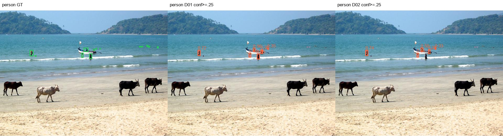
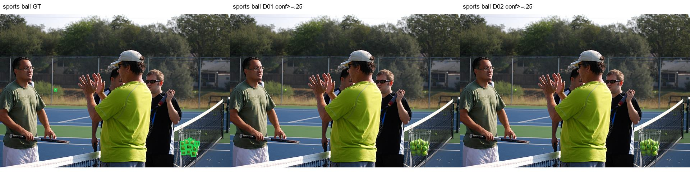
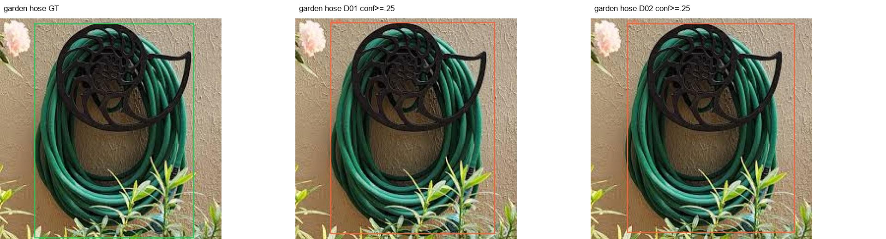
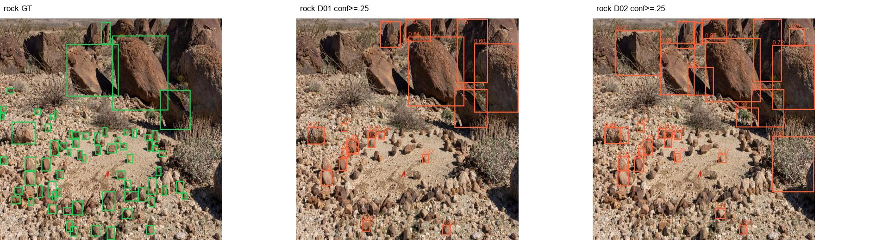

# 障碍物检测第一版模型评估与选型交付报告

交付日期：2026-11-03。最终推荐D02第194轮best.pt，用户已确认停止继续训练。本任务的模型训练与评估交付已完成；板端部署、量化及实车验收另行开展。

## 任务目标与完成情况

完成已有基线及候选的统一复评，选定第一版权重和初始推理参数，归档配置、日志、指标、失败样本及使用说明。当前交付是项目内可复现的PT模型包，加载依赖本项目的通道注意力实现。

## 验收对应关系

| 验收项 | 交付证据与结果 |
| --- | --- |
| 模型加载与结构化输出 | 本次从交付目录best.pt重新加载，8张图片推理完成，输出类别ID、名称、置信度及xyxy，见smoke/results.json与标注图；不要求每图都检出或检出即正确。 |
| 每类与重点目标指标 | 五套范围8类P/R/AP与样本数，固定阈值TP/FP/FN和尺寸分档，见evaluation与本报告。 |
| 权重和配置可追溯 | best.pt、predict.yaml、training/args.yaml、CSV、日志、哈希清单与environment.json。 |
| 优化无收益时保留基线 | 按同口径结果选择D02而非最新实验；D01基线完整AP59.968%、旧集59.587%、合成81.243%，D02分别60.467%、59.838%、85.109%。提升幅度和局限如实保留。 |
| 问题与未完成项明确 | 石块/小球漏检、软管误检、小人员召回取舍；D03缺少完整离线评估，不用于最终排名；未开展NPU与实车验证。 |
| 交付范围 | 模型训练、离线评估与选型。CPU耗时不能代表板端帧率、ROS2延迟或安全停车能力。 |

## 统一复评与最终选型

用户决定不再训练。综合现有统一口径复评，最终推荐 **D02_CA_200ep_3gpu 的第194轮 best.pt**，作为第一版检测模型的冻结候选；D09保留为小目标对照，不取代D02。此处明确的是现有候选的综合选型，不代表每类最佳或已经通过板端/实车验收。

### 选型口径

先看完整2938图与旧固定2801图验证AP50-95，再检查人员、动物、小目标召回和误报，最后以合成140及混合50检查明显场景退步。没有将互相重叠的140/90/50平均成综合分，也未按结果临时设置权重。合成图已多次参与诊断，不能作为盲测泛化结论。

复用已完成CPU FP32复评：imgsz640、batch32、rect=True、conf0.001、NMS IoU0.7、max_det300。此次重新逐一核对D01/D02/D04至D09五套范围的图片、标签manifest与评估配置，全部一致；不混用训练CSV与离线复评，也不将不同F1报告点的R当作同阈值召回。

### 全部可比较候选（AP50-95，%）

| 模型 | 完整验证 | 旧固定集 | 合成140 | 原90 | 混合50 |
| --- | --- | --- | --- | --- | --- |
| D01 | 59.968 | 59.587 | 81.243 | 81.285 | 81.581 |
| D02 | 60.467 | 59.838 | 85.109 | 85.498 | 83.851 |
| D04 | 59.473 | 58.792 | 79.618 | 83.511 | 79.570 |
| D05 | 59.786 | 59.356 | 83.181 | 85.741 | 81.796 |
| D06 | 59.930 | 58.246 | 77.483 | 77.161 | 78.441 |
| D07 | 60.068 | 58.923 | 77.226 | 78.967 | 77.624 |
| D08 | 59.720 | 58.507 | 79.929 | 85.458 | 77.268 |
| D09 | 60.389 | 59.462 | 80.296 | 83.842 | 78.567 |

D00另有当前完整验证同口径复评48.825%，本次已核对其manifest和配置；不是原始数据上训练CSV的58.879%，不可混写。D00缺少其余四范围复评，不参与五范围排序。D03主动停止，当前没有完整同口径离线结果，不能拿中途CSV填入本表；失败启动、单卡试启动及被替换的短跑不作为独立最终模型。

### 为什么选D02

1. 完整验证60.467%、旧集59.838%，均为完整可比候选最高。与D09完整验证仅差0.078个百分点，单看这个差距不足以认定显著优越；本次没有多seed统计检验。

2. 合成140为85.109%、混合50为83.851%，也均最高；D09分别80.296%、78.567%。原90张D05的85.741%略高于D02的85.498%，不隐藏这项例外。

3. D02在合成140上的软管AP50-95=80.323%、飞盘89.069%，D09为55.469%、76.324%。固定conf0.25时，D02软管25TP/16FP/1FN，D09为23TP/28FP/3FN；飞盘D02为27TP/8FP/0FN，D09为23TP/9FP/4FN。混合场景的明显差距比完整总AP的小数点差异更有选型价值。

4. D02为原三尺度检测头＋P3通道注意力，D09增加P2。本次不假设哪一个已经在NPU上更快或兼容更好；但也没有足够综合收益支撑为了P2替换第一版。

### 8类完整验证AP50-95与固定阈值取舍

| 类别 | D02 AP50-95% | D09 AP50-95% | D02 TP/FP/FN | D09 TP/FP/FN |
| --- | --- | --- | --- | --- |
| 人员 | 59.076 | 59.170 | 5839/1293/1996 | 5955/1549/1880 |
| 猫 | 72.262 | 70.927 | 180/44/26 | 183/51/23 |
| 狗 | 65.952 | 66.208 | 171/39/47 | 173/73/45 |
| 飞盘 | 60.443 | 60.590 | 85/19/26 | 85/18/26 |
| 运动球 | 44.561 | 45.817 | 102/38/86 | 116/49/72 |
| 玩具熊 | 57.406 | 57.303 | 110/33/48 | 120/45/38 |
| 软管 | 83.832 | 83.458 | 100/6/0 | 100/10/0 |
| 石块 | 40.208 | 39.640 | 155/124/128 | 159/141/124 |

固定阈值采用conf0.25、同类别IoU≥0.5一对一匹配；P/R工作点不同于AP表的F1峰值。

| 类别 | D02小目标命中/GT | D09小目标命中/GT |
| --- | --- | --- |
| 人员 | 752/1893 | 855/1893 |
| 猫 | 0/2 | 0/2 |
| 狗 | 2/7 | 3/7 |
| 飞盘 | 27/42 | 26/42 |
| 运动球 | 76/148 | 89/148 |
| 玩具熊 | 1/8 | 0/8 |
| 软管 | 0/0 | 0/0 |
| 石块 | 34/135 | 38/135 |

小目标定义：原图等比例缩至长边640，GT面积<32²；0个GT表示无可评估样本。**D02的小目标能力不是最强：人员752/1893、球76/148，低于D09的855/1893、89/148；小石块34/135也低于D09的38。** D09在固定阈值下总体人员召回更高，同时人员FP也从D02的1293增加至1549。因此本次是选择综合表现更稳的D02，不是宣布D02最适合所有风险目标。若后续实车验收把远处人员检出作为优先约束，应以实车数据重新判断，不能用综合AP代替该约束。

合成140的石块仍是D02弱项：8/27命中，AP50-95=46.745%；D09为10/27、54.525%。D02也存在软管误检和球漏检，第一版保留这些已知限制。

### 最终权重与后续使用

[最终推荐best.pt](final_D02_20261103/best.pt) · [训练参数](final_D02_20261103/training/args.yaml) · [逐轮结果](final_D02_20261103/training/results.csv) · [完整验证指标](final_D02_20261103/evaluation/D02/full/metrics.json) · [合成140指标](final_D02_20261103/evaluation/D02/test140/metrics.json)

权重SHA256：`388902aeff6d18f3b8313fef38a5ad548a4099abc73ec7d256fe7b4798339d5f`。已核对当前文件与离线评估checkpoint记录一致。200轮训练的最佳第194轮；模型含P3通道注意力，加载/导出需保留本项目自定义模块。

固定输入640。conf0.25、NMS IoU0.7、max_det300可作为已核验的初始推理配置，conf0.25不是已经验证的最优实车安全阈值；不在本次任意改成0.1来掩盖小目标不足。后续围绕该权重做导出、量化一致性、板端性能和实车场景验证，不再安排新训练。本次将选定权重复制到独立交付目录，保留原始模型与部署文件。

## 训练配置与归档时间

D02为YOLOv8n三尺度P3/P4/P5检测头，在P3融合输出使用通道注意力；从yolov8n.pt初始化。GPU1/2/3，总batch48、每卡16，输入640，训练200轮、patience30，实际跑满，最佳194轮。optimizer=auto，日志确认实际MuSGD、lr0=0.01、momentum=0.9；线性学习率、lrf0.01、scale0.5、mosaic1.0、close_mosaic10、cls0.5、box7.5、dfl1.5、seed0、AMP开启。配置文件中的部分优化器/warmup值受auto策略覆盖，实际以日志与checkpoint为准。

CSV训练累计43743.9秒，约12小时9分4秒；不包括本次评估、打包或板端测试。交付目录中的training保留原始args、日志、CSV、曲线和last；最佳权重另放根目录best.pt。

## D02各类别最终结果

### full

| 类别 | 含该类图片 | GT框 | P% | R% | AP50% | AP50-95% |
| --- | --- | --- | --- | --- | --- | --- |
| 人员 | 2467 | 7835 | 89.912 | 68.781 | 81.976 | 59.076 |
| 猫 | 188 | 206 | 86.260 | 86.408 | 89.822 | 72.262 |
| 狗 | 180 | 218 | 83.768 | 74.312 | 81.094 | 65.952 |
| 飞盘 | 83 | 111 | 89.862 | 71.873 | 80.272 | 60.443 |
| 运动球 | 139 | 188 | 80.715 | 51.596 | 59.037 | 44.561 |
| 玩具熊 | 88 | 158 | 86.512 | 64.951 | 77.133 | 57.406 |
| 软管 | 100 | 100 | 94.096 | 100.000 | 99.221 | 83.832 |
| 石块 | 61 | 283 | 70.918 | 47.350 | 56.621 | 40.208 |

### old

| 类别 | 含该类图片 | GT框 | P% | R% | AP50% | AP50-95% |
| --- | --- | --- | --- | --- | --- | --- |
| 人员 | 2461 | 7829 | 89.978 | 68.757 | 81.945 | 59.031 |
| 猫 | 184 | 202 | 85.697 | 86.139 | 89.617 | 71.698 |
| 狗 | 171 | 209 | 82.379 | 71.582 | 79.895 | 64.081 |
| 飞盘 | 83 | 111 | 90.772 | 70.893 | 80.317 | 60.514 |
| 运动球 | 139 | 188 | 80.763 | 51.596 | 58.968 | 44.614 |
| 玩具熊 | 88 | 158 | 86.532 | 65.062 | 77.045 | 57.407 |
| 软管 | 5 | 5 | 88.293 | 100.000 | 99.500 | 87.935 |
| 石块 | 19 | 161 | 77.730 | 31.677 | 51.408 | 33.428 |

### test140

| 类别 | 含该类图片 | GT框 | P% | R% | AP50% | AP50-95% |
| --- | --- | --- | --- | --- | --- | --- |
| 人员 | 35 | 47 | 91.692 | 100.000 | 99.132 | 96.406 |
| 猫 | 26 | 26 | 97.284 | 96.154 | 97.272 | 95.139 |
| 狗 | 26 | 26 | 95.996 | 92.218 | 97.600 | 95.147 |
| 飞盘 | 26 | 27 | 78.986 | 100.000 | 92.567 | 89.069 |
| 运动球 | 26 | 26 | 100.000 | 51.670 | 88.827 | 82.271 |
| 玩具熊 | 26 | 26 | 86.522 | 100.000 | 99.190 | 95.769 |
| 软管 | 26 | 26 | 69.034 | 92.308 | 94.802 | 80.323 |
| 石块 | 26 | 27 | 100.000 | 28.071 | 51.451 | 46.745 |

### test90

| 类别 | 含该类图片 | GT框 | P% | R% | AP50% | AP50-95% |
| --- | --- | --- | --- | --- | --- | --- |
| 人员 | 20 | 29 | 89.811 | 100.000 | 98.641 | 95.649 |
| 猫 | 10 | 10 | 93.477 | 100.000 | 99.500 | 93.889 |
| 狗 | 10 | 10 | 91.722 | 90.000 | 98.591 | 94.551 |
| 飞盘 | 10 | 10 | 65.572 | 100.000 | 76.782 | 73.611 |
| 运动球 | 10 | 10 | 100.000 | 14.449 | 73.786 | 64.720 |
| 玩具熊 | 10 | 10 | 80.476 | 100.000 | 99.500 | 96.222 |
| 软管 | 10 | 10 | 63.870 | 100.000 | 99.500 | 88.683 |
| 石块 | 10 | 11 | 100.000 | 62.919 | 84.544 | 76.659 |

### test50

| 类别 | 含该类图片 | GT框 | P% | R% | AP50% | AP50-95% |
| --- | --- | --- | --- | --- | --- | --- |
| 人员 | 15 | 18 | 93.913 | 100.000 | 99.500 | 97.692 |
| 猫 | 16 | 16 | 96.155 | 93.750 | 96.500 | 96.200 |
| 狗 | 16 | 16 | 93.735 | 93.531 | 98.441 | 97.056 |
| 飞盘 | 16 | 17 | 87.029 | 100.000 | 97.556 | 93.931 |
| 运动球 | 16 | 16 | 100.000 | 79.229 | 94.008 | 88.604 |
| 玩具熊 | 16 | 16 | 89.187 | 100.000 | 99.147 | 94.999 |
| 软管 | 16 | 16 | 71.687 | 87.500 | 93.427 | 75.953 |
| 石块 | 16 | 16 | 100.000 | 7.238 | 28.354 | 26.376 |

## 重点目标召回与失败样本

固定conf0.25、同类IoU≥0.5一对一匹配；AP表P/R为F1报告点，两者不可混用。

完整验证

| 分组 | TP | FP | FN | 召回% |
| --- | --- | --- | --- | --- |
| 人员 | 5839 | 1293 | 1996 | 74.525 |
| 猫狗 | 351 | 83 | 73 | 82.783 |
| 低矮类别：飞盘/球/熊/软管/石块 | 552 | 220 | 288 | 65.714 |

合成140

| 分组 | TP | FP | FN | 召回% |
| --- | --- | --- | --- | --- |
| 人员 | 47 | 4 | 0 | 100.000 |
| 猫狗 | 49 | 1 | 3 | 94.231 |
| 低矮类别：飞盘/球/熊/软管/石块 | 99 | 30 | 33 | 75.000 |

低矮类别分组不等同尺寸小目标；小目标按图像长边缩到640后GT面积<32²定义，详见选型小目标表。

### 人员典型验证失败样本

原图`000000389451.jpg`；D02结果{'tp': 2, 'fp': 3, 'fn': 10}。拼图为GT、D01、D02，conf0.25。

### 运动球典型验证失败样本

原图`000000548246.jpg`；D02结果{'tp': 0, 'fp': 0, 'fn': 13}。拼图为GT、D01、D02，conf0.25。

### 软管典型验证失败样本

原图`obstructions_images-2-_jpeg.rf.e1522481cdef46ace47c8099d423ffb7.jpg`；D02结果{'tp': 1, 'fp': 0, 'fn': 0}。拼图为GT、D01、D02，conf0.25。

### 石块典型验证失败样本

原图`rocks_DSC5033-e1658535326972_jpg.rf.d8c9490498bfe41099daa0f5dbe5828f.jpg`；D02结果{'tp': 17, 'fp': 12, 'fn': 50}。拼图为GT、D01、D02，conf0.25。

合成混合场景对照见failure_cases/synthetic（GT、D02、D05、D09），对应原图名和计数在failure_cases/test_comparison.json。完整逐图预测仍保存在原runs评估缓存；本交付包保存指标、输入哈希清单、代表图和日志，不复制整个数据集。

## 推理耗时

本次同一进程、CPU FP32、6线程、batch1、640×640零张量，模型融合后交替测3轮，每轮预热3次、计时10次；只测模型前向，不含读图、预处理、NMS。各30次，原始时序见cpu_benchmark.json。此项用于结构成本参考，不能替代板端测试。

| 候选 | 平均ms | P50 ms | P95 ms |
| --- | --- | --- | --- |
| D01 | 25.343 | 24.946 | 26.949 |
| D02 | 25.985 | 25.645 | 28.203 |
| D04 | 26.502 | 25.822 | 31.011 |
| D05 | 25.856 | 25.241 | 29.773 |
| D06 | 26.170 | 25.761 | 29.488 |
| D07 | 42.423 | 41.817 | 48.107 |
| D08 | 27.270 | 26.195 | 32.987 |
| D09 | 44.600 | 41.981 | 59.868 |

D02本次CPU纯前向平均25.99ms，D09为44.60ms；支持D02在这台CPU上的计算成本更低，但不能外推为NPU速度结论。8图推理检查产生9个检测框；其中球样本test90_c4_001.png在conf0.25下没有输出，作为已知漏检如实保留。冒烟检查证明模型能运行和输出结构化结果，不等于8图全检对。

## 后续工作与已知限制

1. 固定D02，下一阶段进行ONNX/NPU转换与同图一致性、量化精度、板端耗时和稳定性测试。
2. 使用真实双目相机独立场景检查远处人员、小球与石块，以及软管/飞盘混淆，再确定业务阈值；合成140已用于多轮诊断，不代表真实泛化。
3. D09小目标召回较强的结果作为保留对照，当前不再训练。
4. 当前初始conf0.25不是业务召回验收线；本任务不承诺实车安全停车或达到未定义业务指标。

## 交付文件

[推荐权重](final_D02_20261103/best.pt) · [推理配置](final_D02_20261103/predict.yaml) · [使用说明](final_D02_20261103/README.md) · [原始训练配置](final_D02_20261103/training/args.yaml) · [训练曲线](final_D02_20261103/training/results.png) · [本次推理输出](final_D02_20261103/smoke/results.json) · [环境](final_D02_20261103/environment.json) · [文件哈希](final_D02_20261103/SHA256SUMS.json)

