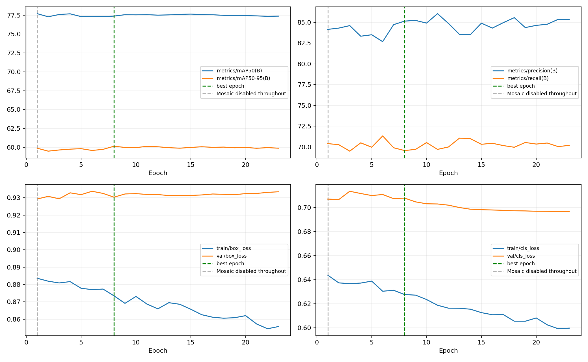
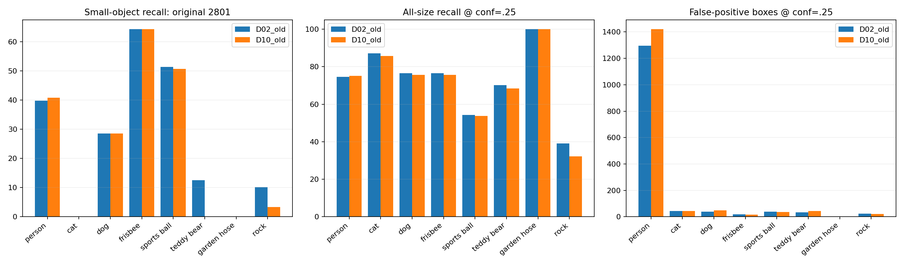
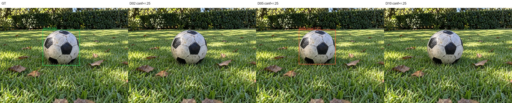
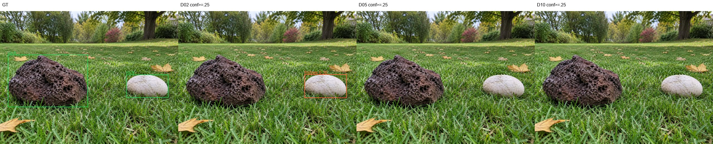
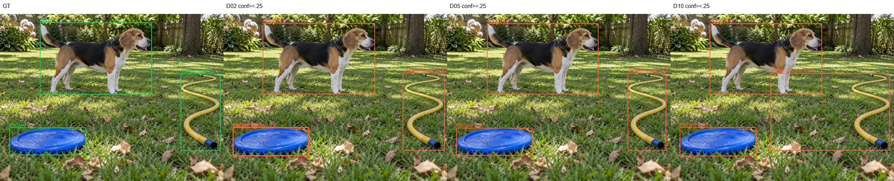

# D10：D02难例增强微调结果与同口径对比

日期：2026-11-04。实验：`D10_D02_hardaug_ft60`。

## 1. 结论

**本轮正常早停，未形成替换D02的综合收益，继续保留D02为当前交付模型。**
计划60轮、patience15；完成23轮，最佳第8轮。训练CSV最佳AP50-95为60.148%，最后一轮59.885%。日志明确记录连续15轮未改善后EarlyStopping，不是断网、抢卡或人工停止。
固定CPU FP32复评：完整验证AP50-95 60.467% → 60.194%；合成140张 85.109% → 84.406%。
conf0.25下，140张测试中球命中仍为13/26；球→飞盘重叠误分类框7→6，石头→飞盘仍为1；石头命中8/27→6/27。软管FP16→4，是明确局部改善，但软管TP25→24，同时有召回损失。不能把局部误检下降写成整体验收提升。

## 2. 权重、配置、时长和数据

[best.pt](../weights/best.pt) · [last.pt](../weights/last.pt) · [args.yaml](../args.yaml) · [results.csv](../results.csv) · [服务器训练日志](../server_train.log)
best SHA256：`8521caa695cad80ba446d159f5829128519689e181af3d50e72fa254a2865772`。已逐文件核验服务器与本地21个训练产物，见[下载校验](../download_manifest_20261104.json)。当前验证集5876个图像/标签文件SHA256一致，见[数据校验](../data_verification.json)。
从D02 best.pt初始化，继承P3通道注意力；模型参数全部迁移357/357，不是从原始yolov8n重新训练。resume=false，新优化器和新学习率周期。GPU1、7双卡，总batch32、每卡16，imgsz640，workers4/进程，AMP=true，cache=false，seed42。
MuSGD，lr0=0.0005，lrf=0.1，cos_lr=true，momentum0.9，weight_decay0.0005；warmup_epochs3、warmup_bias_lr0。mosaic0、close_mosaic0、scale0.1、translate0.05，fliplr0.5；其余参数以args.yaml为准。
训练CSV累计10301.8秒，约2.862小时（2小时51分42秒）；日志四舍五入为2.862小时。最佳第8轮时累计3518.53秒（约58.6分钟）。这些是训练循环与轮间验证时间，不包含本次下载和独立复评，也不是两张卡的GPU小时总和。
**分组学习率不能只看lr0。** 当前trainer对MuSGD分类分支cv3使用3倍学习率；第8轮lr/pg0=0.00145517、lr/pg1=0.000485056，第23轮分别为0.00109955、0.000366516。早停时未走到计划60轮的末端学习率。这解释了日志中的不同分组数值，但单次实验不能把退化唯一归因于优化器或学习率。
数据：`data_hardaug2x_20261104.yaml`、`train_hardaug2x_20261104.txt`。上一轮已修正4份训练标签、排除27张待复核图片；对22张确认难例各生成一张轻量增强图，使用原图＋增强图。训练名单共66839张文件，对应66817张独立原图来源，214085个标注框。增强图占训练文件约0.033%，选中的22张原图加22张增强图共占约0.066%；并不是整套训练集翻倍。
验证集2938张/9099框保持不变；140张合成测试集保持不变，未参与这次微调。人员、猫狗、飞盘、球和玩具熊仍有大量COCO来源，合成测试与真实草坪视角不能互相替代。
| 类别 | 实际训练图片数 | 实际训练框数 | 验证图片数 | 验证框数 |
| --- | --- | --- | --- | --- |
| 人员 | 58839 | 189666 | 2467 | 7835 |
| 猫 | 4133 | 4756 | 188 | 206 |
| 狗 | 4299 | 5244 | 180 | 218 |
| 飞盘 | 2026 | 2452 | 83 | 111 |
| 运动球 | 3598 | 4860 | 139 | 188 |
| 玩具熊 | 2048 | 3852 | 88 | 158 |
| 软管 | 502 | 514 | 100 | 100 |
| 石头 | 700 | 2741 | 61 | 283 |
每类图片数会因多类别同图而重复计数，不能将各行图片数相加当作数据集总图数。训练统计按实际train列表，包含hard_aug，未误用物理train目录总量。服务器仓库HEAD记录的是本次核验时状态，不冒充未单独记录的启动时提交。

## 3. 统一评估口径

best.pt，CPU FP32，640、batch32、rect=True、conf0.001收集AP曲线，NMS IoU0.7、max_det300。固定操作点另按conf0.25、同类IoU≥0.5的一对一匹配统计TP/FP/FN。P/R指标表来自最佳平均F1工作点，不等于固定conf0.25。
五个范围均逐图核验D02与D10的图片和标签哈希，且验证配置一致。主表AP取直接validator输出；缓存预测的重算AP存在小幅浮点差异，未拿它替换主表。训练AMP日志与本地FP32结果分开列出。本报告比较的是PT模型，不将它直接与板端NPU或非rect预处理指标混为一谈。
| 范围 | D02 AP50% | D10 AP50% | D02 AP50-95% | D10 AP50-95% | 差值pp |
| --- | --- | --- | --- | --- | --- |
| 完整验证集2938张 | 78.147 | 77.416 | 60.467 | 60.194 | -0.274 |
| 旧固定验证集2801张 | 77.337 | 76.413 | 59.838 | 59.210 | -0.628 |
| 合成测试140张 | 90.105 | 89.091 | 85.109 | 84.406 | -0.702 |
| 原90张测试 | 91.355 | 92.998 | 85.498 | 87.508 | +2.011 |
| 混合50张测试 | 88.366 | 86.483 | 83.851 | 82.311 | -1.540 |

## 4. 训练趋势

第8轮后继续15轮没有刷新最佳。train box 0.87347→0.85578、train cls 0.62765→0.59969；val box 0.93032→0.93344、val cls 0.70794→0.69686。训练损失继续下降，但没有转成整体AP收益。不能只因没有跑满60轮就判断学习不够，也不能凭一次早停证明再训练绝对无收益。

## 完整验证集2938张：八类最终结果

D10最佳平均F1阈值约0.3994；下面P/R按此曲线工作点。
| 类别 | 图片数 | 框数 | P% | R% | AP50% | D10 AP50-95% | D02 AP50-95% | 差值pp |
| --- | --- | --- | --- | --- | --- | --- | --- | --- |
| 人员 | 2467 | 7835 | 89.787 | 69.233 | 81.778 | 58.596 | 59.076 | -0.480 |
| 猫 | 188 | 206 | 85.624 | 84.466 | 89.879 | 72.010 | 72.262 | -0.253 |
| 狗 | 180 | 218 | 83.923 | 73.853 | 81.902 | 66.544 | 65.952 | +0.592 |
| 飞盘 | 83 | 111 | 88.864 | 71.889 | 79.837 | 60.057 | 60.443 | -0.386 |
| 运动球 | 139 | 188 | 83.392 | 53.416 | 58.463 | 44.283 | 44.561 | -0.278 |
| 玩具熊 | 88 | 158 | 78.753 | 63.342 | 74.921 | 55.141 | 57.406 | -2.265 |
| 软管 | 100 | 100 | 93.581 | 100.000 | 99.381 | 86.583 | 83.832 | +2.751 |
| 石头 | 61 | 283 | 74.554 | 44.170 | 53.172 | 38.337 | 40.208 | -1.871 |

| 类别 | D02 TP/FP/FN | D10 TP/FP/FN | D02 R@0.25% | D10 R@0.25% |
| --- | --- | --- | --- | --- |
| 人员 | 5839/1293/1996 | 5883/1410/1952 | 74.525 | 75.086 |
| 猫 | 180/44/26 | 177/43/29 | 87.379 | 85.922 |
| 狗 | 171/39/47 | 169/46/49 | 78.440 | 77.523 |
| 飞盘 | 85/19/26 | 84/16/27 | 76.577 | 75.676 |
| 运动球 | 102/38/86 | 101/37/87 | 54.255 | 53.723 |
| 玩具熊 | 110/33/48 | 108/44/50 | 69.620 | 68.354 |
| 软管 | 100/6/0 | 100/7/0 | 100.000 | 100.000 |
| 石头 | 155/124/128 | 142/114/141 | 54.770 | 50.177 |

| 重点分组 | D02 TP/FP/FN | D10 TP/FP/FN | D10召回% |
| --- | --- | --- | --- |
| 人员 | 5839/1293/1996 | 5883/1410/1952 | 75.086 |
| 猫狗 | 351/83/73 | 346/89/78 | 81.604 |
| 低矮类别 | 552/220/288 | 535/218/305 | 63.690 |

| 类别 | conf0.1 TP/FP/FN | conf0.25 | conf0.5 |
| --- | --- | --- | --- |
| 人员 | 6470/4563/1365 | 5883/1410/1952 | 5032/375/2803 |
| 猫 | 187/81/19 | 177/43/29 | 167/23/39 |
| 狗 | 180/108/38 | 169/46/49 | 153/23/65 |
| 飞盘 | 88/37/23 | 84/16/27 | 76/8/35 |
| 运动球 | 115/111/73 | 101/37/87 | 87/15/101 |
| 玩具熊 | 122/103/36 | 108/44/50 | 97/15/61 |
| 软管 | 100/12/0 | 100/7/0 | 100/5/0 |
| 石头 | 168/283/115 | 142/114/141 | 112/20/171 |

## 旧固定验证集2801张：八类最终结果

D10最佳平均F1阈值约0.3934；下面P/R按此曲线工作点。
| 类别 | 图片数 | 框数 | P% | R% | AP50% | D10 AP50-95% | D02 AP50-95% | 差值pp |
| --- | --- | --- | --- | --- | --- | --- | --- | --- |
| 人员 | 2461 | 7829 | 89.467 | 69.460 | 81.752 | 58.546 | 59.031 | -0.485 |
| 猫 | 184 | 202 | 85.230 | 84.158 | 89.623 | 71.353 | 71.698 | -0.344 |
| 狗 | 171 | 209 | 81.670 | 72.249 | 80.541 | 64.665 | 64.081 | +0.584 |
| 飞盘 | 83 | 111 | 89.764 | 71.101 | 79.351 | 59.763 | 60.514 | -0.751 |
| 运动球 | 139 | 188 | 83.305 | 53.723 | 58.535 | 44.356 | 44.614 | -0.258 |
| 玩具熊 | 88 | 158 | 78.085 | 63.143 | 74.692 | 55.157 | 57.407 | -2.250 |
| 软管 | 5 | 5 | 89.646 | 100.000 | 99.500 | 89.300 | 87.935 | +1.365 |
| 石头 | 19 | 161 | 82.170 | 28.626 | 47.310 | 30.543 | 33.428 | -2.885 |

| 类别 | D02 TP/FP/FN | D10 TP/FP/FN | D02 R@0.25% | D10 R@0.25% |
| --- | --- | --- | --- | --- |
| 人员 | 5836/1296/1993 | 5884/1421/1945 | 74.543 | 75.156 |
| 猫 | 176/45/26 | 173/43/29 | 87.129 | 85.644 |
| 狗 | 160/40/49 | 158/49/51 | 76.555 | 75.598 |
| 飞盘 | 85/19/26 | 84/16/27 | 76.577 | 75.676 |
| 运动球 | 102/39/86 | 101/37/87 | 54.255 | 53.723 |
| 玩具熊 | 111/35/47 | 108/45/50 | 70.253 | 68.354 |
| 软管 | 5/0/0 | 5/0/0 | 100.000 | 100.000 |
| 石头 | 63/23/98 | 52/20/109 | 39.130 | 32.298 |

## 合成测试140张：八类最终结果

D10最佳平均F1阈值约0.5315；下面P/R按此曲线工作点。
| 类别 | 图片数 | 框数 | P% | R% | AP50% | D10 AP50-95% | D02 AP50-95% | 差值pp |
| --- | --- | --- | --- | --- | --- | --- | --- | --- |
| 人员 | 35 | 47 | 94.844 | 100.000 | 99.291 | 96.251 | 96.406 | -0.156 |
| 猫 | 26 | 26 | 98.360 | 96.154 | 98.060 | 96.218 | 95.139 | +1.079 |
| 狗 | 26 | 26 | 95.941 | 90.956 | 97.648 | 96.123 | 95.147 | +0.976 |
| 飞盘 | 26 | 27 | 83.957 | 100.000 | 97.140 | 94.264 | 89.069 | +5.194 |
| 运动球 | 26 | 26 | 100.000 | 48.301 | 91.256 | 82.454 | 82.271 | +0.182 |
| 玩具熊 | 26 | 26 | 92.393 | 100.000 | 99.500 | 95.210 | 95.769 | -0.559 |
| 软管 | 26 | 26 | 96.095 | 88.462 | 97.475 | 84.969 | 80.323 | +4.647 |
| 石头 | 26 | 27 | 100.000 | 18.562 | 32.360 | 29.762 | 46.745 | -16.983 |

| 类别 | D02 TP/FP/FN | D10 TP/FP/FN | D02 R@0.25% | D10 R@0.25% |
| --- | --- | --- | --- | --- |
| 人员 | 47/4/0 | 47/4/0 | 100.000 | 100.000 |
| 猫 | 25/0/1 | 25/0/1 | 96.154 | 96.154 |
| 狗 | 24/1/2 | 25/1/1 | 92.308 | 96.154 |
| 飞盘 | 27/8/0 | 27/7/0 | 100.000 | 100.000 |
| 运动球 | 13/0/13 | 13/0/13 | 50.000 | 50.000 |
| 玩具熊 | 26/6/0 | 26/6/0 | 100.000 | 100.000 |
| 软管 | 25/16/1 | 24/4/2 | 96.154 | 92.308 |
| 石头 | 8/0/19 | 6/0/21 | 29.630 | 22.222 |

| 重点分组 | D02 TP/FP/FN | D10 TP/FP/FN | D10召回% |
| --- | --- | --- | --- |
| 人员 | 47/4/0 | 47/4/0 | 100.000 |
| 猫狗 | 49/1/3 | 50/1/2 | 96.154 |
| 低矮类别 | 99/30/33 | 96/17/36 | 72.727 |

| 类别 | conf0.1 TP/FP/FN | conf0.25 | conf0.5 |
| --- | --- | --- | --- |
| 人员 | 47/6/0 | 47/4/0 | 47/2/0 |
| 猫 | 25/2/1 | 25/0/1 | 25/0/1 |
| 狗 | 26/2/0 | 25/1/1 | 23/1/3 |
| 飞盘 | 27/14/0 | 27/7/0 | 27/5/0 |
| 运动球 | 16/0/10 | 13/0/13 | 12/0/14 |
| 玩具熊 | 26/7/0 | 26/6/0 | 26/2/0 |
| 软管 | 26/11/0 | 24/4/2 | 23/1/3 |
| 石头 | 7/0/20 | 6/0/21 | 5/0/22 |

## 原90张测试：八类最终结果

D10最佳平均F1阈值约0.3473；下面P/R按此曲线工作点。
| 类别 | 图片数 | 框数 | P% | R% | AP50% | D10 AP50-95% | D02 AP50-95% | 差值pp |
| --- | --- | --- | --- | --- | --- | --- | --- | --- |
| 人员 | 20 | 29 | 90.266 | 100.000 | 98.962 | 96.276 | 95.649 | +0.628 |
| 猫 | 10 | 10 | 93.642 | 100.000 | 99.500 | 94.714 | 93.889 | +0.825 |
| 狗 | 10 | 10 | 100.000 | 99.958 | 99.500 | 97.500 | 94.551 | +2.949 |
| 飞盘 | 10 | 10 | 72.869 | 100.000 | 96.192 | 93.115 | 73.611 | +19.504 |
| 运动球 | 10 | 10 | 100.000 | 16.490 | 79.289 | 66.405 | 64.720 | +1.684 |
| 玩具熊 | 10 | 10 | 79.138 | 100.000 | 99.500 | 96.500 | 96.222 | +0.278 |
| 软管 | 10 | 10 | 87.066 | 100.000 | 99.500 | 89.650 | 88.683 | +0.967 |
| 石头 | 10 | 11 | 100.000 | 51.957 | 71.540 | 65.907 | 76.659 | -10.751 |

| 类别 | D02 TP/FP/FN | D10 TP/FP/FN | D02 R@0.25% | D10 R@0.25% |
| --- | --- | --- | --- | --- |
| 人员 | 29/3/0 | 29/3/0 | 100.000 | 100.000 |
| 猫 | 10/0/0 | 10/0/0 | 100.000 | 100.000 |
| 狗 | 9/0/1 | 10/0/0 | 90.000 | 100.000 |
| 飞盘 | 10/6/0 | 10/4/0 | 100.000 | 100.000 |
| 运动球 | 1/0/9 | 1/0/9 | 10.000 | 10.000 |
| 玩具熊 | 10/2/0 | 10/3/0 | 100.000 | 100.000 |
| 软管 | 10/8/0 | 10/1/0 | 100.000 | 100.000 |
| 石头 | 7/0/4 | 6/0/5 | 63.636 | 54.545 |

## 混合50张测试：八类最终结果

D10最佳平均F1阈值约0.7027；下面P/R按此曲线工作点。
| 类别 | 图片数 | 框数 | P% | R% | AP50% | D10 AP50-95% | D02 AP50-95% | 差值pp |
| --- | --- | --- | --- | --- | --- | --- | --- | --- |
| 人员 | 15 | 18 | 97.929 | 100.000 | 99.500 | 96.158 | 97.692 | -1.534 |
| 猫 | 16 | 16 | 98.567 | 93.750 | 98.553 | 98.047 | 96.200 | +1.847 |
| 狗 | 16 | 16 | 93.467 | 89.510 | 97.324 | 96.186 | 97.056 | -0.870 |
| 飞盘 | 16 | 17 | 91.132 | 100.000 | 97.556 | 94.892 | 93.931 | +0.961 |
| 运动球 | 16 | 16 | 100.000 | 69.038 | 96.237 | 89.885 | 88.604 | +1.281 |
| 玩具熊 | 16 | 16 | 98.165 | 100.000 | 99.500 | 94.320 | 94.999 | -0.679 |
| 软管 | 16 | 16 | 98.503 | 81.250 | 95.893 | 81.780 | 75.953 | +5.827 |
| 石头 | 16 | 16 | 100.000 | 0.000 | 7.300 | 7.220 | 26.376 | -19.156 |

| 类别 | D02 TP/FP/FN | D10 TP/FP/FN | D02 R@0.25% | D10 R@0.25% |
| --- | --- | --- | --- | --- |
| 人员 | 18/1/0 | 18/1/0 | 100.000 | 100.000 |
| 猫 | 15/0/1 | 15/0/1 | 93.750 | 93.750 |
| 狗 | 15/1/1 | 15/1/1 | 93.750 | 93.750 |
| 飞盘 | 17/2/0 | 17/3/0 | 100.000 | 100.000 |
| 运动球 | 12/0/4 | 12/0/4 | 75.000 | 75.000 |
| 玩具熊 | 16/4/0 | 16/3/0 | 100.000 | 100.000 |
| 软管 | 15/8/1 | 14/3/2 | 93.750 | 87.500 |
| 石头 | 1/0/15 | 0/0/16 | 6.250 | 0.000 |

## 小目标与新增来源

小目标定义：GT等比缩放到长边640后面积<32²。低矮类别不等同于尺寸小目标；以下均为conf0.25诊断召回，不是COCO APs。
| 类别 | D02旧集小目标命中/GT | D10旧集小目标命中/GT |
| --- | --- | --- |
| 人员 | 754/1893 | 772/1893 |
| 猫 | 0/2 | 0/2 |
| 狗 | 2/7 | 2/7 |
| 飞盘 | 27/42 | 27/42 |
| 运动球 | 76/148 | 75/148 |
| 玩具熊 | 1/8 | 0/8 |
| 软管 | 0/0 | 0/0 |
| 石头 | 9/89 | 3/89 |

### 新增岩石42张
| 类别 | D02 TP/FP/FN | D10 TP/FP/FN |
| --- | --- | --- |
| 人员 | 0/0/0 | 0/0/0 |
| 猫 | 0/0/0 | 0/0/0 |
| 狗 | 0/0/0 | 0/0/0 |
| 飞盘 | 0/0/0 | 0/0/0 |
| 运动球 | 0/0/0 | 0/0/0 |
| 玩具熊 | 0/0/0 | 0/0/0 |
| 软管 | 0/0/0 | 0/0/0 |
| 石头 | 92/101/30 | 90/94/32 |

### 新增AI软管95张
| 类别 | D02 TP/FP/FN | D10 TP/FP/FN |
| --- | --- | --- |
| 人员 | 6/0/0 | 6/1/0 |
| 猫 | 4/0/0 | 4/0/0 |
| 狗 | 9/0/0 | 9/0/0 |
| 飞盘 | 0/0/0 | 0/0/0 |
| 运动球 | 0/0/0 | 0/0/0 |
| 玩具熊 | 0/0/0 | 0/0/0 |
| 软管 | 95/6/0 | 95/7/0 |
| 石头 | 0/0/0 | 0/0/0 |

## 主要混淆和失败样本

完整验证集按“未匹配预测与异类GT IoU≥0.5”的诊断口径，两组球→飞盘、石头→飞盘均为0，飞盘→球均为3。因此该验证集上的整体AP对现场/合成图的目标混淆未必敏感，不能据验证集零事件宣称实际问题消失。
| 140张测试误分类框 | D02 | D10 |
| --- | --- | --- |
| cat->dog | 1 | 1 |
| dog->teddy bear | 2 | 2 |
| frisbee->garden hose | 7 | 2 |
| rock->frisbee | 1 | 1 |
| sports ball->frisbee | 7 | 6 |
| sports ball->garden hose | 1 | 0 |
| sports ball->teddy bear | 0 | 1 |
以上是框级诊断计数，不是独立图片数，也不是唯一原因判断。错误分解见[error_decomposition.json](error_decomposition.json)，验证集目标混淆清单见[full_confusion_comparison.json](full_confusion_comparison.json)。

更多验证集的收益、退化和历史难例见[cases/index.json](cases/index.json)，测试图原文件名与类别、TP/FP/FN见[test_comparison.json](test_comparison.json)。图中D05仅作为历史参考，本轮主要决策对照是D02。

## last.pt补充核查

为避免整体AP选出的best遗漏后续难例收益，另对第23轮last执行相同140张测试。
| 权重 | AP50% | AP50-95% |
| --- | --- | --- |
| D02 best | 90.105 | 85.109 |
| D10 best第8轮 | 89.091 | 84.406 |
| D10 last第23轮 | 88.484 | 84.096 |
补充结果只用于诊断；不能在未完整复评last的其余范围时把它宣称为替代交付模型。

## 下一步建议

1. 保留D02交付与板端模型，归档D10，不因软管局部收益整体替换。
2. 不直接扩大epochs重跑。先将球/石头→飞盘的真实独立失败图做固定专项验证，区分分类错误、无候选和置信度不足，再选择微调检查点；现有普通验证集并未覆盖出明显同类混淆事件。
3. 如果继续微调，先设计明确的难例采样比例与普通样本回放比例。当前新增22张增强图只占整库约0.033%，整库训练并不等于足够强调目标问题；但不能据此断言必须大幅过采样，以免破坏其他类别。
4. 下一轮还需明确分类分支实际学习率，而不是只写lr0。固定其他条件后再做对照；本轮同时涉及数据清洗、增强、初始化和学习率周期，不能将所有变化归因于某一个因素。
5. 球、石头独立测试样本仍较少（分别26、27个GT框），单张改变会明显影响召回。结论限于当前数据，不将合成140张当作实车泛化证明。
本次未启动新训练、未修改已交付D02、未转换或部署D10 NPU模型。
